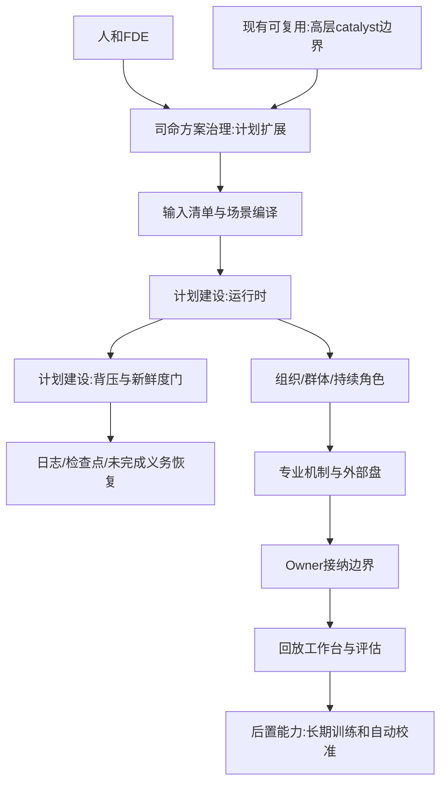
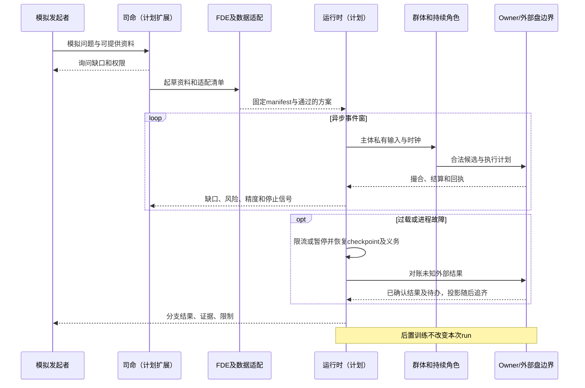
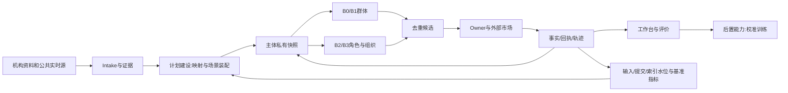

# 12 司命方案治理与全流程运行

修订日期：2026-10-16｜合同版本：未发布草案｜建设状态：计划建设｜验证证据：专用静态校验入口见[README](README.md#文档状态与静态校验wog-r10)；本轮运行、适配、性能及预测未验证。

日期：2026-10-15｜状态：design-draft / non-authorizing｜依赖：[07](07-FDE数据接入与机构适配.md)、[08](08-模型机制与可插拔演化.md)、[11](11-组织与动态群体一等结构.md)。

## 1. 从发起者问询开始

司命先确认能提供什么，而不是先凭想象生成一个完整市场。每个回答记入 `ScenarioIntake`，含提供者、时间、证据、可见性、确定／未知和后续确认项。

| 问题 | 输入 | 输出到方案 |
|---|---|---|
| 谁发起，为何模拟 | 机构身份、玩家身份、问题和决策期限 | Sponsor、目标、观察指标 |
| 拿得到什么 | 自有仓位、研究、终端、公开源、实时更新 | 数据清单、授权、缺口 |
| 模拟哪些范围 | 产业、标的、市场、法域和五日／多年窗口 | Scope、Calendar、ClockPolicy |
| 参与者要多细 | 已知机构、生成分布、关键岗位 | Roster、Population、B0–B3策略 |
| 用哪些机制 | 专业模型、模拟盘、制度和组织流程 | Binding、Owner与recipe |
| 能改什么 | 假设、干预、操作主体、观察视角 | Capability、分支和视角模式 |
| 怎样算结果好 | 预测变量、基准、样本外与停止条件 | EvaluationPlan、StopPolicy |

未知允许保留，不能用一段语言模型补写后宣称事实。司命可以提出默认分布，并要求在运行manifest内标为合成假设。

## 2. 方案合同和生命周期

```text
ScenarioSpec = {
  sponsor_ref, question, objectives, target_metrics,
  time_space_domain, intake_ref, data_manifest, access_matrix,
  participant_roster, character_and_organization_templates,
  population_generation, precision_activation_policy,
  model_and_mechanism_bindings, market_adapter_bindings,
  owner_bindings, cross_owner_recipes, branch_and_intervention_rules,
  realtime_assimilation_policy, stop_policy, evaluation_plan, version
}
RunManifest = {
  scenario_digest, input_snapshots, package_pins, model_pins,
  engine_pins, seeds, permission_snapshot, budgets, replay_key
}
```

方案状态：`draft -> validated -> ready -> running -> paused -> completed/failed`。`ready` 说明合同可装配，不说明预测有效。修改运行方案形成新revision，并按影响建立后继分支，不改变历史manifest。

## 3. 全流程输入输出

| 阶段 | 输入 | 处理 | 输出 |
|---|---|---|---|
| 访谈和检索 | 用户目标与获权源 | 司命提问、查资料、标未知 | Intake与证据清单 |
| 适配 | 原文、表、流、机构流程 | FDE映射、身份时间校验 | 类型化Record和机构包 |
| 装配 | 数据、参与者、机制 | 校验读写、时钟、预算、权限 | ExecutionPlan与缺口报告 |
| 初始化 | 固定输入与参数分布 | 初始化账本、角色和群体 | 初始快照和continuation |
| 推进 | 事件队列和现实新观测 | 传播、心智、程序、订单与市场 | 候选、receipt、后继事件 |
| 同化 | 新行情、公告、用户资料 | 更新信念、参数或另建分支 | 后继预测和误差报告 |
| 结束 | 时间、风险、质量或预算条件 | 处理在途动作、对账和封存 | 轨迹、分布、解释和未完成义务 |

## 4. 每个事件窗的群体与角色协同

1. 水位线推进至可处理范围，补流失败则标记降级或暂停。
2. 分别向各主体发送其实际已送达／消费的资料，更新私有快照。
3. B0/B1更新联合分布和网络，形成episode；不将全体平均化。
4. 检测关键节点、资金阈值、分歧、桥接和玩家关注，按注册策略B1→B2/B3交接。
5. 活跃角色由私有frame作快慢选择；组织先按岗位权限共享、审批、否决和执行。
6. 批量与角色候选经唯一推进令牌去重，按账户归属检查资源和制度。
7. 执行计划拆成子动作，交给外部市场／过程／物理适配器。
8. owner按顺序接纳，回报更新账本、持仓、风险和待办。
9. 成交与信息反馈更新注意、记忆和情绪，重新分群或休眠。
10. 输出授权视图和评估指标，写检查点并判断停止。

## 5. 司命安排事与安排人

两者都支持：先定义过程所需岗位再寻找获权参与者；或先选择关键参与者再围绕其目标安排需要的场景机制。司命控制的是“场景和触发条件”，不能预定每个角色一定卖出、一定合作或某价格必然出现。

司命监督缺口、风险、资料新鲜度和机制运行，发出高层catalyst或方案提议；不代替角色心智、市场撮合或账户owner。人可在工作台切视角、发起反事实，但观察和代行的权限不同。

## 6. 停止与恢复

交易源缺序列、模型超时、风险越界、预算耗尽、用户暂停或到达截止各有处理策略。停止时封存 `open_obligations`，不能把在途订单默认为已撤或已成交。恢复从检查点接续，保留actor lease和外部状态对账；分叉重算使用新run与新seed流。

### 6.1 固定场景性能基准（WOG-R08）

以下是**已确认的目标，尚无实测证据**。金融与工业为分别运行的基准，不由两者的源输入率相同推断计算成本相同。

| 项目 | 金融基准 | 工业基准 |
|---|---|---|
| 规模 | 1 场所、1 标的、10,000 账户、100 活跃决策主体、1 分支 | 1,000 个设备测点，各 10 样本/s，另含批次/异常事件 |
| 输入 | 10,000 条源事件/s | 测点共 10,000 样本/s；批次/异常事件的数量、大小及频率在夹具中固定 |
| 时长与突发 | 稳态 30 分钟；2 倍源输入突发 60 秒 | 稳态 30 分钟；2 倍源输入突发 60 秒 |
| 本域接纳 | 本地持久接收至对应 Owner 提交：p95 ≤ 50ms，p99 ≤ 200ms | 相同计时边界与目标 |
| 查询索引 | 正常负载消费滞后 p99 ≤ 1 秒 | 相同目标 |
| 进程故障 | 已确认持久提交丢失 0；恢复 ≤ 60 秒 | 相同目标 |

BenchmarkManifest 固定 CPU/内存/存储/OS、实现及依赖版本、运行拓扑、载荷大小/分布、日志与持久化配置、源输入数及展开后的领域/投影事件数、主体与机制负载、随机种子、测量时钟和采样方法。LLM 决策耗时、跨域业务完成时间和上游网络延迟另外计量，不混入本域接纳目标，也不能从报告中消失。基准范围和具体负载在实测前冻结，不能跑后选择有利样本。

持久接收与提交确认都须有可校验边界。报告接收、完成、拒绝、排队、滞后、错误和资源占用，避免只统计快速成功请求。突发需记录积压峰值、排空时间及恢复稳态；尚未批准突发期间与稳态相同的延迟承诺。索引、严格查询和跨域义务分别报告，不以图谱更新速度替代事实提交速度。

### 6.2 过载与恢复合同（WOG-R08）

优先保留事实、来源顺序和恢复能力，已确认输入及 Owner 事件不静默丢弃。过载时先限制新任务和非必要查询，再降低展示刷新率及明确允许合并的派生计算；不能合并或跳过买卖成交、账户效果、权限变更和删除任务。

封闭仿真可减慢世界推进，保留虚拟时间/墙钟映射。实时同化追不上源时，显式标注 lag、阻止依赖过期数据的动作；无法维持声明质量则暂停相应机制。数据新鲜度阈值按机制预注册，不能用展示仍在刷新假装运行正常。新输入未获持久确认时可以背压/拒绝，但须向上游明确返回并报告缺口。

进程故障从 checkpoint、持久日志、幂等结果、actor lease 和 open obligations 恢复；外部订单结果未知先对账再重发，投影在规范状态恢复后追赶。恢复时间从故障检测/重启开始计至 Owner 可接纳且未完成义务已恢复可继续处理，外部等待项可以保留但必须可诊断；索引追齐另计。0 丢失与 60 秒仅为声明持久化配置下的进程故障目标，不是整机、存储介质损坏或跨地域灾难承诺。

验收需稳态、突发、索引滞后、陈旧动作拒绝、接收/提交各阶段崩溃、重复恢复及外部结果未知案例。硬件、真实适配和运行证据尚未建立；工业扩展见[22 §16.3](22-全球内存市场全面模拟与最细有效时间粒度方案.md#163-精度性能和有效性分别评估)。

## 7. 架构图



## 8. 主交互时序图



## 9. 数据流图



## 10. 验收不变量

从问题到结果每步有可检查产物；发起者资料可实时更新但不改旧run；角色持续且可休眠唤醒；精度交接不复制主体；信息权限与玩家视角一致；停止留下准确在途状态。贯通实例见[20](20-光模块市场完整贯通案例.md)。
