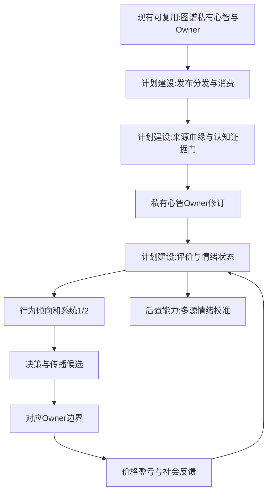
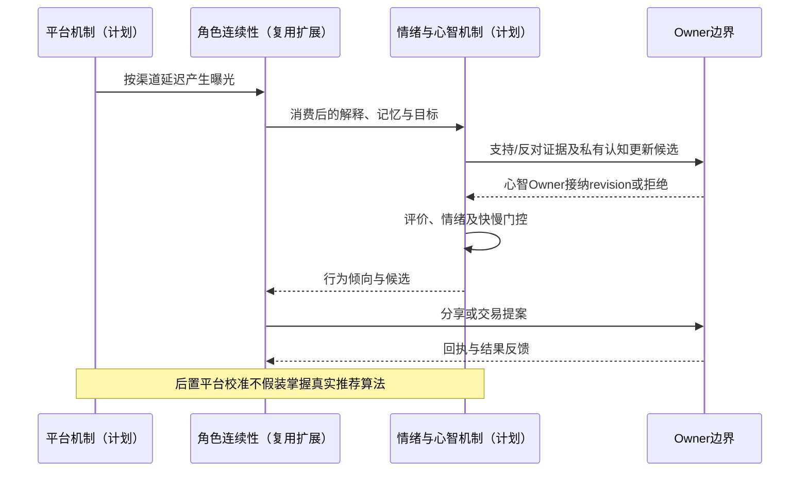
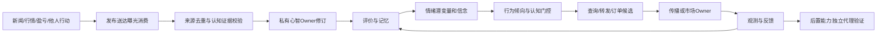

# 13 信息传播情绪与认知机制

修订日期：2026-10-16｜合同版本：未发布草案｜建设状态：计划建设｜验证证据：专用静态校验入口见[README](README.md#文档状态与静态校验wog-r10)；本轮运行、适配、性能及预测未验证。

日期：2026-10-15｜状态：design-draft / non-authorizing｜依赖：[04](04-实体关系图谱与动态边.md)、[10](10-角色智能体心智与Laya接口.md)、[11](11-组织与动态群体一等结构.md)。

## 1. 保留三个独立机制

信息如何到达、主体如何感受、主体怎样认识别人，是三件事。本文定义传播与情绪及其连接；高阶“知道／希望”语义由[10](10-角色智能体心智与Laya接口.md)负责，量化机构的执行和资源优势由[16](16-金融订单行为量化执行与市场机制.md)负责，避免用一个情绪分数包办全部决策。

## 2. 信息传播合同

```text
InformationItem = {carrier_ref, statement_refs, author_account_ref,
  origin_publication_ref, citation_lineage, topic_refs, factual_status}
Publication = {item_ref, platform_ref, publisher_ref, published_at,
  access_scope, correction_of, distribution_rule_ref}
Exposure = {publication_ref, recipient_ref, delivered_at, exposed_at,
  ranking_context, channel_ref, consumption_status, evidence_kind}
Consumption = {exposure_ref, actor_ref, consumed_at, attention_fraction,
  interpretation_ref, trust_update_ref, subsequent_action_refs}
```

渠道实体包括股吧、雪球、券商研究／交易终端、第三方交易软件、财联社等财经资讯、微博、抖音、公众号。每个渠道有订阅／关注网络、排名、收费权限、覆盖、节奏和延迟。相同原文的多次转载要有血缘，不能当成多个独立证据。

角色渠道差异包括“有权订阅、接收到、出现在屏幕、注意到、读完、理解、相信、愿意行动”。后台拥有原文不代表任何一个主体已知。无法获知真实曝光时，用获权观测或合成分发模型，附不确定性而非伪造平台后台数据。

## 3. 三类情绪数据

1. **内在潜变量**：角色在某目标上的恐惧、贪婪、希望、焦虑等合成状态，真实个体不可直接观测。
2. **表达与行为观测**：文本情绪、发帖、阅读、撤单、成交、追涨或沉默，附分类误差，不能直接等同真实心理。
3. **群体代理指标**：贪恐指数、波动、广度、融资、搜索、情绪文本聚合，需注明构造、样本和滞后。

统一 `AffectState(actor, target, t)` 保留目标、valence、arousal、离散维度、强度、参考点、控制感、持续时间、衰减和证据；不同持仓或目标可以同时恐惧和贪婪。

## 4. 情绪目录与绑定

| 维度 | 典型评价 | 可影响的行为倾向，方向由角色设定 |
|---|---|---|
| 贪婪 | 奖励显著、错失机会 | 提高目标仓位、追涨、缩短等待 |
| 恐惧 | 威胁、不可控损失 | 减仓、避险、停滞或不敢止损 |
| 焦虑／怀疑 | 不确定且证据冲突 | 多查资料、缩仓、延迟，或冲动反应 |
| 希望／兴奋 | 期待改善或近期成功 | 持有、反向买入、注意力集中 |
| 后悔／羞耻 | 决策自责、社会评价 | 追回、惜售、隐瞒或加强纪律 |
| 愤怒 | 归责与不公平感 | 对抗、转发、过度交易或退出 |
| 疲惫 | 认知负担与睡眠不足 | 减少审查、依赖习惯、漏读消息 |

信心、信任、风险偏好、纪律、注意力、从众倾向与情绪关联，但不是同一字段。新情绪类型需注册评价规则、状态方程、作用端口、可观测代理和校准方法。

## 5. 数学与规则结合

以下是待校准模型形式，不是经过验证的心理规律：

```text
appraisal_i = f(stimulus, goals, reference_point, beliefs,
                memory, controllability, role_profile)
emotion_i(t+dt) = clip(decay_i(dt)*emotion_i(t)
  + W_i*appraisal_i + social_input_i + noise_i)
action_tendency = g(emotion_vector, beliefs, loss_aversion,
                    risk_budget, urgency, discipline, fatigue)
```

传播输入可用带接触率、信任、衰减和饱和的网络算子计算，不把中心性直接当无穷影响力。希望与恐惧可共存；潜在情绪维度不强制和为1。

前景理论式价值函数可作参考点依赖的候选组件：`v(x)=x^alpha`（收益域），`v(x)=-lambda*(-x)^beta`（损失域）。参数因人、目标和情境而异；损失厌恶不是“恐惧=负贪婪”，更不是强制永远风险厌恶。情绪经过行为倾向和快慢门控，再到合法候选，不能直接施加价格跌幅。

## 6. 贪恐为何不完全对称，指数如何使用

贪婪多面向潜在奖励，恐惧多面向威胁；持仓参考点、流动性、杠杆、损失厌恶和决策时间不同，响应曲线、衰减和阈值无需镜像。可同时高，例如害怕亏损又害怕踏空。一个0—100值无法保留这种高冲突状态。

CNN Fear & Greed 的公开说明以市场动量、股价强度、广度、期权看跌看涨、垃圾债需求、波动与避险需求七类指标合成。通用表示为 `index = sum(weight_j * normalized_score_j)`；精确复刻需核对其当期方法，不凭示意公式声称复现。中国市场或某主题股不直接套用美国指数，需要本地数据、分位基准和版本化指标包。

模拟可输出自己的代理指数，与同口径外部指数、问卷／文本和交易行为交叉验证；不能用同一盘口数据构造情绪又用盘口证明情绪解释正确而忽视循环论证。

## 7. 情绪利用与竞争合作

机构可以依据公开订单流和情绪代理估计对手的阈值、信息迟滞和卖出压力，也可能判断错误。其推断属于私有estimate。资金与速度优势还受成本、库存、拥挤和制度约束；不能赋予“知道所有散户止损点”的全知能力。

同步交易分别标记为共同信号、策略趋同、公开跟随、显式合作、默契假设或未解释。合作需有过程／通信／协议证据；对抗性信息或订单模式仅作为隔离压力测试，检测结果保留替代解释。

### 7.1 传播证据、认知修订与潜变量（WOG-R05 / R09）

发布、送达、曝光、消费、理解、信念与知识各自保留证据，不由前一阶段自动推导后一阶段。[10 §4.1](10-角色智能体心智与Laya接口.md#41-命题上下文与证据门槛wog-r05)定义认知算子与证明规则。转载依据 citation lineage 分组，同源多次曝光可以影响注意力，但不能充作多个独立事实来源。推断出的传播链只能标 estimate；不替真实主体编造消费记录。

情绪、信任、注意力和传播参数按[15 §6.1](15-金融市场参与者与多层规模建模.md#61-潜变量登记与竞争解释wog-r09)登记来源、代理误差和不可识别范围。观察到卖出，可有赎回、风控、共同信号、策略趋同或情绪等解释；观察到工业良率下降，可有材料、设备、工艺、抽样和测量偏差等解释。无法区分时保留多解释，不把拟合所得心理状态写成真实人物事实。

验证使用独立代理、敏感性、消融和时间留出；同一量价序列生成“恐慌指数”再拟合该序列，不独立验证恐慌机制。允许结论为“卖压方向在多种解释下稳健，个体动机不可识别”。

## 8. 架构图



## 9. 主交互时序图



## 10. 数据流图



## 11. 验收不变量与参考

同一指数允许不同群体内部情绪；转载不重复独立证据；没消费不自动更新理解；情绪不绕过现金、仓位或权限；快慢不重复动作；同步不自动认定共谋。参考入口：[CNN Fear & Greed](https://www.cnn.com/markets/fear-and-greed)、Kahneman与Tversky前景理论、双过程研究；正式机制需单独校准。评估见[19](19-金融历史回放训练与预测评估.md)。
