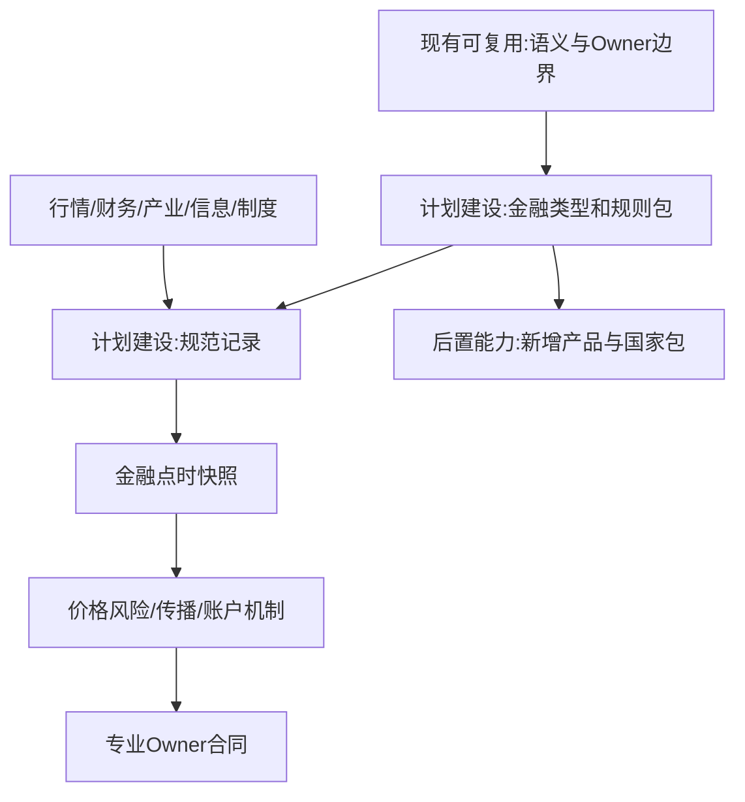
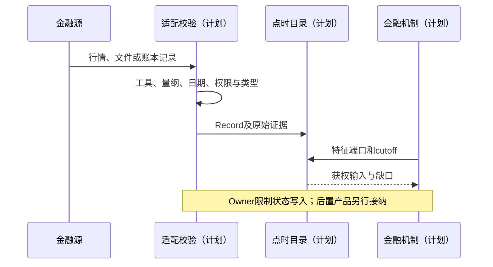
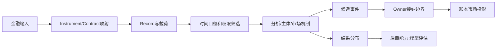

# 14 金融数据专业包与数据分类

修订日期：2026-10-16｜合同版本：未发布草案｜建设状态：计划建设｜验证证据：专用静态校验入口见[README](README.md#文档状态与静态校验wog-r10)；本轮运行、适配、性能及预测未验证。

日期：2026-10-15｜状态：design-draft / non-authorizing｜依赖：[03](03-类型化数据与统一记录合同.md)、[06](06-时间空间口径与适用域.md)。

## 1. 设计目标

金融专业包把业务类别映射到通用结构。业务类别、载荷结构、认识状态、来源、时间口径和权限是独立轴；可保存不等于已绑定定价、撮合、清算和制度机制。

首批执行适配限定为美股、A股、港股、日本、韩国、台湾和新加坡股票市场，以及逐产品声明支持的上市ETF二级交易。完整覆盖矩阵、规则版本、原生接口和验收合同见[17](17-外部模拟盘与跨市场数据对齐.md)。本表仍保留其他金融数据类别，以支持观测、估值和后续扩展；登记了期权/债券/外汇数据不表示本轮已提供其交易执行器。

## 2. 覆盖矩阵

| 类别 | 具体对象 | 关键合同 |
|---|---|---|
| 身份参考 | 发行人、证券、上市记录、代码、合约、场所、法域 | 证券与发行人分开，代码有效期 |
| 交易制度 | 日历、时段、价位、手数、涨跌幅、停牌、回转、卖空 | 按市场、产品、日期生效 |
| 行情微结构 | 最新、收盘、结算、估值、报价、逐档深度、成交、OFI | 时序/事件；价格、股/手/张、方向 |
| 委托与账户 | 下单、确认、排队、部分成交、撤改、现金、持仓、冻结、费用 | 状态机/账本；父子订单、唯一归属 |
| 融资借券 | 可借池、费率、期限、召回、担保、保证金、强平、回补 | 合同/债务；可借、已借、空头分开 |
| 基金ETF | 管理人、产品、净值、申赎、AP、篮子、现金替代 | 多方安排；产品和管理人不双计 |
| 指数公司行动 | 成分权重、生效、再平衡、分红、拆并股、配股、退市 | 版本表/事件；公告与生效分开 |
| 衍生品与债券 | 期权、期货、互换、远期、现金流、票息、评级、违约 | 合约/曲线/曲面；乘数、到期、交割 |
| 外汇利率 | 即期、远期点、利率、收益率/贴现曲线、基差 | 时序/曲线；报价方向、日历、币种 |
| 财务基本面 | 资产负债、损益、现金流、分部、指引、预期 | 表/文档；期间、会计范围、重述 |
| 产业经营 | 客户、供应、产能、良率、库存、订单、价格、技术 | 图/表/时序；来源保密、传导滞后 |
| 持有人流向 | 股本、限售、股东户、机构披露、托管、持仓变化 | 时点表/关系；口径去重，不能反推逐笔实名 |
| 宏观国际 | GDP、就业、通胀、央行、贸易、地缘、制裁、出口限制 | 时序/文档；首发与修订分开 |
| 制度组织 | 法律、法规、政策、路线、方针、细则、白皮书、会议 | Statement/Carrier/Process；效力与执行分开 |
| 新闻研究传播 | 公告、快讯、研报、终端、股吧、雪球、微博、抖音、公众号 | 多模态/网络/事件；原文、血缘、曝光 |
| 心理行为 | 情绪、注意力、信念、记忆、倾向、决策episode | 状态/分布；潜变量与代理分开 |
| 分析风险模型 | 因子、估值、风险、协方差、Greeks、情景、杠杆、容量 | 张量/模型/约束；版本、单位、训练cutoff |
| 运行评估 | 延迟、调用、回执、预测、回放、干预、评分 | 日志/轨迹；现实/合成、样本划分 |

新产品和国家制度需要增加专业类型、语义、owner、机制和验证案例，不以表格列完就声称穷尽。

## 3. 专业身份与市场载荷（设计示意）

```text
Instrument = {instrument_ref, issuer_ref, asset_class, terms_ref,
  underlying_refs, currency, lifecycle, corporate_action_refs}
Listing = {listing_ref, instrument_ref, venue_ref, local_code,
  valid_interval, trading_rule_profile_ref, settlement_profile_ref}
Quote = {venue, instrument, bid_levels[{price,size}], ask_levels[{price,size}],
  quote_type, event_time, venue_sequence, validity}
Order = {order_id, parent_ref, account_ref, instrument, venue,
  side:buy|sell, quantity, price_terms, order_type, time_in_force,
  sell_inventory_or_borrow_ref, status}
Trade = {trade_id, price, quantity, buyer_order_ref?, seller_order_ref?,
  aggressor_side:buy|sell|unknown, event_time, venue_sequence, receipt_ref}
```

报价、委托、成交都有价格条款和数量。市价委托用 `price_terms=market`，不事先伪造成交价；由场所`MatchingEngine`按交易规则处理后，`Trade`才确定实际价量。每笔成交有买卖双方，主动性说明谁取走流动性；成交量通常单边统计。未报价不是价格零；只有日K不能还原逐笔排队和真实参与者。依[16](16-金融订单行为量化执行与市场机制.md)，订单流描述新单、撤单和改单活动；完整的接受、入簿、撤改、过期、成交及剩余数量记录称订单生命周期事件流。两者均不能用成交量代替；集合竞价等场景主动方允许不适用。

## 4. 口径、质量与权限

每源保存字段覆盖、许可、修订延迟、交易日、复权、币种和身份覆盖。供应商“资金净流入”保留其算法，不等于市场只有买无卖。真实逐笔、档位快照、日K和合成盘口分别标级。财报原值与标准化值并存，声明会计范围和重述。发行人、证券、管理人、产品、托管名义主体和受益人不自动合并。

七市场额外要求保存`market_profile/venue/board/product/session/rule_effective_interval/native_protocol_version`，本地订单枚举与原始载荷并存。价格类型、TIF、交易方向、卖空标记、当冲能力和结算类别独立映射。主键不得只用证券代码；同发行人多地上市、ADR、港股多币种柜台、台湾整股/零股、美国多场所数据必须能区分。公开数据未披露的客户身份、隐藏量、逐单队列等保持未知，不从后台合成资料泄漏给模拟主体。

## 5. 架构图



## 6. 主交互时序图



## 7. 数据流图



## 8. 验收不变量

发行人与证券分开；托管与受益人不双计；报价委托成交价量齐全且语义不同；未知主动性不伪造；公告、生效、修订不混淆；专业数据可保存不等于机制已实现。见[15](15-金融市场参与者与多层规模建模.md)、[16](16-金融订单行为量化执行与市场机制.md)。
