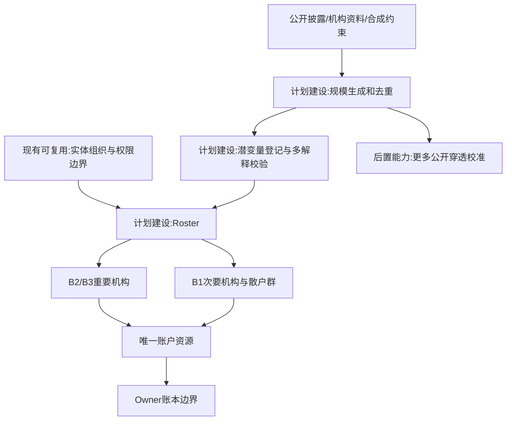
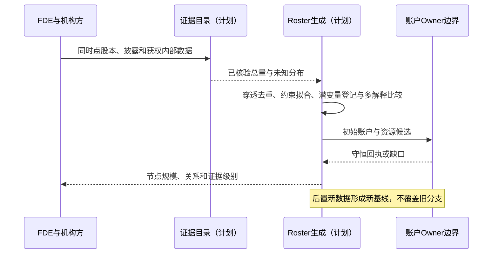
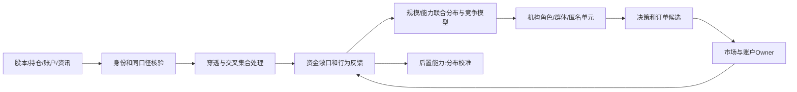

# 15 金融市场参与者与多层规模建模

修订日期：2026-10-16｜合同版本：未发布草案｜建设状态：计划建设｜验证证据：专用静态校验入口见[README](README.md#文档状态与静态校验wog-r10)；本轮运行、适配、性能及预测未验证。

日期：2026-10-15｜状态：design-draft / non-authorizing｜依赖：[11](11-组织与动态群体一等结构.md)、[14](14-金融数据专业包与数据分类.md)。

## 1. 参与者不是只有交易者

| 层面 | 参与者 | 影响路径 |
|---|---|---|
| 产业 | 芯片、设备、制造、云厂商、竞争者 | 订单、产能、成本、技术和现金流 |
| 公司 | 控制人、员工平台、董事会、管理层、债权人 | 治理、披露、融资、分红、减持 |
| 投资 | 私募、公募、保险、养老金、境外资金 | 配置、赎回、风险和时间偏好 |
| 量化执行 | 管理人、策略组合、交易员、券商算法 | 多策略订单、速度、容量和库存 |
| 被动套利 | 指数基金、ETF、AP、做市/套利账户 | 申赎、篮子、基差和再平衡 |
| 普通投资者 | 长期、趋势、价值、短线、融资、观望者 | 异质信息、成本、情绪、杠杆 |
| 中介设施 | 券商、交易所、托管、清算、数据商 | 通道、借券、保证金、交易和结算 |
| 信息 | IR、研究员、财经平台、自媒体、社群 | 发布、解读、传播、注意力 |
| 制度外部 | 国家/部门、监管、央行、国际机构 | 法律、政策、生效、跨境条件 |

企业或媒体可影响市场而不持仓；托管名义主体不是单一意志；同一机构可能有多产品、多策略和隔离团队。

## 2. 规模合同

```text
ParticipantScaleProfile = {
  participant_ref, product_ref, account_refs, as_of,
  aum, investable_capital, cash_available, cash_frozen,
  holdings_by_instrument, cost_distribution, free_and_locked_positions,
  leverage, financing_liability, collateral, borrow_capacity,
  risk_limits, turnover_capacity, execution_participation_limits,
  information_coverage, data_latency, decision_latency, route_latency,
  order_rate_budget, influence_and_reach, source_refs, uncertainty
}
AccountCapability = {owner_ref, legal_domain, venue_access,
  settled_inventory, sellable_inventory, margin_permissions,
  borrow_contract_refs, fees_and_costs, settlement_profile, valid_time}
```

AUM不等于可用现金；订单数不等于成交额；持股不等于此刻可卖。每维需时点、量纲、来源。公开机构持仓不等于全量资金或策略。

## 3. 股本与股东脱水

在同一日期、同一口径验证 `total_shares = restricted + circulating`。限售、长期、质押和被动持股可能重叠，不能层层相减。形成互斥持股分区或显式交叉集合；法定流通股不等于每日自由卖盘。

股东户数不是自然人数。用户提出的29,124户、平均5,000多股需核对披露日期、字段、证券、分母并与股本守恒；本设计不将它或旧稿其他未经本轮复核数字当作事实。股东户快照按时序保存，不把多个季度混成同日结构。

前十名、基金披露、机构汇总和托管有交叉，建立穿透层级与去重规则。无法识别受益人时保留名义集合和未知分布，不把名义持有人当单一交易者。公开持仓反映披露时点，不显示每日成本、今日可卖量和交易意愿。

## 4. 融资账户及匿名散户

融资余额等公开总量可以作为约束，通常不能识别每户资金、成本和杠杆。融资账户也是投资者账户的能力维度，不是永久互斥人群。融券池、借出、空头仓位与回补义务分别记录。

用约束抽样生成持仓、现金、成本、杠杆、渠道和行为阈值的联合分布，保留“高杠杆且高成本”的尾部。缺少实名档案时使用匿名PopulationUnit；不能声称根据股东户均值恢复真实个人分布。

## 5. 10个重要机构、200个次要机构与大规模群体

选择重要机构应覆盖筹码、主动交易、被动流、融资、信息和制度角色，不机械等同前十大股东。重要节点按需建B2/B3持续角色；200个次要机构保留类型、预算、延迟、策略与渠道，不一定逐家启用LLM。散户用B0/B1子群，桥接节点、大额账户、分歧者升B2。

每个候选规模先通过守恒校验再落档。若公开持股与分类数据口径交叉无法拆解，使用约束区间和敏感性分支，不能为凑数编造机构真实持仓。

## 6. 产业、市场、信息、制度关系

重要参与者至少建立六套互联关系：产业供需和替代；公司控制／治理／披露；市场账户、持仓和产品；信息订阅／发布／传播；法律、合同和监管；外部环境及汇率、利率、地缘暴露。基金的研究—经理—风险—执行岗位有授权流程；账户在基金产品层核算一次。

竞争、共同信号、公开跟随、策略趋同、默契假设和显式协议分别建模。只有通信或过程证据支持时才标显式合作；同步卖出本身不足以推断合谋。

### 6.1 潜变量登记与竞争解释（WOG-R09）

每类潜变量由统一 Record 保存业务登记，不引入另一套事实信封。至少注明：语义、主体或群体及目标时间；直接观测/代理测量/情景假设分类；来源、覆盖、滞后、误差与按主体渠道解析的 availability；先验及可识别范围；竞争解释；允许用途；校准数据、版本与独立验证方法。身份匹配还须遵守[09](09-权限关系与运行时接纳.md)的证据与撤回合同。

| 潜变量 | 常见观测/代理 | 必须保留的歧义 |
|---|---|---|
| 机构卖出动机 | 获权申赎、风控记录、订单与披露 | 赎回、限额、共同信号、策略趋同与恐慌可产生近似路径 |
| 情绪、注意与信任 | 问卷、获权消费记录、文本或交易代理 | 表达不等于心理，沉默不等于未读，转载不独立 |
| 资金、成本与约束 | 披露、获权账户、公开融资总量 | 总量不能识别每户杠杆或止损线 |
| 工业故障或需求冲击 | 设备测点、检验、批次、订单代理 | 材料、设备、工艺、测量偏差与共同环境影响可混淆 |

不能从一组拟合良好参数恢复“真实机构画像”。证据不足时使用群体分布或显式情景假设；保留多个模型、区间或联合分布，避免独立抽样破坏相关与尾部约束。敏感性分析、机制消融、时间留出与样本外校验按[19](19-金融历史回放训练与预测评估.md)执行。

输出分别回答结果与解释的稳定性。例如可报告“多解释下卖压方向稳健，动机不可识别”，不强行选定恐慌或合谋。新证据可重加权解释并形成新版本，不覆盖旧分支当时的推断。

## 7. 架构图



## 8. 主交互时序图



## 9. 数据流图



## 10. 验收不变量

股本守恒；产品与管理人不双计；岗位不复制账户；匿名不伪装实名；角色与群体资源互斥推进；参数标注来源／假设／误差；持仓不自动推断卖意。完整Roster范例见[20](20-光模块市场完整贯通案例.md)。

R09 补充：每个潜变量有登记及验证入口；合成画像不标真实身份；相似轨迹保留竞争解释；个体不可识别时退回群体或假设；结果稳健与动机可识别分开报告。
