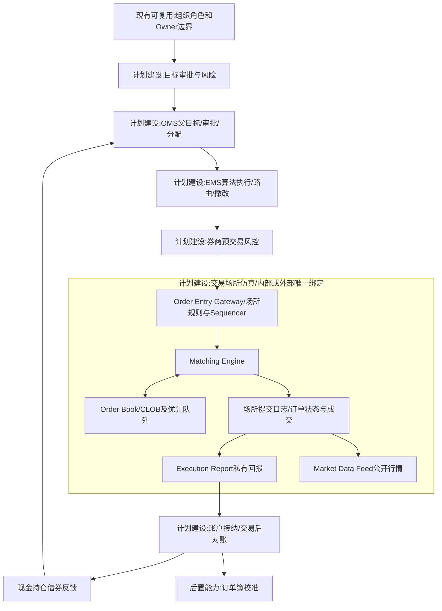
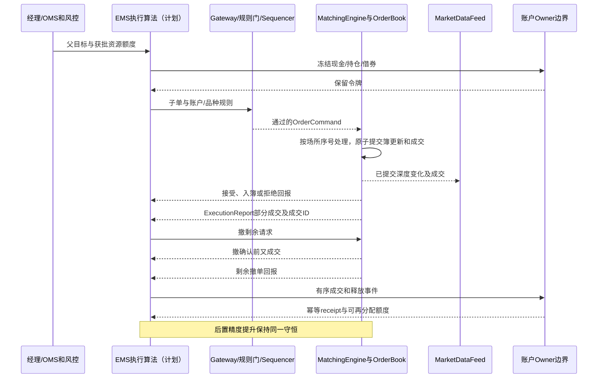
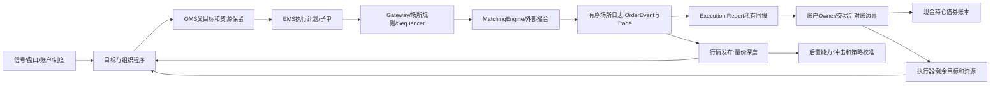

# 16 订单管理、算法执行与交易场所仿真

修订日期：2026-10-16｜合同版本：未发布草案｜建设状态：计划建设｜验证证据：专用静态校验入口见[README](README.md#文档状态与静态校验wog-r10)；本轮运行、适配、性能及预测未验证。

日期：2026-10-15｜状态：design-draft / non-authorizing｜依赖：[09](09-权限关系与运行时接纳.md)、[14](14-金融数据专业包与数据分类.md)、[15](15-金融市场参与者与多层规模建模.md)。

## 1. 统一模块命名与职责

量化资金是量化机构／产品按策略运作的资金，不是一个抽象“高频人”。同一家机构可以有日频选股、趋势、统计套利、ETF套利和执行算法，不默认全部高频或有做市资格。目标决策、执行计划、市场撮合、账户清算分开。

### 1.1 合并范围与行业术语

原稿用“订单流”统称订单接收、生命周期、撮合、回报与市场数据，范围过宽。现合并为一个金融专业子系统：**订单管理、算法执行与交易场所仿真**。其中场所侧称`TradingVenueSimulator`（交易场所仿真器），撮合核心称`MatchingEngine`（撮合引擎）。前者是本项目采用的组合模块名；后者及下列OMS、EMS、订单簿、执行回报等是行业常用术语，不能声称整套模块名由某个标准统一规定。

| 位置 | 行业常用名称 | 本方案职责和状态归属 |
|---|---|---|
| 机构订单管理 | Order Management System，OMS | 管理交易指令、父目标、审批、分配、限额及完成情况；按机构合同提交 |
| 机构执行管理 | Execution Management System，EMS | 拆单、算法执行、路由、撤改、执行反馈；可与OMS集成但职责分明 |
| 场所接入 | Order Entry Gateway | 会话、认证、报文、接收确认及订单申报接口 |
| 预交易风控 | Pre-trade Risk Controls | 机构/券商与场所各检查其负责的资源、权限和限制 |
| 场所排序 | Sequencer | 确定撮合分区内命令及阶段事件的处理顺序 |
| 场所撮合 | Matching Engine | 按场所规则对有效买卖订单匹配；与订单簿共同拥有唯一市场写入权 |
| 委托状态 | Order Book；集中限价市场为Central Limit Order Book，CLOB | 保存有效委托、优先级、可见/隐藏数量；不是每个市场都采用CLOB |
| 私有订单回报 | Execution Report | 接受、拒绝、订单状态、部分/全部成交等执行结果；撤单拒绝等还可用独立消息 |
| 公开行情 | Market Data Feed | 按权限发布报价、深度、成交及市场状态；与私有回报分别投递 |
| 交易后 | Post-trade Processing、Clearing、Settlement | 成交接纳、分配、对账、清算及交收；账户/结算owner负责 |

OMS和EMS是参与者侧系统；Gateway、Sequencer、MatchingEngine、OrderBook及行情发布构成场所侧仿真边界。金融专业包整合这条业务链，但内部仍有清晰的状态owner。采用外部模拟盘时，场所侧职责由外部系统实现，底座不会因此再运行第二个撮合引擎。

本轮将这套端口落实到七市场专业设计：美股、A股、港股、日本、韩国、台湾、新加坡，详见[17的市场清单与专测](17-外部模拟盘与跨市场数据对齐.md#61-首批覆盖矩阵)。股票/ETF二级交易按产品声明，其他产品执行保留后续扩展。本文的市价、IOC/FOK、修改、隐藏/冰山等属于可注册能力目录，不能理解为七地每个场所、品种和交易阶段都原生支持。

### 1.2 订单流和订单生命周期事件流分别定义

**订单流（Order Flow）**用于描述订单申报活动：买卖新单、撤单、改单的到达序列及其数量、价格条件和方向。它是撮合输入侧的活动概念，不是撮合器或整个交易系统的名称。“带符号订单流”等研究术语可有特定统计定义，必须随指标注明，不能假定全行业只有一个含义。

**订单生命周期事件流（Order Lifecycle Event Stream）**是本方案对全链审计记录的明确命名，关联场所收到的命令、接受/拒绝、入簿、撤改、过期与成交回报。上次列出的那一长串事件应归到这里：

```text
场所接收新单/撤单/改单命令并排序
  -> 校验及接受/拒绝事件
  -> 按当前市场阶段撮合或入簿
  -> 部分/全部成交，或等待后续事件
  -> 剩余量按规则保留、撤销或过期
```

这是生命周期的分支示意，不是“先入簿、再改单、再撤单、最后才成交”的固定步骤；可立即成交的到达单不必先成为静候委托。场所外的交易意图、父目标和预交易审批属于上游OMS/EMS记录，结算属于下游账本流。撮合生成的成交集合使用`TradeEventStream`（成交事件流）表示；`TradeFlow`仅在明确定义的分析指标中使用。只有经过账户与结算Owner接纳后，才进入现金、持仓、借券和费用账本。媒体常说的“资金流入/流出”是供应商定义的派生指标，不能替代订单申报或成交记录。

微观结构研究中的“带符号订单流”可能只指按主动方签名的成交序列，`OFI`还可能包含报价新增和撤回的供需变化；每个指标必须另注册定义。`ExecutionReport`中的成交执行回报与`TradeEvent`引用同一成交ID，不能各记一遍成交量。输入申报量、执行回报量和成交量分开统计，不因同一订单贯穿多个消息而重复计量。

同一订单要区分以下对象：

| 对象 | 含义 | 是否直接改变成交价格 |
|---|---|---|
| `OrderIntent` | 角色、策略或组织想完成的目标 | 否 |
| `OrderCommand` | 向场所提交的买卖命令及价格条款 | 否，先等待校验 |
| `OrderEvent` / `ExecutionReport` | 场所内部生命周期事件／发给参与者的私有订单执行回报 | 二者按映射关联；私有回报不是另一笔市场变化 |
| `OrderBook` | 当前有效买卖委托及优先级状态 | 是成交的输入，不是成交本身 |
| `Trade` | 买卖双方按规则匹配形成的价格和数量 | 是 |
| `LedgerEvent` | 账户对成交、费用、保证金和结算的接纳事件 | 否，记录交易后果 |

场所内部的`OrderLifecycleEventStream`信封必须带`venue`、`instrument`、排序分区与场所序号、事件时间、接收时间、订单ID、方向、事件类型和因果父链；价格条款、数量及原订单引用按事件schema声明。父订单ID和客户身份可能仅存在于机构内部，场所和公开行情未必披露，应保存获权映射或未知标记。公开流是内部事件的受限投影，不补造全量账户、隐藏委托或精确排队。聚合成每秒订单率、撤单率、主动成交量、订单簿不平衡等指标时，必须保留窗口、过滤规则和版本；聚合结果不能冒充原始订单流。

### 1.3 撮合引擎是实时市场的核心机制

在实时推进中，交易场所的`MatchingEngine`是专门负责把有效订单转换成成交的高频机制。它不是角色智能体、司命或账户Owner，也不由语言模型逐笔决定。底座可以自己运行该引擎，也可以接入外部模拟盘；两种方式都必须明确唯一撮合权威。

```text
机构执行器 -> 券商/账户预交易风控 -> 场所接收排序与规则门 -> MatchingEngine
MatchingEngine -> 订单簿更新 + 成交事件 + 执行回报（同一有序提交）
场所事件日志 -> 私有执行回报 -> 账户/清算/结算Owner
场所事件日志 -> 行情发布器 -> 各主体的行情接收链
```

预交易检查按责任分配：机构/券商/账户端校验客户权限、可用资源、持仓、借券和限额；场所端校验成员资格、报文、市场阶段、价格与数量约束及本场所规定的风控。某些场所可自行维护预存资金或风险限额，须在适配合同声明，不能假定交易所掌握每个客户全部资金。

`MatchingEngine`按场所、品种、日期和市场阶段绑定规则。连续竞价、集合竞价是交易阶段/机制；价格优先、时间优先、比例分配是优先及分配规则；做市是参与者职责或特定报价机制，这些不是同一个枚举轴。每次匹配生成内部双方订单引用、成交价、成交量、成交ID和序号；主动方在适用时标为买/卖，集合竞价等情况允许不适用或未知。对外披露双方身份的范围另按行情合同控制。

交易撮合与账户记账是两个边界：撮合引擎决定“是否成交、成交多少、成交价格”；账户/结算Owner决定“成交后现金、持仓、借券、费用和结算状态怎样接纳”。不得让账户服务自行声称成交，也不得让撮合引擎直接绕过账本修改资产。预交易风险检查可以拒绝订单，但不能在成交后伪造一笔未发生的撮合。

每笔成交必须有买方和卖方两个有效订单或等价的双边流动性来源。买方现金充足不能单独创造股票；卖方可卖库存或获授权借券能力也不能单独创造成交。撮合 Owner 生成一个双边 `TradeEvent`，至少引用买方订单、卖方订单、成交数量、成交价格、成交 ID、场所序号和因果父链。

买方与卖方的账户效果分别接纳：

```text
trade_quantity = buy_quantity = sell_quantity
buyer.position_delta = +trade_quantity
seller.position_delta = -trade_quantity
buyer.cash_delta = -(trade_value + buyer_fee)
seller.cash_delta = +(trade_value - seller_fee)
```

费用由版本化 `FeeSchedule`、适用账户/场所/产品和舍入规则计算。费用计算机制可以独立运行，但收费结果必须由相应账户或交易后 Owner 接纳；不能把费用作为无来源的成交属性，也不能把买卖双方费用合并成一条无法分账的扣款。部分成交按实际成交数量分别消耗双方预留，未成交余量按订单规则继续保留、释放或过期。

撮合高频路径按序处理新单、撤单、改单、阶段切换和到期事件，不在热路径调用Laya、司命或全图查询。角色和组织生成交易目标；执行器按其延迟和策略生成命令；撮合引擎负责实时市场基础。计算机运行速度与模拟时钟分别记录：历史模拟可以加速或减速，但不能跳过场所事件顺序、因果关系和主体延迟。

### 1.4 场所规则必须形成可执行专业合同

| 独立规则轴 | 必须明确的行为 |
|---|---|
| 订单价格条件 | 限价、市价及本场所的保护价格/转限价变体；买入上限、卖出下限 |
| 有效期与剩余量 | 当日、IOC、FOK等实际支持值；剩余入簿、即撤、全部满足才成交或到期 |
| 排队与成交价 | 价格/时间/比例等优先规则、同价并列处理、成交价确定和改单是否丢失优先级 |
| 交易阶段 | 开收盘集合竞价的申报/撤单窗口、清算价格及并列解法；连续竞价的逐笔处理 |
| 价格数量边界 | 价位、整手/零股、最小最大量、价格带及超界拒绝规则 |
| 暂停与保护 | 停牌、熔断、波动中断、恢复拍卖及期间有效订单如何处理 |
| 特殊委托 | 隐藏、冰山补量及优先级、止损触发位置、自成交防止；不支持的类型明确拒绝 |
| 交易后处理 | 执行回报、公开行情、费用、清算交收与适用的成交更正规则 |

“挂单”通常是有效限价委托未立即全部成交后留在簿中等待的状态/行为，不是与市价、限价并列的万能订单类型。限价单若穿过对手报价也可主动成交；市价单不保证以最新价成交，流动性不足时按场所保护与剩余量规则处理。撤单请求到达不等于撤单完成，必须与新单、成交按同一排序规则竞争。

以上以订单驱动交易场所为主。跨行业通用内核不硬编码这些市场规则；跨市场的询价、双边协商等机制通过各自专业执行端口接入，不能硬装成同一种中央订单簿。

### 1.5 高频写入、发布与恢复边界

同一撮合分区在一个逻辑写入权下，按确定顺序提交订单簿变化、成交ID和回报记录；不可先消耗卖单却遗漏对应买方成交。跨标的可分区并行，但须另处理共享账户的资源保留和多腿风险。撮合器就是该分区市场状态的唯一提交组件，外部引擎接入则由其承担这一职责；本地市场owner只校验接纳映射回报，不再执行第二次撮合。

行情发布与账户入账分别消费已提交场所日志，不强制“所有账户入账完成后才能发布行情”。它们的网络/处理延迟独立；账户尚未入账不改变已成交事实。回报丢失以原成交ID查单对账，不重新下单赌是否成功。恢复须验证检查点、事件游标及订单簿/成交摘要，并区分已成交未对账和未执行命令。

### 1.6 合并后的运行合同（设计示意）

```text
TradingVenueSimulationSpec = {
  venue_ref, instrument_universe, engine_binding, rule_profile_versions,
  session_and_gateway_contract, sequencing_partitions, clock_policy,
  order_entry_schema, execution_report_schema, market_data_schema,
  matching_state_owner_binding, pre_trade_resource_contract,
  checkpoint_and_replay_policy, recovery_and_reconciliation_policy
}
输入 = 新单/撤单/改单命令 + 市场阶段/到期/规则事件
场所规范状态 = 有效订单 + 优先队列 + 市场阶段 + 成交日志 + 回报游标
输出 = 私有执行回报 + 公开行情 + 交易后成交记录 + 审计/恢复检查点
```

订单簿更新、成交生成和恢复日志在同一场所提交边界内完成；账户现金、客户持仓、清算和交收义务仍由各自owner管理。父订单完成情况属于机构OMS，不能用场所某一子单`filled`就宣称整个父目标完成。外部模拟器适配器实现同一端口合同，内部实现不可见时按能力声明和对账证据验收。账户入账失败时保留成交并进入 `filled_unreconciled`，不得重撮合或盲目重发订单。

## 2. 机制分类

| 家族 | 触发 | 机制／观测 |
|---|---|---|
| 目标执行 | 配置、减仓、审批 | TWAP/VWAP/POV、冲击和机会成本 |
| 做市库存 | 双边报价 | 价差、库存倾斜、逆向选择、上限 |
| 趋势反转 | 动量、均值回复、事件 | 信号窗口、跟随、止损阈值 |
| 多腿套利 | 同业、ETF、现货期货、期权、跨市场 | 对冲比例、基差、费用、未对冲风险 |
| 被动强制流 | 指数、申赎、限额、保证金 | 生效日、现金需求、强平队列 |
| 信息驱动 | 公告、新闻、公开舆情 | 实际到达、解读延迟、信任差异 |
| 协同和趋同 | 共同信号、跟随、协议／默契假设 | 通信、组织程序、同步与替代解释 |
| 对抗性测试 | 隔离的压力测试分支 | 撤单潮、虚假深度等可观测特征 |

多个标签可组合，例如ETF套利目标用VWAP执行。不得把“拉伸再砸”“假反弹”设成直接写价按钮；市场形态应由订单供需及撮合结果形成。对抗策略作为隔离测试，不是现实执行建议。

## 3. 正交执行计划（设计示意）

```yaml
ExecutionPlanOrder:
  parent_order_ref: ParentOrderRef
  target: {account_ref: AccountRef, instrument_ref: InstrumentRef,
           side: buy|sell, quantity: Quantity}
  objective: ExecutionObjectiveRef
  schedule_algorithm: TWAP|VWAP|POV|adaptive|registered_other
  aggressiveness: AggressivenessRuleRef
  display_policy: DisplayRuleRef
  price_policy: PriceRuleRef
  routing_policy: RoutingRuleRef
  resource_constraints: [ConstraintRef]
  organization_procedure: ProcessRef
  observation_feedback: FeedbackSpecRef
  deadline: PointInTime
  version: Integer
```

目标、节奏、主动性、展示、价格、路由、资源和审批是不同轴。冰山、隐藏、IOC/FOK、改价和队列优先权按venue能力声明，不能把一个 `schedule_type` 当完整策略。

## 4. 状态机、撤改单竞态与父子守恒

父目标状态包括`draft/authorized/executing/completed/abandoned`及完成比例；它是机构内部执行计划，未必发送给场所。子单生命周期包括提交、接受/拒绝、在簿、部分成交、完全成交、撤单、过期；可立即成交的订单不必经过在簿等待。撤改单请求和确认分开记录，结算待处理/完成/失败为独立轴。撤单确认前仍可能成交。改单若实际变成撤旧建新，需保存队列优先损失和两个单号的关联。终态不能抹去此前部分成交。

三个数量账本分开：

```text
父执行目标 = 累计成交 + 当前活动保留 + 尚未分配 + 明确放弃
单个子单尝试量 = 累计成交 + 活动剩余 + 终止未成交
终止未成交 = 已撤剩余 + 已过期剩余 + 已拒剩余
```

撤单后释放的数量回到父目标“尚未分配”，新子单重新占用；守护令牌保证最多一份活动剩余。不要把取消的尝试量累加成已完成，也不能自动让父目标膨胀。

```text
每笔Trade：买方数量 = 卖方数量 = 单边成交量
账户持仓变化 = 买入 - 卖出（按该venue可交收口径）
交易空头敞口变化 = 卖空成交 - 买入回补成交
借券归还义务变化 = 实际借入 - 实际归还（另计召回与合约调整）
现金账本 = 成交款 + 费用 + 融资/担保/结算等合同事件
```

标记市值随价格变化，不是守恒资源。融券卖出所得可受冻结／担保约束；成交状态和结算状态独立。借到尚未卖出的证券仍有归还义务；回补成交不等于已交收归还，须经结算与归还事件分别更新。费用、利息和权益补偿按借券合同另计，不能把回补与归还各扣一次同一债务。

## 5. 微型撮合例

合成盘口：买一99.90元100股、买二99.80元200股；卖一100.00元150股、卖二100.10元200股。限价买200股、最高100.10元到达：成交150股×100.00，50股×100.10，金额20,005元，均价100.025元，卖二余150股。

随后市价卖120股：100股×99.90，20股×99.80，金额11,986元。主动方向前为买、后为卖；每笔均有双边匹配。第二笔使用已改变的簿，不能拿初始快照重复成交。费用另计。示例不代表某交易所完整撮合规则。

## 6. 量价、盘口和多种手法的呈现

输出必须包含成交价／量／额、主动方向、双边深度、价差、逐档消耗、排队、撤改单、部分成交、盘口补充、父目标剩余量和参与率。K线量价是成交形成后的聚合，不能取代逐笔事件。OFI需指定订单簿层级和算法，不等于简单买成交额减卖成交额。

机构可分时段、价位和场所拆单；对手可以被动承接、抢先成交、追随或反向。限价簿深度减少会放大同等市价流的影响；成交量可上可下，不能预设“跌就放量”。以拉升、砸盘、反弹、回补为案例假说时，将它们拆成订单流、参与率、影响、流动性变化和替代解释再运行。

## 7. 速度与资金优势

分开记录行情获取、特征计算、信号、决策、审批、路由、场所排队和回报延迟，以及订单率、撤改率、成交率。机构可有预授权边界，算法额度内独立执行；超过风控需停止或升级。快不意味着必胜：拥挤、库存、费用、逆向选择和延迟故障都可能导致亏损。

融券、日内回转、卖空能力、T+1/T+0等由venue／证券／账户／日期合同决定。有券不等于可无限回转；ETF执行与申赎腿不预设固定顺序。多腿部分成交必须记录超时、对冲比例与残余风险。

## 8. 外部回报合同

```text
MarketEvent = {adapter_ref, venue, instrument, account_ref?, order_ref?,
  event_type, price_terms, quantity, side, aggressor_side,
  event_time, available_at, venue_sequence, causal_parent_refs,
  source_event_id, engine_run_ref, payload_ref}
ExecutionReceipt = {external_execution_ids, mapped_orders,
  accepted_fills, fees, settlement_status, owner_receipt_ref,
  reconciliation_status}
```

外部撮合器产生市场事件；底座校验映射、来源和排序后接纳。未知回报先对账，不能换ID盲目重发。异常形态只标 possible pattern、evidence missing 和替代解释；不自动判定操纵或合作。

## 9. 架构图



## 10. 主交互时序图



## 11. 数据流图



## 12. 验收不变量与资料

撤改单不放大目标；重复成交只记一次；买卖撮合量匹配；部分失败不伪装全成；终态不覆盖结算；每次输出含数量方向；速度带现实化延迟；共同信号不自动等于合作。

首条跨Owner纵切按已确认的[26 §14.14](26-世界运行图谱与统一运行合同.md#1414-wog-r03-已确认决议合成双边交易最小纵切)执行：TEST-X、500股、每股100，买卖双方各一次合成订单费1，五个业务Owner分别接纳场所、双方账户、费用账户和交收效果。首次成交形成订单费用应付，部分成交不重复评估该固定费；交收时实际支付。场所原子提交订单簿变化、成交、回报记录及幂等结果，账户及交收不并入场所事务。夹具、失败变体和回放证据以该节为准；设计已确认，尚未实现或运行验收，不代表下列完整撮合能力均已覆盖。

撮合专用验收还须覆盖：同价队列优先；穿价限价单即时匹配；市价深度不足及保护规则；IOC/FOK剩余语义；集合竞价解价与分配；撤单与成交竞态；改单/冰山补量的优先级；停复牌和阶段切换；重复命令不重复成交；崩溃恢复保持订单簿、成交和回报一致。确定性连续竞价每步不得遗留规则禁止的可成交交叉簿，锁定/交叉例外按实际市场合同处理。对应测试在实现阶段建设，本稿不声称已通过。

术语及接口参考：[FIX Trading Community标准入口](https://www.fixtrading.org/standards/)、[Nasdaq OUCH订单申报接口](https://www.nasdaqtrader.com/Trader.aspx?id=OUCH)、[Nasdaq TotalView-ITCH行情协议规范](https://www.nasdaqtrader.com/content/technicalsupport/specifications/dataproducts/NQTVITCHspecification.pdf)。FIX的订单/执行消息及OUCH与ITCH的申报/行情分工可用于接口映射；它们不统一规定所有交易场所的撮合算法，也不意味着本方案已经接入这些协议。实际消息、字段和交易规则按接入版本核验。

参考：[VWAP执行研究](https://arxiv.org/abs/1408.6118)、[盘口事件与价格影响](https://arxiv.org/abs/1011.6402)、[ABIDES](https://github.com/abides-sim/abides)。这些资料不替代目标市场的规则版本和参数校准。模拟器职责见[17](17-外部模拟盘与跨市场数据对齐.md)。
