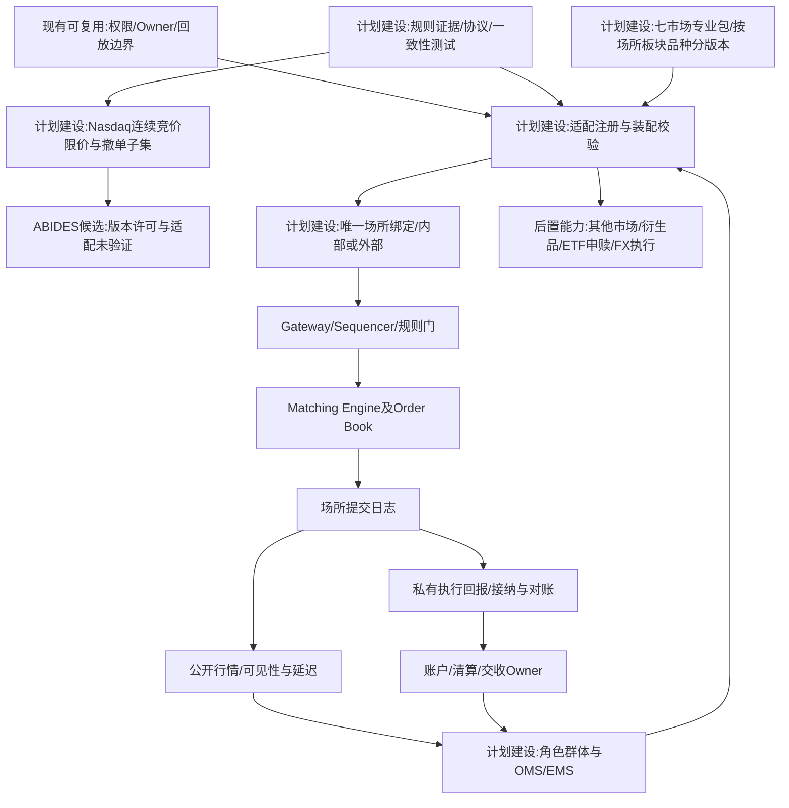
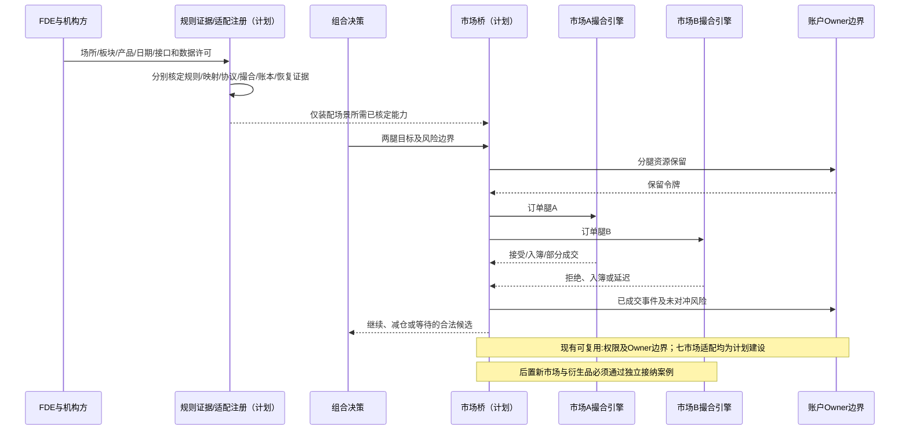
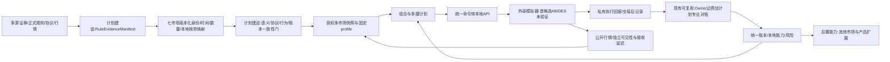

# 17 七个股票市场适配与外部交易场所接入

修订日期：2026-10-16｜合同版本：未发布草案｜建设状态：计划建设｜验证证据：专用静态校验入口见[README](README.md#文档状态与静态校验wog-r10)；本轮运行、适配、性能及预测未验证。

日期：2026-10-15｜状态：design-draft / non-authorizing｜依赖：[06](06-时间空间口径与适用域.md)、[16](16-金融订单行为量化执行与市场机制.md)。

本轮适配范围：美股、A股、港股、日本、韩国、台湾、新加坡股票市场。首先设计普通股票及单独声明支持的上市ETF二级交易；ETF申赎、期货、期权、债券和其他市场保留端口，不列入本轮可交付能力。七个市场是业务范围，不是七个共用规则的交易所，也不是已经完成七个生产连接器。下文是需实施并验收的专业适配合同。

## 1. 不在底座里重写全部市场

底座负责世界、主体、情景、数据对齐和有权接纳；专业市场模拟器负责其内部订单簿、撮合与规则。可分别接股票、ETF、衍生品、外汇等模拟盘，底座用统一账本、组合风险与因果事件协调。接入券商面向人的模拟盘不必然有可重放API，先检查接口、授权和精度，不靠屏幕动画假装成交。

数据对齐是集成核心，但不仅是字段名：还须对齐身份、时间、单位、资金归属、事件顺序、终态、回执和恢复语义。对于可提交订单的市场，必须额外声明**撮合权威**：订单由哪个`MatchingEngine`按哪一版场所规则处理，底座不能同时让本地撮合器和外部市场各自产生一笔成交。

## 2. 市场适配合同（设计示意）

```yaml
MarketAdapterContract:
  adapter_ref: {id, version, digest}
  engine_ref: EngineVersionRef
  supported_markets: [MarketRef]
  instrument_mapping_ref: MappingRef
  rule_profile_refs: [VenueRuleProfileRef]
  capabilities: {submit: bool, cancel: bool, replace: bool,
    orderbook: bool, account_ledger: bool, borrow: bool,
    checkpoint: bool, replay: bool, multi_leg: bool}
  matching_authority: internal|external|historical_replay
  matching_rule_profile_ref: VenueMatchingRuleProfileRef
  market_profile_ref: MarketProfileRef
  venue_profile_refs: [VenueProfileRef]
  product_profile_refs: [ProductProfileRef]
  native_protocol_bindings: [ProtocolBindingRef]
  rule_evidence_manifest_ref: RuleEvidenceManifestRef
  conformance_report_ref: ConformanceReportRefOrNone
  command_schema_refs: [TypeRef]
  event_schema_refs: [TypeRef]
  order_identity_policy: IdentityPolicyRef
  event_ordering_policy: OrderingPolicyRef
  clock_and_calendar_refs: [ClockPolicyRef]
  account_and_resource_mapping: MappingRef
  state_authority_map: OwnerBindingMap
  idempotency_and_reconciliation: PolicyRef
  failure_and_compensation: PolicyRef
  conformance_cases: [CaseRef]
```

引擎能输出价格，不代表能执行拟真的订单；只有日线成交价的回测器不能升级成盘口模拟器。能力缺失在装配阶段拒绝或选择明确降级模式。`matching_authority=external`时，外部引擎负责接受/拒绝、排队、撮合、撤改单竞态和成交事件；底座负责订单目标、权限、身份映射、事件接纳、账本对账和结果解释。`matching_authority=internal`时，必须提供可回放的场所规则、序号、订单簿和撮合测试；`historical_replay`只能重放已有成交，不能宣称运行了反事实撮合。

### 2.1 市场基础事件边界

市场实时链路分成四类事件：

1. `OrderCommand`：参与者向场所发出的买卖命令；
2. `OrderEvent`：场所返回的接受、拒绝、入簿、撤改单、过期等生命周期状态；
3. `TradeEvent`：撮合引擎按规则匹配买卖双方后产生的成交；
4. `LedgerEvent`：账户/结算Owner根据已接纳成交更新资产和义务。

盘口快照和增量属于`Market Data Feed`的订单簿数据，用于观察当前披露的有效委托，不能代替场所的权威订单事件。依[16](16-金融订单行为量化执行与市场机制.md)，**Order Flow**描述新单、撤单、改单的到达活动；1、2、3类关联组成的完整审计序列称**Order Lifecycle Event Stream**；**Trade Event Stream**只包含第3类；资金、持仓和借券变化属于第4类。第2类关联执行回报和第3类成交共享同一成交ID，不能重复计量。意图、审批和结算不计入场所订单流；未到达场所的命令仅有客户端时序，跨分区使用因果偏序而非虚构全局总序。四类事件用来源序号、幂等键和因果链对齐，公开源不披露的身份、父单和隐藏委托保持未知。

外部适配的统一对象是[16](16-金融订单行为量化执行与市场机制.md)的`TradingVenueSimulationSpec`场所端口：`Order Entry Gateway -> Sequencer/Rule Controls -> Matching Engine + Order Book -> Execution Reports/Market Data Feed`。本地OMS/EMS通过适配器发命令、接执行回报；撮合权、盘口、成交日志归场所绑定端负责，账户/清算/交收归账本合同负责。它们合成一套金融仿真链，能力、权限和写入权仍分别声明。

场所日志分别发布私有执行回报与公开行情；账户对账和行情分发独立消费，不以所有账户完成记账作为发布盘口的前提。模拟中的不同主体可以因通道延迟先收到公开成交、后收到自己的执行回报。撮合引擎负责其订单簿、成交和回报的一致提交，本地Owner接纳回报后记账；不能将本地尚未对账误判成场所未成交。

### 2.2 七市场统一装配合同

```yaml
MarketProfile:                         # 设计示意，字段非现成API
  profile_ref: {market_key, version, digest}
  coverage: {venues: [], boards: [], products: [], sessions: []}
  operating_mode: endogenous_simulation|historical_replay|paper_execution
  venue_bindings: [VenueProfileRef]
  instrument_master_ref: PointInTimeInstrumentMasterRef
  identity_mapping_ref: VersionedMappingRef
  trading_calendar_ref: CalendarVersionRef
  timezone_ref: IANATimezoneRef
  session_state_machine_ref: SessionPolicyRef
  order_type_matrix_ref: OrderSupportMatrixRef
  tick_lot_price_band_refs: [RuleTableRef]
  matching_priority_and_price_ref: MatchingRuleRef
  auction_and_halt_rules_ref: RuleProfileRef
  market_access_and_routing_ref: AccessRoutingProfileRef
  pre_trade_and_short_sale_ref: RiskRuleProfileRef
  trading_eligibility_ref: AccountInstrumentEligibilityRef
  settlement_and_custody_ref: SettlementProfileRef
  fee_tax_and_fx_refs: [RuleProfileRef]
  corporate_action_policy_ref: RuleProfileRef
  protocol_bindings: [ProtocolBindingRef]
  rule_evidence_manifest_ref: RuleEvidenceManifestRef
  validation_state: specified|mapped|conformance_passed|shadow_validated
ProtocolBinding:
  interface_role: order_entry|execution_report|drop_copy|market_data|post_trade
  provider_ref: ProviderRef
  venue_ref: VenueRef
  native_protocol: NativeProtocolName
  native_version: VersionRef
  field_enum_precision_map_ref: MappingRef
  sequence_recovery_and_reject_map_ref: MappingRef
  available_fields_and_visibility_ref: AccessContractRef
  unknown_field_policy: preserve_raw_and_block_affected_operation
```

`market_key`采用业务命名空间`us_equities/cn_a_equities/hk_equities/jp_equities/kr_equities/tw_equities/sg_equities`，与国家、法域、市场运营者身份分开。证券身份、上市记录、场所和交易板块分别编号；MIC等代码依据版本化参考表映射，不靠证券后缀推断场所。台积电台湾股票与美国ADR、A/H双重上市证券等不是同一个可任意互换持仓。

**规则选择键**为`venue + board + instrument/product + session + event_time + account/access_channel`。查找结果必须唯一；缺失或冲突返回`rule_unresolved/rule_conflict`，不默认套用另一个交易所。账户与券商限制可以收紧规则，不能放宽交易所禁止项。订单类型支持表采用`native/emulated/unsupported/unverified`四态；`emulated`明确由EMS还是场所处理、触发来源、延迟与误差，不能伪称原生。

适配能力逐项登记，不能只给整个市场一个“支持”勾选。未验证卖空不必阻断已验证现金多头场景；场景实际使用的任一规则、字段或恢复能力未解决，则该场景不能进入`ready`。冻结manifest时连同所有适用规则、来源和测试报告固定摘要。

FDE每个场所的交付包至少包括：`profile`、点时证券主数据映射、`rules_and_sources`、订单支持矩阵、交易阶段状态机、`protocol_mapping`、`market_data_recovery`、`account_and_settlement`、`conformance_cases/results`及已知缺口。名称为交付物建议，不是要求引入新的运行框架。输入同一目标指令时，七地适配器可合法产生不同原生命令或明确拒绝；统一合同追求业务含义保真，不追求每地都输出相同枚举。

```yaml
MarketDeploymentManifest:              # 设计示意
  profiles:
    - {market_key: us_equities, coverage_ref: USVenueCoverageRef}
    - {market_key: cn_a_equities, coverage_ref: CNAStockBoardCoverageRef}
    - {market_key: hk_equities, coverage_ref: HKEXSecuritiesCoverageRef}
    - {market_key: jp_equities, coverage_ref: TSECoverageRef}
    - {market_key: kr_equities, coverage_ref: KRXCoverageRef}
    - {market_key: tw_equities, coverage_ref: TWSETPExCoverageRef}
    - {market_key: sg_equities, coverage_ref: SGXSTCoverageRef}
  default_on_unmapped_rule: reject_affected_operation
  default_on_unmapped_native_enum: preserve_raw_and_reject_affected_operation
  default_on_market_data_gap: mark_book_unreliable_and_recover
  default_on_unknown_order_outcome: reconcile_before_resubmit
  default_on_unavailable_venue: reject_or_explicitly_reroute_with_authorization
```

### 2.3 统一订单、回报与行情合同

| 层 | 统一输入/输出 | 每个市场必须处理的差异 |
|---|---|---|
| OMS/EMS输入 | 账户、证券、目标、方向、数量、执行限制、截止时间 | 客户/产品权限、借券和市场访问通道 |
| `OrderCommand` | 新单/撤单/替换、客户ID、原单ID、场所、价格条件、数量、TIF、市场阶段、能力与保留引用 | 真实原生枚举、撤改语义、数量/价格约束、阶段允许矩阵 |
| `ExecutionReport` | 接受/拒绝/部分/全部成交/撤销/过期、累计成交、活动剩余、最后成交量价、原因码 | 原单与改单ID链、成交修正、撤单拒绝、回报重复与乱序 |
| `MarketDataEvent` | 来源、场所、证券、频道、序号、事件类型、可见量价、交易阶段、时间与原始载荷 | 委托级/价位级/快照、集合竞价指标、隐藏数量不披露、SIP/直连差异 |
| `PostTradeEvent` | 成交ID、交易日、应收付、币种、费用税费、交收日、结算状态 | 各地清算、交易/结算日历、证券/现金义务和失败处理 |

方向、`order_type`、`price_terms`、`time_in_force`、交易时段、交易能力分轴。真实接口没有的字段保持未知，不补造父单、账户受益人或主动方。对外API可以保留旧消息类型名，映射后内部语义不得改变。金额及价格用定点/十进制与明确舍入，不能用二进制浮点误差跨越最小价位。

撤改单需先固定原生命令语义：原地改量/改价是否可能、何种修改丢失优先级，或必须撤旧下新。券商受理、场所受理、入簿、成交、结算分别记录。命令重发去重范围、序号重置、重连与查单均由绑定协议声明，不假定所有市场支持FIX或相同重发语义。

### 2.4 “同标准”验收与降级

每项能力须分别取得四类证据：**语义与字段映射**、**协议消息往返**、**场所行为一致性**、**资源及交易后对账**。接口可解析不等于撮合符合规则，拟合量价也不等于协议兼容。

规则证据保存`发布机构/文档/条款/发布日期/生效区间/修订与替代关系/抓取时间/原文摘要/适用键/核验状态`。网站可访问只是来源发现，不是规则验收；旧英文概览与最新正式文件冲突时不能自动采用旧页。缺正式协议、许可或完整数据时，允许明确限定的语义仿真或历史回放，不能宣称原生协议一致或逐笔可还原。

`specified`表示本稿定义了需求；`mapped`表示映射与规则证据已核定；`conformance_passed`表示选定版本的测试通过；`shadow_validated`表示获权仿真/影子通道的真实输入回报对账完成。它们与[01](01-通用底座与扩展边界.md)的可表示、可执行、已验证分层对应，但不代表具有现实交易授权。

### 2.5 首个适配目标与候选（WOG-R06）

首个目标固定为 **Nasdaq 普通股、常规连续竞价、现金账户、限价新单与撤单**，首个模拟器候选为 **ABIDES**。这限定第一轮适配的规则子集；不包含多场所智能路由、集合竞价、卖空或全部特殊状态。未支持命令/阶段明确拒绝。其他市场仍为规划，寒武纪等 A 股示例不得套用美股规则。

实施顺序由已确认的[WOG-R03（26 §14.14）](26-世界运行图谱与统一运行合同.md#1414-wog-r03-已确认决议合成双边交易最小纵切)补充：先建设并验收独立TEST-X合成合同纵切，再推进本节外部适配。合成价格、固定订单费、交收时刻和撮合规则只用于验算，不移植为Nasdaq规则；后续适配复用回执、双边账本、故障与回放检查，并按本篇重新取得六轴证据。合成通过不提升ABIDES适配状态，R03设计确认也不授权运行时代码实施。

ABIDES 目前只是选型候选，本轮未下载、接入或执行。具体版本/commit、组件许可证与依赖、接口端口/协议、时钟、事件语义、检查点/恢复能力需后续逐项核定；不能因名字或研究用途声称 Nasdaq 原生协议支持、规则一致或交易所认证。模拟器许可、市场规则资料许可和数据用途分别核定，数据可读不等于可训练或分享。

| 首批案例 | 必须检查的结果 |
|---|---|
| 双边入簿及撮合 | 每笔成交对应有效买卖订单；优先序及价格按固定规则版本验证 |
| 部分成交 | 累计成交加剩余/撤销数量守恒，双方资源仅按实际成交变化 |
| 撤单与成交竞态 | 场所序号决定结果，不把撤单请求当作撤单成功 |
| 重复回报 | 场所执行和各账户效果按自身作用域去重 |
| 断线与恢复 | 缺口可发现，未知订单结果先查询/对账再决定重发 |
| 双方账户、费用和交收 | 买卖量相等；资金含固定 FeeSchedule；未完成义务可恢复 |

### 2.6 分轴证据登记与提升（WOG-R06）

每个场所/品种/阶段/版本组合分别登记**规则来源、字段映射、协议往返、撮合行为、账本对账、故障恢复**六轴证据。每轴保存状态 `unverified|pass|fail|unsupported`、适用范围、来源/测试版本、命令、输入摘要、预期/实际结果、证据定位及时间；未运行不能标 pass。总 `validation_state` 只能摘要适用且必需轴的结果，不能用单一成功掩盖缺项。规则、接口、模拟器或费用版本变更后按依赖重新验证。

合成测试、历史回放、语义仿真、原生协议测试和获权影子运行分别标记模式。合成双边订单测试通过不能提升为原生协议通过；历史逐笔重建不能证明反事实撮合。首批设计已确定，真实适配与所有运行证据仍待验证。

## 3. 多标的与跨资产品种

| 场景 | 输入 | 耦合机制与输出 |
|---|---|---|
| 行业内轮动 | 多股票、相关敞口、现金、替代信号 | 组合决策竞争共同预算，输出各标的子单 |
| ETF申赎与篮子 | 份额、净值、PCF、AP、现金替代 | 基金与账户流程；股票篮子和ETF订单关联 |
| 指数再平衡 | 公告、旧新权重、生效和资金规模 | 被动计划、提前交易、收盘执行差异 |
| 现货期货/期权 | 合约乘数、基差、Greeks、期限 | 多腿目标、保证金、交割与未对冲风险 |
| 跨国股票与汇率 | 本地工具、不同日历、货币与通道 | FX转换、可访问性、跨境资金和时区 |
| 跨资产风险冲击 | 股票、信用、商品、利率、融资条件 | 共同风险预算、抵押折扣与连锁平仓 |

相关性、产业供应或概念相似只构成候选关联。可交易替代、套利约束和传导强度需要单独模型。不能假定产业相关公司的股票一定等比例涨跌。

本轮上述表格只启用已声明的股票/ETF二级交易与组合估值功能；申赎、多腿衍生品执行等仍为后续扩展。FX可以作为组合估值输入；真实或模拟换汇、跨境划拨是独立适配能力，不因支持外币股票而默认完成。

## 4. 共同账户与结算边界

`PortfolioAccount`关联多个本地账户；每个本地账户有币种、证券、托管、法域和可访问市场。统一组合估值不等于资金能立即跨境划拨。FX交易、转账、税费、结算等待、资本限制和抵押品可用性都有过程与回执。

跨腿先占用各腿预算，按实际成交计算残余敞口；不能假设同时成交。一个市场关闭时另一市场变化，前者只能更新估值或下一次开盘预期，不虚构闭市成交。ETF套利先买篮子还是先卖份额、是否可借券与申赎要由实际能力选择。

## 5. 三种市场模式

- **历史驱动**：重放历史背景行情，模拟自身执行成本；声明是否影响历史流，不能据此声称模拟了市场全体反馈。
- **封闭内生**：参与者和背景流经撮合形成价格，现实数据用于校准或对照。
- **混合同化**：指定哪些流由外部驱动、哪些由模拟主体生成，列清替代和去重规则。

逐笔真实成交与相同主体模拟成交不能重复加入；强制贴合历史价格的分支不能拿“贴合效果”证明预测准确。

## 6. 事件对齐、失败和对账

按引擎run、venue、partition、sequence与原始ID去重。快照/增量切换需连续游标，缺失期间不得靠插值捏造队列。跨源使用因果偏序与水位线，不强行按毫秒戳猜唯一顺序。

下单超时且结果未知先查单；市场已成交本地失败时写未对账状态，恢复后由账户/结算 Owner 接纳真实外部回报。只在未执行且合同允许时补偿撤单；不能抹去外部成交。相同外部状态若同时映射进本地市场和账本，职责必须互斥，避免两边都扣钱。外部事实来源、适配器接入和本地账户接纳分别记录，不能把适配器成功解析当作账户已入账。

外部适配器的唯一职责是保存原始回报、验证 `venue/run/partition/sequence/external_id`、建立本地映射、去重、报告缺口和发起查单。它不拥有本地现金、持仓、费用或交收状态。外部场所已经确认的双边成交以外部执行 ID 和可验证序号作为来源依据；本地 Venue 投影不得再次撮合，账户 Owner 也不得凭订单状态自行制造成交。

跨 Owner 的外部接入流程固定为：

```text
外部场所成交
  → 接入 Owner 保存观测与回报
  → Venue/交易后边界验证映射和重复
  → 买方与卖方 Account Owner 分别接纳账本效果
  → Settlement Owner 接纳交收义务
  → 对账完成或建立补偿义务
```

外部模拟器不支持检查点时，使用已记录事件审计回放；不能承诺重新调用确定性复现。每次引擎版本升级重跑接纳案例。

### 6.1 首批覆盖矩阵

| 专业包 | 需分别装配的场所/板块 | 交易币种与时钟 | 本轮边界 |
|---|---|---|---|
| 美股 | Nasdaq、NYSE、NYSE Arca、Cboe美国股票场所各自profile | USD；America/New_York，保留DST | 股票及已注册ETF；完整美国市场需另核全部场所与场外流覆盖 |
| A股 | 上交所主板/科创板、深交所主板/创业板、北交所 | CNY；Asia/Shanghai | A股现金股票；ETF回转/申赎规则另配，不沿用股票规则 |
| 港股 | HKEX证券市场，主板/GEM及适用产品分类 | HKD及实际交易柜台币种；Asia/Hong_Kong | 股票及已注册ETF，柜台身份和互换机制分开 |
| 日本 | TSE Prime/Standard/Growth分别标记 | JPY；Asia/Tokyo | TSE上市股票及已注册ETF，PTS/场外不冒充TSE |
| 韩国 | KRX KOSPI/KOSDAQ，KONEX单列适用规则 | KRW；Asia/Seoul | KRX现金证券；NXT等其他运营者不自动并入KRX |
| 台湾 | TWSE上市与TPEx上柜分别装配 | TWD及实际产品币种；Asia/Taipei | 股票及已注册ETF；兴柜等其他机制须独立能力声明 |
| 新加坡 | SGX-ST Mainboard/Catalist及订单簿分类 | SGD及实际交易币种；Asia/Singapore | 现金股票及已注册ETF；其他产品与场外不默认支持 |

这是计划profile清单，所有项当前均为`specified`。交易所普通股与同所ETF、特殊证券和特殊时段不共用一套未经限定的规则。仅部署其中若干场所时，场景必须公开覆盖缺口；不能把七个专业包数量当成所有场所已经接入。

### 6.2 美股：多场所、路由与行情视角

**输入**：证券及上市地、交易所/场所代码、账户现金/保证金与短卖能力、场所状态、直接行情和/或获权SIP合并行情、路由策略及延迟、公司行动和费用。NYSE/Nasdaq名称不代表只有在上市地才能成交；每个委托明确执行场所。

**场所机制**：各场所独立排序、订单簿、撮合、开收盘拍卖和交易时段；不能将NYSE与Nasdaq的优先级、拍卖规则直接混用。EMS/SOR按主体实际可见的报价和场所可达性路由，记录在途时间、费用与重路由。Reg NMS相关受保护报价、交易穿透例外和锁定/交叉处理用单独规则表；不能用后台全知NBBO替代交易者的延迟观察。止损通常位于哪一层触发、是否支持隐藏/储备/peg/post-only等必须由具体接口能力给出。

**协议与行情**：Nasdaq OUCH、该场所FIX等分别映射订单接口；TotalView-ITCH是行情接口，不当作下单协议。NYSE/Cboe使用其版本化接入与行情规范，不强制改名为OUCH。SIP与直连流中重叠成交按官方引用和场所ID去重，官方NBBO与主体所见估算NBBO分别保存；仅有一家场所盘口时不得宣称全美最优报价。

**账户与交易后**：现金/保证金/卖空标记、locate与借券义务、适用的短卖价格限制、融资与交易频率限制按日期和账户分轴。美国常见证券T+1交收是需取正式生效证据的候选基线，不推出所有产品相同，也不推出未结算现金无限回转。费用、分红/拆并股与交易撤销/更正均入账，不改写原成交。

**输出与专测**：每场所订单回报、成交与盘口；路由腿、当时可见报价与参考报价；合并行情去重结果；未执行/跨场所风险。至少测DST切换/半日市、闭市订单、延迟NBBO、不同场所同时部分成交、拍卖与连续时段切换、LULD/停复牌、卖空限制、成交更正和重复回报。仅单场所可运行时标`single_venue_subset`。

### 6.3 A股：交易所、板块与账户可卖量分离

**输入**：沪/深/北证券及板块、普通/风险警示等状态、上市日期与特殊交易日、价格/数量约束表、停复牌及日历、账户已交收/可卖/冻结头寸、两融资格与券源、各源逐笔/档位数据。

**场所机制**：开收盘集合竞价、连续竞价及中间休市分阶段建模，撤单窗口与订单申报窗口分别判断。主板、科创板、创业板、北交所按规则键选价格限制、价格笼子、申报数量、市价申报类型、剩余处理和适用的特殊停牌机制。常见10%/20%/30%只用作分类提醒，不能作为所有日期和状态的默认参数；风险警示、新股及其他例外必须从具体版本加载。ETF和其他允许回转品种不继承普通A股的可卖量规则。

**协议与行情**：沪深北各原生或经券商/获权供应商的版本化接口独立绑定，申报与行情通道分别映射。逐笔委托、逐笔成交、价位快照的字段和缺口恢复不同；未披露的全市场客户身份保持未知。不能将供应商封装的API称作交易所原生协议，只有档位数据不得声称精确重建个体队列。

**账户与交易后**：普通股票当日买入可卖限制、已持有可卖库存、证券/资金交收安排、可用与可取资金、券商风控独立建模。“T+1”必须注明是回转限制还是交收周期，不能一个枚举代替全部现金和证券义务。卖空/融券限定到合格账户、标的、券源、额度及规则日期，不因有持仓就允许无限日内回转。印花税、佣金和经手等费用用生效表。

**输出与专测**：场所原单/撤单回报、特殊市价类型实际处理、成交量价和可卖余额。测同一指令在三个交易所/不同板块的接受差异、不可撤时段、价格保护、涨跌停队列、上市特殊期、买入股票不可当日卖出、已有库存卖出、零股/数量规则、两融失败及行情缺序补流。

### 6.4 港股：本地订单类型、交易阶段与交易柜台

**输入**：证券、主板/GEM、交易柜台及币种、每证券board lot、价位表、竞价适用范围、借券/卖空名单及标记、经纪/交易所接口权限。股数与手数保留双向转换，不假定港股都每手100股；不同币种柜台不凭发行人身份自动合并。

**场所机制**：按HKEX规则分别表达开市前时段、持续交易时段、收市竞价及其报价/撤单窗口。官方机制页面列出竞价盘/竞价限价盘，以及持续交易中的限价盘、增强限价盘、特别限价盘；以实际版本核定扫档范围、未成交余量及附加条件。通用`market`不能无声映射成特别限价盘；相近行为也须明确价格保护、剩余语义和不等价之处。CAS随机结束窗口、价格限制、VCM适用条件作为可版本化规则。

**协议与行情**：OCG-C及获权券商接口对应订单/执行；HKEX市场数据接口单独绑定。保留本地订单类型、拒绝码、回报ID与频道序号，直连和经纪延迟分开。北向/南向互联互通是另外的访问通道及资格/日历/额度合同，不继承本地账户全权限。

**账户与交易后**：可卖库存、指定证券卖空及借券、交易费用税费、CCASS相关交收义务、不同柜台现金各自记录；场所支持交易不等于某个经纪账户允许。支持日内回转与证券正式交收分轴。

**输出与专测**：本地订单类型及其实际结果、盘口/成交、柜台资源、交收义务。测增强/特别限价与普通限价的差异、board lot与碎股通道区别、不可撤/随机结束、VCM、未支持市价类型拒绝、指定卖空限制、双柜台不重复资产与互联互通资格拒绝。

### 6.5 日本：Itayose、Zaraba与特殊报价

**输入**：TSE板块、证券交易单位与价位类别、日价格限制、前收盘/参考价、市场阶段、特殊报价、账户与交收日历。JPX本轮可读页面列出9:00–11:30及12:30–15:30的交易时段，方法页标注2024-11-04更新；历史场景须取当时规则，不把延长后的收盘时间应用到过去。

**场所机制**：`Itayose`为集合竞价、`Zaraba`为连续竞价；开收盘与其他适用情境分别绑定。特殊报价、连续成交报价等价格稳定机制与普通静候委托不同，须保留状态、更新间隔和恢复规则。收盘竞价、午间休市、并列订单分配、日限价和市价/限价优先按正式条款核定，不能把日本市场简化成全天无间断的价格时间优先簿。

**协议与行情**：TSE订单接入/回报规范与FLEX等行情系列分别选定版本和权限；名称发现不意味着取得协议文件。券商API作为独立provider绑定。PTS或其他场所若后续加入，要独立撮合和路由，不使用TSE证券代码直接共享队列。

**账户与交易后**：现金/信用交易资格、短卖标记、借券与价格限制、日内交易条件、JSCC/JASDEC相关清算与交收映射分别核定；不把“可当日卖出”解释成已交收。币种JPY和数量/价格单位精确处理。

**输出与专测**：竞价/连续成交、特殊报价状态、参考价格与余单、私有回报和交收义务。测午休前后、旧/新交易时段、收盘竞价、特殊报价暂停即时成交、日限价、并列分配和特定类别价位，缺规则时拒绝对应机制。

### 6.6 韩国：KRX板块、波动控制与其他场所隔离

**输入**：KOSPI/KOSDAQ/KONEX板块与产品、交易日历/阶段、价位与价格限制表、VI状态、账户资格、借券/短卖规则与生效日期、KRW头寸及费用税费。

**场所机制**：集合竞价/连续竞价及盘前盘后分别配置；波动性中断（VI）、熔断/停复牌、单一价格交易等状态各有进入、等待、清算及退出规则。不同板块或投资警示状态的订单支持、限价和配额不能只由`country=KR`选择。有关短卖的禁限、恢复及机构控制要求具有时间敏感性，不用长期常量表示。

**协议与行情**：取得KRX及获权经纪/数据商的当前技术规范后映射订单、执行、行情频道、断流恢复；当前发现的Global KRX规则导航不等于完整协议已取得。韩国其他运营者如NXT是独立venue，若不接入则记录市场覆盖缺口，不把其成交复制进KRX簿中；后续接入需加入路由与跨源去重。

**账户与交易后**：已持有/已买入/借入证券及可卖量、融资信用、可交易与可交收、KRX/KSD相关交收引用、费用税费按版本核定。借券、卖空和当日交易权限各有可执行前提，不从机构类型推定。

**输出与专测**：各板块订单回报、VI/拍卖/停牌市场状态、逐笔与价位数据、资源及交收状态。测VI切换时在途撤单、连续转竞价、价位边界、历史短卖禁限变化、账户资格拒绝、盘后模式隔离、重复回报与缺失协议能力阻断。

### 6.7 台湾：上市/上柜、逐笔交易、零股与当冲资格

**输入**：TWSE/TPEx独立场所、证券/产品、交易单位与价格区间、日价格限制、处置/交易方式状态、零股资格、现股当冲及短卖资格、账户与TWD资源、交易阶段和交收日历。

**场所机制**：开收盘集合竞价与盘中逐笔交易分别建模。TWSE官方交易机制说明列出市价及IOC/FOK在连续交易时段的适用性；不得将其直接开放到所有竞价或零股时段。整股、盘中零股、盘后零股、盘后定价及大额交易是不同机制/时段，队列和数量规则不混用。瞬间价格稳定、处置证券或分盘方式须依状态生效表装配。TPEx必须有自身规则证据，不能因为同币种而复制TWSE全部参数。

**协议与行情**：TWSE、TPEx订单与行情技术规范分别绑定；broker wrapper原始载荷、订单号和拒绝码保留。撮合输出的“张/股”、报价档位和交易阶段明确转换，零股成交不当作整股簿成交。统一股数统计时标出原单位与换算定义。

**账户与交易后**：现股当冲的合格证券、账户及先买后卖/先卖后买能力、融券/借券和未完成回补独立建模；不是所有股票和客户天然无限当冲。清算、TDCC相关保管/交收、交易税和其他费用按产品及日期选择；ETF费用/税制不套普通股默认值。

**输出与专测**：TWSE/TPEx独立回报、整股/零股簿与成交、当冲/借券义务、现金及交收状态。测集合竞价禁用特定TIF、整股与零股数量校验、价格稳定与分盘状态切换、当冲资格失败、先卖后买未回补、场所ID冲突与量单位转换。

### 6.8 新加坡：SGX-ST交易簿、单位股与多币种

**输入**：Mainboard/Catalist证券、交易币种、board lot/单位股类别、价位表、交易阶段、市场状态、账户/借券与SGD或外币头寸、SGX/CDP相关交收日历。

**场所机制**：开市、午间/收市等阶段按生效规则装配，包含竞价、连续、不可撤窗口及适用的随机结束/Trade at Close安排；不把所有证券/所有历史日期都开相同时段。限价、市价、market-to-limit、有效期和数量/价格条件按SGX原生支持矩阵核定；券商synthetic stop等在EMS标记，不宣称SGX原生。Unit Share Market与普通board lot簿分别处理，不能把碎股直接排入普通整手队列。

**协议与行情**：SGX原生接入、执行回报和市场数据规范与获权券商API分别固定provider、版本和能力。规则手册不代替协议字段表；只有市场数据而无submit接口时只支持观察/历史回放，不能返回虚构订单受理。

**账户与交易后**：按产品记录CDP清算适用性、应收证券/现金、交收日期、失败交收和适用buying-in过程。SGX-ST在线规则表列出若干Ready Market证券T+2及Buying-in Market T+1，证明同一市场可有不同结算类别；该表不能替代对具体产品/日期的核定。支持多币种不等于自动换汇或共用现金，借券与卖空标记及费用各自接纳。

**输出与专测**：普通/单位股簿独立订单回报和成交、多币种应收付、日历与交收状态。测数量单位、午间/收盘阶段转换、原生/合成条件单区别、不同settlement class、无FX余额拒绝、结算失败与重放、数据存在但交易端口缺失的降级。

### 6.9 规则、协议与数据的证据清单

检索日期为2026-10-15，仅表示本轮访问，不是所有规则的生效日。以下链接用作FDE核定入口，页面可访问不表示已完成条款、许可与接口验收。精确费率、交易时段、价位、风险警示规则、短卖限制和交收参数在正式部署时均须固定正式文件版本。

| 市场/组件 | 官方来源 | 本轮证据与缺口 |
|---|---|---|
| 通用消息 | [FIX标准](https://www.fixtrading.org/standards/) | 行业消息参考；不代替交易所撮合规则或接入许可 |
| 美国 | [Nasdaq OUCH](https://www.nasdaqtrader.com/Trader.aspx?id=OUCH)、[ITCH规范](https://www.nasdaqtrader.com/content/technicalsupport/specifications/dataproducts/NQTVITCHspecification.pdf)、[NYSE交易时段](https://www.nyse.com/trade/hours-calendars)、[Cboe美国股票](https://www.cboe.com/us/equities/) | OUCH与NYSE正文已读；ITCH规范此前可取；其余场所协议、Reg NMS、账户规则及交收正式文件仍待逐项核定 |
| A股 | [上交所业务规则](https://www.sse.com.cn/lawandrules/sselawsrules/)、[上交所机制概览](https://english.sse.com.cn/start/trading/mechanism/)、[深交所规则入口](https://www.szse.cn/lawrules/rule/)、[北交所](https://www.bse.cn/) | SSE规则目录及概览可读；概览存在历史参数，不能当最新统一规则；深交所本轮页仅返回门户、北交所未提取正文，正式规则及技术接口未核全 |
| 港股 | [HKEX交易机制](https://www.hkex.com.hk/Services/Trading/Securities/Overview/Trading-Mechanism?sc_lang=en)、[技术基础设施](https://www.hkex.com.hk/Services/Trading/Securities/Infrastructure/Overview?sc_lang=en) | 正文支持本地订单类型区分，基础设施页列出OCG-C FIX版本资料；正式协议全文与全部规则未核全 |
| 日本 | [JPX交易时段](https://www.jpx.co.jp/english/equities/trading/domestic/01.html)、[交易方法](https://www.jpx.co.jp/english/equities/trading/domestic/04.html) | 正文可读，支持午间/收盘时间及Itayose/Zaraba区分；接口、报价稳定及交收条款待核 |
| 韩国 | [KRX KOSPI交易导航](https://global.krx.co.kr/contents/GLB/06/0602/0602010201/GLB0602010201.jsp) | 页面可读但正文有动态加载；KOSDAQ/KONEX、当前短卖规则及技术接口待核 |
| 台湾 | [TWSE交易机制](https://www.twse.com.tw/en/products/system/trading.html)、[TPEx](https://www.tpex.org.tw/en-us/) | TWSE正文可读，支持市价/IOC/FOK的时段区分；TPEx入口重定向中文首页，正式规则和接口待核 |
| 新加坡 | [SGX-ST交易规则](https://rulebook.sgx.com/rulebook/sgx-st-rules)、[SGX证券交易入口](https://www.sgx.com/securities/trading) | 规则正文可读；门户动态加载，原生协议和各产品参数待核；Mainboard上市规则不当作撮合规则 |

不完整的网页、重定向门户、旧概览以及未取得许可的原生协议不得标为`source_verified`。后续资料进入[07](07-FDE数据接入与机构适配.md)证据存储，按条款和适用键核定后才可从`specified`提升。对于券商模拟盘，还要单独记录“其行为是否偏离正式场所规则”，不能用券商返回成功替代交易所规范证据。

### 6.10 七市场共同验收与跨市场案例

每个场所/产品/时段组合形成`ConformanceCase`：规则证据、初始簿及账户、输入命令序列、预期私有回报、预期公开行情、预期资源/交收结果、容差、协议版本与恢复点。至少覆盖：

1. 合法限价单被动入簿、穿价即时部分/全部成交，同价优先与剩余量守恒。
2. 本地市价/市价变体/IOC/FOK的原生支持、深度不足和未支持类型拒绝；条件单原生与EMS模拟分别验收。
3. 撤单成交竞态、改单优先级、拒绝/过期、ID复用及重复执行回报去重。
4. 开收盘竞价、午休/半日市、不可撤窗口、停复牌/波动控制和异常阶段；不适用规则明确声明。
5. 数量单位/零股、价位区间、限价/保护、费用税费与舍入，特殊证券/上市阶段例外。
6. 现金不足、不可卖库存、借券/卖空/当冲资格、权限过期和同账户跨场所超额占用。
7. 行情快照/增量切换、重复/乱序/缺号、session重置、重连查单、检查点恢复及已成交未对账。
8. 交收日历、公司行动、结算失败、成交更正/撤销与费用补偿；交易成功不等于已交收。

跨市场验收用同一私募的USD/CNY/HKD/JPY/KRW/TWD/SGD本地账户和独立初始资源：亚洲市场开市时美国股票可能闭市，宏观新闻按当地时钟到达；A股已有库存可卖不意味着当日新买库存可卖；香港本地订单语义不接受泛化市价替代；日本午休与台湾零股队列分别推进。资金不足时只能生成获权FX/转账提案或拒绝，不从统一AUM凭空补资金。比较七地订单回报、撮合和账户义务，按收盘/休市状态输出估值或真实模拟成交，不虚构同时开放。

验收报告逐市场、场所、产品、阶段和接口版本列出`pass/fail/unsupported/unverified`，并注明`semantic_only/native_protocol`及数据覆盖层级。未获得场所认证时可以称“已通过所列规则测试的仿真适配”，不能称“获交易所认证”。本轮仅完成设计；上述报告和运行证据尚待实现。

## 7. 架构图



## 8. 主交互时序图



## 9. 数据流图



## 10. 验收不变量

同笔外部成交只接纳一次；本地账本与引擎账本有明确权威；不同币种不直接相加；闭市不成交；跨腿失败保留敞口；资金转移与结算等待真实入模。选型入口：[ABIDES](https://github.com/abides-sim/abides)、[TwinMarket](https://github.com/FreedomIntelligence/TwinMarket)，均是研究参考而非已接入或满足所有能力的声明。
