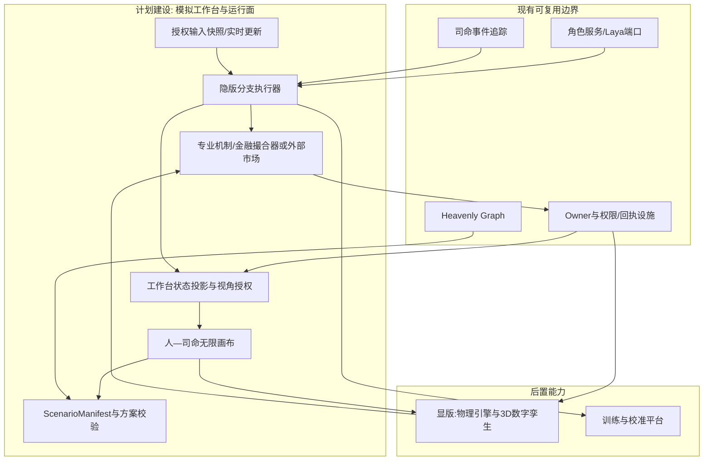
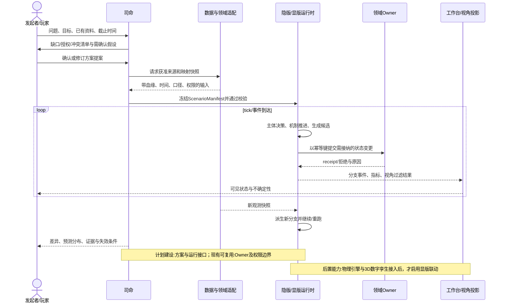
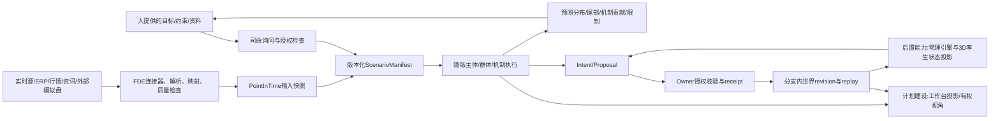

# 18 显版、隐版与人—司命工作台

修订日期：2026-10-16｜合同版本：未发布草案｜建设状态：计划建设｜验证证据：专用静态校验入口见[README](README.md#文档状态与静态校验wog-r10)；本轮运行、适配、性能及预测未验证。

日期：2026-10-15｜状态：design-draft / non-authorizing。

## 1. 目标与边界

工作台是模拟发起者与司命共同定义、检查、运行和解释模拟方案的控制面；它不是显版本身。隐版通过后台机制运行模拟，仍可配工作台、图谱、盘口、量价和回放视图。显版按本项目约定特指物理世界高度参与的运行形态：后台机制与物理引擎驱动的前台3D数字孪生共同推进模拟。三者读取同一份有版本的 `ScenarioManifest`、同一事件合同和同一授权边界，不能各自维护一套相互矛盾的世界。

工作台允许模拟发起者以“玩家”会话身份参与：回答司命问题、提交资料、调整假设、选择分支、暂停/继续并切换到其有权查看的角色或组织视角。玩家身份不赋予数据所有权、机构内部权限或对世界真相的写入权。人提交的是提案；有权 owner 依[09](09-权限关系与运行时接纳.md)校验并接纳。

隐版用于参数扫描、蒙特卡洛/主体模拟、敏感性分析和反事实分支；金融盘口、量价/资金流、关系图、信息扩散和组织流程均属于工作台可提供的观察面。单纯加入金融3D展示不构成显版。金融与矿山、工厂、物流、能源设施联合推演时，可为物理子场景接入显版；必须提供物理求解器、边界条件、双向作用端口和误差合同。前台收到的状态由owner接纳结果驱动，操控则经Intent/Proposal回到相应owner；3D引擎不能另立世界真相。

## 2. 人、司命与运行时职责

| 参与方 | 可以做 | 不可以做 |
|---|---|---|
| 发起者/玩家 | 定义目标、边界、风险容忍度；提供或授权资料；比较分支；暂停并切换视角 | 直接把假设改成现实事实；读取无权访问的主体私有记忆；越过 owner 接纳 |
| 司命 | 询问缺失输入；检索获准来源；提出映射/假设；装配并校验方案；安排角色、群体和机制；监控漂移与停止条件 | 伪造来源；代表参与者决定其行动；私自扩大授权；把模拟状态写成现实状态 |
| FDE | 建连接器、字段映射、领域机制配置、机构专属验收 | 通过适配绕开源权限或 owner |
| 机制/角色/群体 | 在授权快照内生成事件或行动提案 | 直接提交非本 owner 所有的事实 |
| Owner | 对其负责的状态执行校验、幂等接纳、拒绝并给回执 | 把接纳解释成预测正确或现实授权 |

司命的流程是：澄清目标与决策截止点 → 询问主体/资产/时间/空间/口径/权限/风险偏好 → 接入资料与实时源 → 标注来源、时效、冲突和缺口 → 提出多套场景假设供人确认 → 建立 `ScenarioManifest` → 通过静态校验 → 运行小样本试跑 → 检查守恒和边界 → 扩展分支 → 监控新观测 → 更新输入快照并分支重跑 → 解释分布、证据和失效条件。不得静默填充重大缺口。

## 3. 统一运行合同

以下是[12](12-司命方案治理与全流程运行.md)中`ScenarioSpec`与`RunManifest`的工作台装配视图，称为`ScenarioManifest`，不是第三个可独立写入的方案源。`scenario_id + revision`引用方案修订；实际运行还须固定其`RunManifest`摘要、输入快照、引擎版本、预算和回放键。

```yaml
ScenarioManifest:
  scenario_id: string
  revision: integer
  purpose: decision_question
  initiator: principal_ref
  world_ref: string
  branch_ref: string
  domain_packs: [pack_version]
  actor_roster_ref: string
  organization_roster_ref: string
  cohort_roster_ref: string
  source_snapshot_refs: [snapshot_ref]
  assumptions: [{id, value, owner, uncertainty, approved_by}]
  mechanisms: [{id, version, input_contract, output_contract, tick_policy}]
  visibility_policy_ref: string
  stopping_rules: [rule]
  random_seed_policy: string
  run_mode: hidden|visible|hybrid
  presentation_mode: headless|workbench|workbench_and_3d
  physical_twin_binding_ref: PhysicalTwinBindingRefOrNone
  output_contract: [metric_ref]
```

每个运行批次固定 manifest 修订、代码/机制版本、数据快照、权限版本和随机种子策略。实时输入产生新 `InputSnapshot` 和新子分支，不覆盖已经运行的历史。分支结果必须能回链到具体假设和输入差异。

`presentation_mode`与`run_mode`分轴。隐版可启用完整工作台；`visible/hybrid`必须绑定已接纳的物理孪生端口、时钟同步和状态提交合同，缺失时拒绝装配为显版。金融模型、风险曲面和关系图的可视化均不自动满足该条件。

隐版产出：每条分支的状态轨迹、指标分布、置信/预测区间、尾部样本、机制贡献、敏感性、证据血缘、运行成本和被跳过的主体精度。工作台呈现时间游标、主体/组织视角、网络与空间视图、事件解释、盘口和成交流、分支对比；显版另外呈现由物理求解状态驱动的3D场景及设备、物料和空间场变化。任何一方都不能只显示“结论数字”而省略条件与来源。

## 4. 无限画布和视角

画布是多视图编排器，不是另一种数据库。节点引用 Entity、Observation、Mechanism、Scenario、Branch、Metric、Source 或 View；连线明确区分语义关系、数据依赖、执行顺序、因果假设、授权关系和可视化布局。布局坐标是 presentation metadata，不写入世界状态。

金融场景至少提供：产业/公司、市场/账户、参与者/组织、信息渠道/观点、制度/外部环境、订单簿/逐笔事件、时间/分支比较视图。用户点击交易者或组织后，只能切换到其授权观察面；“玩家视角”看到发起者可见的数据和自身决策，“角色视角”看到角色实际可得信息、信念/情绪和行动原因，“观察者视角”看到经权限过滤的全局统计。

显隐同步按 `event_id + world_ref + branch_ref + revision` 订阅。拖动画布节点只改变布局；修改场景参数必须生成新方案修订；显版手动操控若代表世界内动作，先成为 Intent/Proposal，再按 owner 流程处理。

## 5. 架构图



## 6. 主交互时序图



## 7. 数据流图



## 8. 状态与验收不变量

- **现有可复用**：项目中的图谱、角色服务/Laya、司命事件追踪、权限与 owner 设施；接入前需核实现有接口和权限测试。
- **计划建设**：ScenarioManifest、FDE 版本快照、分支执行、画布联动、视角过滤和显隐同步合同。
- **后置能力**：工业物理孪生、多集群高吞吐执行、自动校准和训练。

1. 画布布局不能改变模拟语义；语义编辑一定生成新修订和差异。
2. 每次运行可固定输入快照、机制版本、权限版本和随机性策略后重放。
3. 玩家、司命、角色、群体和 owner 的权限不能互相继承。
4. 隐版统计和显版单主体视图来自同一分支修订；筛选不可改变底层结果。
5. 新实时数据建立新输入快照；不得回写覆盖旧分支的已见信息。
6. 显版未收到 owner receipt 时显示“候选/待接纳”，不显示为已发生事实。
