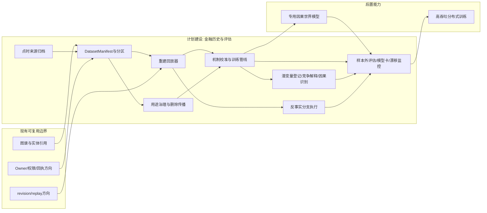
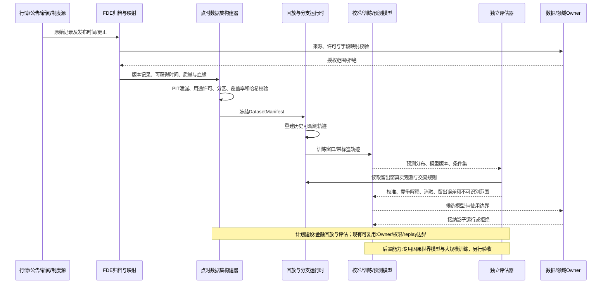
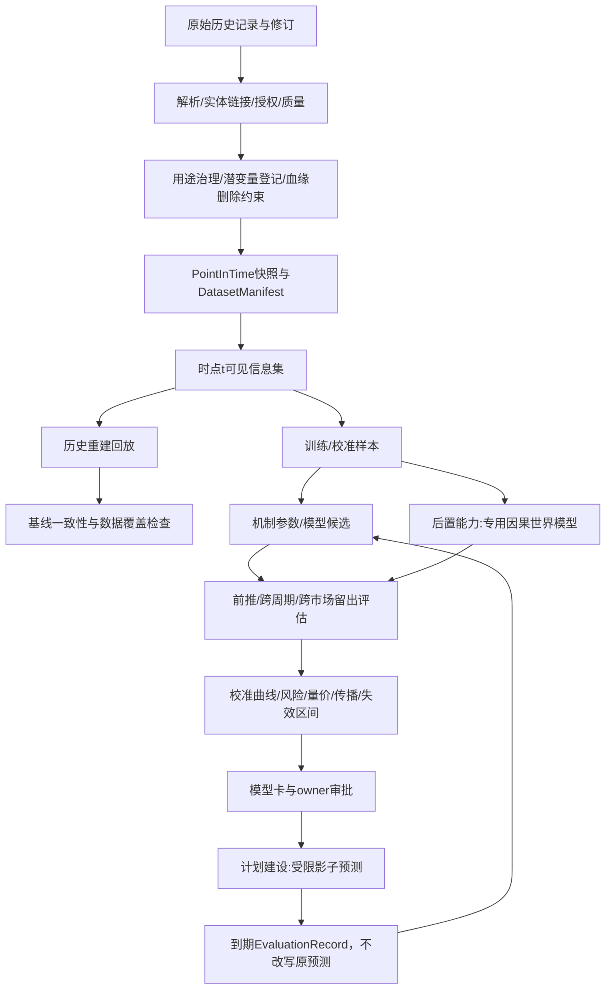

# 19 金融历史回放、训练与预测评估

修订日期：2026-10-16｜合同版本：未发布草案｜建设状态：数据与评估管线计划建设；专用训练为后置能力｜验证证据：专用静态校验入口见[README](README.md#文档状态与静态校验wog-r10)；本轮运行、适配、性能及预测未验证。

日期：2026-10-15｜状态：design-draft / non-authorizing。

## 1. 目标与不可声称事项

建立从点时资料集、历史事件回放、机制校准到样本外评估的闭环，为未来训练金融专用因果世界模型准备有血缘、可重放、授权明确的轨迹。训练目标是预测条件下的市场/参与者状态分布和可检验机制，不是仅拟合一条历史价格曲线。

历史轨迹拟合成功不证明因果关系；仿真结果不自动成为投资建议；回测收益不代表可实现收益。必须分开报告预测准确性、机制识别证据、策略模拟结果和真实执行表现。市场反事实通常不能从单条历史路径识别，需明确识别假设、替代解释和不确定区间。

## 2. 点时历史包

对每份数据保留事件发生时间、首次公开时间、源可获得时间、系统摄取时间、修订/更正时间、适用时间窗、交易日历、时区、币种、复权口径和授权范围。依[03](03-类型化数据与统一记录合同.md)，`available_at` 是 `AvailabilityRef`；查询必须先按主体与渠道解析可得时点，再校验 `resolve(available_at, actor, channel) <= t` 及权限。若重放主体实际决策，还须校验曝光、消费和理解阶段；按平台实收模式另检查接收游标。晚到或后续修订数据只能进入后续版本，不能泄露到早期决策。

金融历史包可包括：逐笔成交及报价、订单簿快照/增量、委托生命周期、交易所规则和日历、公司行动、财报与公告、新闻/研报/社媒及转载链、宏观与利率、融资融券、基金申赎与持仓披露、期货/期权/ETF/外汇/跨境流、交易成本、结算和保证金。并非每个历史时段都具备全部品类；缺失字段需标注覆盖率和代理变量，不能静默补齐。

每个历史数据集发布 `DatasetManifest`：来源和许可、表/字段语义、点时策略、清洗与映射版本、缺失与修订统计、去标识化规则、时区/日历、样本区间、哈希、可见性、训练/校准/验证分区和排除原因。匿名交易者/机构身份只可在来源许可范围内使用，推断身份要标成估计并限制用途。

## 3. 回放语义与训练样本

回放器按原始可观测顺序重现信息可用性、交易时段、市场规则和机制 tick。回放环境有两种模式：**重建模式**重放已知输入和观测，校验数据/机制能否再现可观测事件；**分支模式**在明确的干预假设下生成替代结果。两者输出标签不同，不能把分支合成结果伪装成历史。

训练样本以 `WorldSnapshot(t) + AuthorizedObservationSet(actor,t) + Action/Intent + MechanismVersions + OutcomeWindow` 组织；角色行动标签必须说明是观测到的真实决策、从公开行为推断，还是合成主体行为。组织级资源流、群体聚合与个体账户做唯一计量，禁止聚合结果重复计入个体账本。对模型不可见的未来信息、修订后报表和幸存者样本建立显式泄漏测试。

校准按层拆分：数据质量与实体映射；市场状态和波动/流动性；订单流与成交机制；参与者分布/决策；信息传播和情绪；跨资产约束；尾部与制度切换。每层记录参数来源、可识别范围、先验、后验、稳定区间和替代解释。不得用全样本统一调参后再宣称样本外。

## 4. 评估面板

| 评估对象 | 建议指标 | 读数限制 |
|---|---|---|
| 价格/收益 | MAE/RMSE、方向命中、分位数损失、概率校准 | 与随机游走、基准模型比较；按期限和状态分层 |
| 量价/盘口 | 成交量分布、价差、深度、OFI、冲击/恢复、撤改单率 | 聚合与逐笔指标并列；校验守恒和撮合顺序 |
| 风险/组合 | VaR/ES覆盖率、回撤、流动性成本、保证金/强平链 | 覆盖率和尾部样本数量一起报告 |
| 传播/认知 | 延迟分布、曝光/消费/信念更新、观点扩散 | 观察到的传播路径与模型推断分开 |
| 参与者 | 持仓/换手/资金约束、拆单轨迹、群体分布 | 匿名代理身份不代表真实机构画像 |
| 稳健性 | 跨时期/标的/市场迁移、制度切换、敏感性 | 明确失败状态和适用范围 |
| 反事实 | 预测区间、干预效应分布、机制贡献 | 非随机历史不能独立验证所有因果效应 |

采用滚动前推验证、跨周期留出、跨标的/跨市场迁移和压力期测试。所有基准、阈值、样本剔除规则在揭盲前固定并版本化。小样本与严重数据缺口应降级为研究推演，不出确定性判断。

## 5. 训练闭环与漂移

离线历史包 → 点时一致性检查 → 重建回放 → 参数校准 → 训练/验证 → 反事实与稳健性 → 审核模型卡 → 受限影子运行 → 监测校准漂移 → 新版本/回滚。在线新观测只更新后续分支和状态估计；它不直接改写模型权重或旧的已发布预测。权重更新需要独立数据治理、验证和审批。

每次预测保存预测时点、目标窗、条件集、模型/机制版本、数据快照、概率分布、基准、评估到期时点和解释版本。到期后结果结算为新 `EvaluationRecord`，保留原预测。模型退化或数据漂移触发告警、降级或停止，不能自动扩大预测用途。

### 5.1 因果与潜变量的独立验证（WOG-R05 / R09）

因果证据分类及每个估计的必要声明以[08 §5.1](08-模型机制与可插拔演化.md#51-因果声明与识别合同wog-r05)为准；认知门槛以[10 §4.1](10-角色智能体心智与Laya接口.md#41-命题上下文与证据门槛wog-r05)为准。DatasetManifest 引用[15 §6.1](15-金融市场参与者与多层规模建模.md#61-潜变量登记与竞争解释wog-r09)的变量登记、代理误差和不可识别范围，不能把情景假设标成真实个体标签。

同一可观测路径须比较竞争机制/参数族；保留多模型权重、区间或联合分布，并分别报告预测稳定性与解释可识别性。校准、敏感性、消融和时间留出分开留证；不能用参与校准的代理再充独立验证。金融卖压可来自赎回、风控或共同信号，工业良率可受材料、设备、工艺和测量影响；数据不足时允许只确认结果方向，拒绝唯一动机叙事。

### 5.2 数据用途与删除后的评估边界（WOG-R07）

DatasetManifest 必须引用来源权利、允许用途、训练/派生/分享/导出、地域、留存和删除义务；许可未知时阻断相应用途。读权限不等于训练权，脱敏/聚合不自动解除来源限制，详细合同见[09 §5.2–5.3](09-权限关系与运行时接纳.md#52-数据治理与用途判定wog-r07)。

撤权、到期和删除传播到样本、嵌入、特征缓存、派生评估与受控副本；备份恢复重新施加限制。无法保留的内容使旧评估只能在声明范围内复核，不能保证完整重放。已用于训练的数据另评模型撤回、重训等处置并留证，不能宣称删除原文件即消除模型影响。审计只保留必要受控信息。

## 6. 架构图

## 7. 主交互时序图

## 8. 数据流图

## 9. 状态与最低验收

- **现有可复用**：现有 revision/replay、owner 和权限思路；金融 PIT 数据集、市场逐笔回放和预测评估均需新增。
- **计划建设**：来源归档、时间可获得性合同、泄漏检测、确定性重放、评估流水线、预测记录和模型卡。
- **后置能力**：专用因果世界模型、大规模训练和在线机制自适应。

1. 给定同一数据/代码/规则/种子版本，重放顺序和结果在声明容差内可复现。
2. 时点 t 不得读取 t 后才可获得的公告、修订、社媒帖或成交数据。
3. 回测收益需包含手续费、冲击、延迟、容量、融资、借券和交易规则限制。
4. 所有结果均与预先登记基准比较，独立保留训练、校准和测试窗。
5. 模型更新不覆盖旧预测；每次预测到期后追加评估记录。
6. 对因果表述报告识别假设、替代机制和不可识别项，不以轨迹拟合替代因果证据。
7. 对潜变量登记覆盖、代理误差与竞争解释，个体证据不足时退回群体分布或假设；结果稳健不等于动机可识别。
8. 训练/导出等用途各自获权；删除传播及模型处置分别留证；数据已删除或受限时不冒充完整重放。
