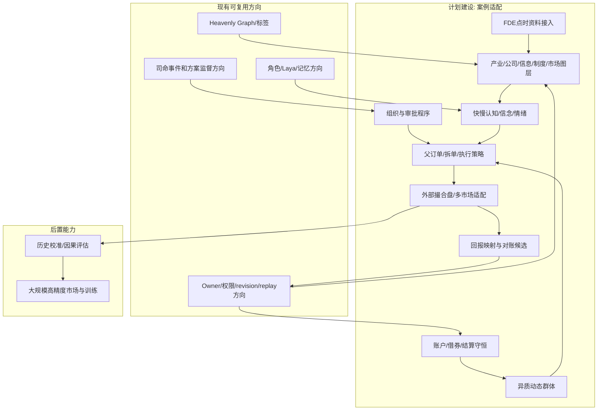
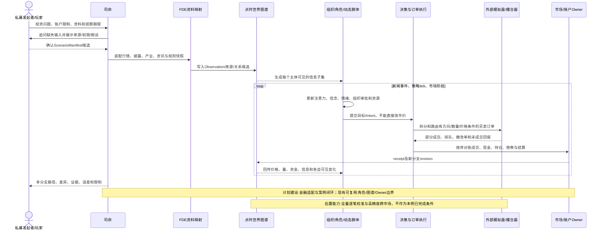
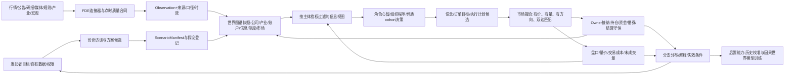

# 20 光模块产业链与二级市场多参与者贯通案例

修订日期：2026-10-16｜合同版本：未发布草案｜建设状态：计划建设 / non-authorizing｜验证证据：专用静态校验入口见[README](README.md#文档状态与静态校验wog-r10)；本轮运行、适配、性能及预测未验证。

日期：2026-10-15｜状态：design-draft / synthetic scenario。案例是检验底座能否贯通输入、图谱、参与者、信息、执行、市场、回放和解释的方案，不是对中际旭创真实持仓、机构策略或未来价格的陈述。

## 1. 决策问题与范围

**模拟发起者**：有授权账户和自有风险限制的私募基金；玩家可以是投研负责人，也可在获准范围切换到基金经理、量化执行、普通投资者、媒体编辑或监管观察面。**问题**：在光模块产业利好已被广泛传播、资金拥挤且产业/政策/海外需求出现变化时，组合在五个交易日内可能经历哪些下跌、反弹中继和流动性分支？不同信息到达、参与者结构、融资约束和订单执行如何改变量价路径与回撤？

案例多标的覆盖中际旭创、光模块/光器件同业、上游关键器件、下游云服务/数据中心资本开支代理、相关ETF/指数、股指或行业衍生品（若适配器支持）、汇率和海外同业映射。标的映射是待校验的关系，不把“同概念”当成等比例价格联动。正式运行须选定市场、证券代码、交易日、复权和交易规则版本，并由数据源核验。这里不给出未经来源核验的股本、流通股、股东人数或实际机构持仓。

**合成约束**：五个交易日的期末价格相对起点下跌 18%，路径包含至少一次下跌中继和一次由订单流形成、但未保证持续的反弹尝试。-18% 是案例情景条件，不是预测。若设置 10 个重要机构、200 个次要机构、29,124 户股东或平均持股约 5,000 股，它们是待公开资料交叉核验的建模输入，未核验前只可作为合成/待核参数；应校验户均、股数、可流通股及账户口径是否相容。

## 2. 从人提供的信息到可运行方案

司命先对发起者进行结构化访谈：投资决策是什么、期限/基准/止损或回撤限制、资金和当前持仓、可交易品种、是否允许杠杆/融券、需要哪些市场、数据与文件的使用权、已知观点、观察和停止条件、需要比较的分支。对“不知道”的输入记为缺口，不由司命伪造。

随后司命以有授权的公开资料和发起者材料建立来源档案：公司财报与公告、产业链客户/供应商披露、交易所行情/规则、指数与ETF文件、融资融券公开统计、机构披露、宏观/汇率/海外市场、新闻/研报/股吧/雪球/微博/抖音/公众号等公开内容。每条内容保留发布、可获得、摄取和修订时间，版权/访问范围，作者/账号可信度是估计还是事实，原文与摘要关系。经纪商App、财联社等资讯产品的内容须从获准接口或发起者提交资料接入；不能假设平台全量数据可得。

FDE把多源字段映射到通用记录及金融专业合同，列出冲突、覆盖率、实体链接置信度、数据延迟和不可见字段。司命提交待确认的 `ScenarioManifest`：目标、市场/标的、时间窗、空间与法域、输入快照、角色/组织/群体、机制版本、tick、资金规模范围、约束、随机种子策略、分支和输出指标。发起者确认后，先用小规模试跑验证权限、顺序、量价与账本守恒，再扩展到全体主体。

## 3. 参与者清单与关系层

### 3.1 参与者类型

| 类别 | 进入模型的对象 | 心智/机制及信息差异 |
|---|---|---|
| 发起私募 | 基金、产品、投委会、经理、研究员、风控、交易员、托管/经纪关系 | 研究判断与组合约束；组织内部有汇报、批准、否决、额度和延迟；自有资金与客户赎回约束分账 |
| 重要机构（案例拟 10 家） | 可公开识别并证据支持的公募/ETF、保险/资管、私募、券商自营、量化机构等 | 每家独立资金区间、风格、期限、风险限额、持仓证据等级、信息渠道、下单能力；未知画像用类型分布而非虚构实名策略 |
| 次要机构（案例拟 200 家） | 同类机构的异质群体，按风格、规模、持有期、渠道、杠杆、约束分层 | 不做绝对一体化；小群体保留分布和噪声，大群体按状态聚合；跨阈值关键成员升级为角色并守恒拆分资金与人数 |
| 长期股东与持股平台 | 控股股东/实控人、董监高、战略持有人、员工/产业持股平台等，仅按披露识别 | 可用减持窗口、锁定/承诺和治理权限影响可售供给；披露持仓不等于每天实际意图 |
| 普通账户 | 普通现金账户、融资账户等统计群体 | 通过券商软件、新闻、自媒体和熟人传播获信息；资金、持有成本、注意力、经验、融资余额分布不同；不推断具体自然人 |
| 量化机构 | 量化组织及策略子账户，不是一个“高频人” | 策略读取特征有不同延迟/频率；容量、订单率、撤改单、库存、借券和风控分开；机构内部共享和隔离由组织程序决定 |
| 卖方/券商 | 研究所、分析师、销售、经纪、两融、做市/自营（仅在具备资格时） | 研究观点发布和分发、客户触达、融资/借券供给与风险限制是不同关系；观点不自动等于交易 |
| 产业实体 | 上游芯片/激光器件/光纤、模块厂商、设备与封测、云厂商/数据中心、运营商 | 订单、产能、交付、库存、成本、资本开支、技术迭代及合同关系按披露/代理数据建模 |
| 信息平台 | 交易软件、财经新闻/资讯、股吧、雪球、微博、抖音、微信公众号、私域群 | 平台推荐/关注/转发、时延、审核和曝光机制；作者、帖子、观点、受众、算法分发分别建模 |
| 制度与外部环境 | 交易所、监管、指数公司、基金规则、宏观/利率/汇率、国际贸易与地缘事件 | 权限、规则、公告和生效时间；国际局势通过可追踪传导链进入预期、订单、成本或风险溢价，不作为万能冲击按钮 |

### 3.2 每个参与者必须有的运行画像

```yaml
ParticipantProfile:
  identity: {entity_ref, actor_or_cohort, org_ref?, account_refs[]}
  role_scope: [{role, jurisdiction, valid_time, authority_ref}]
  resource_bands: {cash, equity, borrowing, short_locate, risk_budget, confidence}
  portfolio_state_ref: point_in_time_snapshot
  objectives: [{target, horizon, priority, evidence_status}]
  constraints: [market_access, mandate, redemption, leverage, borrow, compliance]
  information_access: [{source, channel, latency_distribution, access_policy}]
  cognition: {beliefs, memory_ref, experience, attention, emotion_state, fast_slow_policy}
  decision_model: {model_ref, version, trigger, reconsideration_cost, uncertainty}
  execution_capability: {venues, order_types, rate_limits, latency, max_participation}
  organization_process_ref?: approval_and_delegation
  privacy_scope: access_policy_ref
  calibration_status: observed|estimated|synthetic|unknown
```

资金、持仓、交易能力和身份必须带来源与时点。披露数据只能支撑披露精度；日频公开数据不允许推演出精确机构逐笔行为。资金体量至少给 P10/P50/P90 或区间、币种、可用比例、风险预算与估计置信度；不能只放一个看似精确的数字。

### 3.3 图谱关系不是单一“持有/影响”边

实体图分层但可跨层连接：产业供应/客户合同；公司治理/股权/任职；市场账户/委托/成交/借券；信息发布/引用/转载/曝光/消费；投资/融资/托管/申赎；制度适用/许可/限制；地理/法域/交易日历；宏观状态/事件影响。每条边可有有效时间、观测时间、来源、权限、方向、强度/容量、延迟、置信度、状态和适用域；边权变化由事件或模型提案更新并经 owner 接纳。

“A 发出帖子”“平台把帖推荐给 B”“B 实际看到”“B 相信内容”“B 因此下单”是五个不同事实/假设。参与者对别人“知道/希望/相信/以为别人知道”的嵌套认知仅在明确的有限阶模型、主体可见范围和成本约束下使用；不能把高阶认知字段当作全知视角。

### 3.4 可验算的合成基线与10个重要机构

本节是独立的合成测试夹具：沿用光模块场景，但将核心证券记为`OPT-A`，价格起点100元。以下股本、机构代号和规模不映射中际旭创或任何真实机构，不能混入现实证据档案。其他证券使用独立账本；本表仅列OPT-A敞口，AUM包含其他资产，不能当成该证券的买盘预算。

设总股本10亿股，其中限售2亿股、法定流通8亿股。流通部分采用互斥资源分区：长期低换手持有人3亿股、10个重要机构合计1.6亿股、200个次要机构合计1.4亿股、普通账户合计2亿股。长期不是新的法律限售状态；质押、借出或冻结是这些份额的属性，不能再从总量重复扣除。

| 代号与组织 | AUM／可用现金（亿元） | OPT-A持仓（万股） | 主要目标与约束 | 信息、决策及执行差异（合成） |
|---|---|---|---|---|
| I01 发起私募 | 20／3 | 600 | 组合回撤与赎回预算；计划分阶段减仓 | 财经终端与卖方研究；研究—经理—风控—交易，分钟级审批，秒级拆单 |
| I02 主动公募 | 150／10 | 2,200 | 基准偏离、行业上限与流动性 | 公司公告、研究与持有人流程；小时级复核，VWAP／POV执行 |
| I03 保险配置产品 | 800／50 | 3,500 | 长期限估值、授权仓位与偿付约束 | 财报、产业研究；日级评估，被动限价分批承接 |
| I04 指数ETF产品 | 120／2 | 2,800 | 跟踪与申赎；经理不自由追涨杀跌 | PCF、指数、净值与申赎事件；按篮子流程形成交易 |
| I05 趋势量化产品 | 200／8 | 1,800 | 趋势、波动目标与容量 | 行情特征到达20–100毫秒，策略100毫秒–1秒；预授权内自动执行 |
| I06 统计套利产品 | 80／5 | 1,400 | 同业价差、库存、费用与借券权限 | 多标的行情，策略0.5–5秒；被动挂单与多腿对冲 |
| I07 多资产私募 | 100／6 | 1,000 | 跨资产风险预算和保证金 | 新闻、利率、汇率与衍生品；分钟级再平衡，按实际成交留残余敞口 |
| I08 境外配置产品 | 300／12 | 1,200 | 通道、币种、时区和本地可卖量 | 海外终端与本地代理；小时级研究，受交易日历及资金过程约束 |
| I09 券商自营产品 | 60／4 | 900 | 库存与敞口限额；不默认有做市资格 | 自有研究和获权行情；预授权执行，限制订单率和参与率 |
| I10 事件驱动私募 | 30／2 | 600 | 公告可信度、止损与资金集中度 | 快讯、公告、公开社媒；先核来源，秒至分钟级调整父目标 |

以上时间是场景假设，必须拆到获取、消费、计算、审批、路由和回报端口，不是宣称现实机构性能。每家管理人、产品、策略和执行账户分别编号。I04相关AP、其他产品和岗位不重复占有这2,800万股。所有初始持仓还须逐户生成`settled/sellable/locked`明细；信息渠道、情绪参数、记忆和风险限制由角色模板补齐。

200个次要机构先按互斥产品身份分为：50个主动配置产品持4,000万股，40个趋势产品持2,500万股，40个价值产品持3,000万股，30个套利产品持2,000万股，20个事件产品持1,500万股，20个被动产品持1,000万股。机构总数200、合计1.4亿股；每类内部再约束抽样规模、成本、杠杆、渠道和阈值，不能平均分成相同机构。跨类的信息、情绪和风格群仅作重叠观察投影。

普通账户2亿股可以在现金交易、融资能力、持有成本与渠道维度交叉分层。未生成和核验账户数前，不强制套入29,124户或户均5,000股。运行夹具需输出独立账户数、登记户口径、代表权重和股数之间的校验表。

### 3.5 六层关系怎样影响一次行动

对I01固定以下可回放路径：下游资本开支观测经产业模型影响OPT-A及同业收入估计；发行人治理与披露关系决定谁能发布正式公告；经理通过产品授权控制本产品账户；研究员经获权终端先读快讯，交易员只接收已批准父目标；交易制度限制可卖量与回转，机构内规限制参与率；汇率、海外市场时区和贸易条件影响估值及对冲。六层每次转换都有来源或合成假设、发生及可得时间、机制版本和不确定性。

I05可比I01更早消费结构化行情，也可能因未订阅某研报而更晚理解基本面。I03资金更大却可能只在估值阈值满足后承接。I04因赎回卖出与I05因共同价格信号卖出可能同步，但不因此建立合作边。若研究显式协作，必须另建通信／协议过程、授权和局部信息，不能后台让两家天然共享心智。

## 4. 输入、转换、输出合同

| 阶段 | 输入 | 转换/owner | 输出 |
|---|---|---|---|
| 资料接入 | 发起者资料、公开公告/新闻、行情、规则、产业数据 | FDE 连接器、许可、点时映射、实体消歧、质量报告 | `Observation`、来源档案、缺口/冲突表 |
| 场景装配 | 目标、标的、期限、账户、参与者规模、假设、风险边界 | 司命生成方案候选，人确认；映射 owner 和机制 | 版本化 `ScenarioManifest` 与可运行计划 |
| 社会初始化 | 披露主体、统计群体、信息渠道、产业/组织图 | 社会初始化器与领域 owner | 角色、组织、群体、账户和关系快照 |
| 行为生成 | 点时可见信息、角色心智、目标/约束、市场状态 | Laya/规则/统计策略各自给行动提案；执行算法生成订单计划 | `Intent`、`ParentOrder`、`ExecutionPlan` |
| 市场处理 | 买卖订单、规则、费用、时钟 | 外部模拟盘或声明能力的撮合器 | 有价有量有买卖方向的成交/盘口事件、未成交量 |
| 状态更新 | 成交、新闻、公司/产业/制度事件 | 市场、账户、产业、传播各自 owner 接纳 | 新 branch revision、现金/持仓/借券/信念变化 |
| 输出解释 | 全量获准轨迹、多分支和误差 | 司命归因时区分事实/模型/假设，不代替因果识别 | 量价分布、资金流、回撤、订单执行、传播链和失效条件 |

现实观测、假设、估计、候选、模拟事实和预测结果遵守[03](03-类型化数据与统一记录合同.md)；量价与委托合同遵守[14](14-金融数据专业包与数据分类.md)、[16](16-金融订单行为量化执行与市场机制.md)；跨市场规则遵守[17](17-外部模拟盘与跨市场数据对齐.md)。

## 5. 行为与信息如何耦合

1. **获取**：主体按渠道权限、订阅、推荐、终端、研报关系和延迟采样消息；并非每人都看到同一条新闻。
2. **理解**：角色依据知识、经验、记忆、信任、注意力和系统1/系统2使用策略形成信念；快系统可被情绪/显著性/近期经验推动，是否启动慢思考由时间、成本、组织流程和风险阈值影响。
3. **扩散**：转载、推荐、评论、群聊和券商分发形成带时间的路径；观点情绪有类型与强度，贪婪/恐惧是连续核心轴，其他情绪/行为倾向按[13](13-信息传播情绪与认知机制.md)定义。
4. **决策**：研究判断转为组合目标，经过组织审批与风控，再形成父订单；同一信号可导致不同机构买入、卖出、等待或对冲。
5. **执行**：算法将父目标拆为子单；主动/被动、限价/市价、时间节奏、参与率、路由、排队、改单/撤单和剩余量均记录。量化的低延迟与高频率用获取/计算/决策/路由延迟分布和订单率体现，不通过给机构直接改价格来表现。
6. **撮合反馈**：买卖订单按 venue 规则匹配生成成交价、成交量、金额、主动方和双边账户变化；盘口和 OFI 随订单到达/撤回/成交变化。成交改变盈亏、保证金、情绪、风险预算和下一轮决策。
7. **参与者博弈**：合作仅来自可建模的组织/协议/共同约束/跟随关系或证据支持的沟通；趋同策略可能独立发生。对抗压力分支可抽象测试流动性撤退、追单、拥挤、诱导性信号影响、异常撤单等风险，不提供真实市场操纵的下单脚本，也不以统计共振认定违法合作。

## 6. 交易策略与执行行为族，以及“下跌中继”产生方式

依[16](16-金融订单行为量化执行与市场机制.md)按正交维度组合执行，而非预置涨跌动作。OMS管理父目标，EMS把它转成订单流；交易场所仿真器的撮合引擎与订单簿处理命令，输出私有执行回报和公开行情，账户侧再接纳交易后义务。“行为族”是策略与执行模型分类，不把撮合基础设施混入参与者行为。案例测试矩阵至少覆盖：基准执行（TWAP/VWAP/POV）、限价被动承接/主动扫单、拆单与动态参与率、做市库存倾斜、动量跟随、均值回复、事件驱动、ETF/指数被动流、融资约束和赎回流、融券可用性与回补、跨标的/衍生品对冲、跨市场延迟套利、停牌/涨跌幅/交易时段限制、订单簿深度突然下降、撤改单竞态、拥挤策略同时降风险。

对照组分别改变：订单到达速率、每单大小分布、撤改概率、主动方向、限价距离、时段参与率、信息延迟、策略同步程度、现金/持仓/借券余量、市场弹性、买方补单率和背景成交量。所有参数均有现实来源或标为合成。行情先上涨再出现下跌中继，必须由供需与成交形成：卖方主动订单消耗买档、买盘回补变慢或撤退、反弹阶段短时买入流恢复但后续供给再压过承接；各阶段都有真实事件序列，禁止设置 `price -= 18%` 的直接控制器。

五日只是交易日容器。每个交易日内部按市场阶段 tick（集合竞价、连续竞价、收盘/结算），事件驱动触发新闻传播、策略信号和市场开关；不同参与者有各自感知/决策/下单频率。较粗 tick 的群体流可被盘口状态事件唤醒，关键账户升级精度时保留人数、资金、持仓、信念分布的守恒拆分。

## 7. 合成五日推演样例

下面说明“如何生成并观察路径”，不是声称真实参与者会按此操作。所有金额、账户、反应率、新闻内容和成交数均需明确标成合成，最终 18% 为条件目标。若底层机制不能在守恒条件下生成该结果，该批样本应记为未命中，不能强行修价格。

| 交易日 | 信息/产业状态变化 | 参与者决策差异 | 订单与市场应观察的结果 |
|---|---|---|---|
| D1 | 大涨后的拥挤尚存，资本开支信息被部分渠道先解读为低于预期 | I01启动减仓审批；I03等待估值；I05先降风险；晚到散户仍讨论旧利好 | 卖方主动流增加并消耗买档；I06等承接使下跌不是无买方的“资金消失” |
| D2 | 财经快讯、券商解读与社媒转发扩大覆盖；估值与赎回讨论升温 | I02复核后分批卖；I05及次要趋势产品因共同信号减仓；部分融资账户触阈值 | 卖出更急、承接更慢，价差和冲击上升；每笔卖出均有匹配买单，不能由成交猜出真实机构身份 |
| D3 | 澄清和超跌观点传播，负面产业假设尚未解除 | I06均值回复、获权空头回补、部分散户追反弹；I01继续较被动减仓；I03试探承接 | 短时买方主动流恢复并形成反弹，量可低于D2；记为反弹／中继候选，尚不能提前知道次日失败 |
| D4 | 反弹未带来新增基本面支持，新信息与风险预算再次收紧 | I01/I02剩余父单变得更紧迫；趋势产品再降风险，追反弹账户止损；I04仅按实际申赎触发交易 | 卖盘供给再超过承接、深度恢复不足，反弹失败后续跌；此时才能回顾识别D3为下跌中继，不凭形态断言有意诱导 |
| D5 | 新闻消化、产业预期/宏观环境和资金约束继续更新 | 部分策略降频，部分被动调仓按规则完成，基金重新评估风险 | 若条件分支命中，收盘相对起点 -18%；同时展示未命中分支。量、价、主动方向、深度、撤改、成交额、融资/借券和账户损益完整对账 |

每个分支输出各日开高低收、逐笔/订单簿覆盖级别、成交量/额、主动买卖量、价差/深度、OFI、父子订单完成率、撤改单、冲击成本、换手、融资/借券变化、产业/跨标的状态、渠道曝光和实际消费、信念/情绪转移、组织决策时延、回撤及不确定区间。未接入逐笔数据的模拟盘必须明确降为 bar-level，不能展示伪造盘口细节。

### 7.1 量价验算用的目标轨迹

以下为人工编制的输出格式与算术夹具，不是已运行生成的数据。正式运行要由成交事件聚合生成；按期末跌幅筛选样本时须同时保留未命中样本，不能把筛选命中率当成事前预测概率。

| 日 | 收盘价（元） | 当日收益 | 单边成交量（万股） | 成交均价（元） | 成交额（亿元） | 已知主动买／卖成交量占比 |
|---|---|---|---|---|---|---|
| D0 | 100 | 基点 | — | — | — | — |
| D1 | 96 | -4% | 4,000 | 98 | 39.2 | 42%／58% |
| D2 | 91.2 | -5% | 6,500 | 93.5 | 60.775 | 33%／67% |
| D3 | 93.02 | 约+2% | 4,500 | 92.5 | 41.625 | 57%／43% |
| D4 | 86.51 | 约-7% | 9,000 | 88 | 79.2 | 28%／72% |
| D5 | 82 | 约-5.21% | 7,500 | 83.5 | 62.625 | 38%／62% |

期末`82/100-1=-18%`。夹具设最小价位0.01元，日收益按实际收盘价计算后显示近似值，不能把展示用百分比反算并提交不合法价位。D3缩量反弹、D4放量续跌只是这一夹具的形态，不能固化成通用规律。量是买卖匹配后的单边统计，主动买卖占比按取流动性方标记；不表示全市场买股数与卖股数不等。成交金额是累计交易额，不是净新增资金；价格变化导致的市值变化也不等于同额现金流出。

### 7.2 I01的一段父子订单账

取D1某个合成盘中窗口，I01获批卖60万股，初始持仓600万股、可用现金3亿元，持仓可卖与参与率均已检查：

1. 子单A尝试20万股，先成交10万股×97.80元、8万股×97.70元；撤单回报确认剩余2万股撤销。确认前仍有成交可能，窗口最终以场所回报为准。
2. 子单B尝试25万股并全部成交，均价97.60元。
3. 子单C尝试7万股并全部成交，均价97.50元；剩余10万股尚未分配，等待新的可见盘口与截止策略。

累计尝试52万股，其中成交50万、撤回2万；父目标仍为`60万=成交50万+活动保留0+尚未分配10万+放弃0`，不能将撤回量算成已完成。对手盘为多个获权账户的被动买单，须逐笔保存实际匹配，不能假定都由某一家“接盘”。

成交款合计4,882.1万元，I01持仓降到550万股；不计其他事件时，可用现金最终为`3亿元+4,882.1万元-费用`，但应按结算合同分别记录已成交应收款、可用和可提余额，不能一概立即可提。相应买方账户减少同额成交款并取得共50万股；费用流向费用账户，未结算义务单列。若重复收到子单B回报，幂等键阻止再记25万股。后续反弹只可能改变尚未完成的10万股计划，不会抹去已成交50万股。

## 8. 群体规模、股东与资金校验

公开股东户数只表示某一披露时点与口径的登记统计；平均持股需明确是总股本/总户数还是流通股/持有人数。将股东户数映射为现金账户、融资账户或活跃交易者都需要另外证据，不能由总户数推出。长期股东按披露股东名册、定期报告、锁定与减持公告交叉验证；“普通股民”和“融资账户”只能用合法公开的统计分布或合成账户群体估计。

`10+200+散户群体`是模拟复杂度配置，不是市场参与者总量的事实：10个重要机构可逐一设立代表角色；200个次要机构可先按策略/规模/渠道形成数十个动态 cohort，再按关键事件细分，运行中按活动度合并/拆分；大规模散户以多个异质 cohort 表示；公开可识别主体只有具备来源证据时才使用实名实体。机构、产品、账户、策略、基金持仓必须明确映射关系，防止同一资金在组织/策略/账户/群体重复计入。

每次聚合/拆分遵守守恒：在互斥执行分区中，`独立unit数 = Σ分区unit数`，`现金/证券/借券 = Σ唯一子账户资源`。渠道群、情绪群等重叠观察投影按身份并集去重，不能直接相加人数或资金；匿名加权单元还须保存代表户数和权重。群体信念/持有成本等保存分布或充分统计，不可把均值角色当作所有人的真实一致行动。长期被动持有人和可交易流通账户分开；限售/质押/借出证券不重复算作自由流通供给。

## 9. 输出和解释

结果分三栏：**观测/披露事实**（带来源和时点）；**机制推演**（成交、持仓、现金、传播、制度事件）；**假设与反事实**（参数、关系、隐含参与者意图）。司命逐个回答“谁在何时能看到什么、基于什么信念/约束、通过哪个组织流程形成什么父订单、如何拆单、在何种盘口状态下成交、成交如何改变资金/价格/后续信念”。无法观测或区分的部分明确列为竞争性解释。

对“为何跌 18%”不只输出一条故事线：按多分支比较消息到达延迟、卖出压力、买方流动性、杠杆/赎回、拥挤、跨标的对冲和制度限制的敏感性；报告条件贡献范围和不可识别性。若多个机制组合产生同样量价路径，说明等价解释，不能选一个叙事包装成确定因果。

## 10. 架构图



## 11. 主交互时序图



## 12. 数据流图



## 13. 状态、验收与交付顺序

- **现有可复用**：图谱、标签、角色、司命、owner/revision/replay 的设施方向；须先完成接口盘点和权限回归。
- **计划建设**：金融记录合同、跨源 point-in-time 对齐、参与者画像、动态群体、量价机制、订单状态机、工作台多视角和外部市场适配。
- **后置能力**：全量逐笔校准、特定市场高保真、实时因果同化和因果世界模型训练。

最低验收：源可追溯且授权有效；视角无信息越权；组织决策能回放；群体拆合守恒；同一市场参与者资金不重复；每笔成交买卖数量相等且有价格、方向、时序；父订单目标守恒；部分成交/撤单竞态可重放；现金/持仓/借券/费用/结算对账；多市场日历和币种不混淆；新观测不篡改过去分支；-18% 只作为条件分支目标并同时报告命中率和失败路径。

建议交付顺序：先单市场、少量合成主体和公开历史数据验证输入→信息→角色→父子订单→成交→账本；再引入组织/媒体传播和群体；再加多标的与市场；最后接实时数据并做新快照分支。每一步先清楚记录能力级别，缺少盘口或身份数据时就降低仿真精度，不以画面丰富度冒充证据质量。
