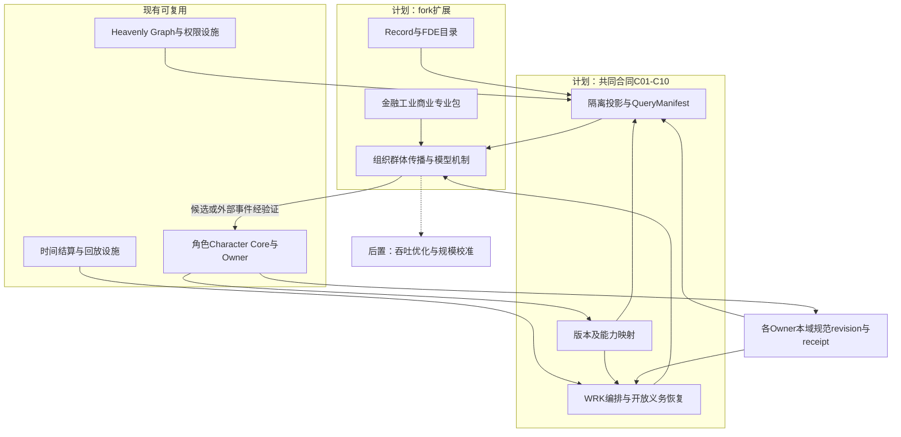
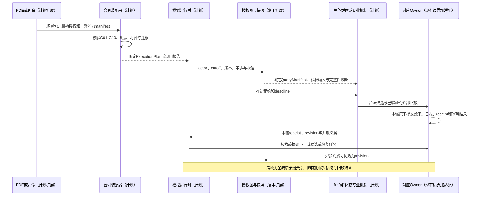
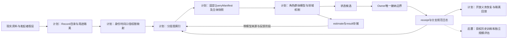

# 21 模拟fork通用图谱与主项目合同对齐附加设计修正

修订日期：2026-10-16｜合同版本：未发布草案｜建设状态：计划建设｜验证证据：专用静态校验入口见[README](README.md#文档状态与静态校验wog-r10)；本轮运行、适配、性能及预测未验证。

日期：2026-10-16。状态：`design-draft / non-authorizing`。

本文是完整版00–26的共同合同映射与附加修正。主项目配对文档为[13-主项目通用图谱与模拟合同附加设计修正规格（规格06附加）](../../../10月中旬分析/群体模拟升级/规格/13-主项目通用图谱与模拟合同附加设计修正规格.md)，运行消费者为[规格14-世界运行图谱与群体模拟协同规格](../../../10月中旬分析/群体模拟升级/规格/14-世界运行图谱与群体模拟协同规格.md)。规格13负责C01–C10通用语义，本文负责fork映射与兼容验收，规格14负责主项目WOG/WRK消费者；三者同步吸收[26 §14](26-世界运行图谱与统一运行合同.md#14-设计成熟度评估记录2026-10-16)中已确认的R01–R10通用边界。

## 1. 目标与合同优先级

模拟fork与主项目共同维护通用底座合同。fork可注册行业、机构和场景扩展，继续接收主项目图谱、角色、司命、时间、领域Owner和连续性设施更新。本次设计不导入金融专业规则到游戏主项目。

后续读取先检查根架构硬边界，再按[README职责表](README.md#来源映射与合同优先级)定位主合同，并查本文及配对文档的共同合同映射。03负责记录字段，04负责关系载荷，06负责时空，05/09负责接纳与权限，11负责组织群体，12负责运行，16/17负责订单场所，26负责组合与查询。本文不重定义各域schema，也不能覆盖已确认的R01–R10边界；实际差异须双方显式登记受影响版本、消费者与迁移，不凭时间较新或名称相同自动覆盖。主项目保留现有值对象与wire，通过显式适配表达相同语义，不要求原地采用fork字段名。

本文件不改变现有运行和历史记录，也不证明共同底座已经实现。接口、类型、枚举和伪代码均为设计示意。

## 2. fork设计修正登记

| 编号 | 原位置 | 后续设计采用的修正 | 不兼容处理 |
|---|---|---|---|
| F01 | [02](02-底座分层与模块责任.md) §1、§4：模块与上游同步 | SimulationRuntime承担WRK合同的模拟场景实现；共享推进、接纳、回放语义 | 不复制第二clock/scheduler或万能Owner |
| F02 | [04](04-实体关系图谱与动态边.md) §1–4：统一图层、动态边与超边 | 跨图身份可解析，私有图边界独立；多方安排保留角色与整体修订 | 多层显示不授权合库或越权遍历 |
| F03 | [03](03-类型化数据与统一记录合同.md) §2、[04](04-实体关系图谱与动态边.md) §2、[05](05-世界真相证据模型与修订回放.md) §1：epistemic_status | 保留R01六值；C03用途与认识态度/生成/生命周期的兼容映射须另行版本化；接纳仅由OwnerReceipt证明 | 不新增Record.admission，不自动改名record_kind；迁移发布前不得转换旧wire |
| F04 | [03](03-类型化数据与统一记录合同.md) §2、[06](06-时间空间口径与适用域.md) §1–3：PointInTime与ClockPolicy | 继承主项目六时间对象；UTC源时间和虚拟SimulationTime分别表达 | ClockPolicy作为profile/adapter配置投影，不能独立推进世界 |
| F05 | [09](09-权限关系与运行时接纳.md)：PermissionEvaluator | 主项目权限/准入设施加机构与数据授权适配，保留独立知情链 | 不创建与上游并行的权限事实库 |
| F06 | [11](11-组织与动态群体一等结构.md) §5：B0–B3 | 统一为连续性、轻量模块、局部事件角色、完整角色harness四层 | 旧B2不能自动当新B2；旧B3组织须展开并按成员能力映射 |
| F07 | [10](10-角色智能体心智与Laya接口.md)、[13](13-信息传播情绪与认知机制.md)：认知与传播 | 复用L1和Character Core边界，增加受限命题AST和真实/合成消费证据 | 自然语言、路径可达和情绪均不自动生成知识事实 |
| F08 | [04](04-实体关系图谱与动态边.md) §5、[08](08-模型机制与可插拔演化.md)：模型反馈 | 模型输出保留estimate/result；修改规范状态必须绑定相应Owner | 模型回写图投影不意味着接受其描述的现实命题 |

本文为F01–F08的附加修正登记；其与R01–R10的同步关系见§11.1。各领域设计已按确认结果增量修订，历史初稿与旧枚举不因此成为另一套有效合同；消费者按职责表和受支持版本映射。

## 3. C01–C10在fork中的映射

| 共同合同 | fork字段/模块 | 必须补足或保留 |
|---|---|---|
| C01 IdentityAndType | EntityRef、TypeRef、角色/组织/市场实体、FDE身份映射 | 类型注册及版本、来源别名、匹配证据/置信和可撤回映射；不同主体种类独立编号，不凭名称合并或猜匿名身份 |
| C02 RelationAndArrangement | Record承载RelationInstance、Arrangement及其投影 | 规范通用字段归Record，关系角色/安排归载荷；来源向量、投影版本/游标归读模型 |
| C03 EvidenceAndAssertion | Record、Statement、ClaimPayload（ClaimRecord载荷）、OwnerReceipt | 保留六值用途与其他语义轴；Proposal/回执是流程对象，不以采集成功证明命题为真 |
| C04 TemporalAndAvailability | PointInTime、AvailabilityRef、ClockPolicy、Calendar | 映射到TemporalProfile/Timeline/Time/ClockMapping/Work/Window，保留不同延迟与序号 |
| C05 ScopeAndPermission | AccessScope、PermissionRequest/Decision、acting_as、来源及用途治理 | 观察/代行和训练/分享/导出/跨境分别许可；派生限制继承，撤权与删除传播分别执行 |
| C06 StructureAndProgression | OrganizationStructure、PopulationUnit、CohortProjection/Episode、PrecisionHandoff | 统一B层语义；保留异质性、资源归属、误差和唯一推进锁 |
| C07 MechanismAndPorts | ModelSpec、MechanismSpec、StageBinding、外部适配器 | 输入输出、时间依赖、read/write set、本域原子提交及跨Owner预留/确认/释放/补偿/对账 |
| C08 ProjectionAndQuery | WorldRecordView、RelationProjection、SnapshotService、QueryManifest | 分层存储、固定RecordRef/载荷切片/版本和授权；dependency_complete与available_with_gaps读取分开 |
| C09 BranchAndReplay | RunManifest、OwnerReceipt、ReplayCheckpoint | 图分支/模拟分支/现实档案隔离；冻结输入、检查点/日志/开放义务，审计与隔离执行回放分开 |
| C10 ContractCompatibility | upstream_commit、包pins、迁移和扩展清单 | 双方能力manifest、逐消费者兼容、旧轨迹/权限回归与纵切证据；设计/实现/运行状态分开 |

这些是语义映射，不能只按字段名复制结构。fork的OwnerReceipt状态与主项目OwnerCommitReceipt状态仍按操作合同适配；例如pending、deferred、partial不是任意可互换的成功枚举。

## 4. 数据、认识状态与图谱边界

### 4.1 Record是信封，RelationInstance是载荷

关系载荷继续引用[03](03-类型化数据与统一记录合同.md)统一记录，不能另建缺少world/branch、记录时间、权限、来源和口径的边数据真值。source_refs在接入层解析为固定来源revision和血缘，不能只保存会随head变化的裸ID。

```text
关系规范记录: Record(payload = RelationInstance)
关系读取投影: WorldRecordView / RelationProjection
投影元数据: source_revision_vector, projection_version, projection_cursor
```

以上只描述组合关系，正式schema不重复已有信封字段。源业务revision、图投影revision和投影消费cursor分开，避免图索引更新被误认为账户、组织或私有记忆已提交。

### 4.2 六种用途的兼容解释

当前`Record.epistemic_status`保留R01确认的六值；将其映射为C03用途轴或将来命名为`record_kind`只是兼容迁移提案，未获发布前不改字段。observed、believed、suspected等态度由业务语义表达；projection、inference、correction是生成语义；revoked、expired、superseded是生命周期。Owner是否接纳及接纳何种操作仅由OwnerReceipt证明，不新增Record或WorldRecordView的admission轴。信封中不保存投影版本、来源向量或消费游标。

| 记录例子 | 可被接纳的内容 | 不推出 |
|---|---|---|
| 采集到一篇“工厂停产”的报道 | 系统在某时收到该载体 | 工厂一定停产 |
| 发起者预设运输中断 | 某分支采用该假设为初始条件 | 现实运输已经中断 |
| 模型估计交期延长 | 模型、输入和结果被保存 | 供应方已正式修改合同 |
| 角色相信交期延长 | 私有信念按证据接纳 | 所有角色都知道，或该命题为真 |
| 模拟机制履约失败 | 模拟分支Owner按合同确认失败 | 现实合同违约 |

允许不同来源冲突并存。修订与撤销产生新记录并使相关依赖失效；历史RunManifest固定输入引用，不被新图head替换。引用不可变不代表内容永久可保留；删除、到期或撤权后按权限和留存合同限制回放，缺失输入须明示。

### 4.3 多图、动态边与多方结构

图层可同时展示产业、组织、认知、制度等结构，但公共投影、私有认知、能力图继续分区治理。跨图边、摘要、统计和模型特征均继承来源限制；一条公开边不能泄露它连接了某个隐藏账户或私有命题。

多方Arrangement可在现有图存储中以节点加角色边实现；不承诺已有原生超图引擎，也不以更换数据库为前提。关系属性随机制变化，经相应Owner接纳后更新事实投影；估计关系更新走分析结果合同，并保留其用途限制。

## 5. 时间与权限的具体修正

### 5.1 六对象对齐

| 主项目对象 | fork用途 |
|---|---|
| TemporalProfile | 场景推进、分辨率、确定性、结算与恢复政策；绑定日历和ClockPolicy配置 |
| SimulationTimeline | 某世界/分支的推进owner、确认边界和生命周期；市场子时钟不是第二世界推进器 |
| SimulationTime | 主体工作和事件在目标timeline中的逻辑时间 |
| ClockMapping | UTC/交易场所/资讯源/物理子步/模型事件序到目标时间的映射 |
| ScheduledWork | 已到期传播、角色唤醒、审批、履约、外部适配器推进工作 |
| SettlementWindow | 固定input cutoff、read-set、版本、迟到处理与确认边界 |

原PointInTime中的instant_utc适用于带现实日期的源记录；虚拟分支不能编造UTC以满足字段，后续schema应使用带clock/timeline标识的时间联合类型或映射引用。字段类型升级保留旧解码器和显式转换。

recorded_at是来源/规范系统记录时间，不自动等于observed_at或processed_at；available_at继续按主体/渠道解析。消费、决策、审批和路由延迟决定模拟行动最早到达时刻，真实模型API耗时属于operational成本，是否映射模拟延迟由profile声明。晚到结果不得倒填。

### 5.2 权限与知情分离

fork机构权限以适配合同接入主项目：主体与acting_as → 获准用途和字段 → 主体快照 → 候选 → 组织审批与资源检查 → Owner提交前复核 → receipt → 授权投影。

政府权力、组织任职和委托是被模拟的制度状态；系统授权是运行设施的准入决定；二者通过有证据的绑定连接。FDE只能配置已支持的映射，不能以新增关系或声明owner的方式获得任意读写权。

observe_as、act_as和research_view分开授权。即使研究视图能查看某分支的合成角色信念，也不能让其他角色自动读取。共享组织信息需实际发布/送达，不能合并岗位私有记忆。

### 5.3 来源用途、留存与删除

R07的fork主合同见[09](09-权限关系与运行时接纳.md)。来源权利、用途、训练/派生/分享/导出/跨境、地域、敏感级别、留存和删除分别登记；read不推出其他用途，未知授权阻断相应操作。派生物继承来源限制，聚合或匿名化不自动公开。身份匹配保留证据、置信与可撤回关系。

撤权、到期、删除与依法保留分开处理。各Owner执行本域删除，协调器只追踪传播至载荷、索引、缓存和派生物的结果；最小审计记录也须受控。恢复备份先重施限制，回放报告缺失，不以不可变引用承诺永久内容。删除训练源不等于消除模型影响，模型撤回或重训另评。已成立的履约义务按既有系统权限继续处理，用户撤权不能使既成事实消失。

## 6. B层、群体化与组织展开修正

| B层 | 统一后含义 | 原fork表的迁移要求 |
|---|---|---|
| B0 | 已准入连续性状态低成本推进 | 总体统计/匿名粒子另列representation字段，不直接等同B0能力 |
| B1 | 注册轻量心智或行为模块 | 异质网络与批量计算可以保留，不能自动声明完整主观思考 |
| B2 | 有界局部事件级角色模拟 | 原“独立持续角色”检查其harness；完整L1–L4角色应映射到B3 |
| B3 | 完整角色智能体harness | 原“组织多角色程序”先拆岗位角色和流程；各角色分别指定B层 |

持续身份在各B层都保留，是否长期存在不能作为B2/B3分界。将下列轴分开保存：

```text
subject_kind: individual | organization | cohort
representation: identified_unit | anonymous_unit | particle_distribution
fidelity_level: B0 | B1 | B2 | B3
organization_expansion: external_port | process | positions
aggregation_policy_ref / error_budget
embodiment_profile_ref
model_route_capabilities
```

此为配置语义示意，合法组合由注册能力检查。B3要求完整角色harness；cohort本身不能仅因勾选B3就成为全知“群体人格”，需按机制展开对应角色。Laya/Slow/Deep路由也不由B层名称自动决定。

保留原动态群体目标：内部成员或粒子有差异，保留渠道、资源、成本、情绪、阈值等联合分布；只有时段内特定行为相近才聚合。不同分析群可重叠，行动分配必须互斥或以唯一unit令牌去重。聚合/拆分在权重、资产引用、未完成动作、记忆摘要和误差上守恒，不虚构真实身份。

交接沿用原actor/window锁，金融订单、工业在途任务等作为专业义务载荷传递。若未来增加行为维度子锁，须先完成写集冲突与交接合同，不能用细分维度重复提交动作。组织有内部多岗位不意味着资源复制；统一预算和规范资源仍由相应Owner核算。

## 7. 模型、图谱与运行闭环

图谱负责选择候选依赖和邻域，SnapshotService按主体、截止时间、权限和来源版本构造输入，机制计算候选，领域Owner接纳状态。结构化高阶命题仍属角色私有认知，关系引用只提供索引，不替代逐层证据验证。

### 7.1 本域原子与跨Owner协同

每种规范状态只绑定一个直接Owner。本域原子提交适用的Record revision、事件、资源预留、开放义务、OwnerReceipt和幂等结果；不能仅发成功回执而缺少相应效果。跨域以预留→确认/消耗→释放或追加补偿连接，各操作按自己的作用域去重；协调器不能替他域写资源，也不承诺全局同时完成。未知外部结果先查询/对账，失败保留既成事实与开放义务，恢复不重做已接纳效果。具体合同见[05](05-世界真相证据模型与修订回放.md)及[26 §14.6](26-世界运行图谱与统一运行合同.md#146-wog-r02-已确认决议)。

### 7.2 固定读集与分层存储

大型原文、数值序列、矩阵等通过03的PayloadRef及成员级元数据保存；稳定对象、关系、安排和必要摘要按版本化策略投影，不把所有原始内容逐项建图。Owner提交不等待投影，图谱缺失不能证明源事实不存在。

SnapshotService按主体、用途、世界/分支、cutoff、选择策略和预算固定输入；QueryManifest沿用[26 §6.5](26-世界运行图谱与统一运行合同.md#65-跨存储查询合同wog-r04)，不在本文复制schema。清单记录规范版本、事件游标、载荷切片、投影pins、转换/测量版本及权限依据，返回完整性、水位和缺口。dependency_complete缺必需依赖就不能返回完整快照；available_with_gaps须显式披露。二者都不承诺跨Owner全局原子快照。

### 7.3 认知、因果与潜变量

命题固定对象、时间、分支和版本；observes、believes、hopes、intends独立。knows须实际取得并理解、具有可追溯证据并通过注册版本证明规则；开放现实无法核实的内容保持信念或假设。支持/反对证据并存，争议或撤回由私有心智Owner追加revision；有界推理不默认自省或公共发布即共同知识。

因果区分记录依赖、机制假设、模型干预和现实识别，不构成置信度晋升链。因果声明保留干预/对照、结果窗、模型、混杂/识别假设、适用范围与不确定性。潜变量另记直接观测/代理/假设、覆盖/滞后/误差、先验与识别范围；保留竞争模型、区间或联合分布，以敏感性、消融和时间留出验收。个体证据不足退回群体或情景，不把最佳拟合当作真实动机。

### 7.4 反馈、恢复与回放

分析结果可以独立持久化；读取这些结果参与后续估计时，保留自产/外部来源、模型版本、训练cutoff和反馈滞后。状态估计如果参与规范状态更新，必须声明接纳合同。闭环零延迟依赖需要阶段划分、滞后或已准入联合求解，不能让图中估计不断自证。

开放现实同化、封闭反事实和混合模式继续区分。现实档案更新产生后继输入和预测；模拟分支已确认事件不被抹去。研究重算建立新run，精确审计使用已记录输出，外部引擎或LLM重新调用不保证逐位一致。

恢复使用checkpoint+log+open obligations，先限新任务/查询，再降展示及允许合并的派生计算，规范事实不得静默丢弃。封闭仿真可减速；实时滞后须标lag并阻断陈旧动作，必要时暂停。审计回放解释既有事实，执行回放在隔离存储按固定输入/规则重跑；不可回放能力、缺失载荷和非业务排除项均显式登记。金融/工业性能数值只归12的固定场景，不能直接当主项目性能承诺。

## 8. 架构图



## 9. 主交互时序图



## 10. 数据流图



## 11. 共同版本、上游同步与验收

C10的设计示意：

```text
CompatibilityManifest = {
  upstream_commit, contract_versions, consumer_versions,
  supported_type_and_event_refs, owner_descriptor_refs,
  projection_allowlist_digest, privacy_policy_revision,
  temporal_profile_and_mapping_refs, schema_migration_refs,
  local_extension_refs, replay_capabilities, missing_capabilities
}
```

双方尚未发布独立共享包；共同合同目录是设计目标。后续可先通过版本化接口与适配器复用，再根据依赖边界决定代码打包，不以大仓库重构作为当前角色主线前置。

每次升级执行：合同差异 → 逐消费者能力交集 → schema/权限/快照迁移演练 → 旧轨迹审计回放 → 新场景验证 → 明确激活边界。缺能力返回拒绝、缺口或预注册降级，不自动升级B层、不接纳新的Owner事件族、不静默替换历史pins。图谱分支admit只处理派生图生命周期；不会自动提交账户、资源、组织或现实状态。

### 11.1 R01–R10同步登记

| 已确认裁决 | 共同合同及消费者 | 同步边界与待验收内容 |
|---|---|---|
| R01 记录与投影 | C02/C03/C08；规格13 §4、规格14 §3 | Record唯一信封、RelationInstance载荷、投影派生、Proposal/Receipt流程；主项目wire须显式适配 |
| R02 Owner及跨域一致性 | C07/C09；WRK、领域Owner、私有心智Owner | 本域原子、跨域协调与作用域幂等；提交中断、未知结果及开放义务恢复待运行验证 |
| R03 最小纵切 | C09/C10；合同适配器和验收消费者 | TEST-X夹具留在26 §14.14；主项目采用本域场景另验通用不变量，不以fork通过代替主项目通过 |
| R04 存储与查询 | C08；投影、SnapshotService、L1、WRK | 分层载荷、固定清单、完整性模式、投影可重建；权限/缺口/版本测试待建设 |
| R05 认知与因果 | C03/C07；Character Core、传播及模型端口 | 注册知识规则、四种因果语义与有界推理；不将图路径当知识或因果 |
| R06 首个适配 | C07/C10；fork场所适配器 | Nasdaq子集与ABIDES候选留17；只共享能力/版本/证据登记方法，不要求游戏主项目接入 |
| R07 数据治理 | C01/C05/C09；接入、权限、存储、回放 | 来源权利、用途、身份匹配及删除传播；撤权/备份/派生泄漏等需独立证据 |
| R08 性能与恢复 | C07/C09/C10；运行编排及验收 | 共享背压、lag、恢复与固定基准方法；12的金融/工业指标不成为主项目SLO |
| R09 潜变量 | C03/C07；群体行为与分析模型 | 观测/代理/假设、竞争解释、识别范围及验证；不能据拟合声称真实个体画像 |
| R10 文档治理 | C10；三篇文档与索引消费者 | 职责主合同、版本/状态/证据分开；静态检查不提升运行成熟度 |

### 11.2 迁移与验收要求

每个迁移条目登记源/目标合同版本、旧字段/枚举、转换或拒绝条件、消费者pins、权限影响、回滚点与证据。`record_kind`不自动替换fork的`Record.epistemic_status`，`admission`不成为Record/WorldRecordView字段；OwnerReceipt与OwnerCommitReceipt按操作及接受效果引用映射，不能把pending、deferred、partial等同成功。旧语义不能映射时在适配诊断中报unknown，不向冻结六值枚举塞新值或伪造事实。

R03合成纵切的设计已确认，实现与运行验收待完成；本轮同步也只确认通用设计映射，不代表主项目消费者已实现兼容。执行回放须在固定确定性能力范围内比较业务结果；外部/LLM非确定性路径使用记录输出重放并明确限制。

| 验收项 | 必须结果 |
|---|---|
| 同一通用合同适配城镇生产与工业/商业场景 | 复用身份、关系、传播、时间与接纳合同，领域规则独立注册 |
| 原B2完整角色、原B3多岗位组织迁移 | B层按能力映射；岗位与组织展开独立；不丢历史身份与义务 |
| 现实报道、合成假设、模型结果并存 | record用途与私有信念分离；报告不自动成为事实 |
| 关系变更、撤权、来源修订与索引滞后 | 失效可诊断，查询有水位与缺口；旧run不改输入 |
| 重叠群体拆合与角色激活 | 无重复推进、无重复资源，统计贡献和在途动作有去向 |
| 源时间/虚拟时间/消费与模型耗时 | 映射、日历、序号和模拟延迟有依据；不倒填结果 |
| 模型输出回到图与后继模型 | 保留来源和滞后，不当独立新证据，不绕过Owner |
| 旧receipt/分支/检查点与新版本共存 | 旧轨迹可审计；能力不支持时明确不可重放，禁止模型补史 |
| 域内提交中断、跨域单侧失败与重复回报 | 无半套效果或重复资源变化；既成事实保留、开放义务恢复，协调器不越权 |
| 严格/有缺口查询、投影丢失与载荷缺失 | 固定清单及诊断正确；重建不改事实，输入缺失不冒充完整回放 |
| 在途撤权、删除传播及备份恢复 | 无越权读取或再次暴露；既存履约按系统权限处理，不抹去事实 |
| 知识争议、竞争动机与因果声明 | 规则/版本/支持反对证据可查；不可识别保留假设，不将模型输出自动接纳为知识 |

`[现有可复用]`仅表示主项目已有相关设施；本轮不作运行时重验。`[计划建设]`是本文件所有映射、迁移与新增消费者合同。`[后置能力]`为目标规模下的增量图计算、分布式存储和校准。禁止合并私有图权限、图谱直接写事实、任意配置获得Owner、以及把设计完整度等同预测有效性。

本轮交付只包含附加设计与入口链接；未实施schema迁移、运行时适配、金融撮合或其他领域机制。
