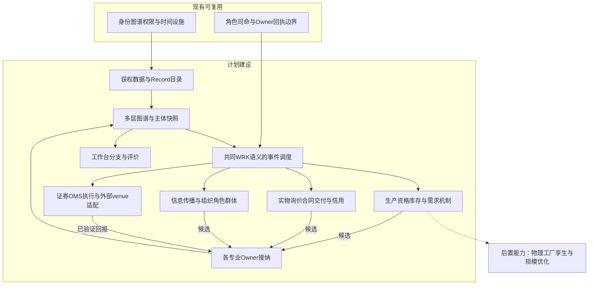
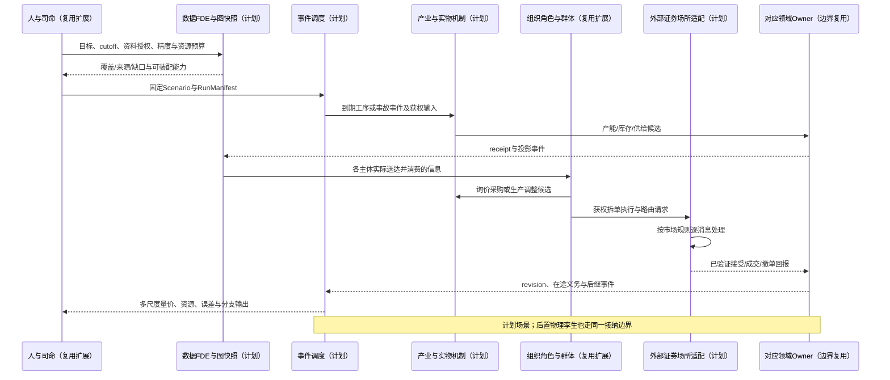
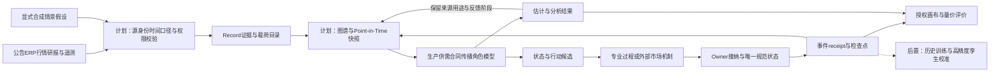

# 22 全球内存市场全面模拟与最细有效时间粒度方案

修订日期：2026-10-16｜合同版本：未发布草案｜建设状态：计划建设｜验证证据：专用静态校验入口见[README](README.md#文档状态与静态校验wog-r10)；本轮运行、适配、性能及预测未验证。

日期：2026-10-16。状态：`design-draft / non-authorizing`。所有结构、方程、粒度和规模均为待校准设计，不是已实现性能、实时市场判断或真实机构仓位。

## 1. 场景目标、默认解释与交付

目标是在同一模拟底座上联动推演内存产品、产业链、组织决策、信息传播、制度冲击和相关证券市场，研究缺货、补库存、扩产、技术迁移、需求反转与金融资金博弈的共同演化。

本方案把“内存”严格核心定义为DRAM，HBM属于DRAM产品分支；NAND/SSD作为必须联动的相邻存储市场单独建模。SRAM、嵌入式/新型存储、HDD和计算芯片按替代、互补与上游依赖接入，不将它们视为可自由互换的产能或商品。

“tick压到最低”按最细有效时间粒度设计，同时减少无事件计算。时间粒度、运行墙钟速度、数据时间精度和结果准确度分别验收。默认采用离散事件、多速率、局部加细，保留关键原始消息序列；不要求所有工厂、合同和角色每微秒更新。

默认模拟发起方沿用金融场景的私募研究团队，只作为可替换ScenarioSponsor；可换为原厂战略部、OEM采购部、渠道商、产业基金或研究机构。发起方身份决定其自有数据、可操作对象、观察权限和目标，不能获得全市场真实私仓或秘密合同。

交付物包括：产品/参与者/制度覆盖清单、源数据与缺口台账、图谱及专业合同、模块输入输出、机制和时钟装配、一次跨尺度事件推演、工作台视图与分阶段验收。本文只设计方案，不实施连接器、模型或市场引擎。

## 2. 继承底座与覆盖状态

依赖[03数据合同](03-类型化数据与统一记录合同.md)、[04图谱](04-实体关系图谱与动态边.md)、[06时空口径](06-时间空间口径与适用域.md)、[08机制](08-模型机制与可插拔演化.md)、[09权限](09-权限关系与运行时接纳.md)、[10角色](10-角色智能体心智与Laya接口.md)、[11组织群体](11-组织与动态群体一等结构.md)、[12司命](12-司命方案治理与全流程运行.md)、[16订单执行](16-金融订单行为量化执行与市场机制.md)、[17七市场适配](17-外部模拟盘与跨市场数据对齐.md)。冲突按[21附加修正](21-模拟fork通用图谱与主项目合同对齐附加设计修正.md)的C01–C10及B层语义解释。

| 状态 | 本方案中的含义 |
|---|---|
| 现有可复用 | 主项目身份、Heavenly Graph、角色/司命、权限、Owner与时间/回放设施；本轮不重验其运行状态 |
| 计划建设 | 本篇全部内存专业类型、数据映射、供需/合同机制、事件调度绑定与验证 |
| 后置能力 | 真实工厂物理孪生、设备/晶圆级多物理求解、超大规模联合校准和分布式优化 |

覆盖分为“可表示”“有数据约束”“有机制可执行”“已校准验证”四个独立状态。某类参与者出现在清单里，不代表它的真实参数已知或对应机制已完成。

## 3. 产品、用途、市场和空间覆盖

### 3.1 产品族矩阵

| 层 | 需区分的产品/对象 | 核心不可合并维度 |
|---|---|---|
| 通用DRAM | DDR4、DDR5及历史/后继代际配置 | 密度、速率、die修订、温度/质量等级、认证、封装 |
| 移动DRAM | LPDDR各代、移动/嵌入式组合封装 | 功耗、带宽、厚度、OEM认证与机型BOM |
| 图形DRAM | GDDR各代 | GPU板卡适配、速率/功耗、供应承诺 |
| HBM | 按代际、堆叠层数、单堆容量、带宽、封装接口建SKU | 良裸片、TSV/堆叠、测试、客户认证与先进封装槽位 |
| 模组与子系统 | UDIMM、RDIMM、LRDIMM、SODIMM、各类新模组形态、CXL内存设备 | ECC、rank、RCD/缓冲芯片、PMIC、SPD、固件与平台兼容 |
| 专用/长期供货DRAM | 汽车、工业、网络、消费电子专用规格 | 认证寿命、温度、失效率、EOL与替代再认证 |
| NAND | SLC/MLC/TLC/QLC等、不同层数/密度与代际 | 工艺与die、容量、耐久、良率、封装和binning |
| NAND成品 | raw NAND、eMMC、UFS、client/enterprise SSD | 控制器、固件、接口、耐久、延迟与客户验证 |
| 相邻存储/架构 | SRAM/cache、NOR、新型非易失存储、HDD、内存池化/压缩 | 只通过明确互补/替代机制联动，不能一比一换算 |

产品族只规定可注册空间；在某历史日是否量产、可售或获客户资格由有效期和证据决定。不预置某个未来产品一定会按期推出。

### 3.2 需求与交易分层

终端需求覆盖AI训练/推理、通用服务器、云基础设施、PC/工作站、手机、GPU板卡、汽车、工业、网络通信、游戏主机与消费设备。每层拆分新装、替换、维修、备件、渠道补库和投机囤货，防止把同一终端需求在多个环节重复累计。

实物市场区分原厂直供、OEM/ODM长期合同、经销商与模组厂采购、现货/经纪询价、零售、电商、二手/拆机/翻新。报价、可成交承诺、订单、发货与回款是不同记录；同一颗芯片转售三次不能算成原厂新增产出三次。

证券观察范围沿用美、A、港、日、韩、台、新加坡七市场。只有已声明连接器、品种和交易规则支持的标的进入执行；其他权益、债券、CDS、外汇、利率、能源与衍生品先作为观测/情景变量，除非另行接入获准模拟引擎。

空间和制度域覆盖生产基地、封测/仓库、供电供水区域、运输路径、客户交货地、原产地、上市地、税区与适用法域。企业注册地、工厂所在地、股权控制地和收入市场分别表达。跨境运输、制裁、出口许可、客户资格及技术服务限制按日期和适用对象建机制。

现实产业结构与材料/技术/治理深化见[24-内存跨国产业链材料技术控制与规则机制设计](24-内存跨国产业链材料技术控制与规则机制设计.md)。该篇登记2026-10-16本轮实际读取的官方产品、地点与公告，区分当期活动、未来计划、发行人表述和未核实关系；不从公司国籍或概念关联推定供应合同、技术许可或断供意图。

## 4. 参与者与利益相关者登记

以下名称为建模候选，不表示已核验其当前产品、份额、合同或精确法律主体。FDE在场景cutoff逐个核对产品目录、年报、法人/合资结构与证券映射；不将历史公司结构直接用于当前场景。

| 类别 | 候选实例/范围 | 内部角色与决策 | 对外关系与资源量级 |
|---|---|---|---|
| DRAM/HBM原厂 | Samsung、SK hynix、Micron，及按产品资格接入的CXMT、Nanya、Winbond等 | 战略、销售、工厂、工艺、财务、法务、投资者关系 | 产线、晶圆投入、良率、现金、研发、客户认证、合同配额 |
| NAND供应方 | Samsung、SK hynix/Solidigm、Micron、Kioxia、Sandisk、YMTC等候选 | 产能/技术迁移、产品组合、直供与渠道销售 | 法人、品牌、合资工厂、经济权益和物理产能分别编号，防重复计产 |
| 晶圆/先进集成与封测 | TSMC及获准封装设施、ASE、Amkor、JCET等 | 封装槽位、测试、客户项目排期和良率 | HBM与逻辑芯片集成依赖、substrate/中介层和设备产能；不把它们一律视为DRAM原厂 |
| 设备、材料与设施 | ASML、Applied Materials、Lam、TEL、KLA、Disco、Advantest等及材料/气体/水电供应方 | 接单、交付、维护、服务许可、检验 | 设备台数、交期、安装和验收、耗材库存、服务能力、融资 |
| 原料与半导体级加工材料 | 矿产/基础化工、高纯硅/硅片、光刻/CMP/湿电子化学、超纯气体/前驱体、封装与过滤/纯化等；按24逐专业资格接入 | 纯化/配方、批次检测、共同认证、加工产能、供货与信用决策 | 品质向量、保质期、包装/运输、材料/技术来源、独立替代及共同失效域；不能以原料吨数代替合格材料供应 |
| 模组/存储产品与控制器 | Kingston、ADATA、Corsair、Longsys、Biwin；Phison、Silicon Motion、Rambus、Montage等候选 | 芯片采购、库存、产品组合、固件、渠道、信用 | 芯片/成品库存、BOM、订单、额度、工程与认证能力 |
| 加速器/平台设计方 | NVIDIA、AMD及自研加速器团队 | HBM规格、验证、BOM、封装协调、采购承诺 | 客户预测、设计锁定、认证、预付款、合同数量与替代成本 |
| 云/数据中心运营者 | hyperscaler、区域云、托管商、企业自建机房 | 资本开支、算力采购、训练/推理配置与采购节奏 | 预算、电力、GPU/CPU交期、服务需求、库存和订单 |
| OEM/ODM/EMS | 服务器、PC、手机、汽车与工业设备厂及代工厂 | 采购、设计、排产、定价、销售、质量 | 终端订单、销售、BOM、库存、供应商资格、现金周转 |
| 终端用户 | 企业IT、消费者、汽车/工业客户 | 延迟购买、升级、替代、维修、减配 | 收入/预算、价格敏感度、设备存量、应用需求 |
| 经销商/代理/经纪 | 授权代理、区域批发、现货经纪 | 报价、锁货、补库、转售、信用与回款 | 库存位置/年龄、销售网络、授信、可出售量、物流 |
| 零售/二手/灰色渠道 | 电商、装机、回收、拆机、翻新和跨境贸易 | 调价、促销、拆分/组合、质量与来源选择 | 库存、退货、质保、渠道声誉和来源证据；真伪不确定另记 |
| 银行/保理/保险 | 库存融资、贸易信用、设备租赁、物流险 | 授信、估值折扣、追保、承保、理赔 | 额度、抵押品、期限、集中度、违约和强制去库 |
| 政府、监管与公共机构 | 各国部门、海关、出口许可、竞争监管、地方政府与补贴执行方 | 规则制定、生效、审查、补贴拨付、许可与执法 | 法律权源、预算、权限范围、程序和时间；不压成单一policy节点 |
| 员工与地方社区 | 工程师、维护、劳工组织、承包商与居民 | 生产/维护、安全、就业、议价、停工与协商 | 技能、人时、班次、薪酬、安全与环境约束 |
| 物流与基础设施 | 港口、航空/海运、仓储、供电水、网络和园区 | 排队、运输、调度、恢复 | 路径容量、在途货权、时效、温湿度、保险与应急资源 |
| 发行人与公司治理参与者 | 董事会、管理层、实控/长期股东、员工持股等 | 资本开支、回购、融资、披露、分红 | 股权、投票、债务、锁定、交易限制；不等同每日活跃盘 |
| 主动投资机构 | 私募、公募、对冲、产业基金、家族办公室、主权基金等 | 研究员、PM、风控、交易员和投委会 | AUM与实际可投现金分离，组合、净敞口、流动性、赎回/杠杆 |
| 量化与流动性参与者 | 趋势、统计套利、事件、因子、执行算法、获准做市商 | 数据、研究、策略、执行与监控 | 账户、资金、库存、融券、API、延迟/频率、算力和容量 |
| 被动资金与市场中介 | ETF、指数、AP、券商、托管、清算、借券方、交易场所 | 申赎/再平衡、路由、撮合、结算与证券借贷 | 规则、篮子、库存、账户、保证金与权限；衍生流程按能力单独启用 |
| 个人交易者 | 长线、波段、短线、融资、跟随、逆向等动态群体 | 消费渠道、情绪评价、快慢决策、订单计划 | 资金、仓位、成本、杠杆、可卖量、注意力、经验、速度 |
| 信息与研究生态 | 原厂公告/电话会、客户/供应链研究、TrendForce等、券商、财经媒体、终端、股吧/雪球、自媒体 | 采访、编辑、订阅、推荐、转载、纠错、观点与互动 | 来源、付费权限、覆盖、触达、延迟、影响力、利益冲突和声誉 |

### 4.1 每个参与者都要有量级合同

```text
ParticipantScaleProfile = {
  entity_ref, role_assignments, decision_domains,
  balance_sheet_refs, cash_and_credit_refs, owned_vs_managed_resource_refs,
  inventories_and_capacity_refs, account_and_position_refs,
  order_and_commitment_refs, staffing_and_compute_refs,
  information_entitlements, latency_frequency_capacity_profile,
  influence_by_channel_and_target, legal_and_operational_constraints,
  measurement_refs, valid_interval, source_refs, uncertainty
}
```

金额保留币种/汇率日期，产能保留工厂/工艺/产品/期间，资金区分AUM、现金、可用购买力、保证金和投资授权。公司市值不是可拿来采购的现金；签约配额不是现货库存；机构管理资金不是每个岗位各持有一份。

私有信息缺失时按公开总量/区间生成多套受约束的联合分布，保留置信与替代解释。未知真实账户不得伪造为“已识别账户”。不同账户、股东、受益人、基金产品、经理、平台账号分别编号并用有证据的关系连接。

### 4.2 参与者粒度

原厂集团、关键工厂、主要客户、关键经销商与重要资金分别建独立实体；关键岗位用持续角色。余下OEM/渠道/资金/散户按约束联合分布和网络群体覆盖，遇到瓶颈、分歧、集中风险、桥接传播或玩家关注再展开。

初始工作量夹具可设10–30个关键组织、100–500个次要组织、千级至万级匿名单元/粒子、20–80个按需激活岗位。这只是可调设计规模，不代表真实市场机构数，也不是性能承诺。全市场所有股东持续精确实名建模不作为启动条件。

## 5. 图谱层、动态关系与制度

| 图层 | 关键节点/关系 | 可变属性与机制 |
|---|---|---|
| 产品/技术 | 产品、die、模组、BOM、工艺、资格、替代和互补 | 认证状态、转换成本、带宽/容量/功耗边界、合格率 |
| 产能/物理 | 工厂、产线、设备组、lot、批次、队列和路线 | 利用率、工序停留、维护、良率、返工、能耗与恢复 |
| 实物供给 | 批次、仓库、货权、采购/销售承诺、运输与交付 | 可用/冻结/在途数量、质量、交期、违约、配额 |
| 组织/治理 | 集团、合资、部门、岗位、任职、委托和议事 | 投票、预算、审批、否决、责任、内部共享 |
| 商业/信用 | 合同、多方安排、授信、抵押、保险和发票 | 价格条款、付款期、担保、折扣、集中度、可取消性 |
| 信息/认知 | 载体、命题、发布、订阅、关注、消费、信念 | 接触率、推荐、信任、延迟、注意力、认识态度和证据 |
| 金融 | 发行人、证券、基金/账户、委托、持仓、成交与借券 | 流通/锁定、可卖量、价格/数量/方向、组合风险与执行权限 |
| 制度/外部环境 | 法域、机构、会议、文件、条款、生效/许可/执法过程 | 管辖、产品/技术/客户适用条件、期限、争议、执行强度 |
| 模型/证据 | 模型端口、参数、训练窗口、数据记录和结果 | read/write set、版本、适用域、来源依赖、误差与时钟 |

例如“原厂—HBM客户”拆成设计资格、供货承诺、采购配额、实际交货、应收账款和私有预期等关系；法律关系、市场关系和认知关系不共用一个权重。联合生产/封装安排保存参与角色和经济权益；合资产能只在物理产线计一次。

路线、方针、政策、法律、法规、实施细则、白皮书、指导文件、会议决议分别由专业类型定义。载体、陈述、规范效力、发布者、授权来源、适用域和实施过程分开。文件发布、预期形成、正式生效与实际执法可发生在不同时间。

## 6. 数据获取、证据与缺口

| 数据组 | 来源类别 | 入模粒度/口径 | 典型缺口与处理 |
|---|---|---|---|
| 产品与技术 | 原厂目录、标准、平台验证、公开技术资料 | SKU、代际、die、规格、认证、版本/有效期 | 未公开yield/客户资格以区间假设保存 |
| 财报与组织 | 报告、公告、电话会、交易所披露、法人/合资文件 | 集团/分部、会计期间、币种、修订与并表范围 | 分部收入不可直接当某SKU产量；合资并表不重复计供给 |
| 产能与工厂 | 披露、政府许可/环境资料、设备交期、授权MES/ERP | 厂/线/工艺/lot、wafers per period、节点/面积/良率 | 公开产能不等于有效产出；隐含值单独估计 |
| 价格与商业 | 授权合同/报价、DRAM/NAND研究服务、分销/零售 | 产品、单位、币种、Incoterms、税/运费、样本和时间 | 评估价不冒充逐笔成交；报价量未知单独编码 |
| 库存与信用 | ERP/WMS、应收应付、采购订单、渠道调查、财报 | SKU/质量/批次/仓位/货权/年龄，已承诺/在途区分 | 无真实渠道库存时用状态估计，不能当观测事实 |
| 终端需求 | OEM销售/出货、装机、云资本开支、应用需求、客户订单 | sell-in/sell-through、BOM、配置、期间与地区 | 订单可能重复/可撤；同一采购链去重 |
| 物流与灾害 | 授权物流、气象/地震/电网/水情、海关与航运 | 路径、节点、工厂关联、发生/观测/到达时刻 | 货品编码未必区分产品；遥感只能间接估计 |
| 制度与宏观 | 官方法规、许可、会议/实施文件、统计、汇率/利率 | 法域、对象、效力、公布/生效/执行时间 | 不根据媒体标题直接编译出法律约束 |
| 市场微结构 | 获权交易所/券商/终端行情、交易/持仓回报 | venue、证券、逐笔/逐档、序号、时间戳、订单类型 | L1/L2快照不能唯一恢复全量订单；MBO/MBP能力分别声明 |
| 信息传播 | 新闻/研报版本、公开文章、授权平台/订阅日志 | 原文与转载血缘、账号、曝光/消费证据 | 真实推荐/私信/曝光通常不可得，采用带误差的合成机制 |
| 投资者结构 | 股东、持仓披露、借贷/融资公开数据和自有授权账户 | 账户/股东/受益人、基准日、公开日和覆盖 | 隐藏持仓、真实买卖意图和主经纪数据不能假定可得 |

原始载体、结构化提取、观测、模型估计、合成假设、候选、分支事实分别标识。资料具有event/valid/recorded/published/available/observed/processed等时间语义；季度财报不可在季初预知。

FDE负责获权源映射、身份去重、时间/口径转换与质量验证。司命先问清发起方自有持仓、采购或渠道数据、订阅、时限和观察指标，再形成DataManifest/GapRegister。未拿到数据时输出缺口和区间，不让模型自行补成确定事实。

### 6.1 本轮资料核验边界

2026-10-16只核验了以下公开入口可访问及网页标题，未抓取最新财报、报价、份额、产能或产品资格，不据此声称建立了现实基线：

- [Micron产品入口](https://www.micron.com/products)：HTTP 200。
- [SK hynix官网](https://www.skhynix.com/)：HTTP 200。
- [Samsung DRAM产品入口](https://semiconductor.samsung.com/dram/)：HTTP 200。
- [DRAMeXchange](https://www.dramexchange.com/)：HTTP 200；报价、订阅和历史使用权需单独确认。
- [Kioxia投资者关系](https://www.kioxia-holdings.com/en-jp/ir.html)：HTTP 200。
- [Sandisk投资者关系](https://investor.sandisk.com/)：本轮HTTP 403，未核验其内容；后续换用可访问的官方披露来源。

执行前须按资料cutoff重建SourceRegister，登记字段、license、更新时间、修订、可用频率与访问主体；入口可访问不等于内容已核实或获准批量使用。

### 6.2 三种运行模式与现实数据边界

| 模式 | 现实输入 | 模拟主体能改变什么 | 不可混淆的边界 |
|---|---|---|---|
| 历史回放/影子研究 | 逐时点已可获得的历史消息，或实时只读行情与资料 | 私有研究、信念、计划和明确声明的影子成交估计 | 不能把影子订单插进不可改写的真实成交序列后，再声称真实价格受它影响；被动成交估计需队列与成交模型 |
| 内生反事实模拟 | cutoff前的初始化、外生冲击、校准参数 | 合成主体的生产、报价、采购、订单和成交，经机制共同改变分支状态 | cutoff后的真实成交/价格只用于独立对照或已声明外生变量，不能同时作为模型内生结果回灌 |
| 实时同化＋前向分支 | 新观测经Owner接纳后形成新的现实锚点 | 从锚点启动多条未来内生分支，并随新证据调整后继预测 | 现实锚点与预测分支分别版本化；旧分支保留，现实与模拟订单/库存不叠加计算 |

每个运行及跨域端口声明mode、外生/内生变量清单、干预权限、现实流替换/排除规则和切换检查点。例如可以用真实宏观/电力冲击驱动合成产业和证券市场，但若要研究本次事故的内生股价影响，就不能同时强制逐笔重放事故后的真实股价作为该分支的成交结果。

## 7. 模块输入、计算、输出与状态接纳

| 模块 | 输入 | 计算/决策 | 输出 | 规范状态责任 |
|---|---|---|---|---|
| 身份与数据适配 | 原文、ERP/MES/WMS、行情和授权 | 标准化、去重、版本/时间/口径校验 | Record、SourceRef、缺口/质量报告 | 证据/目录合同；不证明内容真 |
| 技术研发与工程导入 | 客户/标准需求、设计/工艺版本、实验、预算/人才、试验资源 | 并行研发、实验、阶段门、技术转移、客户验证与爬坡 | 实验结果、受限能力绑定、研发成本与资源占用、后继供给分布 | 项目/资源/工程/质量与客户资格各对应Owner；不从突破直接生成产能 |
| 工厂与产能 | 投片、工艺路线、设备/劳工/水电、维护与产品计划 | 批次排队、停机恢复、转线、工艺/封装/测试良率 | 各工序WIP、预计/实际合格输出、成本、延迟 | 已准入生产/资源Owner适配 |
| 产品资格与替代 | 规格、BOM、客户测试、软件/固件、认证资源 | 验证流程、改型、成本/性能与供货约束 | 资格状态、替代方案、所需时间和需求变化 | 资格/工程过程合同 |
| 终端需求 | 预算、终端销售、应用负载、BOM、价格和宏观 | 新装/替换、减配、延期、采购与补库 | 净终端需求、采购计划和可撤订单 | 采购方组织/订单合同 |
| 商业询价与分配 | RFQ、可出售库存、配额、信用、买卖方私有预期 | 询报价、谈判、锁货、合同、配额与订单接受 | firm/indicative quote、订单、条款、排队/拒绝 | 商业合同/销售订单Owner |
| 库存与交付 | 采购订单、合格批次、仓储/物流、所有权和交期 | 分配、冻结、装运、签收、质检、退货/返修 | 可售/承诺/在途库存、交付和缺货 | 库存/物流/合同协作回执 |
| 商业财务与融资 | 发票、交付、成本、应收应付、信用和担保 | 收入确认、付款、利息、追保和违约 | 财务状态、现金、减值、融资约束 | 财务/账户Owner；按会计合同 |
| 信息与认知 | 公告、报价、报道、消费证据与主体经历 | 分发、解释、信念/情绪/快慢门控 | 授权消息、记忆候选、研究观点与行动意图 | 发布/消费合同及Character Core |
| 投资与执行 | 私有组合、资金/限额、研究、盘口、延迟与市场规则 | 组合目标、审批、拆单、路由、撤改单 | 父子订单、接受/拒绝、成交和剩余委托 | 外部venue/账户/结算各司其职 |
| 同化与评价 | 新现实数据、先验、模拟路径和基准 | 滤波、重加权、误差/可识别性分析 | 后继预测、分支权重、误差/缺口报告 | 分析结果合同；状态校正另经Owner |

上述Owner名称为责任绑定目标，不表示仓库已存在完整内存产业Owner。允许优先把专业引擎接为适配器；不能靠给模块命名就获得任意提交权。

每次正式接纳保留OwnerReceipt、读取版本、幂等键与后继revision。签约同时涉及信用和库存时，通过已声明的预留/确认/释放协议协作；任一步失败或超时释放相应预留，不能先向买方确认成交再发现货物被另一订单占用。证券执行前预留资金/可卖证券，部分成交按数量更新预留；最终费用、清算与交收按场所和账户合同完成。外部场所已确认的成交以回报对账和补偿处理，不允许司命为优化结果随意撤销。

## 8. 产业与实物市场机制

### 8.1 生产与产能转换

生产供应与技术研发的详细机制以[23-内存生产供应与技术研发全链路专项设计](23-内存生产供应与技术研发全链路专项设计.md)为本场景的专业深化：覆盖产品路线、设备/材料/服务依赖、产销计划、ATP/CTP、工序批次与质量、实验阶段门、版本/客户资格、技术转移、资源争用和爬坡。以下保留总体摘要，不以单个产能参数替代上述机制。

多级材料、技术权利、控制关系与规则按[24](24-内存跨国产业链材料技术控制与规则机制设计.md)补足：必要条件/替代组合、规则适用与组织选择分开求值，关键性随产品、场地、客户和时间窗口变化。数值模型计算产量/成本/风险，规则和过程机制表达技术资格、许可、合同与治理条件，再由对应Owner接纳正式效果。

以plant/line/tool group/process/lot为生产主体，区分规划产能、已装机产能、可用工时、投片、在制、合格产出、封装测试、认证和可交付库存。工厂可先用批次级离散事件/排队模型，关键瓶颈再展开设备和工序；不要求从晶体管电气级求解整个市场。

```text
good_dies(lot) = gross_dies(wafer_geometry, die_area, product_mix)
                * wafer_yield * die_test_yield
saleable_units(batch) = package_and_test(good_die_inputs, stack_height,
                packaging_slots, component_supply, qualified_yields)
saleable_bits = sum(saleable_units_sku * qualified_capacity_bits_sku)
```

方程为待校准结构：HBM需要多颗die、堆叠/测试与配套资源，不能把单die产出直接当完整HBM堆；相关良率依赖不能无依据独立相乘。Gb与GB按8倍换算，bit产出、die、package、module、wafer分别记量纲。技术缩小可能增加bit产出但伴随爬坡、die面积和产品组合变化。

HBM与普通DRAM的产能竞争用“共享资源＋路线转换矩阵”表达，受厂线工艺、设备、工期、die面积、良率、封装和资格约束。NAND与DRAM不能按同一系数转线。扩产需要设备交期、场地/许可、资本、安装、调试、爬坡和客户验证，CapEx公告当天不会产生可交付量。

技术研发独立建模为“需求/假设→并行设计/工艺/封装与实验→工程样品→可靠性/客户验证→技术转移→试产放行→爬坡”的有资源约束、可失败/返工的过程。研发占用人员、设备、材料、试验晶圆、算力和现金，可挤压当期商业供应；新技术仅在版本、工厂/设备、材料、产品与客户适用域内生效。良率/成本改善由试验和生产证据驱动，技术公告先改变获知者预期，实际供给须等制造与资格链兑现。

### 8.2 需求、替代与重复订单

净终端需求来自设备出货/安装与配置BOM，加维修/替换和库存目标变化；AI需求拆分训练/推理、模型/软件优化、并发与服务收入，不把GPU订单、服务器订单和HBM需求分别相加。

```text
gross_purchase_need = net_end_demand + target_ending_inventory
                      - usable_opening_inventory - eligible_confirmed_arrivals
purchase_intent = max(0, gross_purchase_need)
effective_demand = eligible_purchase_intent(price, credit, qualification,
                  cancellation_terms, alternative_supply)
```

统一计算窗口和单位，target_ending_inventory为窗口末目标存量；若改用目标库存增量公式，就不能再次扣除同一期开端库存。现存承诺需一致地纳入需求和可用库存，不可两边重复扣减。负需求缺口进入去库/取消/转售机制，不生成负数采购。另建reservation/order graph识别重复占额、可撤订单、跨供应商备份和投机囤货；保留真实终端需求与订单信号的差异。缺货预期可引发超额订货，恢复后撤单导致牛鞭反转。

替代关系含再认证时间、性能/功耗/容量约束、硬件/固件兼容、质保和转换成本。HBM不能直接由一箱DDR颗粒替代；换代、CXL、量化/压缩、减配或HDD替代分别经过适用机制。

### 8.3 实物定价、数量与履约

实物市场使用RFQ/报价/议价/合同/配额机制；只在真实或显式合成的集中撮合场所装配订单簿。不能默认全世界DRAM、HBM存在一个透明统一盘口。

```text
PhysicalQuote = {seller, buyer_scope, sku_or_grade, unit, currency,
  bid_or_ask, unit_price_or_range, available_quantity_or_unknown,
  firm_or_indicative, min_order, expiry, location, delivery_window,
  payment_credit_terms, quality_origin_warranty, source_ref}
SupplyAgreement = {participants_with_roles, qualified_skus,
  volume_schedule, pricing_or_index_formula, allocation_priority,
  prepayment, cancellation_take_or_pay_terms, delivery_terms,
  inspection_acceptance, remedies, governing_domain, version}
```

每种报价和订单都建价与量字段，量未知就明确unknown；供应商报价、买方询价和实际成交分别保存，包含买卖方向、交易对手范围和匹配资格。研究机构评估价、挂牌价、成交价、零售价与合同价不可混合。合同价按重议/公式/生效时点调整，不能跟随每个现货tick即刻变化。

供需冲击经过可售量、信用、优先级、外部选择、议价和报价接受产生价格/数量。可配置结构性议价模型或带约束经验模型，参数须由历史/授权数据校准；不将“缺货10%所以涨20%”当通用定律。价格上涨可能伴随现货成交量萎缩；高价小单不代表全行业合同都重定价。

### 8.4 库存、物流与融资反馈

库存按SKU、批次、质量、货权、地点、用途冻结、年龄和来源保存。库存状态至少包括on_hand、reserved、allocated、in_transit、quarantine、consigned、returned、obsolete；这些维度不能混为互斥单枚举，例如在途货也可以已被分配。

实际流转遵守：期末实物＝期初＋合格生产＋调入－出货－报废＋有证据退回。采购承诺、背靠背转售、寄售货权与物理位置分别记账。渠道多次转售只增加各层交易流，不增加总物理供应。对产品装配/拆解使用BOM转换，禁止跨SKU凭空守恒。

融资约束产生库存质押、估值折扣、利息、授信和追保；需求转弱时“跌价—抵押缩水—强制去库—报价再降”可内生产生。商业毛利与存货减值、收入确认与回款分开，实物价格变动并不等于财报当日全部体现。

## 9. 信息、角色、情绪和金融量价

### 9.1 每个角色的全面设定与信息差

关键角色按[10](10-角色智能体心智与Laya接口.md)保存职责、目标、职业经验、人格/风险偏好、专业能力、记忆、信念、注意力、疲劳、纪律、决策模型、快慢门控与组织权限。组织共享研究需要实际发布，不把CEO、采购员、工厂工程师、渠道商、基金PM的私有信息并集广播。

例如工厂维护经理知道损坏设备和抢修进度；原厂销售只收到供货调整；客户采购看到分配承诺；记者得到片段；公开投资者只看到报道；量化机构可能先收到公告结构化feed而没有阅读渠道群聊。每一方的消息到达、消费、可信度和可行动资格分别计算。

Laya用于获准候选的短周期角色选择；估价、产能优化、风险、报价与高频执行可交给数值/规则/优化模型。系统1受情绪、记忆、习惯和压力影响，系统2需时间/动机/能力；不能把量化程序等同人类情绪，也不以“理性”让其全知。

### 9.2 传播和高阶认知

原始事件→作者/公告→资讯平台→推荐/订阅→送达→曝光→消费→解释→信念/记忆/情绪→组织与交易行动。渠道包含供应链电话、采购群、付费研究、交易终端、财经资讯、券商、股吧/雪球及微博/短视频/公众号等。传播允许争论、删改、转载、辟谣、选择性沉默和跨语言传播，转载保留同源血缘。

knows/believes/hopes/intends等命题可嵌套且有深度/预算上限。例如“经销商认为客户相信明天还会涨价”，可影响锁货；“PM相信同行已买入”，可改变紧迫感。命题本身属于持有者私有推断，不证明另一方实际知道或已经交易。

情绪至少包含贪婪、恐惧、希望、焦虑、后悔/愤怒与疲劳相关状态；信任、信心、风险偏好和注意力独立。面向不同产品/持仓可同时贪婪和恐惧。观测情绪、主体潜变量与市场代理指数分离，经角色行为倾向到达订单/采购候选，不直接给证券或芯片施加涨跌幅。

### 9.3 证券映射、机构博弈与量价反馈

公司→法人/子公司/合资→业务分部→SKU/客户/工厂→收入成本现金流→估值情景→投资者信念→组合目标→订单管理/执行→交易场所撮合→回报/结算，形成可追溯链。

原厂涨价可能增加售价，也可能丢量；模组厂可能有低价库存收益，但后续采购成本抬升；OEM可能减配/提价/降毛利；设备公司可能受益于CapEx但确认滞后。股票同时受利率、汇率、市场风险、估值基准、拥挤与流动性影响，不规定“HBM上涨→所有存储股上涨”。

证券交易中，买卖双方带价格、数量、方向、类型、时效、账户和可执行约束进入各自venue。父订单拆分、参与率/限价/时间策略、撤改单、部分成交、剩余排队、交易成本和拒绝分别发生。订单事件流由场所按规则处理；成交量不能代替委托量，成交的买卖数量相等。

量化机构的优势以数据权限、获取/处理/决定/路由延迟分布、频率预算、资金、库存/借券和容量建模，并受拥挤、冲击、成本、保证金、制度和风控约束。竞争、合作、共同信号、策略趋同和跟随分开记录；同步动作不能直接标记串谋。主动买卖方向可由场所或分类算法得到，分类有不确定性；不能把全市场“卖出成交量大于买入成交量”当守恒解释。

ETF/篮子、跨上市地、行业替代、跨币种敞口和组合风控按专业能力装配。真实有套利通道、证券可互换和可交割资格才可执行套利；跨国相关股票不能因为题材相同就无风险互换。未接入的衍生品仅作情景与观测，不能声称有真实套保成交。

### 9.4 必须同时输出的量价指标

实物侧按SKU/级别分别输出firm/indicative买卖报价、报价量/可售量、RFQ、接受/拒绝量、实际成交、订单新增/取消、backlog、fill rate、交期、库存周转和合同实现ASP；明确价格加权的样本与成交单位。

证券侧输出逐笔成交价量、买卖盘价格/深度、价差、撤单、新增委托、队列与补单、主动成交分类、资金/仓位变化、成交冲击、参与率、波动、停牌/涨跌限制及组合风险。行业成交额按账户流水分析净敞口变化时必须有账户覆盖，不能凭成交额推导所有机构净流入。

## 10. 将时间粒度压到最细有效层

### 10.1 四个不同概念

- 时间表示精度：能表示多近的两个时刻。
- 调度粒度：机制何时需要推进，离散事件无需固定tick。
- 数据分辨率：来源能证明到什么时间精度和顺序。
- 价格tick/数量lot：报价最小变动与交易数量单位，由商品/场所规则决定，与时间tick无关。

时间坐标建议支持timeline相对整数纳秒作为可选高分辨率profile，原始源时间和交易所序号完整保留；不是宣称全世界信息可精确同步至1ns。来源只有秒级时不能靠补零创造毫秒证据；更细于配置单位的源数据按明确可逆表示/精确映射处理，不能无声舍入改变优先顺序。

### 10.2 最细有效调度表

| 子系统 | 最细处理方式 | 常规更新尺度（设计范围） | 何时加细 |
|---|---|---|---|
| 证券撮合/订单事件 | 按外部引擎每条有序消息推进，不合并改变排队的事件 | 保留原场所时间精度/序号；可达微秒或纳秒标注，取决于数据与引擎 | 成交/撤单竞争、队列位置和执行敏感事件 |
| 策略计算与执行 | feed、时限、风险或订单回报触发 | 微秒至分钟的策略profile；具体延迟待实测/校准 | 重要公告、盘口变化、风险阈值，不逐消息调用LLM |
| 消息传递/平台分发 | 事件到达与消费队列，允许毫秒级合成延迟 | 毫秒至秒/分钟，取决于渠道数据精度 | 资讯抢跑研究、辟谣和桥接传播 |
| 人类角色/组织 | 注意力、任务、审批、阈值和deadline触发 | 秒至日；已有挂单/执行算法独立运行 | 关键意外、问询、价格越界和冲突 |
| 实物报价/现货 | 每次询价/报价修订/锁货/接受事件 | 秒、分钟、小时或源记录精度 | 缺货抢单、断供公告、信用冻结 |
| 生产/仓储/运输 | 工序完成、故障、维护、装卸、位置/状态变化事件 | 分钟至日；有更细遥测则接原精度 | 事故、资源竞争、瓶颈或交付临界 |
| 技术研发/工程导入 | 试验开始/完成、测量、阶段门、版本/资格与试产事件 | 工序可秒/分钟，项目小时至月/年；依来源和机制 | 共享资源争用、可靠性失败、返工、技术转移与爬坡门限 |
| 物理事故子场景 | 专业求解器稳定子步与同步端口 | 由动力学/数值稳定性决定，不能一律给1ms | 显版孪生或安全/损伤模型确有需求时 |
| 合同/信用/制度 | 签署、生效、到期、发货、回款或追保事件 | 小时至季度，突发生效可即时调度 | 审批截止、许可撤销、违约与融资链 |
| 供需/财务/扩产 | 新资料、到期窗口、能力变化或参数阈值触发 | 日、周、月、季度至年 | 财报、需求反转、设备/工艺关键里程碑 |

粒度范围不是性能承诺，也不表明人能在微秒内作决策。采购合同和真实平台曝光没有逐秒数据时，只能做合成机制敏感性分析。

### 10.3 一个内核，多事件队列

沿用C04六个时间对象与单推进owner。队列按因果依赖、域内序号、可执行时间和确定性tie-break排序；跨venue只保留偏序及时间误差，不把跨机器墙钟排序伪装成真实唯一先后。

```text
ScheduledEvent = {event_ref, timeline_ref, simulated_time,
  source_clock_and_precision, source_partition_and_sequence,
  causal_parent_refs, stage_ref, dependency_read_set,
  owner_binding_ref, visibility_scope, idempotency_key}

next_time = min(next_eligible_external_event,
                next_scheduled_completion,
                next_validated_threshold_crossing,
                next_required_sync_boundary)
```

next_time只能越过已证明没有必处理事件的区间。工厂长周期机制提交下一次工序/故障事件，股票撮合仍可在两者之间处理大量消息；证券休市时工厂和新闻继续推进。模型周期若跨越来自其他域的已知输入变化，需在输入事件处分段，不能以明天的完整日统计提前决定今天的订单。

同一时刻采用“源接纳→获权分发→消费/计算→候选提交→场所处理/Owner接纳→回报”的显式阶段或因果父链。阶段不是全局万能顺序：实际先后以消息依赖和各Owner合同为准。同刻递归设链预算和零时间环检测，超预算明确暂停/重排，不悄悄增添虚构延迟。

水位线由源完整性和允许迟到政策确定。缺序列暂停受影响盘口/执行或使用显式降级；无关工厂可继续，但依赖该源的决策不能假装新鲜。迟到观测追加到档案，改变后继预测或建立修订分支，不回写旧决策。

### 10.4 跨域同步与精度预算

```text
TemporalBudget = {source_resolution, clock_uncertainty,
  quantization_bound, numerical_step_error, aggregation_error,
  max_staleness_by_input, latency_distribution_ref,
  threshold_detection_rule, synchronization_policy, replay_guarantee}
```

这些量有不同单位/含义，不能简单相加成一个精度分数。场景按研究问题声明阈值：若两种报价间隔小于源误差，则输出先后不确定分支；若合并订单会改变成交顺序，则该聚合不合法。固定步模型需有阈值定位/误差界，越界时加细或保留不确定时间窗。

跨域优先单协调器的保守推进：只在输入依赖闭合/允许滞后内确认效果。零lookahead机制由协调器逐事件串行或同合同联合求解，不先承诺乐观回滚。外部引擎不支持快照/精确重演时，以已记录输出审计并明确限制，不能在发生了正式效果后任意回滚。

### 10.5 成本控制

只重算脏依赖子图；图索引保留高频状态投影/游标，完整订单和遥测仍在事件存储，不为每条消息创建重型语义节点。需要新鲜规范值时获权回查Owner快照，不能用滞后图索引代替撮合簿。

LLM用于问询、解读、研究、组织协商和有意义的角色决策；固定策略/数值/批处理执行高频工作。动态群体按行为窗口聚合，保持资金/库存/订单和联合分布；阈值临界、尾部大户与桥接节点展开。

批量传输可使用Arrow/IPC等既有模式；是否采用Rust热路径、列式引擎或分布式由实测瓶颈决定。分支可共享不可变源载荷和前缀，私有状态和后继事件隔离。保存审计必需事件，不以丢成交/撤单、提前送消息或跳过Owner换速度。

## 11. 一次从产业事故到市场分化的全流程推演设计

本节为合成情景，不对应特定真实公司、工厂、日期或价格；所有时延只为说明链路。模拟前固定基准日、现实输入、行业状态分布、七市场日历、角色权限与随机流，研究窗口“事件前若干月＋冲击后数周”，关键盘中窗口单独加细。

### 11.1 初始化与竞争假设

设原厂A有共享DRAM资源的产品组合，客户B有HBM采购承诺，模组商C有DDR5库存，经销商D部分库存靠短期融资。私募P观察A及上下游证券；量化Q订阅快速公告/行情；渠道群R更早听到非正式涨价消息。真实数据不足的库存/仓位保留多组受公开总量约束的参数。

预设分支：事故仅影响少数工序、关键测试瓶颈中断、恢复慢于预期、消息夸大、备用供应补位、同时终端需求走弱。司命安排这些条件和观察目标，不能预写A股票涨多少、哪家资金一定获胜。

### 11.2 事件窗：毫秒、小时、天同时运行

| 相对时间/尺度 | 物理、商业与信息发生什么 | 角色/群体如何行动 | 接纳与观察输出 |
|---|---|---|---|
| T0 | A某厂出现供电/设备事故，已在制lot并非全部报废 | 维护经理按工厂证据判断范围；其他人尚不知情 | 故障事件、受影响工序/队列、可信损失区间；供应预测先为estimate |
| T0后数分钟 | 内部系统和客户沟通逐步到达；部分渠道出现传闻 | 生产部门调度修复；销售申请调整承诺；D评估惜售和资金成本 | 组织发布/审批、恢复任务、RFQ变化与传闻血缘 |
| 官方公开Tpub | 经授权公告明确有限事实；报道可能超出事实范围 | 每个终端/平台按订阅和延迟分别收到，未收到者保持原状态 | publication、delivered/exposed/consumed时间分别记录 |
| Tpub后数毫秒（合成快速路径） | Q的结构化feed达到其策略端口，盘口仍逐消息变化 | Q按既有策略风险与库存下父/子单；P尚未读完全文 | 路由延迟、接受/拒绝、排队/撤单/成交与剩余量；不能提前知道P仓位 |
| Tpub后秒至分钟 | 不同市场根据开休市状态先后反应；没有全球同步开盘 | 有资金追涨，有资金用流动性卖出；部分策略信号相同产生拥挤 | 每市场量价、深度、价差、成交冲击、私有账户变化 |
| 当日小时尺度 | 现货RFQ增加，部分卖家撤报价或减可售量；HBM合同未必即刻重议 | C根据低成本库存与补货风险报价；客户寻替代并核查资格 | 可执行报价价量、成交与拒单、合同backlog、库存冻结；不把传闻报价当全市场成交 |
| 第1–3日 | 工程确认实际损失与恢复路径；渠道传播原消息与澄清 | P研究员修正模型，PM/风控/交易员按程序调整；散户群出现恐惧、踏空与逆向分裂 | 认知修订、组织回执、拆单计划、反弹/回落路径由订单簿产生 |
| 第1–2周 | 订单分配、交期、备用供应、运输和资格验证逐步兑现 | OEM决定延期/减配/接受涨价；原厂调整投片但尚未收获新产出 | 按SKU交付、渠道库存、合同ASP/毛利和客户取消，不预填恢复产量 |
| 第2周以后 | 若需求走弱/事故影响被高估，重复占额释放；若瓶颈持续，价格继续分化 | D可能因追保去库存；原厂/模组商/客户与投资者各自调整 | 现货和合同价差、交易量、库存年龄、信用压力、证券估值与持仓分化 |

可能出现“现货价涨但成交量缩、部分存储股先涨后跌、客户股受成本挤压、某有现货的模组商短期获益”等路径；它们是待机制产生的结果，不作为结论预置。数据也可能支持完全不同的方向。

### 11.3 实时同化与结束

公开恢复公告、客户订单、实物报价、持仓/交易和新研究不断进入；观测同化更新预测分布与分支权重。已证实未受影响的产线不再被持续扣产；真实客户取消与合成备份订单区别处理。信息澄清不会抹去此前已发生的成交、错误信念或亏损。

结束时封存各Owner版本、lot与物流WIP、未交付合同、信用义务、未成交订单、账户风险、角色私有frame、群体游标、源序列和随机流。输出包括产品价格/数量/交期分布、企业财务与供需归因、市场量价与组合风险、分支比较、信息差和未知项。

### 11.4 两个局部价量验算夹具

以下全部为合成输入，只用于核验机制，不预设主情景的价格路径。

实物夹具：同一已获买方资格的模组SKU，某仓on_hand为1000件，reserved为600件，可售400件；卖方firm报价为1200元/件200件、1300元/件200件。买方采购岗位提议以不高于1200元/件购150件，组织批准且信用可用。销售合同Owner接纳后新增150件交付承诺、合同金额180000元；在尚未发货时on_hand仍为1000、reserved增至750、可售降为250。原低价报价剩50件，另一档200件。合同是否预付、何时确认收入/付款/转移货权由条款与实际事件决定，不能接单当刻同时报成销售交付和已回款。该夹具的多档报价只针对特定买卖范围，不是全行业透明订单簿。

证券夹具：某已支持零股单位的合成venue，当前卖盘100股@50.00、200股@50.02；获准限价买单250股@50.02按该venue优先规则先后成交100和150股，成交额12503元、成交均价50.012元，第二档剩50股。市场成交量为250股，买方与卖方各记录250股，不能相加成500股。未成交排队、信用/资金预留、费用和结算分别按profile记账；如果订单在到达前遇到撤单或另一订单，结果必须随消息顺序变化。证券价格和模组单价互不混用。

## 12. 工作台与观察输出

无限画布区域包括：全球供给与工厂、产品/BOM替代、客户/合同与配额、库存/物流/信用、制度与事件、新闻/研报/社交传播、组织/角色私有视角、证券订单簿与多账户、跨尺度时间线、分支评估。一个实体在多个区域是同一身份投影，展开后显示来源/有效期/权限/用途轴。

每条关键边可查看方向、属性/单位、来源、变化曲线、Owner或模型、机制版本、作用延迟与不确定性。选择“原厂销售经理”“采购主管”“渠道商”“PM”“量化策略”视角时仅展示该主体实际可得信息；research_view查看合成内部状态需另行授权。

显示源数据时间精度、模拟逻辑时刻、实收/处理滞后、投影水位和精度等级，不以界面60FPS冒充每秒60次世界真相更新。市场图表和产业网络属于工作台；只有接入物理求解驱动的工厂/事故3D孪生才进入显版。

## 13. 架构图



## 14. 主交互时序图



## 15. 数据流图



## 16. 分阶段装配与验收

### 16.1 先后顺序

| 阶段 | 装配范围 | 通过条件 |
|---|---|---|
| A 基线与数据合同 | SKU/主体/股权和合资、时间/口径/来源、覆盖矩阵、公开总量与不确定性 | 不重复计产、库存、订单或资金；未知显式保留 |
| B 实物闭环 | 代表性DDR、HBM、NAND产品；工厂→资格→客户/渠道→交货/信用 | 库存/BOM守恒，报价价量、合同/现货与可撤订单分离 |
| C 行为与证券联动 | 关键组织角色、异质群体、传播、相关标的和外部盘 | 主体信息差、审批/拆单、实际撮合回报与组合核算成立 |
| D 最细事件窗口 | 事故公告、消息竞争、关键订单与风险/信用阈值 | 无倒填/未来数据，事件顺序和精度误差可审查 |
| E 扩展与验证 | 全球产品/机构覆盖、长周期技术/资本开支、历史留出集 | 相较基准有增益且报告误差/覆盖；规模与延迟实测 |
| F 后置孪生 | 专业物理模型、工厂遥测和3D场景 | 物理证据、Owner接纳及可见表现有独立运行证据 |

覆盖目标从设计开始完整登记，执行能力逐阶段兑现。先验证代表性产品机制不意味着把其参数套给所有SKU。

### 16.2 关键验收不变量

1. 生产：晶圆/die/堆/package/module量纲正确，封装/测试/认证约束生效，产能和合资权益不重复统计。
2. 商业：报价、承诺、订单、交付、收入和现金分离；多次转售不增加原厂物理供给；重复占额释放有依据。
3. 量价：实物按SKU同时报告价格/数量/样本，证券按真实规则处理双边委托和成交；同一成交买卖数量相等。
4. 行为：角色按设定、私有记忆和实际获知形成动作；群体保留联合分布和分歧；组织岗位无重复资金。
5. 时间：源精度不足不伪造先后；迟到消息、工序突发、闭市和跨时区不丢事件；API耗时不自动改变世界时间。
6. 接纳：图谱/司命/语言模型不能直接提交库存、资金、私有记忆或市场价格；外部回报校验来源及映射。
7. 反馈：现实同化/反事实/混合模式不双计真实与合成流；自产预测和同源转载不能多次充当独立证据。
8. 回放：固定源输出与pins能审计恢复在途义务；不可确定重算另开run；合成分支不写现实ERP或交易账户。

### 16.3 精度、性能和有效性分别评估

性能manifest冻结event/s、盘口消息率、SKU/工厂/lot/组织/匿名单元/活跃角色/分支规模、模拟跨度、事件落盘量、内存、p50/p95/p99处理滞后和成本。WOG-R08 的首批目标与恢复口径统一见[12 §6.1–6.2](12-司命方案治理与全流程运行.md#61-固定场景性能基准wog-r08)：工业为1,000测点各10样本/s并另含固定批次/异常事件，金融为单场所单标的10,000账户、100活跃决策主体、10,000源事件/s。两者分别测试，不代表全球内存全场景已经达到该性能。

稳态30分钟、2倍输入突发60秒；本地持久接收到对应Owner提交目标p95≤50ms、p99≤200ms，正常负载索引滞后p99≤1秒，进程故障已确认持久提交丢失0、恢复≤60秒。以上均为目标，实测待验证。源事件与展开事件分开计数，固定硬件/版本/载荷；LLM、跨域完成与上游网络另计。过载先限制新任务/查询、再降低展示和允许合并的派生计算，不能静默丢规范事件。实时落后标lag并阻断依赖陈旧数据的动作，未知外部订单先对账；故障按检查点、日志和未完成义务恢复。纳秒时间类型不构成吞吐或尾延迟证据。

采用高精度参考窗口与粗粒度版本对照，检查成交序列、VWAP/滑点、排队、消息先后、关键阈值时刻、缺货量、交期、库存和资金守恒。阈值容差按研究问题预登记；有偏序不确定时比较可行顺序集合/分布，不编造唯一ground truth。

预测评估按时间滚动和事件留出，分别评估SKU现货/合同价、成交/发货/订单量、库存/交期、财务与证券收益/波动。与季节性、供需/库存、因子或时序基准对照；分布校准、误差、风险尾部与成本后表现分开，不能因合成轨迹看似合理就认定机制真实。

通过情景干预、机制消融和多组参数等价路径检验可识别性。相似价格轨迹可能由不同库存/需求/信用/传播组合导致；应输出替代解释。历史训练可沿用[19](19-金融历史回放训练与预测评估.md)，但本方案不以世界模型训练完成为运行前置。

## 17. 本方案对通用底座的增量要求

C01/C02需要产品/批次/BOM、资格、资源转换、多方合同与合资身份；C03需要公开/私有/估计/假设的独立语义轴；C04需要事件时间和源精度/序号、多时钟与阈值事件；C05需要机构角色/数据授权；C06需要异质群体和在途义务交接；C07需要生产/议价/定价/风险等端口；C08需要查询水位/缺口与Owner快照回查；C09/C10需要分支、回放和能力manifest。

其中批次转换、合同履约、报价谈判、库存信用和供需机制属于可复用领域机制候选，内存SKU、工艺、认证和产品替代参数属于专业包。正式实现前检查现有closed-family/Owner能力，缺能力先报告，不新增不受治理的通用写入器。

完成设计后下一步应冻结发起者目标、现实资料cutoff、可用数据层级、首批SKU/主体与市场适配能力，并将阶段A–D转为可独立验收的实施计划。本轮不启动实现或安装新依赖。
