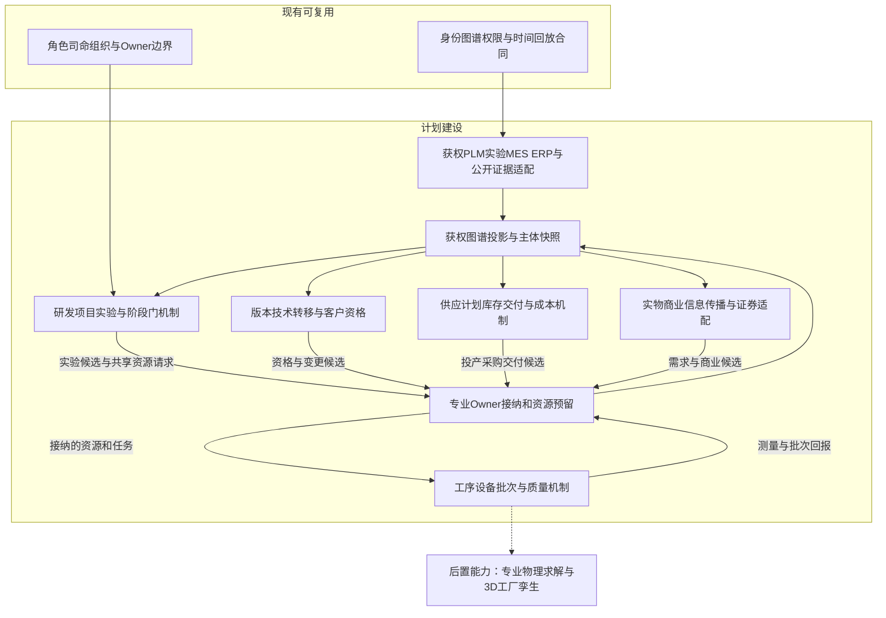
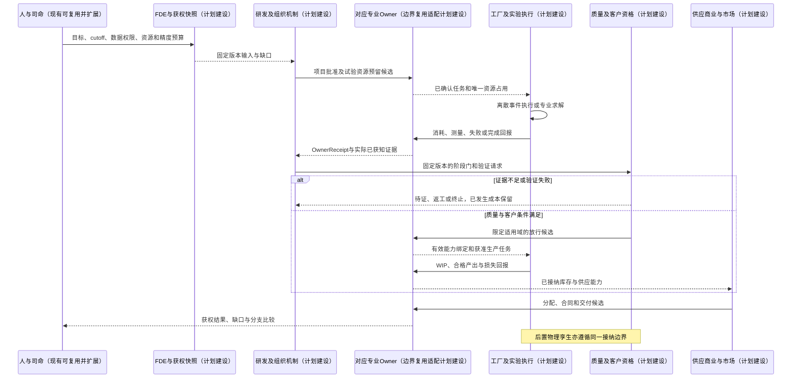
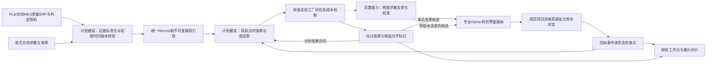

# 23 内存生产供应与技术研发全链路专项设计

修订日期：2026-10-16｜合同版本：未发布草案｜建设状态：计划建设｜验证证据：专用静态校验入口见[README](README.md#文档状态与静态校验wog-r10)；本轮运行、适配、性能及预测未验证。

日期：2026-10-16。状态：`design-draft / non-authorizing`。本文深化[22全球内存市场方案](22-全球内存市场全面模拟与最细有效时间粒度方案.md)的生产供应，并增加完整技术研发链路。所有合同、方程、参数与案例均为设计示意，不表示真实工厂数据、工艺预测或引擎已验证。

## 1. 目标、方法与实施状态

模拟必须回答：谁在什么地点、用哪一版技术和哪些资源，何时能生产、认证并交付多少合格产品；技术变化如何经过实验、工程化、客户导入和爬坡改变供给，而供需、利润和融资如何反向影响研发与投资。

采用“批次/工序离散事件＋资源约束＋证据驱动的研发阶段门”作为主方案。仅用季度产量模型难以解释故障、转线和爬坡；对全球全部工厂做器件级物理求解则需要不可得数据且计算成本极高。聚合模型可用于数据不足的外围，专业物理求解器用于局部关键问题，二者通过同一合同接入。

| 状态 | 本文内容 |
|---|---|
| 现有可复用 | 身份、Heavenly Graph、Character Core、组织/群体、权限、领域Owner、时间及回放边界；此处不重验运行实现 |
| 计划建设 | 研发、实验、版本、工艺路线、工厂批次、资格、供应计划、成本与专业调度适配，全部内存参数校准 |
| 后置能力 | 器件/工艺多物理模型、真实设备闭环、高保真工厂3D孪生与大规模联合校准 |

统一采用[03记录合同](03-类型化数据与统一记录合同.md)及[21共同合同修正](21-模拟fork通用图谱与主项目合同对齐附加设计修正.md)。本文不另建Record信封，不扩张Owner权限，不创建第二世界时钟。现实/影子/反事实模式沿用22 §6.2。

## 2. 生产供应的分层对象

| 层级 | 独立身份与关键状态 | 对外输出 |
|---|---|---|
| 集团/法人/合资 | 控制权、经济权益、许可、现金、产能使用权 | 投资、研发预算、可支配资源；同一物理产线只计一次 |
| 工厂/园区 | 空间、洁净厂房、电水气、灾害暴露、劳工/环保许可 | 公共资源、区域冲击、可运行范围 |
| 产线/工艺平台 | 工艺版本、支持产品、工具集合、转换/验证要求 | 产品资格矩阵与可行路线 |
| 设备组/设备/腔室 | 处理能力、配方资格、维护、故障、污染、校准、备件 | 可执行工序、有效时段与排队状态 |
| 工序/路线版本 | 顺序、返入、批处理、等待上限、抽检/返工/报废规则 | 下一工序、所需资源、处理时间分布 |
| lot/wafer/die批次 | 来源、数量、工艺/设计版本、位置、加工历史、质量状态 | WIP、可追溯合格品和损失 |
| 堆叠/封装/测试批次 | BOM、DRAM与基底die、材料、设备、测试程序 | 以具体SKU计的封装/测试产出 |
| 模组/整机与客户平台 | PCB、RCD/PMIC/控制器/固件、装配、兼容与验证 | 可导入某客户平台的产品 |
| 仓储/运输/合同交付 | 货权、地点、用途、冻结、交付窗口、客户条件 | 可分配库存、可承诺量和实际履约 |

wafer、die、stack、package、module、bit、byte各有单位。颗粒良品、完整HBM堆、与GPU集成后的产品是不同输出；后者不能全部算成内存原厂可售SKU。产品族和实际BOM决定基底die、封装路线及供应方，不能把某代工艺假设推广到全部HBM。

产能不以一个“月产能”数表示。分别保存规划、土建、装机、已验收、已获配方资格、可运行、已被占用及按SKU推算的输出能力，注明晶圆尺寸、期间、产品组合和良率口径。

## 3. 产品路线与上游依赖

本节的跨国现状、原料/加工材料分层、技术授权与国家/治理/客户控制关系，以[24-内存跨国产业链材料技术控制与规则机制设计](24-内存跨国产业链材料技术控制与规则机制设计.md)为专业补充。24明确官方证据的日期与范围，并以必要条件、专业规则、组织程序和数值机制共同判断可制造/可交付性，保留未知及争议。

### 3.1 产品专业路线

| 产品 | 需要展开的路线与技术 | 主要供应瓶颈 |
|---|---|---|
| DDR/LPDDR/GDDR | 阵列与外围设计、单元/电容与互连工艺、晶圆制造、晶圆测试、封装、速度/功耗分档、平台验证 | 有效die产出、速度/功耗与可靠性合格率、配套与客户资格 |
| HBM | DRAM die设计/制造、TSV相关工序、薄化/键合/堆叠、基底die、热/信号/电源完整性、堆叠与最终测试、客户集成 | KGD供给、堆叠/键合、基底die、测试时间、封装槽位、客户集成 |
| NAND | 单元/阵列/外围、层数与结构、沉积/刻蚀等多工序、晶圆测试、分档、封装 | 工艺周期、关键设备/材料、良率、密度/耐久与可靠性 |
| SSD/UFS等成品 | NAND、控制器、DRAM/缓存配置、固件、ECC/FTL与电源保护、装配、验证 | 控制器/固件成熟度、NAND匹配、性能一致性、客户验证 |
| 模组/CXL等 | 颗粒采购、PCB/接口/配套芯片、固件、装配、平台/系统验证 | 多部件齐套、信号完整性、平台支持、质量与供货寿命 |

工序表是注册范围，不宣称某厂当前采用某种未公开技术。工艺路线由证据和场景参数实例化，不在本文虚构真实制程配方。

### 3.2 依赖必须跨到设备、材料与服务

关键依赖包括光刻/掩模、刻蚀、沉积、清洗、离子注入、热处理、CMP、量测/检测、薄化/切割/键合/测试设备，以及硅片、光刻材料、气体/化学品、封装基板/中介层、焊接/键合材料、洁净水电气、软件/IP和技术服务。各厂路线适用性分别声明。

每条供应边保存供货/服务资格、规格、周期、数量、可靠性、库存、替代方、转换成本、共因暴露和许可条件。设备已进口不意味着备件、软件更新、维护和服务永远可得；停止服务可能先降低可用率，再影响合格产出。

不必展开所有螺丝；按交期风险、替代难度、资源稀缺度和研究目标选择瓶颈。未展开部分保留成本/耗用与风险边界，不能默认无限供给。

## 4. 计划、采购与可承诺供应

### 4.1 从市场需求到工厂排产

需求预测/客户意向 → 已签订单与可撤占额识别 → S&OP/产销协同 → 主生产计划 → 物料与能力计划 → 工厂投片/派工 → 封装测试计划 → 客户分配 → 发货/回款。

滚动计划保留冻结窗口、订单优先级、客户义务、库存目标、预测误差和版本。新计划是候选；只有获准的投片、采购、预留和任务才改变资源。每日重优化也不能无成本取消已在制lot或已经签署的采购。

计划目标可配置交付率、利润、战略客户、现金、技术学习和风险的多目标权重，受合同、质量和权限约束；调度器与角色均不能为提高利润绕过安全/法规门禁。

### 4.2 ATP/CTP与未来产出

ATP（Available-to-Promise，可承诺量）按具体产品、客户、地点、交期窗口计算；CTP（Capable-to-Promise，可生产承诺）再检查生产路线、物料、资源和资格。二者不是“全厂剩余晶圆×平均良率”。

窗口内先筛选货权、质量、资格和可到达性，计算合格现货及获准可承诺的未来到货，再扣除尚未履行承诺和安全预留。底层预留登记决定重叠集合的唯一扣减；不能把已经包含合同预留的“自由库存”再扣一次同一订单。窗口间不能重复承诺同一批货。

预计产出带概率与恢复风险；组织可按合同允许承诺其中一部分，但必须标为未来履约义务，不能据此生成已入库成品。CTP需要在时间展开的资源图中同时预留上游投入与后续瓶颈，并随延期重算受影响交付。

## 5. 工厂离散事件与有效产能

### 5.1 派工与资源占用

每个工序声明资源需求：合格设备/腔室、操作技能、配方/掩模、物料、公用工程、装载与加工时间、换型/清洗、最大等待、批量和放行条件。开始事件原子预留相应资源；完成、失败、暂停和取消按合同释放或转移，避免同一设备同一时刻生产两批货。

半导体路线允许多次返回同一设备组；设备分钟必须累计全部返入。批处理设备等待凑批，换型/污染隔离、优先插单、返工和维护均影响队列；利用率接近满载时，交期和长尾延误可能显著上升。

```text
resource_minutes_required(r, W)
  = sum(operation_visits * minutes_per_visit for work in window W)
    + setup_cleaning_and_other_exclusive_occupancy(r, W)

resource_minutes_required(r, W) <= serviceable_calendar_minutes(r, W)
```

分钟口径中若serviceable已扣除维护/故障，则左侧不重复计同一停机；若使用显式故障事件，就不再用同一损失的OEE因子二次扣减。OEE的可用率、性能和质量三个分量也不能与事件损失、工时降额和良率重复相乘。

### 5.2 质量、追溯与良率

质量至少拆为晶圆损失、die缺陷、电性/速度/功耗分档、堆叠/封装、最终测试及可靠性。每次筛选记录输入、通过、失败、待判和返工去向。已被前一环节剔除的产品不再投入下一环节的分母。

可在数据允许时使用缺陷密度/面积模型、分档曲线、条件失效或经验模型；新节点、设备、材料、批次和环境存在共因关联。不能默认所有die/工序独立，也不能把真实良率未知改写成精确数值。

lot分拆/合并保留来源和版本；因设备漂移而追加的hold/隔离可影响此前批次。返工须有允许路线、数量、次数和损伤/成本，不允许无限循环或在未检测时把良品状态提前写入。

### 5.3 故障与恢复

故障影响可为降速、停机、污染、WIP损伤、公用工程中断或认证失效。恢复分诊断、备件/工程师、维修、清洁校准、试跑、质量确认和正式复产；“恢复供电”不等于全部WIP安全或立即恢复合格供货。

区域地震、电力、水、交通或许可事件可同时影响多个供应商。共因事件只生成一次，由暴露关系传播；不能一方面扣除灾害产出，另一方面再叠加已含该灾害的独立停机率。

## 6. 封装、成品、库存与供应网络

多部件装配须满足BOM齐套、材料资格、工艺路线和槽位。预测窗口中的理论数量上限可由各部件数量/BOM用量及资源上限给出，但实际完成时点仍由排队和良率决定。

HBM不能只看DRAM die：不同高度/代际消耗不同die、配套件和工时，测试可能因产品复杂度变长；有die而缺基底die、键合能力、测试或客户封装资源，市场仍可能缺货。技术使每颗容量提高，也可能提高单堆制造难度和单位资源占用。

出厂后继续模拟分配、质检、库存年龄、仓储/运输、客户收货、退货/返修及失效率。货权、地点、质量、商业占用是独立轴；客户专属资格不能被抽成全球自由库存。

供应网络保存多级依赖和替代：认证过的双供可按可用份额切换；尚未认证的新供方需样品、测试、变更批准和交期。新供应商的存在不能直接消除当前缺口，转售也不能增加行业总产出。

## 7. 技术研发的多条并行链

### 7.1 研发对象与专业内容

| 研发链 | 要建模的任务 | 工程输出与检验指标 |
|---|---|---|
| 材料/器件/单元 | 材料筛选、结构、电容/泄漏/保持、单元稳定性、缺陷和可靠性 | 实验与测试分布、候选结构、适用工艺窗口 |
| 制造工艺/设备协同 | 关键工序、集成、设备/配方、量测与缺陷控制 | 受限的工艺路线/配方资格、能力窗口、成本/周期 |
| 芯片架构/电路设计 | 阵列/外围、接口、时序、电源、面积、修复/ECC相关设计 | 设计版本、仿真、版图/签核、掩模、样片和分档 |
| HBM/封装/系统协同 | TSV、薄化/键合、堆叠、热/翘曲、基底die、信号/电源完整性 | 堆叠/封装方案、良率/测试窗口、客户集成结果 |
| NAND与控制器/固件 | 阵列/工艺、耐久/保持、读写扰动、控制器、ECC/FTL与固件 | 器件/成品性能、可靠性、兼容和固件版本 |
| 模组/平台/应用 | PCB/配套芯片、平台时序、功耗、系统稳定性及工作负载 | 客户平台资格、可用配置、实测性能与限制 |
| 测试/可靠性/制造工程 | 检测覆盖、测试时间、故障分析、烧机、质量/安全 | 测试程序、放行规则、质量证据与量产控制计划 |

客户需求、标准演进、竞品、人才、IP/许可、工具与材料共同影响这些链路。JEDEC等标准适用性、供应商内部资格、客户平台验证和法定合规分别记录，不视为一张万能认证证书。

### 7.2 可注册阶段门与返工

典型路线为：需求/问题 → 假设与立项 → 可行性实验 → 设计/工艺开发 → 工程样品 → 集成验证 → 可靠性与客户验证 → 试产/技术转移 → 量产放行 → 爬坡/持续改善 → 退役或下一代。

这不是所有项目统一线性瀑布。材料、器件、软件和封装可并行迭代；项目可在任一阶段返工、暂停、终止、授权转让或与其他项目合并。每个阶段门分别声明必需证据、阈值、样本/条件、责任岗位、审批程序、目标适用范围、失败去向和资源预算。TRL/MRL等可作视图，但等级不能替代具体证据。

一个“实验成功”最多解锁其证明的范围；不能直接推出产品良率、客户接受或可交付产能。样片过测也不意味着所有速度/温度等级都已通过。量产放行和客户放行允许不同先后，但给某客户承诺交付时两者均须满足。

## 8. 研发资源、试验结果与知识状态

### 8.1 研发不是免费过程

项目占用研发人员/技能、实验室、EDA/仿真许可、算力、IP、掩模/样片、试验晶圆、设备、材料、测试与客户工程时间，受预算、招聘、供应、合作、保密和出口许可约束。研究团队同一时段不能把全部工时同时交给两个项目。

试验批可以占用生产线，造成当期少投商业产品；改线/新节点导入可能停机和报废旧库存。原型、技术转移、量产导入都带机会成本。研发预算、现金付款、费用/资本化和投资者获知分别处理，按适用会计合同映射，不能把投入直接全算成当期产能资产。

### 8.2 结果如何产生

实验计划固定待检假设、设计/工艺版本、输入、测量条件、样本、评判规则和结果到达时间。结果可来自获权实验/测量数据、已校准专业模型，或显式合成的条件分布；语言模型可提议方案与解释，不能凭文字宣称发现现实有效的新工艺。

```text
experiment_result ~ P(result | design_and_process_versions,
  material_and_tool_state, experiment_conditions, prior_evidence,
  model_version, shared_latent_factors)
```

成功率、完成时间、成本和质量相关性保留；资源增加只在能力模型允许范围内缩短时间/改善结果。日历推进或反复点击试验不自动提高良率。随机实现记录流与事件标识；共享冲击和分支比较避免因事件数量改变而无意串用随机样本。

实验结果在完成并被测量后才供对应主体获知；长周期可靠性试验不能在开始时知道最终结果。早期指标允许更新预测，但不能提前替代正式放行证据。

### 8.3 知识、IP与能力分开

知识对象至少区分假设、实验结果、解释、负结果、诀窍、设计/配方版本、专利/许可、工程规范和有效能力。专利公开不等于拥有制造诀窍，获得许可不等于有设备和熟练团队；人才流动也不瞬间复制整厂能力。

内部可用、合作方可共享、对客户可披露、公开发表分别有权限/时间。角色私有判断和组织已批准技术结论分开；泄露、误读、夸大及竞争者推断走信息传播，不把公共图谱变成各厂秘密配方的合集。

## 9. 技术转移、版本与量产爬坡

研发输出通过“设计/工艺版本＋验证包＋适用域”交给制造工程；生产方完成设备/配方资格、人员训练、试产、控制计划和放行。客户再按SKU、版本、封装、地点/产线、平台与用途验证；变更通知/审批和再认证条件由各合同定义。

```text
CapabilityBinding = {technology_version, product_revision, process_route_revision,
  site_line_tool_scope, material_and_supplier_scope, qualified_operating_window,
  evidence_refs, qualification_and_change_rules, valid_interval, rights_ref}
```

该载荷放入统一Record。产线在时刻t只能调用当时有效且获准的绑定。新工艺不是“节点名称”覆盖旧工艺；旧版与新版可以并行，WIP及合同维持原版本追溯，迁移必须声明兼容和处置。

爬坡同时追踪投入规模、可用设备、周期、缺陷、分档、封装、可靠性、测试、客户接受率与单位合格品成本。可用条件学习曲线或状态空间模型，经有效试验/生产和反馈事件更新；不预设固定S曲线，不强制单调，换材料/设备、污染或设计修改可引起倒退。

竞争者可能购买设备、扩产、降价、改变产品组合、寻求合作或改技术路线；这些行动又占用共同设备/材料/人才供给。技术领先、成本领先、产能领先和客户锁定分别表达，不能用单一“技术值”决定市场份额。

## 10. 经济反馈与组织决策

| 决策主体 | 所获信息/可作决策 | 资源与制衡 |
|---|---|---|
| 首席技术负责人/研发负责人 | 技术路线、试验数据、团队能力；提议项目与里程碑 | 预算、人才、IP、竞争与技术不确定性 |
| 设计/工艺/封装/测试团队 | 本岗位数据和共享结论；试验、分析、变更提案 | 实验资源、跨团队依赖、版本和批准程序 |
| 工厂/制造工程/质量 | 工序与质量数据；排产、维护、隔离、放行 | 安全/质量、设备资格、交期与项目占用 |
| 采购/销售/产品管理 | 订单、库存、客户反馈、成本；采购、分配和谈判 | 合同、信用、资格与保密 |
| 财务/董事会/投委会 | 项目现金流、风险、融资；预算、扩产、停项 | 权限、资本成本、偿债、组合与监管 |
| 客户工程/采购 | 自有平台与样品数据；验证、导入、转供和锁量 | 产品发布、性能、成本、供货风险 |
| 外部投资者/研究员 | 已获公开/授权资料；估计利润与技术成熟度 | 信息不完整、传播噪声、资金与市场风险 |

Character Core保存角色全面设定、私有记忆、经验、信念、情绪及快慢门控；Laya可选取获准行动，数值/优化模型负责试验计划计算、资源调度和财务分析。研发人员、CEO、销售与投资者不能直接共享全部内部状态。司命可配置情景、安排任务与检查缺口，不能替代试验结果、质量放行或董事会审批。

成本按材料/设备占用/人工/能源/测试/返工/折旧/研发等适用口径建账，区分现金支出、固定成本、变动成本、存货成本和损失。单位成本分母为对应窗口合格产出，试产低良率不能拿成熟量产分母稀释。期望利润/NPV、技术选项价值与战略目标可影响投资，但不自动生成批准或融资。

核心反馈包括：

- 高价格/短缺 → 客户锁量与扩产/研发意愿 → 争用设备/人才/资金 → 更长交期 → 延迟到来的供给。
- 高端产品利润 → 共享资源转向新产品 → 旧产品有效供应收缩；若旧需求尚存，其价格可能反向上涨。
- 研发成功 → 工程迁移/早期损失 → 合格产出改善 → 成本与定价变化 → 客户采用/竞争者响应。
- 需求转弱 → 撤单/库存跌价 → 现金压力 → 减产/推迟项目；维护与研发削减可能损害后续竞争力。

每条反馈经过资源、组织程序和时间延迟，价格/份额由商业与市场机制生成，不能直接写成研发阶段门的奖励。

## 11. 专业数据合同与机制端口

以下均为统一Record的载荷/引用设计示意；世界、分支、时间、口径、来源、权限和修订由[03](03-类型化数据与统一记录合同.md)与[21](21-模拟fork通用图谱与主项目合同对齐附加设计修正.md)承载。

| 专业载荷 | 必要内容 | 输入 → 输出/负责边界 |
|---|---|---|
| ProductRevision / ProductBOM | 规格/单位、设计、组成与损耗、质量等级、用途和客户域 | 需求/设计 → 物料、兼容、输出定义；产品工程接纳 |
| TechnologyVersion / CapabilityBinding | 路线/工具/材料/场地适用性、验证证据、资格与有效期 | 实验/工程证据 → 可执行能力；技术/资格Owner |
| ResearchProject / WorkPackage | 目标假设、依赖、预算、人时、里程碑、停止规则 | 需求/战略 → 项目任务/资源候选；组织/项目Owner |
| ExperimentPlan / ExperimentRun | 输入固定版本、条件、样本、资源、结果就绪时刻、随机或求解器合同 | 预留资源与实验 → 测量结果；实验接纳不等于技术成功 |
| GateDecision / Qualification | 条件、证据、实际审议、权限、放行范围、复核/失效规则 | 结果与程序 → 通过/失败/待证；质量/客户等对应Owner |
| ProcessRoute / OperationSpec | 返入图、耗用、设备/配方资格、处理/等待/换型与异常规则 | 可行路线与资源 → 可调度工序；工艺工程Owner |
| ProductionLot / OperationRun | 输入数量/版本/位置、谱系、资源占用、开始/结束、质量与流向 | 投入/派工 → WIP、产出、损失；生产/库存Owner协作 |
| ResourceReservation | 资源/日历、数量/时间区间、用途、优先级、确认/释放/过期 | 项目或生产请求 → 唯一可用量与占用；资源所属Owner |
| YieldAndBinModel / RampState | 条件分布、共同因子、校准窗口、样本与学习状态 | 测量/工序事件 → 估计或合成候选；不自授事实写入权 |
| SupplyPlan / FulfillmentProjection | SKU/客户/地点/窗口、承诺、在制/来料、资源可行性、风险 | 需求/生产/库存 → 计划和ATP/CTP；承诺经商业Owner |
| ChangeNotice / TransferPackage | 源/目标版本、验证包、受影响批次/合同、迁移/退役与客户要求 | 变更与资格 → 受限迁移；不改历史批次版本 |
| CostAndLearningRecord | 成本口径/单位、资源耗用、质量结果、学习/财务版本 | 实际事件/估计 → 成本与学习证据；财务/分析合同分别接纳 |

各Mechanism端口声明输入schema/单位/时点、read set、输出用途、触发条件、资源消耗、随机性、失败、幂等和目标Owner。不将模型估计的“可制造”直接转换为产品已获客户认证。

跨Owner处理遵循预留→校验→确认/释放：项目预算、人时与产线全部可用才启动实验；失败/超时释放未消耗预留，已使用材料和工时按实际记录。生产完成需先验证输入消耗与质量去向，再幂等入库和生成OwnerReceipt；结果回报丢失通过对账恢复，不重复产货。已发生的实验成本、报废和现实交付不能因项目失败而撤销。

## 12. 图谱、证据与数据接入

图谱形成“需求 → 产品版本 → 设计/工艺/封装技术 → 实验与证据 → 工程能力 → 工厂/设备/材料 → 批次 → 资格 → 合同/客户 → 财务/证券”的多层路径。边保留方向、强度/单位、作用时间、条件、来源和版本；产线兼容、知识依赖、法律许可和客户采用用不同关系类型。

科研合作、联合开发、合资工厂、授权与多方供应协议用Arrangement加角色边；物理资源与经济权益分开。同一设计在不同厂的成熟度可能不同，不能从一条“掌握技术”边自动传播出全集团产能。

| 来源 | 可映射数据 | 不能据此推出 |
|---|---|---|
| PLM/研发项目/实验系统 | 产品/设计版本、任务、试验、变更、测量与证据 | 所有研究结论都正确或可量产 |
| EDA/TCAD/专业仿真与测试 | 固定模型/版本、条件、参数、结果和误差 | 仿真通过即实物/客户验证通过 |
| MES/设备/质量系统 | 批次、路线、设备事件、WIP、检测、隔离与放行 | 单设备正常即可整厂按规划满产 |
| ERP/APS/WMS/TMS/财务 | 采购/订单、计划、库存、物流、信用和成本 | 未确认计划或预计到货即实际库存 |
| 公告、论文、专利、标准、设备/客户披露 | 公开里程碑、技术说明、外部证据与时点 | 专利授权等于商业能力；招聘/设备订单等于投产 |

FDE为机构配置源映射、身份、单位、权限、生产/研发流程和验收；司命帮助补全场景与查缺。缺失私有数据时提供多组受公开产量、收入、CapEx和交期约束的潜在路线/参数，不编造准确配方、真实客户名单和lot记录。

物理对象守恒可成立，但模型未必可识别：相同季度产出可能来自不同投片、die面积、良率与WIP变化。分别标出可观测量、可估计量和未约束量，保留替代解释。

## 13. 最细有效时间与算力装配

| 机制 | 事件/更新 | 细化条件 |
|---|---|---|
| 设备加工/派工 | 工序开始、结束、换型、故障、维护、释放；分钟/秒或源精度 | 设备争用、工序等待期限、关键故障；原始高频遥测可独立保留 |
| 实验/仿真任务 | 预约、启动、检查点、结束、测量和解释 | 耦合求解、可靠性失效；数值子步由求解器稳定性决定 |
| 研发/组织 | 资料到达、任务依赖、审议与deadline；小时至月 | 关键返工、风险或外部冲击，角色不逐传感器帧思考 |
| 技术迁移/爬坡 | 试产批、质量复核、资格、版本切换与产能释放 | 门限附近、批次异常、客户变更 |
| 供需与证券 | 按22既有合同的RFQ、发布、消费和逐消息撮合 | 公开研发进展、量产延期、交付意外引起的快速反应 |

同一调度内核按下一必处理事件推进；研发几周没有结果时不每纳秒重算，期间工厂、采购和证券仍持续运行。实验内部不可跳过的积分/状态过程通过专业求解器推进，不把“尚无外部事件”误认成物理状态静止。

聚合层级按工厂/设备组/批次/工序/局部物理求解独立设置，角色B层另行设置。聚合与展开交接WIP、谱系、已占资源、残余加工时间、故障/学习状态与共同随机因子；唯一推进权交接后才生效。不能凭展开创建额外设备或消除即将故障的风险。大体量波形/图像/传感器序列放载荷存储，图谱保留摘要、依赖与游标。

## 14. 合成推演：新HBM技术导入如何先挤压供应再改变市场

以下数据全部为算术/机制夹具，不对应现实企业或产品。以完整合格HBM堆为输出，假定每堆消耗8颗已合格DRAM die，其他BOM另行齐套。

### 14.1 起点与供给上限

某窗口有96000颗KGD、可完成9000堆键合/堆叠的资源、8500堆最终测试处理能力、10000套已合格基底die与其他配套。先忽略装配损失求上限：min(96000/8, 9000, 8500, 10000)=8500堆。若实际投入8500堆且本合成窗口组合通过比例为90%，最终合格7650堆，消耗68000颗die、剩余28000颗。

该90%只表示本夹具给定的总通过比例，未另外重复扣堆叠/测试损失；850堆失败品按处置规则隔离/报废，不能自动拆成6800颗可重售KGD。现实需按失败环节和可恢复性追溯。

### 14.2 研发立项与当前供应竞争

原厂研发团队拟改善键合/热管理与测试方案。客户工程提出可靠性和平台指标，财务批准有限试验预算。试验借用商业工具占用相当于1000堆的资源，余下商业堆叠能力降至8000：同窗口商业上限降为8000，若其他条件不变且合成通过比例仍90%，商业良品为7200，较原基线少450堆。

试验消耗必须单独出账；这里“其他条件不变”要求预先另行预留齐套的试验die/材料、人员与测试资源，或从商业可用量显式扣除。若无法满足，上述7200仅为上限，实际还会更少。销售不能把未来研发收益拿来填平当前450堆缺口，须重新分配、谈判交期或启用获准备选供应。

### 14.3 试验、失败与资格门

试验结果可能改善某指标但未通过可靠性，导致返工；也可能成功后仍需客户平台验证。工厂只接受获准试产版本，客户未放行时相关合格堆仍不属于该客户可交付量。团队可基于早期数据提高成功预期，但不能提前宣布量产完成。

竞争者可能扩充旧工艺、抢客户、合作采购或以价格换长协；它们的设备/预算/资格约束同步存在。内部团队可能偏乐观、质量岗位坚持证据、销售担心延期、财务限制超支，通过组织程序产生真实分歧与选择。

### 14.4 放行后瓶颈移动

假设数月后新方案完成设备与客户资格，堆叠能力达到11000，仍有12000堆所需KGD与10000套配套，但测试能力仍为8500。即使成熟组合通过比例提高到95%，窗口良品也只是8075堆；不能以11000×95%=10450报供货。

若随后获准测试升级到10500，配套只有10000套时，上限为10000，按同一合成通过比例得到9500良品。瓶颈从测试移到配套；新技术、测试设备和材料齐套共同决定兑现时点。新阶段的投入、成本、损失和库存分别核算，不复用已消耗的旧窗口die。

### 14.5 向实物、信息与金融传播

内部失败/成功先进入对应团队视角，再经客户沟通与披露程序传播。公开“实验突破”可先改变证券市场预期，实物客户只在资格/供货条件满足后调整订单。若延期，承诺缺口、现货询价、渠道囤货与融资压力可能增加；若多家扩产同时兑现且需求转弱，供给和价格可能反向变化。

输出必须并列：各阶段成功概率/证据与耗时、每种资源占用、商业/试验投片、WIP、die/堆/模块产出、合格交付、成本/现金、报价价量/成交/交期、客户替代与取消、角色信念以及证券盘口/成交价量。方案不预设股价方向或涨跌幅。

## 15. 架构图



## 16. 主交互时序图



## 17. 数据流图



## 18. 分阶段交付与验收不变量

先以DDR、HBM、NAND各一条代表性路线验证批次/资源/质量和库存闭环，再接一个有失败与返工路径的研发项目、跨团队资源争用、技术转移、客户验证和爬坡，最后联动商业和证券并扩到多厂。外围缺少数据时保留聚合与不确定性，不把一厂参数直接复制成全球事实。

必须通过以下验收：

1. 物量：lot分拆/合并、BOM转换、失败/报废/返工、库存和在途逐事件对账；bit/byte、die/堆/模块无混淆。
2. 资源：同一设备/人员/材料/预算无重复占用；试验挤出商业生产；维护、OEE和良率无重复损失。
3. 研发：实验不能在结果就绪前完成，失败不凭推进tick自动变成功；阶段门缺证不放行；不适用工厂/客户不能调用能力。
4. 版本：工艺/设计/配方/测试/客户资格固定版本；新版本不改历史WIP；变更触发必要再认证。
5. 供应：研发里程碑、装机、试产、可承诺、可交付与实际回款分别核算；同一未来批次不跨窗口重复承诺。
6. 权限：公开资料不能穿透研发秘密；角色/司命/模型不得直接写良率、资格、资源与产出；正式变化有OwnerReceipt。
7. 时间与恢复：最细参考窗口与聚合版本对照瓶颈、队列、交期、产出和成本；检查点恢复保留未完任务、已耗资源、预留与随机状态。
8. 预测：以未用于校准的工厂/时期/事故/技术迁移验证产出、交期、良率分布与成本，报告不确定性和替代解释；无法获得真值的字段不能宣布验证准确。

本轮仅核对设计结构、引用与合成夹具算术；未接入真实PLM/MES/设备/研发数据，未运行生产/研发引擎或专业物理求解器。实际能力与最小稳定时间步需后续实现和数据验证。
