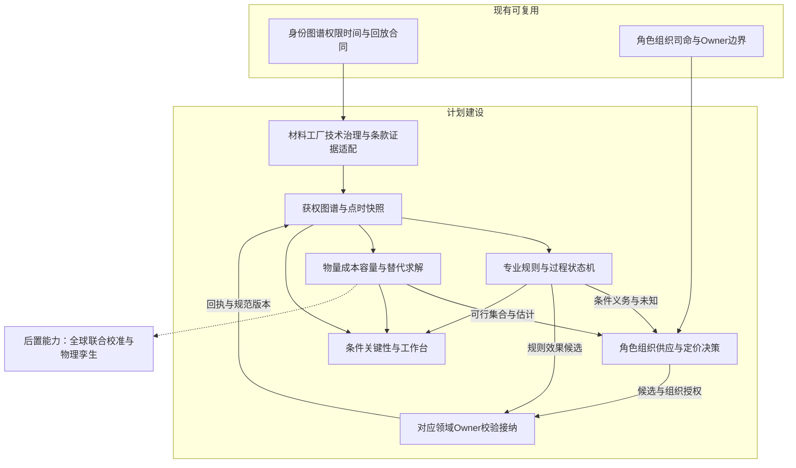
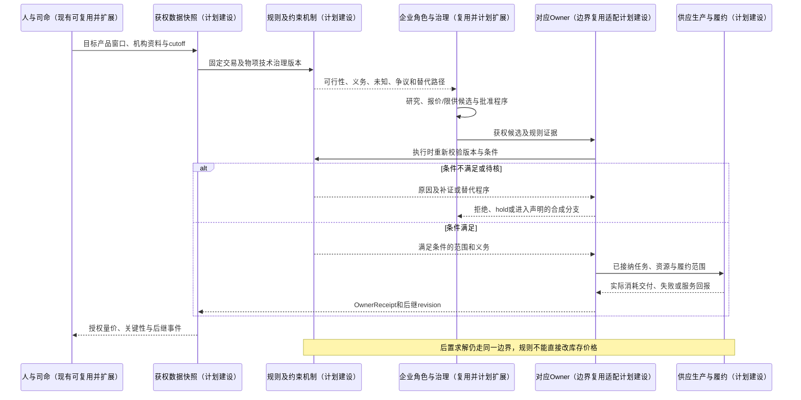
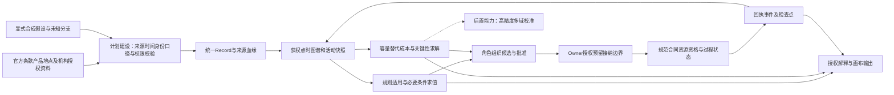

# 24 内存跨国产业链材料技术控制与规则机制设计

修订日期：2026-10-16｜合同版本：未发布草案｜建设状态：计划建设｜验证证据：专用静态校验入口见[README](README.md#文档状态与静态校验wog-r10)；本轮运行、适配、性能及预测未验证。

日期：2026-10-16。状态：`design-draft / non-authorizing`。本篇依据本轮读取的官方产品、地点及2026年公告，深化[22总体方案](22-全球内存市场全面模拟与最细有效时间粒度方案.md)和[23生产研发设计](23-内存生产供应与技术研发全链路专项设计.md)。新增类型、规则与案例均为设计示意；公开主体的假设行为不代表其真实意图。

## 1. 现实基线与本次设计修正

内存产业链是跨行业、跨国、跨集群的受约束生产与交易网络。矿产/基础化工的资源可得性、半导体级纯化/配方、批次质量、设备服务、技术权利、客户认证、公司治理与国家制度都可能决定一条产线是否有可交付产出。

生产由“物理可行＋工程成熟＋权利与许可＋组织决策＋商业接受”共同决定。这些轴分别建模，不能用一项优势抵消另一项必要条件缺失。

| 状态 | 能力边界 |
|---|---|
| 现有可复用 | 身份/标签治理、Heavenly Graph、组织/角色、权限、领域Owner、时间、回执和回放边界；本轮不重新验收运行实现 |
| 计划建设 | 多级材料/技术与控制关系、产业集群暴露、专业规则包、供应决策过程、条件关键性分析及内存专业数据装配 |
| 后置能力 | 全量全球供应商校准、隐私保护协作、跨国法律持续维护、高保真物理孪生与大规模联合求解 |

沿用[03统一记录](03-类型化数据与统一记录合同.md)、[08模型机制](08-模型机制与可插拔演化.md)、[09权限](09-权限关系与运行时接纳.md)及[21共同合同修正](21-模拟fork通用图谱与主项目合同对齐附加设计修正.md)。本篇注册领域规则与专业数据，不新造万能规则Owner、第二权限库或无边界元标签引擎。

## 2. 截至cutoff可核验的行业结构

本轮读取日期为2026-10-16。下表区分“公司公开表达”“已公告里程碑”“未来计划”，不能把公司说法当成独立测量的全行业事实。资料无披露日则登记观察日期，不能倒填历史发布时间；同日资料进入历史分支还需核对具体发布时间和主体可得时间。

| 已读取依据 | 本轮能支持的事实范围 | 对模拟设计的要求 |
|---|---|---|
| Micron官网当前首页 | 公司宣称面向NVIDIA Vera Rubin的HBM4已处于high volume production；另列DRAM/NAND技术产品 | 2026场景不能只停在HBM3E；量产状态、规模、良率、分客户供给分别保存，后几项本轮未核验 |
| Samsung当前HBM4产品页 | 公司介绍1c DRAM、4nm foundry与集成制造/封装能力 | 内存die、逻辑基底die、封装及对应技术/主体分别建；集团内部也要分配资源和资格 |
| SK hynix 2026-09-28 TSMC OIP公告及2026-10-16 OCP介绍 | 公司展示HBM4、与NVIDIA平台的关系，描述TSMC生态合作与后继研发 | 客户/平台、共同开发、制造合作与技术授权分开；产品展示不证明对所有客户已获准交付 |
| SK hynix 2026-08-28印第安纳基地公告 | 公布先进HBM封装基地动工，预计2028年洁净室、2029年下半年量产 | 动工属于未来能力项目，当前供给为零；时间点是计划，保留延期/变化分支 |
| Kioxia/Sandisk 2026-01-29联合公告、07-03生产公告、08-27投资公告 | 联合研发/制造安排延续至2034；北上Fab2第十代3D Flash开始生产；另有未来投资计划 | 联合研发、厂房/设备、产能权益、分货和销售身份拆开；已投产和未来投资不可混算 |
| SUMCO、Siltronic、GlobalWafers官方产品及Siltronic地点页 | 高纯硅、晶体/硅片及多地生产；Siltronic列德国和新加坡生产 | 基础硅资源、电子级高纯硅、拉晶/硅片加工分别建；总部国籍不等于生产所在地 |
| JSR电子材料页、Kanto电子材料页 | 光刻/多层材料、CMP浆料/清洗液，以及高纯化学品与输送系统 | 加工材料是独立工业链，具有配方、纯度、过滤/包装和客户工艺资格 |
| Air Liquide Electronics、Entegris官方页 | 超高纯气体/先进材料；纯化、过滤与材料处理等产品/服务 | 同一化学名称不能代表同一可用等级；厂内供气和污染控制也是依赖 |
| ASML产品服务、ASMPT与Besi产品页 | 光刻与支持服务、热压/混合键合等设备能力 | 设备、软件、配方、服务与工艺适配分开；有某类设备产品不证明某厂已采用 |
| BIS EAR入口 | 按物项分类、目的地、最终用户/用途等识别约束的法规入口 | 必须逐物项/交易/日期查规则；本轮未完整核验现行条文，不能声称某真实交易已合法或被禁 |

因此本设计以“三星、SK hynix、Micron的高端DRAM/HBM生态＋Kioxia/Sandisk等NAND生态＋其他专业/区域供应方”为起始主体层。CXMT、YMTC、Nanya、Winbond等继续登记为分产品/资格的待核验主体，不凭名称赋予同等HBM能力。本文未核定全球份额、隐含产能、当前价格或各企业秘密BOM。

## 3. 原料、加工材料与耗材的完整分层

材料分类同时注明在何处被消耗、是否进入产品、是否可回收、危险品/运输要求、品质与资格。下列为应覆盖的专业范围；实际工艺使用哪些物料由对应路线确认。

| 链路 | 原料/前体 → 加工/服务 → 工厂输入 | 需要展开的关键条件 |
|---|---|---|
| 硅与硅片 | 硅质原料 → 工业硅/化学中间体 → 电子级高纯硅 → 拉晶/切片/抛光/清洗及适用加工 → 合格硅片 | 纯度、晶体缺陷、直径、电阻率/掺杂、表面/平整度、批次与客户资格；太阳能级产能不能直接当半导体级 |
| 光刻材料 | 基础有机/无机原料 → 单体/树脂、感光组分、溶剂等 → 配方、纯化、过滤、包装 → 胶/显影及配套材料 | 设备/波长/工艺匹配、金属/颗粒杂质、保质期、涂布/显影窗口；EUV与不同DUV路线分别适用 |
| 湿电子化学品 | 工业化学/前体 → 电子级纯化和配制 → 酸碱、氧化剂、溶剂、清洗/剥离液等 | 具体杂质谱和检测下限、稳定性、包装容器/配送；同浓度不代表可替代 |
| 电子气体/沉积前驱体 | 来源/合成 → 分离、纯化、混配、检验 → 工厂储存/现场供应/管路与终端净化 | 纯度、痕量水氧/颗粒、配方、气瓶/容器周转、危险品许可、供气连续性 |
| CMP与表面处理 | 磨料/化学组分/聚合物 → 浆料、抛光垫、调节/清洗材料 → 配方和设备联合验证 | 去除率、选择比、缺陷、稳定性、耗用寿命；低价格替代品可能增加报废 |
| 互连与薄膜材料 | 金属/前体 → 高纯靶材、沉积源、电镀/配套化学品 → 工艺使用 | 含量、杂质、膜性质、靶材/设备适配及再生回收质量 |
| HBM/先进封装 | 玻璃/树脂/填料/金属/硅等 → 基板/中介层、NCF/MUF及其他键合/封装材料 → 工艺集成 | 路线专属配方、热膨胀/翘曲、热/机械/电气与可靠性、堆叠/键合匹配；各厂路线不同 |
| 设备耗材与污染控制 | 石英/陶瓷/高分子等 → 腔室件、密封、过滤/纯化组件、容器与输送部件 | 材料寿命、放气/腐蚀/污染、设备资格、清洁维护与替换周期 |
| 模组/SSD配套 | 玻纤/树脂/铜等 → PCB/连接、被动元件及装配材料；控制器/PMIC等另走芯片链 | 高频/电源质量、配套齐套、固件和平台资格；某一小件缺货也能阻塞成品 |
| 公用工程/处理服务 | 水、电、气、洁净/废水废气处理、回收与物流 | 园区容量、能源稳定、环保许可、危险品运输和回收合格性 |

材料的`MaterialSpecification`保存具体指标向量与单位，不能只记“纯度99.999%”：同一总纯度下，不同关键杂质/粒径、包装或检测方法可能造成完全不同良率。供应商CoA、进料检验、实际工序表现与客户接受分别留证。

把原料价格上涨、电子级加工能力不足、批次污染、配送受阻和供应方主动拒售分别设为事件。它们具有不同传播速度：低占比原料涨价可能只影响成本，某个不可替代的低用量高纯材料停供则可能停整条路线。

## 4. 跨国产业集群与共同暴露

初始地图按“国家/地区—集群—园区—法人/工厂—生产/研发活动”登记；对每一具体活动单独核验，不用国家标签赋予能力。

| 初始区域 | 需覆盖的活动/集群候选 | 本轮证据边界 |
|---|---|---|
| 韩国 | 内存制造/研发、HBM工程与材料/设备配套；利川、清州、华城/平泽等候选 | 主体产品与合作已读取；各厂当前SKU/工时/产能需逐项核验 |
| 日本 | 硅片/光刻与电子材料、设备、DRAM技术开发；四日市/北上NAND、广岛DRAM等 | Kioxia两基地和Micron广岛地点已读取；供应商客户关系不可推定 |
| 中国台湾 | 内存制造、逻辑代工、封装、硅片/基板、控制器与服务器供应链；新竹/台中/台南等 | Micron地点、GlobalWafers产品与SK生态资料部分支持；厂线细节待核 |
| 美国 | 内存/平台研发、设备/EDA/IP、云与GPU客户、现有/拟建生产和先进封装 | Micron及SK公开资料支持部分活动；拟建基地独立于当期可用产能 |
| 中国大陆 | DRAM/NAND、封测/模组、材料设备、终端需求和生产配套；合肥/武汉/长三角等候选 | 本轮未核验这些集群的完整现状，不预置节点/份额/客户资格 |
| 新加坡/马来西亚及其他东南亚 | 晶圆/硅片、封测与物流、公用工程和区域配套 | Micron地点和Siltronic新加坡生产已读取；办公室地址不自动当生产能力 |
| 欧洲 | 荷兰光刻/装配设备、德国硅片/材料、法国气体材料等，以及跨国服务网络 | ASML/Besi、Siltronic与Air Liquide资料支持对应产品/部分地点；具体产地待逐项确认 |

上游矿产、能源、基础化工来源继续向这些地区以外展开；地图不以此表封闭。灾害/港口/电网/水源/园区、共同母公司、同一技术许可或单一材料原厂构成不同共同失效域。两个不同国家的经销商若采购同一原厂同一配方，不算真正独立双供。

`ClusterExposure`是带时间/空间证据的关系和暴露载荷，分别描述物理共址、共享设施、物流、人才/服务和制度暴露。企业注册地、总部、控制链、工厂、物项来源、技术来源、最终客户/用途及运输路线分别表达。

## 5. 关键技术究竟由谁掌握

将“技术”拆成技术对象、知识、知识产权/许可、工程能力与实际生产绑定，避免一个`has_technology`标签包办。

| 独立轴 | 需要记录 | 不自动推出 |
|---|---|---|
| 技术/设计/配方版本 | 所属对象、指标、依赖、成果与版本 | 任何工厂都能采用 |
| 权利归属 | 专利族与法域/权利状态、商业秘密、软件/IP所有或控制关系 | 权利人在全部法域都能禁止所有用途 |
| 获得方式 | 自研、受让、被许可、交叉许可、共同开发、采购嵌入IP/设备、公开标准等，允许并存 | 产品合作就是技术转让；符合标准就是拥有全部必要权利 |
| 授权范围 | 被许可法人、产品/版本、用途/地域/场地、期限、数量、转授权、费用与合同条件 | 集团子公司、客户或新基地自动继承许可 |
| 能力形成 | 团队诀窍、设备/材料、控制窗口、实验/制造证据 | 付了许可费就达到成熟良率 |
| 工程/客户资格 | 适用设备/工厂/版本与客户平台、放行/失效条件 | 某客户验证通过即可供应所有客户 |
| 持续依赖 | 支持服务、软件有效期、密钥/更新、备件、诀窍传递与合作 | 授权终止必然立即让现有设备停止运作 |

授权的专利使用权、制造诀窍、软件运行许可、技术服务和出口许可是不同安排。终止/到期分别处理通知、补救期、既有版本/在制/库存处置、存续权利、争议和执行；不得默认权利人可任意单方撤销已授予的不可撤销权利。

还要表达第三方阻碍：企业可能拥有自己专利但未获得实现该路线所需的其他权利。相反，某些权利不适用/到期也不等于丢失技术能力。权利未知标为unknown；没有公开许可披露不能推断无许可，也不能据此指控侵权。

设计上将这些权利/安排与23的`CapabilityBinding`连接，作为适用活动的必要条件或风险/程序条件。本文没有核实某真实内存厂的私有许可条款，不把本篇示例挂到真实公司头上。

## 6. 谁如何影响公司的供应行为

| 影响主体 | 实际作用路径 | 对限供/断供/定价的潜在影响 | 必须保留的界限 |
|---|---|---|---|
| 国家与具体公共机构 | 法律/监管、许可、海关、补贴、公共采购、投资审查、司法/执法 | 禁止/许可条件、审查延期、补贴义务、优先供应要求或成本变化 | 国家不是单一意志角色；不同部门权限、争议与程序分开 |
| 董事会/管理层 | 任免、预算、经营授权、产品/市场战略及合同批准 | 退出客户、变更报价、分配产能、暂停技术合作 | 按章程/授权链决定；销售个人不能任意作集团决定 |
| 控股/重要股东 | 投票、董事席位、保留事项/否决、融资和关联安排 | 通过治理促使战略/市场选择变化 | 持股比例不等于直接下停供命令的权限；经济权益与投票/控制分开 |
| 技术权利人/设备服务方 | 许可/支持合同、续约、服务与配件交付、司法救济 | 延迟升级、提高许可/支持报价、依法或依约暂停服务 | 合同、法域、技术实际可控性、存续权利和争议各自判断 |
| 关键材料/部件供应方 | 报价/分配、质量放行、交期、信用、联合认证 | 限量、提价、付款条件或拒绝新单 | 既有合同与新单分开；供应商也受成本、客户和规则制约 |
| 战略客户 | 设计规格、平台验证、预付款/长协、配额、双供与替代 | 锁产能、议价、要求专属方案、延期或退出 | 大客户也未必能强制原厂违法或随意改已签条款 |
| 银行/投资者/保险及员工等 | 融资契约、抵押、承保、劳动与技能/安全约束 | 现金约束、停工或交付风险，间接影响供给 | 通过实际程序/事件传导，不能压成一个影响力权重 |

关系边保存事实权利、资源依赖与感知影响三类内容，不能混用。`beneficial_interest`、`voting_right`、`appoints_director`、`reserved_matter_veto`、`delegates_pricing`、`licenses_technology`、`qualifies_supplier`等分别注册。关键管理者按23角色合同持续运行，组织通过会议、提案、审批、否决和执行形成行动。

非正式游说、声誉压力、政治预期、客户威胁和经理个人偏好可影响意愿及认知；只有合法/有效授权或实际执行事件才能产生相应规范/物理效果。管理层意见、公众报道与真实决议分别保存。

## 7. 把“关键程度”设计成条件结构

### 7.1 先表达必要条件，再计算影响

为每一目标保存`RequirementSet`：目标产出/活动、时间窗口、适用产品/客户/场地、必要条件、可选组合、数量/能力需求、资格、权利与替代期限。使用有类型的AND/OR/阈值/资源约束表达式，引用已注册机制；不能直接执行任意自然语言或脚本。

```text
can_deliver(customer_X, product_P, window_W) requires ALL_OF:
  qualified_output(P, W)
  customer_qualification(X, product_and_site_revision)
  delivery_route_and_credit_feasible(X, W)
  applicable_legal_and_contract_conditions_satisfied(activity, W)

qualified_output(P, W) requires ALL_OF:
  available_tool_route
  usable_materials_within_spec
  trained_staff_and_utilities
  applicable_technology_rights_and_engineering_binding

usable_material_M requires ANY_OF:
  supplier_A_material_revision_1_with_current_qualification
  supplier_B_material_revision_3_after_qualification_and_arrival
```

这里的`requires`是设计示意。某B供应商虽然存在，但认证完成在交期之后，不是本窗口可用替代。物理必要条件、依法合规的交付条件和组织选择分轴保存；第8节说明违规情景也可以显式模拟。

### 7.2 关键性档案

`CriticalityAssessment`至少包括：目标/窗口/基线、必要条件解释、单点或联合失效集、受影响产量/客户/现金、库存缓冲、到失供时间、替代容量/资格/权利、恢复时间和成本、共同暴露、条件议价权及证据/不确定性。

区分以下关键性：

- **结构关键**：去掉某条件后目标无可行路径，即使该实体营收很小。
- **能力关键**：有替代来源，但合格产能/交期不够；某时间窗内形成瓶颈。
- **技术/资格关键**：替代需要工艺改造、授权或再认证；已有库存可以暂时缓冲。
- **控制关键**：某权利人、机构、董事会或客户拥有对应范围的许可/否决/认证权。
- **共同失效关键**：多个表面来源共享原厂、场地、上游或许可，同时失效。
- **商业关键**：重要客户/供应方掌握外部选择或现金/配额，但议价空间受合同与替代约束。

图分析可使用时间展开网络、容量约束、最小割/最小割集、故障树和替代路径搜索；含AND装配与资格/规则时，普通最短路/中心性不足，须结合约束求解。拓扑高中心度不等于有权断供，也不证明垄断。

可计算`lost_deliverable_units(W, intervention)`与恢复分布，比较移除、限量、延迟或涨价的边际影响；保留基线、联合失效和模型假设。不要把不同维度加成唯一真相分数。看板可展示分项或解释性分级，并允许由分数回查必要条件和受影响批次/合同。

## 8. 规则模型、数值模型与主体选择共同运行

### 8.1 规则必须分种类

| 规则族 | 例子 | 主要输出 |
|---|---|---|
| 物理/技术可行性 | 缺必要材料、工艺不兼容、设备不具资格 | 不可执行、需要改造/验证；意愿不能直接补足物料 |
| 质量/安全/环境过程 | 进料不合格、隔离、可靠性与排放条件 | hold、再检、返工、条件放行或拒绝，责任程序单独记录 |
| 法律/监管/许可 | 物项、用途/用户、地域、来源技术、时间与具体许可 | 适用/不适用/未知，禁止、许可/例外条件、审查和义务 |
| IP/软件/服务权利 | 制造范围、场地、有效期、转授权、服务条件 | 授权范围、费用/期限、需协商/救济/停止的义务 |
| 合同/商业承诺 | 配额、价格公式、重议、付款、排他/优先权 | 应履行/可选行动、违约/争议与补救 |
| 组织治理/授权 | 价格折扣权限、董事会保留事项、预算与委托 | 可提议/批准/执行、需会签或否决 |
| 战略/经营启发式 | 保核心客户、限制信用敞口、报价策略 | 在可选空间内的偏好/策略候选，可由角色质疑与修改 |

法律、行政政策、补贴条件、白皮书、会议意见、合同和企业策略保持各自效力、权源和适用域，不能统一成高低不明的policy。跨法域冲突、适用事实未知或证据不足，返回争议/待核状态与可比较情景，不让一个数值权重自动裁决。

### 8.2 规则合同与可解释判定

```text
RuleDefinition = {rule_ref_and_version, rule_family, issuer_and_authority_refs,
  source_clause_refs, effective_interval, recorded_and_available_refs,
  subject_object_activity_scope, typed_applicability_predicate,
  required_evidence_and_unknown_policy, exceptions_and_override_basis,
  obligations, decision_table_or_state_machine_ref,
  conflict_and_appeal_procedure_ref, proposed_effect_types, owner_bindings}

RuleEvaluation = {rule_revision_refs, scoped_input_revision_vector,
  applicability: true|false|unknown,
  domain_outcome, unmet_conditions, proof_trace,
  obligations_and_deadlines, uncertainty_and_conflicts,
  next_recheck_trigger, proposed_effects}
```

载荷使用统一Record。规则不直接写库存、价格、资格或账户；正式效果经对应Owner接纳。标签用于找到类型、适用条件和注册规则绑定，元标签仍只治理标签本身。

采用决策表、类型化谓词/约束和过程状态机装配专业规则，可接成熟规则/约束求解实现；本轮不选定新引擎或自造语言。静态检查类型/单位、权限、冲突、依赖环与可终止性；运行固定版本、输入证据和判定轨迹。LLM可辅助提取条款并标注来源，未经注册验证与适用审核的提取结果不能自动生效。

### 8.3 不能让模型把所有主体强制成守法机器

物理不可行不能靠角色意愿直接突破；法律义务与现实主体是否遵守分别建模。基准运行中，对禁止行为不发出合法执行许可；若研究情景明确包括违规、错误合规判断或蓄意违约，应通过独立声明的合成行为机制产生候选，并模拟可行性、发现、处罚、诉讼及资源后果。不得改写法律为允许，也不得把该模拟映射为现实外部执行授权。

质量违规亦然：必要材料缺失无法凭空生产，但绕过检验可能产生有缺陷品、追溯/召回与责任。产品事实、主体对规则的认识、组织合规判断及系统操作权限四者分开。未知适用性不自动判违法；该活动可以hold/复核或进入明确假设分支，处理方式按合同登记。

### 8.4 一次供应决策的输入输出顺序

1. 固定活动、主体身份、物项/技术来源、客户/用途、工厂/路线、日期及获权证据。
2. 计算物理/工程可行性、规则适用性、权利与合同义务；未知和争议保持显式。
3. 数值模型计算成本、信用、供给/库存、替代、容量与报价区间，受上述约束。
4. 角色/组织基于私有信念、目标、情绪和治理程序选择供货、限量、价格、谈判、申请许可、验证替代或退出等候选。
5. 执行前复查授权、规则版本/生效时刻、信用与资源；对应Owner预留/确认，接纳合同/报价/任务。
6. 实际交付、拒绝、审批/执法或失败事件产生后继状态；保存理由与血缘，反馈后续决策。

这是依赖顺序，不要求所有模型串行重复计算。规则变更、许可到期、股权/任职变化、客户用途变化、批次质量或新证据使相关缓存失效；入队与执行时都检查，已合法完成的历史事件不因后来规则变化被无声改写。

## 9. 限供、断供和提价如何具体发生

| 动作 | 需要的机制 | 对生产/交易的结果 |
|---|---|---|
| 不接新单 | 销售授权、客户域、已有合同与原因 | 新报价/订单被拒；既有订单是否履约另判 |
| 配额/优先分配 | 可用量、合同/战略客户、分配程序 | 客户得到不同数量/交期，行业供给总量不凭空变化 |
| 暂停发货/服务 | 许可/信用/质量/合同或经营决议及范围 | 某批次冻结或服务任务取消；现有库存和产线影响随时间传导 |
| 撤销资格/授权或不续约 | 对应权利、程序、证据、生效/补救与存续条件 | 限定活动失去条件、需要替代或争议处理，非万能远程停机 |
| 涨价/收费变化 | 新单报价权限、合同公式/重议、付款/运输等条款 | 形成新报价或合同变更候选，买方可接受、减量、转供或拒绝 |
| 改变产品组合/退出产品 | 管理层批准、在制/客户义务和改造约束 | 供给结构延迟变化、EOL/备货/替代与库存风险 |

定价含单位价格、数量、货币、交期、质量/认证、服务、运费税费、信用、预付款和take-or-pay等条件。不要用“国别敌对＋30%”直接生成成交价；国家/股东压力影响实际选项与成本、风险和意愿，再由报价/谈判/合同形成结果。

关键客户可能以锁量/预付款换价格和优先级；关键供应商可能以供给稀缺提高新单报价，也可能为长期合作保持原价。既有固定价合同无重议权时，不能自动随现货上调；违约、重议与履约是可区分分支。竞争、依法合作和可能违法的限制竞争行为分别建模，不能从共同涨价推断串谋。

## 10. 合成案例：材料、技术权利和客户控制共同限制一条HBM路线

以下采用现实存在的产业机制，主体A/B/L/P/X、条款、数量和时间全部为合成，不对应本篇列名公司的实际交易。

### 10.1 基线

工厂P的某HBM产品窗口可消耗合格材料M 1000 kg；按合成BOM每堆消耗0.01 kg材料，上限100000堆（不含质量损失）。其他资源上限90000堆，基准实际待完成能力取二者较小值90000堆。材料A是已认证来源，B供应相同化学类别但尚未通过该工艺/客户验证。

技术L授权覆盖P的现有场地/版本，另建工厂P2尚不在范围；P2虽有相同设备也不能在基准合规模式直接复用许可。董事会批准经营范围，销售经理仅有规定区间报价权；客户X对其平台认证和自己订单有决定权，没有原厂库存Owner权限。

### 10.2 许可审查发生后

为M新增跨境交付的假设规则在T1生效，适用于具体物项/用户/用途。模型核对后，A暂停受影响新发货并申请许可；若许可条件不适用则该交易不应被冻结。已在P境内的合格库存能否使用按规则/合同原文另判，不能把暂停进口自动推成厂内库存作废。

本分支设现有库存200 kg允许继续使用，在途300 kg待清关/审查，其余计划未发。仅按允许使用库存，材料上限降为20000堆；在途不先计入可用量。按当前需求和预计消耗计算耗尽/停工时间，不把T1当作所有工序立刻归零。

### 10.3 组织与替代博弈

A可以提出未受限制范围的新单报价，是否提价由其现金/成本、对其他客户的承诺和管理层策略决定；被禁止交付的范围不能靠付高价获得合规许可。P的采购寻找B，工艺与客户团队要求样品、测试及可靠性：B“有货”不等于马上可替代。

技术权利人L评估扩大P2授权；已有许可的不可撤销/存续部分照约保留。P2还需工程和客户资格，不能仅补签许可就生成产出。控股股东通过已登记董事席位促成新增预算讨论，是否批准依表决/保留事项及融资条件，而非持股标签直接写预算。

若客户X预付锁定其中15000堆，必须通过合同和资源预留。剩余供给是否分给其他客户仍依义务和管理决策；X的承诺不能把20000堆库存上限抬高。其他客户可以寻找不同路线或延迟产品发布。

### 10.4 不同结果与可见输出

分支包括许可获批到货、审查延长、B验证失败、B在交期前完成验证且能供货、P2扩权但未完成客户资格、终端需求走弱等。输出各客户的价量/交期、受影响工序/WIP、替代成本、项目预算、规则判定与未决争议，以及新闻传播和相关证券订单/成交价量。

关键性结论按窗口变化：T1前A影响替代成本；200 kg耗尽前存在缓冲；B认证前M形成供货割点；B认证后若上游仍与A同源，共同风险可能未解除。时间推移、新资格与许可改变关键性，不能固定一个A的影响力数值贯穿全程。

## 11. 工作台与通用底座增量

画布增加原料→纯化/加工→配方/部件→工序→产出/客户的多层视图，叠加技术/许可、治理/权利和空间/集群。用户选择产线、产品或客户窗口，可沿解释路径看到：缺哪个条件、由谁决定、依据哪条条款、谁实际知道、何时耗尽、哪些替代尚未成熟、影响多少可交付量。

规则边显示适用域、条件、证据、程序、有效期与争议；依赖边显示数量/质量、库存缓冲、资格/替代和共同原厂。国家、股东或客户的控制边只能通过实际权力路径连接执行节点，不能把可视化连线当成直接指令。

计划新增`RequirementSet`、`CriticalityAssessment`、权利/授权Arrangement、材料规格与批次质量、`ClusterExposure`和`RuleDefinition/RuleEvaluation`专业载荷。复用C01–C10的身份、关系、证据、时间、权限、机制端口、投影和回放，不修改主项目的标签权限语义。角色和司命仅提议，权利/资格/预算/库存/合同变更经对应Owner接纳。

## 12. 架构图



## 13. 主交互时序图



## 14. 数据流图



## 15. 验收不变量

1. 原料、电子级加工、成品规格、资格与可用批次分开；有矿产/有同名化学品不直接产生合格供应。
2. 控制权、经济权益、治理权限、技术权利、工程能力、主体知情和系统权限各自可审计；普通持股关系不授予停供/改价权。
3. 法律、合同、质量与策略保持独立效力；规则版本/适用未知不被模型评分掩盖，多法域冲突不靠任意优先级消失。
4. 规则输出候选与解释，正式效果有OwnerReceipt；市场价格不由规则或情绪直接改写。
5. 同一共因/母公司/原厂在替代分析去重；AND装配、资格、容量和时间条件均参与关键性判定。
6. 新发货限制、厂内库存使用、服务停止、许可到期及技术实物能力的影响按范围和时间分别演化。
7. 重放冻结规则/关系/资料版本与实际可得时间；新规不抹去旧成交，在途事务执行前重校验。
8. 基准合规行为与显式违规/违约情景分开；内部合成模拟绝不自动产生现实执行权。
9. 合成案例200 kg/0.01 kg=20000堆；锁定15000后最多剩5000给其他需求，且均仍受其他资源与质量限制。
10. 不用看似完整的图谱证明现实数据完整，不用供应冲击预设证券方向。现实关键性结论须给证据、窗口、对照和敏感性。

## 16. 本轮实际读取的来源与后续缺口

以下链接已实际读取页面内容；除注明日期的公告外，产品/地点页为本轮观察快照，不能当作历史各时点已知状态。未保存网页原始归档，本篇不声称具备来源级可重放证据包；正式场景须归档内容摘要、版本、访问和发布时间。

| 编号 | 官方来源 | 本轮使用范围 |
|---|---|---|
| S01 | [Micron首页](https://www.micron.com/)；[Locations](https://www.micron.com/about/locations) | 当前HBM4公司表述及跨国地点；地点用途需单独确认 |
| S02 | [Samsung HBM4](https://semiconductor.samsung.com/dram/hbm/hbm4/) | 工艺/产品及集成路线公开表述，未验证比较性能 |
| S03 | [SK hynix TSMC OIP，2026-09-28](https://news.skhynix.com/en/tsmc-oip-conference-2026/)；[OCP，2026-10-16](https://news.skhynix.com/en/ocp-global-summit-2026/) | 产品、平台、生态与研发公开信息，非许可条款 |
| S04 | [SK hynix印第安纳，2026-08-28](https://news.skhynix.com/en/groundbreaking-ceremony-in-indiana/) | 建设状态和未来计划，不当作当前供给 |
| S05 | [Kioxia/Sandisk JV](https://www.kioxia.com/en-jp/about/news/2026/20260130-1.html)；[北上生产，2026-07-03](https://www.kioxia.com/en-jp/about/news/2026/20260703-2.html)；[投资计划，2026-08-27](https://www.kioxia.com/en-jp/about/news/2026/20260827-3.html) | 合作、已公告生产与未来投资分别建模；JV页面路径01-30而正文日期01-29，保留差异 |
| S06 | [SUMCO产品](https://www.sumcosi.com/english/products/)；[Siltronic产品](https://www.siltronic.com/en/products.html)与[地点](https://www.siltronic.com/en/our-company/sites.html)；[GlobalWafers](https://www.sas-globalwafers.com/en/home-2/) | 高纯硅/硅片加工及部分多地生产；未读得客户逐笔关系 |
| S07 | [JSR电子材料](https://www.jsr.co.jp/jsr_e/products/em/)；[Kanto电子材料](https://www.kanto.co.jp/english/products/denshi.html) | 光刻、多层、CMP、清洗、高纯化学及系统范围 |
| S08 | [Air Liquide Electronics](https://electronics.airliquide.com/)；[Entegris](https://www.entegris.com/en/home.html)及[Clean Gas Delivery](https://www.entegris.com/en/home/resources/industry-insights/gas-purification-solutions.html) | 超纯气体/材料与纯化过滤依赖，不据此认定某真实内存厂供方 |
| S09 | [ASML产品服务](https://www.asml.com/en/products)；[ASMPT](https://www.asmpt.com/)；[Besi产品](https://www.besi.com/products-technology/) | 设备/服务与键合技术产品范围，不认定全厂装机或唯一性 |
| S10 | [BIS EAR入口](https://www.bis.gov/regulations/ear) | 规则定位；入口注明非正式法律版本，eCFR/Federal Register本轮遇访问拦截，未核验现行完整条文 |
| S11 | [JSR公司资料](https://www.jsr.co.jp/jsr_e/company/profile.html)与[治理](https://www.jsr.co.jp/jsr_e/company/governance.html) | 当前公司/治理公开资料；未据此确定完整最终控制链或任意董事否决权 |

本轮部分Micron IR、ASML新闻、METI、专利许可页面遇403/404，未将其内容当证据。下一步按场景对象逐一补齐现行法规/许可证、真实控制与授权链、材料规格/客户资格、供应合同及库存；无法取得的部分保留受约束假设，不能以概念清单伪称已完成全产业事实建库。
