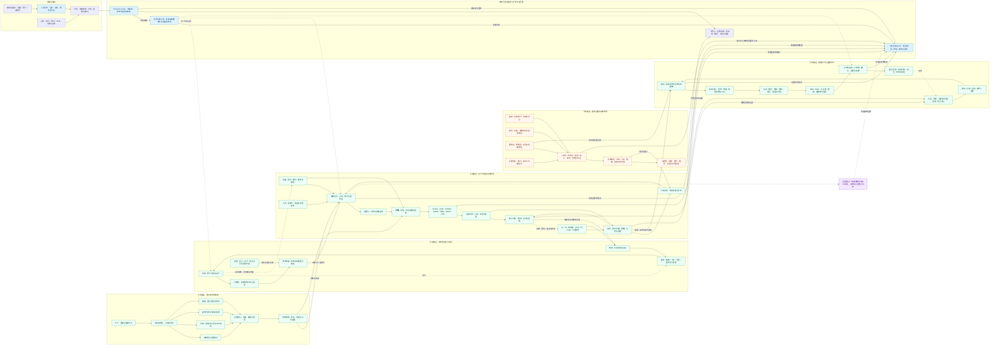
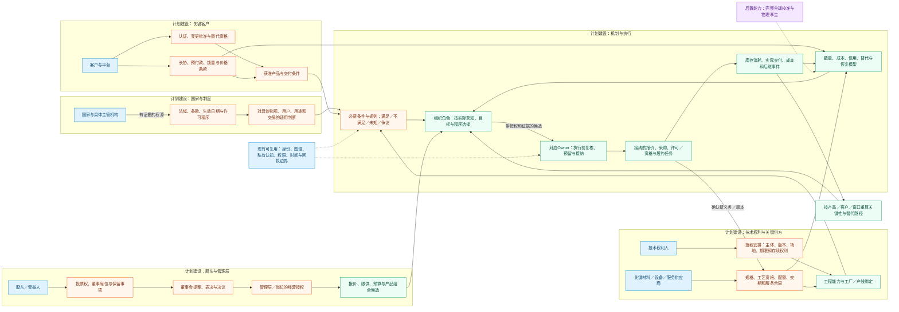

# 25 内存模拟方案在线图谱导航

修订日期：2026-10-16｜合同版本：未发布草案｜建设状态：导航资产已产出；模拟运行计划建设｜验证证据：专用静态校验入口见[README](README.md#文档状态与静态校验wog-r10)；本轮运行、适配、性能及预测未验证。

日期：2026-10-16。状态：`design-draft / non-authorizing`。本页将[22总方案](22-全球内存市场全面模拟与最细有效时间粒度方案.md)、[23生产研发](23-内存生产供应与技术研发全链路专项设计.md)和[24材料技术与规则](24-内存跨国产业链材料技术控制与规则机制设计.md)整理为可在 Gephi Lite 浏览、搜索、布局和检查属性的交互网络。Mermaid 仅保留为附带的结构说明。

图表示设计关系，不是完整现实供应链或已运行模拟。现有设施仅表示复用边界；行业机制为计划建设；物理孪生等为后置能力。具体公司及供应关系的证据边界见24 §2、§16，图中不凭空指定真实客户或秘密授权。

## 1. 在线交互图谱：Gephi Lite

主入口：[Gephi Lite](https://lite.gephi.org/v1.1.0/)。本轮已在独立浏览器窗口实际导入并打开图谱，无需注册。网址只打开工具，**不会自动携带本地工作区**；换浏览器、清理浏览器数据或重新打开时，应加载下列文件。

| 文件 | 用途 |
|---|---|
| [Gephi 工作区](25-内存模拟方案Gephi工作区.json) | 优先使用；保存图数据、分层初始布局和显示设置 |
| [GEXF 图谱](25-内存模拟方案交互图谱.gexf) | 通用交换格式，可在 Gephi Lite 或桌面 Gephi 导入 |
| [Graphology JSON](25-内存模拟方案交互图谱.json) | 同一节点边集合的结构化数据，供后续网络工具和工作台适配参考 |

重新打开：进入工具，选择 **Workspace → Open… → Open a local file**，选取本地工作区 JSON，点击 **Open**。布局位置与显示设置保存在工作区中；当前镜头与面板状态由工具管理，必要时点击右下角 **See the whole graph** 回到全图。

当前快照包含 **218 个节点、339 条有向关系、11 个分组**，依据 22–24 的设计逐项重建。旧版把多个对象拼成一个节点的问题已经在这三份图谱文件中纠正；关系按语义重新指定，未把旧边做笛卡尔积扩展。下文 Mermaid 为历史概览的分组说明，不再作为交互网络的节点边定义。

### 1.1 节点与关系的表达规则

**一个节点表达一个具有明确语义的概念或对象。** 当前是设计概念网络，`record_kind=design_concept`，不是现实实例网络；加载真实公司、工厂、账户和合同后，应另建具有稳定实体 ID 的实例节点，并显式关联其类型。不能把一种类型的所有成员折叠成一个现实主体。

| 原来的混合标签 | 当前表达 |
|---|---|
| 公告、ERP／MES／PLM、行情与资讯 | 公告、ERP、MES、PLM、行情数据源、财经资讯源各为独立节点；系统通过“提供记录”连接各自记录类型 |
| 模拟发起方：私募／原厂／采购方 | 模拟发起方作为角色概念；私募基金发起方、原厂发起方、采购企业发起方各自连接该角色类型 |
| FDE：实体映射、口径、权限与缺口 | 节点名为 FDE；职责放入说明属性，其输入和输出用明确关系连接 |
| 国家、具体部门、法域与许可 | 国家、主管机构、法域、出口许可各为独立节点，并连接许可审批、法律条款和出口管制规则 |
| 股东、投票、董事席位与保留事项 | 股东、投票权、董事席位、保留事项分开；连接董事会、表决过程、决议与经营授权 |
| OMS／EMS：父子单、路由、撤改单与延迟 | OMS、EMS、母订单、子订单、订单路由、新单请求、撤单请求、改单请求分别表达 |

分组名称保存为 `layer` 属性，显示颜色按分组区分；`semantic_type` 区分主体、系统、资料、材料、产线、过程、权利、规则和观测等。`projection_scope` 区分场景编排/底座设施与领域概念，避免把 FDE 当成产业链公司。技术权利人、专利权、技术许可协议、技术版本和产线工程能力具有各自身份和关系。

属性不机械拆成节点。例如报价单是一个对象，价、量、币种、有效期保存在其 `design_fields` 字段合同示意中；存在独立身份和生命周期的产品 SKU、合同、客户及交付批次才建立关系引用。节点标签保持简短，说明、职责、来源、状态放入属性。

关系必须有明确含义，如“供应”“授予”“限定地点”“经历”“产生接纳回执”。这些是设计关系模式，`evidence_status=design_pattern`；它们说明应如何建模，并不证明现实已经发生了相应交易。真实实例还需要有效时间、适用范围、数量口径、证据与权限，遵循 03、04、06 和 09 的主合同。节点大小和边粗细仅用于可读性，不表示量化影响强度或资金规模。

可使用以下操作探索方案：

- 搜索“技术权利人”“晶圆”或“Owner”，选择节点查看属性及相邻关系；缩放和平移观察局部。
- 使用 Layout 的 ForceAtlas2 调整网络布局，用 Filters 按属性筛选；筛选和布局只改变观察结果，不产生世界事实。
- 在 Data 表格检查节点、边的属性与关系来源；修改显示或布局后可用 Workspace → Save as… → Save locally → Download 保存新的本地工作区。

这些是**单一设计概念和明确命名的关系模式**，不是已核实的公司级全球供应链。边的 `kind` 保存关系名称，正式实现仍需注册版本化专业关系合同。图谱不包含实时数据更新、真实账户权限执行、规则求值或模拟运行；这些仍按 03、04、08、09 与 22–24 的设计实施。通用 JSON 是可视化交换数据，不替代 03 的运行记录合同，也不授予任何事实写入权。

在线工具是当前设计快照的观察入口；未来工作台需按主体权限和 PointInTime 从已接纳版本生成投影，再显示数值、时间区间和证据。架构、交互顺序和数据权威边界由下文第 4 节链接的设计图共同说明。

## 2. 附带分组概览：内存模拟全景图

## 3. 附带分组概览：五类主体的影响路径图

## 4. 阅读与执行边界

三图配套：[00](00-总纲与设计地图.md)提供架构、主交互时序与数据流图；本页两幅附带概览用于导航，不替代该运行与权威边界合同。

下文两张概览图中的实线表示所标注的依赖、权利或过程；虚线表示反馈、共享设施或后置对接，均不自动证明现实因果。图中关系加载后仍需按固定版本、获权快照和机制端口执行；图谱、角色、司命或标签不能直接改规范库存、价格、资金和权限。

主交互时序使用[24 §13](24-内存跨国产业链材料技术控制与规则机制设计.md#13-主交互时序图)，数据流与Owner边界使用[24 §14](24-内存跨国产业链材料技术控制与规则机制设计.md#14-数据流图)。本页是上述架构文档的可视化导航，不新增运行机制。
