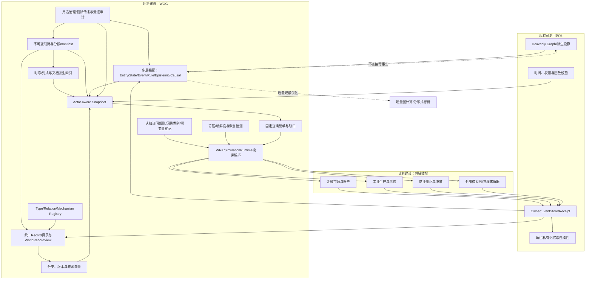
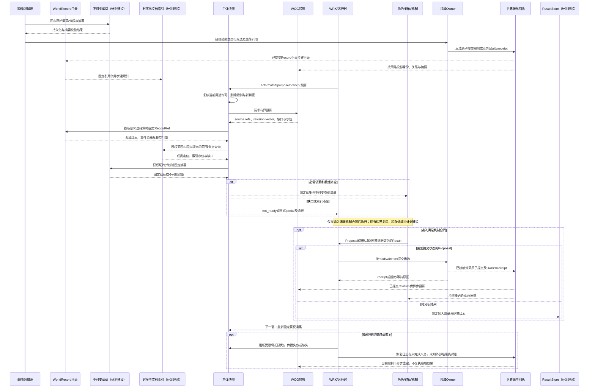
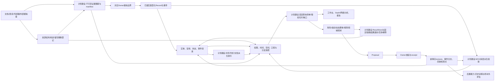
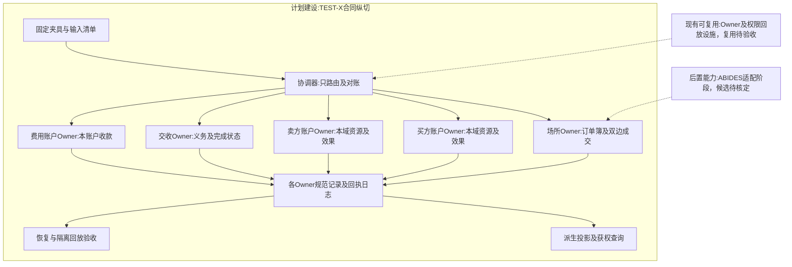
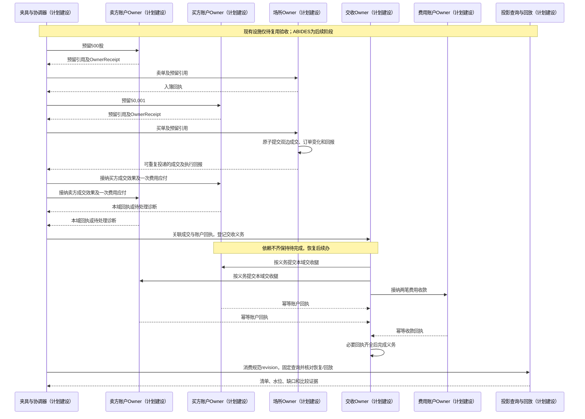
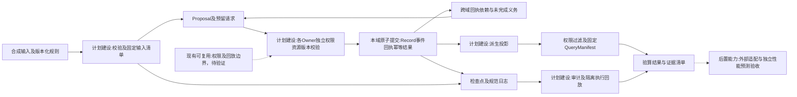

# 世界运行图谱与统一运行合同

修订日期：2026-10-16｜合同版本：WOG-0.1｜建设状态：计划建设｜验证证据：专用静态校验入口见[README](README.md#文档状态与静态校验wog-r10)；本轮运行、适配、性能及预测未验证。

日期：2026-10-16｜版本：WOG-0.1｜状态：`design-draft / non-authorizing`

本文是模拟预测底座的通用图谱核心合同。它把原来的“实体关系图谱”提升为**多层时空可演化世界运行图谱**（Multi-layer Spatiotemporal Evolvable World Operating Graph，简称 **WOG**）。WOG 不是第二个世界真相库，也不是把所有数据强行存成图节点；它是从统一记录、事件、状态、机制和权威回执生成的可重建运行投影。

本文适用于金融、工业、商业和公共治理场景。金融专用字段、市场规则和外部撮合引擎仍由[14](14-金融数据专业包与数据分类.md)、[16](16-金融订单行为量化执行与市场机制.md)和[17](17-外部模拟盘与跨市场数据对齐.md)负责；本文不把它们硬编码到通用内核。

## 1. 设计结论

### 1.1 正式定义

> WOG 是一种由类型化记录驱动的、带时间/空间/适用域/权限/证据上下文的动态图结构。它同时表示世界中的对象、关系、状态、事件、过程、规则、观测、主体认知、因果候选和模拟分支，并为运行时提供有界、可回放、可校验的读集。它不直接写入领域事实；所有候选变化必须经过对应领域 Owner 接纳。

WOG 的基本对象不是“节点加一条边”这么简单，而是：

```text
统一记录 + 类型语义 + 实体/安排 + 状态版本 + 事件流
+ 过程机制 + 规则约束 + 观测证据 + 主体认知
+ 权限投影 + 时间空间口径 + 模拟分支 + Owner 回执
```

### 1.2 图层不是九份互相独立的数据

类型与语义、Entity、State、Event、Process、Rule、Epistemic、Causal、Projection 是同一世界记录的不同投影：

```text
Record（承载Event / State / Relation）+ OwnerReceipt
             ↓ 可重建投影
Schema · Entity · State · Event · Process · Rule
Epistemic · Causal · Projection
```

同一个政策事件可以同时是 Event Graph 的事件、Rule Graph 的规则依据、State Graph 的状态变更原因、Epistemic Graph 的不同主体获知对象和 Causal Graph 的传播起点。投影之间通过稳定 `record_ref`、`entity_id`、`relation_id` 和 `source_revision_vector` 互相引用，不复制成互不一致的事实。

### 1.3 与普通知识图谱的区别

| 普通知识图谱 | WOG |
|---|---|
| 主要保存静态事实 | 保存事实、状态、事件和演化过程 |
| 三元组是主要单位 | 三元组、安排、事件、状态和机制共同组成 |
| 边通常没有时间和状态 | 关系有有效期、容量、成本、延迟、条件和失效 |
| 默认全局可见 | 按主体、渠道和时间生成不同投影 |
| 查询和检索为主 | 查询、推进、回放、分支和干预评估 |
| 图谱可以被当作事实库 | 规范事实仍由 Owner/世界账维护，图谱是可重建投影 |
| 不表达主体认识差异 | 支持知道、相信、希望、意图和误判的受限递归命题 |

## 2. 统一世界记录合同

WOG 不另造一套字段。所有节点、关系、事件和状态都引用[03-类型化数据与统一记录合同](03-类型化数据与统一记录合同.md)中的 `Record`。`WorldRecord` 保留为 WOG 读取接口的兼容名称，表示可重建的统一读视图，不是第二套持久化事实 schema。下面是该读视图的最小形状（设计示意）：

```yaml
WorldRecordView:
  record_ref: RecordRef
  relation_id: RelationIdOrNone
  projection_kind: Entity|State|Event|Relation|Arrangement|Other
  visible_payload: PayloadRefOrInline
  source_revision_vector: RevisionVector
  projection_version: ProjectionVersion
  visibility_diagnostics: VisibilityDiagnostics
```

`WorldRecordView` 只包装 `RecordRef` 及其有权可见的投影内容；它不拥有独立事实 revision、`epistemic_status`、Owner 决策或写入入口。规范记录的通用字段仍由 `Record` 唯一承载。

硬约束：

1. `record_type`、`schema_version`、`revision` 分开；schema 升级不等于事实修订。
2. `available_at` 按主体/渠道解析，不能把全体同时可知的发布时间当作获知时间。
3. 未知、缺失、不适用、未披露、尚未收到、有争议不能都编码成 `0` 或空字符串。
4. 观测、假设、模型估计、模拟候选、Owner 接纳事实和结果必须分轴保存。
5. 历史 revision 追加保存；纠正生成新记录，不静默覆盖旧输入。

## 3. 节点、关系和多方安排

### 3.1 节点的单一语义原则

一个节点表达一个具有稳定身份、生命周期、引用价值或机制意义的概念/对象。并列实体不能拼成一个标签：`ERP`、`MES`、`PLM`、`公告`、`行情源`必须各自建节点；“FDE：实体映射、口径、权限”应是一个 FDE 节点，其职责放在属性和关系中。

下列是可投影类型目录，不要求所有 Record 或类型实例逐一建图。具体实体化按[04 §1.1](04-实体关系图谱与动态边.md#11-图中实体化边界wog-r04)的版本化策略选择；高频样本、文档原文和矩阵单元默认保留为载荷，不逐项展开。

节点类型由 `TypeRegistry` 注册，至少覆盖：

```text
Entity        公司、国家、工厂、账户、角色、设备、产品
Organization  组织、部门、岗位、基金、监管机构
Material      原料、批次、库存、能源、证券、订单
Document      公告、研究报告、合同、政策、规则文本
Process       生产、审批、传播、撮合、清算、研发
Event         下单、成交、断供、发布、审批、故障、政策生效
State         现金、库存、持仓、产能、情绪、信用、资格
Rule          法律、政策、交易所规则、合同约束、组织制度
Mechanism     撮合器、传播器、规则求值器、风险模型、物理模型
Agent         角色智能体、司命、批量行为处理器
View          工作台视图、主体投影、3D显版或回放视图
```

节点字段（设计示意）：

```text
Node = {
  entity_id, type_ref, label, identity_scope, lifecycle,
  valid_time, source_refs, authority_ref, access_scope,
  state_refs, semantic_tags, revision
}
```

### 3.2 动态关系边

二元边仍支持快速邻接查询，但边本身是可演化的关系投影，不是无上下文的“关联”：

```text
RelationProjection = {
  relation_id, relation_type, record_ref, source_ref, target_ref, direction,
  endpoint_roles, valid_time, recorded_at,
  spatial_scope, jurisdiction, quantity, unit, capacity,
  cost, latency, strength, probability,
  condition_refs, trigger_refs, failure_condition_refs,
  state_ref, assertion_refs,
  access_scope, lifecycle, owner_contract_ref,
  source_revision_vector, projection_version, projection_cursor
}
```

`RelationProjection` 是派生读模型。`source_revision_vector` 是对规范输入版本的查询摘要；`projection_version` 是投影构建版本；`projection_cursor` 是投影消费进度。三者都不能冒充关系事实 revision，也不能独立接纳或修改规范状态。规范来源以 `Record.lineage` 中带具体 revision 的依赖为准。

`strength` 不能代替所有量化含义。传播强度、供应容量、资金规模、权力范围、置信度和运输延迟分别注册字段与单位；未定义的关系不得随意添加万能 `weight`。

关系更新链：

```text
源事件/到期工作
  → 获权输入快照
  → 注册机制计算关系候选
  → 对应 Owner 校验
  → OwnerReceipt
  → 承载RelationInstance的新Record revision
  → 图谱投影、回放和视图刷新
```

### 3.3 多方安排

订单、合同、联合研发、会议、董事会决议和供应承诺不能被拆成互不相干的两两边。用 `Arrangement` 节点保存整体身份，再用角色化边连接参与者：

```text
SupplyContract#C1
├── supplier: SupplierS
├── buyer: ManufacturerM
├── material: MaterialX
├── quantity: 1000 ton/month
├── unit_price: currency/value/formula
├── valid_time: t0..t1
├── delivery_terms: DeliveryTerm#D1
├── rule_refs: [ExportRule#R1]
└── owner_contract: ContractOwner
```

实现可用“安排实体 + 角色边”替代原生超边，但必须保留安排整体的有效期、修订和接纳状态。

## 4. 状态、事件、过程和规则如何交织

### 4.1 状态图

状态是某一 `PointInTime` 下可读取的值或分布，不是永久属性：

```text
StateRevision#t0:
  supplier.capacity = 100
  fab.material_inventory = 30 days
  fund.cash = 2 billion
  fund.position = 5 million shares
  security.price = 120
```

### 4.2 事件图

事件记录发生了什么，不直接宣称所有状态已改变：

```text
Event#E001:
  type = export_control_effective
  actor = AuthorityR
  subject = SupplierS
  event_time = t1
  effective_time = t2
  source = OfficialNotice#N1
```

### 4.3 过程图

过程是事件和状态变化之间的机制：

```text
政策起草 → 会签 → 公告发布 → 许可证申请 → 海关审核 → 货物放行/扣留
下单 → OMS拆单 → EMS路由 → 撮合 → 执行回报 → 清算 → 结算
```

过程节点必须声明读集、候选写集、时间域、失败语义和 Owner，不允许用自由文本边直接执行。

### 4.4 规则图

规则表示适用条件和规范后果：

```text
ExportRule#R1
├── jurisdiction = CountryA
├── material_scope = MaterialX
├── effective_time = t2
├── permit_required = true
├── exception = civilian_review
└── violation_effect = hold_or_penalty
```

规则求值输出 `eligibility` 或候选约束；规则节点不能直接改库存、价格、账户和记忆。

## 5. 认知、因果和权限投影

### 5.1 主体认知图

认知关系必须绑定 `holder`、命题、时间、来源和访问范围：

```text
Q knows(E001)
Q knows(M does_not_know(E001))
P believes(Q knows(E001))
M hopes(S continues_supply)
```

`knows` 不是图上两跳可达；必须实际取得并理解证据，且通过固定版本的知识证明规则。其结论限定于分支、目标时点与规则上下文；无法核实的现实命题留为 believes。`observes/believes/hopes/intends` 独立，既不互推，也不自动递归自省或形成共同知识。完整命题上下文、支持/反对证据、争议/撤回、私有心智 Owner 新 revision 与推理预算见[10 §4.1](10-角色智能体心智与Laya接口.md#41-命题上下文与证据门槛wog-r05)，传播证据见[13](13-信息传播情绪与认知机制.md)。

### 5.2 因果图

因果图保存记录依赖或候选机制路径，不把路径本身当作因果效应：

```text
出口限制
→ 可供货量下降
→ 产能预期下降
→ 研究报告下修
→ 基金降低仓位
→ 卖单增加
→ 盘口深度减少
→ 成交价格下跌
```

每条作用路径带 `mechanism_ref`、滞后、适用条件、模型版本和识别状态；预测结果不能自动再次成为独立证据。

记录依赖、机制假设、模型内干预结果和现实识别证据分别标注，不是置信度晋级阶梯。因果估计必须声明干预、对照、结果窗、模型版本、混杂/识别假设、适用范围及不确定性；不可识别时返回竞争解释或范围。唯一主合同见[08 §5.1](08-模型机制与可插拔演化.md#51-因果声明与识别合同wog-r05)。潜变量按[15 §6.1](15-金融市场参与者与多层规模建模.md#61-潜变量登记与竞争解释wog-r09)登记来源覆盖/滞后/误差、代理、先验和验证；相似量价或工业良率轨迹不识别唯一动机/故障，多模型、敏感性、消融及时间留出证据见[19](19-金融历史回放训练与预测评估.md)。

### 5.3 权限投影图

Projection Graph 是视图，不是新事实库：

```text
同一世界 revision
  + actor_ref
  + purpose
  + cutoff
  + access_scope
  + channel_availability
  = 该主体可见的 WOG 投影
```

一个机构能看完整合同，不代表普通投资者能看；司命有方案治理权限，不因此拥有角色私有记忆；图谱有路径，不代表主体已消费消息。查询结果必须返回具体来源 revision、投影版本及消费水位、截断原因和缺口原因；投影版本不是独立的事实 revision。跨存储拼装遵守 §6.5。

读取、训练、派生、分享、导出和跨境用途分别核定，未知许可阻断相应用途。投影、摘要、嵌入与缓存继承来源限制；撤权、许可到期、内容删除和依法保留分别处理，按血缘传播并逐副本回执。不可变引用不代表永久保留，删除后回放如实报告不可用，恢复先重施限制。数据治理唯一主合同见[09 §5.2–5.3](09-权限关系与运行时接纳.md#52-数据治理与用途判定wog-r07)。

## 6. 运行合同与 Owner 边界

### 6.1 统一运行闭环

```text
Observation / Source
  → Snapshot（主体、cutoff、权限、版本）
  → Mechanism / Agent / Population
  → Proposal（候选变化）
  → Domain Owner 校验
  → OwnerReceipt
  → Truth revision / State revision / Event log
  → WOG projections / Replay / Workbench
```

角色、群体、规则模型、外部市场模拟盘和物理求解器只产生候选或结果；Owner 才能接纳规范状态。纯分析结果可进入 `ResultStore`，不为了保存预测而制造事实事件。

### 6.2 图谱读写边界

| 组件 | 可读 | 可写 |
|---|---|---|
| GraphProjection | 已授权事实、关系、事件、状态摘要 | 派生索引/投影版本 |
| SnapshotService | 固定 cutoff 和主体可见范围 | 输入摘要与缺口记录 |
| Mechanism/Agent/Population | 获权读集 | Proposal/Result |
| Siming | 方案、缺口、公开和授权读集 | 调度/激活候选 |
| Domain Owner | 领域规范状态和候选 | receipt、revision、领域事实 |
| Character Core | 角色私有记忆输入 | 私有记忆接纳回执 |
| Workbench/Godot | 授权投影 | 用户意图/观察事件，不直接写事实 |

### 6.3 模拟分支

每个分支固定：

```text
world_ref + branch_ref + manifest_digest
+ type/schema versions + mechanism versions
+ rule versions + seed streams + clock policies
```

分支可以修改假设、规则、机制和主体策略，但不能把候选分支自动合并到现实事实分支。

### 6.4 分层存储与图谱实体化（WOG-R04）

采用“物理分层存储、逻辑统一 Record/Owner/版本合同”。逻辑职责可以在同一数据库实现，也可拆分部署；本决议不指定数据库产品或性能指标。完整的载荷字段主合同见[03 §2.1–2.2](03-类型化数据与统一记录合同.md#21-不可变载荷引用与分段记录wog-r04)，事件与恢复边界见[05 §4.6–5](05-世界真相证据模型与修订回放.md#46-日志载荷与派生索引wog-r04)。

| 层 | 保存什么 | 对 WOG 和运行时的作用 |
|---|---|---|
| Owner 规范存储和领域事件日志 | 本域事实 revision、事件、receipt、幂等结果、预留和义务 | 唯一规范提交依据；按域有序，通过因果引用连接其他域 |
| Record 目录 | 规范信封的检索元数据和固定引用 | 定位记录与载荷；副本显示来源版本及同步水位，不取得事实写权 |
| 不可变载荷存储 | 原文、音视频、流分段、大型表格、曲线、矩阵和张量 | 以内容摘要和版本化 manifest 固定输入；不可作为可丢弃索引 |
| 时序/列式与文档查询索引 | 范围扫描、聚合、数值切片、全文检索加速 | 可重建查询层，回指具体记录、分段和成员位置 |
| WOG 图投影 | 稳定对象、Arrangement、角色关系、规则/过程/文档身份与必要状态/事件摘要 | 关系发现与导航；不逐样本建图，不保存唯一原文 |
| ResultStore | 带固定输入和方法版本的分析/预测结果及载荷 | 保持 estimate/result 等认识状态，复算生成新版本 |

时序/列式格式可以是不可变原始载荷的物理编码；“索引可重建”只适用于查询副本，不允许丢弃唯一数据。文件内容放在图数据库之外不表示交给第三方系统保管。

写入顺序为：固定并校验需引用的载荷 → 对应 Owner 本域原子提交 → 目录副本与图谱/时序索引异步消费。提交不等待所有读模型刷新；投影故障不撤销已提交事实。高频机制可直接消费授权的有序事件和固定数值切片，图谱不承担每个 tick 的中转。

图谱节点和摘要按版本化策略选择，保留 RecordRef、源版本与水位。特定事件需要独立关系导航时可选择性投影，但未投影的事件仍可由日志及载荷定位。“图中没有节点”不能推导为事件未发生。图谱刷新、索引重建和回放均不产生新的业务接纳或外部写回。

### 6.5 跨存储查询合同（WOG-R04）

SnapshotService 编排统一查询，WOG 负责有界关系选择，领域读取接口和数值/文档查询层提供固定版本内容。以下是设计示意，Record 和 PayloadRef 字段仍以 03 为准：

```yaml
SnapshotQuery:
  world_ref: WorldRef
  branch_ref: BranchRef
  actor_ref: EntityRef
  purpose: PurposeRef
  cutoff: PointInTime
  selection_policy_ref: SnapshotSelectionPolicyRef
  scope: TypedGraphAndPayloadSelection
  consistency: dependency_complete|available_with_gaps
  required_position: OwnerRevisionAndCursorVectorOrNone
  budget: QueryBudget
QueryManifest:
  snapshot_ref: SnapshotRef
  query_ref: ImmutableQueryRef
  access_decision_ref: PermissionDecisionRef
  owner_revisions: RevisionVector
  event_cursors: PartitionCursorVector
  record_refs: [RecordRef]
  payload_slices: [PinnedPayloadSlice]
  projection_pins: [ProjectionVersionAndCursor]
  transform_and_measurement_refs: [VersionedRef]
  open_dependency_refs: [AuthorizedDependencyRef]
  diagnostics: [Diagnostic]
  completeness: complete|partial|not_ready
  digest: Digest
```

`PinnedPayloadSlice` 固定 PayloadRef、分段/成员范围和内容摘要；`projection_pins` 同时固定投影构建版本、消费游标和来源版本摘要。所有游标声明来源/Owner、流、分区及其作用域，不把来源序号、Owner 提交序号和图谱水位混用。`cutoff` 及 selection policy 沿用[06](06-时间空间口径与适用域.md)的有效时间、主体可得时间与修订选择，不能只用一个事件时间筛选。

`QueryBudget` 声明截止期限、遍历深度/节点数、行数/字节数与允许的载荷窗口；`scope` 固定关系选择、字段、成员/轴范围及所需聚合，不能以无界遍历代替输入定义。

查询过程：

1. 校验主体、用途、分支和读取能力，固定查询策略和预算；先按授权范围筛选候选记录、图路径、索引命中和载荷成员，再拼接或聚合。解引用与交付时复核授权，持有引用或旧快照不授予读取能力。
2. 选择并固定各域 RecordRef、事件游标和载荷范围；图摘要必须与所选源版本匹配。不能把旧关系摘要、最新账户状态和另一个截止时间的行情无声拼接。必要时从规范数据重建对应投影片段，或报告索引滞后。
3. 校验所选业务效果的因果依赖和未完成义务。`dependency_complete` 要求请求范围所需依赖及数据齐全、版本相容；达不到指定位置或预算内无法补齐时，等待至请求期限或返回 `not_ready`，不能交付为完整机制输入。它允许读取“成交成立、结算义务尚未完成”的真实暂态，不要求所有业务流程已结束。
4. `available_with_gaps` 在输入不齐时可以交付固定的部分结果，但必须返回 `partial` 和缺口/水位；机制只有按自身注册的缺失数据策略才可消费。该模式下数据齐全时也可返回 `complete`。任何模式都不提供跨 Owner 全局原子快照，也不因 dependency_complete 向其他 Owner 扩大查询权限。
5. 保存不可变查询清单及摘要，固定本次实际读取的内容、变换、聚合和口径版本；分页和后续载荷读取沿用同一快照。重新请求“最新”产生新清单，不改变旧快照。完整审计清单本身受控，对调用者仅返回获权范围，依赖诊断不得暴露无权查看的对象或内容。

诊断至少区分：`no_match`、`not_projected`、`index_lag`、`permission_filtered`、`source_gap`、`payload_unavailable`、`digest_mismatch`、`dependency_pending` 和 `budget_truncated`。有预算截断、必需输入缺失或不可校验时不得宣称 `complete`；权限过滤按请求的授权范围判断完整性，响应不披露被隐藏对象的身份或数量。`no_match` 只表示指定可见范围内无匹配，不能冒充全世界不存在。

### 6.6 R04 流转示例

**金融。** 在模拟分支中，买方现金购买寒武纪 500 股且被收取手续费，须由有效卖单或等价卖方流动性与买单匹配。Venue Owner 保存双边成交事件和场所顺序；双方 Account Owner 分别保存现金/持仓/费用效果与回执，交收义务由对应 Owner 维护，沿用 R02。行情原始分段不可变保存，时序索引用于查成交窗口的报价；图谱按策略投影证券、场所、获权账户、订单/成交引用及必要关系摘要，不逐 tick 建图。查询某次成交结果时固定成交、可见账户效果、费率版本和行情切片；若请求范围需要的账户接纳尚未完成，完整依赖读取返回未就绪，允许部分结果的读取明确报告缺口。普通买方不能因此查询卖方私有账户明细；无权查看的内部对账依据不随查询泄露。

**工业。** 炉体、产线、产品批次、供应商、合同安排与角色关系进入图投影。温度/振动按设备分区和序号封装为固定载荷，时序索引提供生产窗口读取；异常、检修和批次状态由相应 Owner 接纳，检修文档身份入图、原文以 PayloadRef 保存。查询某批次的热处理过程时，固定批次—炉体关系版本、传感器分段、异常/检修事件、文档切片和质量统计方法；传感器断流即报告源缺口，不能因图中批次显示“已完成”便声称过程数据完整。修复映射或补流追加新版本，旧分析仍引用旧清单。

### 6.7 首个适配与运行基准（WOG-R06 / R08）

首个真实适配目标为 Nasdaq 普通股常规连续竞价、现金账户、限价新单/撤单；首候选 ABIDES 尚未下载、接入或验证。版本、许可、接口与恢复能力及规则/映射/协议/撮合/账本/恢复六轴证据按[17 §2.5–2.6](17-外部模拟盘与跨市场数据对齐.md#25-首个适配目标与候选wog-r06)登记。合成测试、历史回放、语义仿真、原生协议及影子运行分别留证；不以候选或规格声明替代实际能力。

金融与工业固定场景基准及过载/恢复合同以[12 §6.1–6.2](12-司命方案治理与全流程运行.md#61-固定场景性能基准wog-r08)为准。金融为单场所/单标的、10,000账户、100活跃决策主体、1分支、10,000源事件/s；工业为1,000测点各10样本/s并另含固定批次/异常事件。分别稳态30分钟、2倍突发60秒。本域接纳目标p95≤50ms/p99≤200ms、正常索引滞后p99≤1秒、进程故障已确认持久提交丢失0且恢复≤60秒；全部是未实测目标。固定硬件/版本/载荷，源与展开事件分开计，LLM/跨域完成/上游网络另计。

过载先限制新任务/非必要查询，再降低展示和明确可合并的派生计算；已确认输入与Owner事件不静默丢弃。封闭仿真可减慢推进；实时追不上显式lag并拒绝依赖陈旧数据的动作，必要暂停。checkpoint、日志与open obligations恢复后对账未知外部订单，投影随后追齐。进程故障目标不等于整机或存储灾难承诺。

## 7. 总体架构图



## 8. 主交互时序图



## 9. 数据流图



## 10. 现有、计划、后置和禁止事项

| 状态 | 本合同中的含义 |
|---|---|
| `现有可复用` | Heavenly Graph、Owner/receipt/revision、角色私有边界、时间/权限/回放方向，可作为实现边界；不等于目标消费者全部接入 |
| `计划建设` | WOG 记录目录、不可变载荷与分段合同、时序/列式/文档查询索引、跨存储固定清单、类型/关系/机制注册、主体快照、多层投影、认知与因果接口、WRK 读集接入、领域适配 |
| `后置能力` | 大规模增量图计算、分布式图存储、物理求解联动、全球联合校准、因果世界模型训练 |
| `禁止` | 第二套事实库、图谱直接写库存/价格/生命/记忆、邻接自动等于知道、图路径自动等于因果、未经注册的关系/规则获得执行权 |

## 11. 与本底座文档的整合

| WOG 合同 | 现有主合同/专业包 |
|---|---|
| Record、WorldRecordView、类型、测量、版本 | [03](03-类型化数据与统一记录合同.md) |
| 时间、空间、口径、适用域 | [06](06-时间空间口径与适用域.md) |
| 关系、动态边、多方安排 | [04](04-实体关系图谱与动态边.md) |
| 证据、事实、Owner、回放 | [05](05-世界真相证据模型与修订回放.md)、[09](09-权限关系与运行时接纳.md) |
| 机制、模型端口与可插拔演化 | [08](08-模型机制与可插拔演化.md) |
| 角色、组织、动态群体、司命 | [10](10-角色智能体心智与Laya接口.md)、[11](11-组织与动态群体一等结构.md)、[12](12-司命方案治理与全流程运行.md) |
| 金融事件、订单、账户和市场 | [14](14-金融数据专业包与数据分类.md)、[16](16-金融订单行为量化执行与市场机制.md)、[17](17-外部模拟盘与跨市场数据对齐.md) |

本文是跨文档的统一图谱合同。上述文档仍保留其领域细节；发生字段冲突时，03/06/09 的规范字段和 Owner 边界优先，本文只补充图谱的组合与投影语义。

## 12. 验收不变量

1. 同一 `record_ref` 在所有投影中可追溯到同一规范 revision；投影丢失不损失规范事实。
2. 节点标签只表达一个概念；并列对象不能通过拼接标签伪装成一个实体。
3. 多方安排可恢复整体身份、参与者角色、有效期、修订和接纳状态。
4. 关系变化可以由源事件、机制版本、承载 `RelationInstance` 的 `Record` revision 和 OwnerReceipt 重建；撤权后旧投影不可继续被读取。
5. 角色/群体/外部引擎只能产生 Proposal/Result，不能直接改规范状态。
6. 同一主体在同一 cutoff 读取的 WOG 快照可重放；不同主体的 `available_at` 可以不同。
7. “未找到关系”“索引滞后”“权限过滤”“源数据缺失”必须有不同诊断，不得都返回空集合。
8. 模拟分支与现实事实分支隔离；历史 revision、模型版本和规则版本固定可回放。
9. 图谱可用于发现候选路径，但不能单独证明因果、知识或现实合同成立。
10. 组织账户、岗位、群体投影和角色资产不重复计量。
11. 分段保留成员级时间、序号、权限和可得时间；图谱不保存唯一原文，不要求高频样本逐项实体化。
12. 丢弃或重建图谱/时序/文档索引不丢失规范事实和固定载荷，不重复产生领域效果。
13. 同一输入快照的关系、状态、事件和数值切片使用固定且相容的源版本；查询清单可定位实际输入和方法。
14. 必需数据或依赖不齐时，严格读取返回 not_ready，部分读取显式报告 partial；未完成交收等真实暂态可被如实读取。
15. 载荷切片、聚合和分页不扩大权限；当前授权不允许读取或摘要不符时，不以旧清单冒充读取成功。
16. 知识证明绑定命题/时间/分支/规则版本，冲突证据和撤回可追溯；转载不充作独立证据，认知更新经私有Owner。
17. 因果类别分开，不可识别保留范围/竞争解释；潜变量不因拟合良好变成真实机构画像。
18. 未知用途许可阻断；派生物继承来源限制；删除按血缘传播并逐副本留证，备份恢复先重施限制，回放报告受限/缺失。
19. 市场适配证据六轴分别记录；候选、合成测试和历史回放不冒充原生协议或影子运行通过。
20. 性能目标和实测分开；过载不静默丢Owner事件，未知外部结果先对账，恢复保留幂等及未完成义务。

## 13. 交付顺序

1. 先完成 C01–C10 的类型、关系、证据、时间、权限、机制、投影、分支兼容登记。
2. 以一个金融最小闭环和一个工业供应最小闭环验证同一 WOG 记录合同。
3. 接入组织/动态群体的 B0–B3 交接和主体认知快照。
4. 再接入外部市场模拟盘、物理求解器和实时同化。
5. 最后建设大规模增量图、跨场景训练和样本外预测评估。

本文只描述设计，不代表 WOG、金融适配或主项目协同已经实现或通过运行验收。

## 14. 设计成熟度评估记录（2026-10-16）

本节记录对《完整版》00–26 设计稿、各专业包与本 WOG 合同的一次静态架构评审。§14.1–14.4 是**原始审查意见与讨论流程**，不构成新的规范字段、实现承诺或验收证据；后续已确认决议逐项归档，并同步写回前文规范章节及第 11 节所引主合同。分数是基于原始评审时文档覆盖、边界清晰度、可执行定义和验证证据的主观成熟度刻度，不因本轮文档回写自动上调。

### 14.1 评审结论

当前定位：**架构方向较成熟的研究型模拟底座设计；尚未收敛为可直接按统一合同实施的工程规格，更未达到经过校准的预测系统。**

| 维度 | 设计成熟度 | 评审判断 |
|---|---:|---|
| 通用架构与行业扩展边界 | 8/10 | 数据、语义、机制和 Owner 分层明确，具备跨行业组合方向 |
| 数据、时间、空间、证据和权限 | 7/10 | 覆盖较完整，但字段主合同和跨 Owner 提交协议尚待冻结 |
| WOG 图谱运行合同 | 7/10 | 已超越静态知识图谱，投影、动态关系、多方安排与认知隔离方向清楚；规范来源仍有重叠 |
| 金融领域覆盖 | 7/10 | 数据、参与者、传播、订单、撮合、结算和多市场边界覆盖广；大部分仍是待实现规格 |
| 组织、动态群体与角色协同 | 7/10 | 结构区分和精度交接较清楚；需要用运行夹具验证唯一推进、拆合守恒和私有认知 |
| 工程实现准备度 | 4/10 | 模块合同、事务边界、部署拓扑、失败恢复与端到端实现证据不足 |
| 实时性能准备度 | 3/10 | 多速率与离散事件原则明确，但吞吐、尾延迟、背压和恢复目标未由基准测试验证 |
| 外部市场适配准备度 | 3/10 | 七市场 profile 规格较细；当前规格声明不等于映射、conformance 或 shadow validation 已通过 |
| 历史校准与预测有效性 | 2–3/10 | 评估方法已有设计；尚无足以证明预测、因果识别或真实交易表现的数据与样本外结果 |

综合判断约为 **6/10 的设计成熟度**。这不表示产品完成度为 60%；更准确的拆分是：**概念与边界较成熟，合同冻结和运行可实现性中等偏低，预测证据尚未建立。**

### 14.2 已形成的设计优势

1. **权威边界正确。** 图谱是派生投影；角色、群体、司命、模型和外部引擎提出候选；领域 Owner 负责接纳并生成 receipt/revision。
2. **模拟世界与主体认知分离。** 观测、假设、估计、候选、分支事实和主体私有记忆不再被当成同一种知识；发布时间、主体可得时间和消费时间分开。
3. **图谱语义从静态关系提升为运行结构。** 动态关系、多方安排、状态、事件、过程、规则、认知和因果候选可以交织，并共享来源和版本引用。
4. **群体与组织没有混为一谈。** 组织表达制度权力与程序；动态群体表达特定时间窗内行为或信息相近的成员投影；二者都不替成员重复持有资产。
5. **金融市场机制的分层较扎实。** 目标、父订单、子订单、交易场所命令、订单簿、撮合、成交、清算和结算分开；量价必须由双方匹配后的成交形成。
6. **预测边界相对诚实。** 文档承认历史拟合不是因果证明，情景命中不是事前概率，外部引擎的价格输出也不自动构成盘口级模拟能力。

### 14.3 问题登记与讨论顺序

下表将问题按阻断程度排序。它登记待决议题，不预先替代逐项讨论。

| ID | 优先级 | 问题 | 风险 | 讨论后应产出的决定 |
|---|---|---|---|---|
| WOG-R01 | P0 | 规范数据合同重复：03 的 `Record`、04 的 `RelationInstance`、05 的 `Proposal/OwnerReceipt` 与本篇 `WorldRecord/RelationProjection` 的继承、组合和权威字段关系尚未唯一化 | 运行时和各文档可能实现出多套不兼容字段、版本和状态机 | 已确认并回写03/04/05及本文；决议见§14.5，运行验证待建设 |
| WOG-R02 | P0 | 规范事实来源和跨 Owner 一致性尚未完全落到事务/对账合同 | 市场成交、账户账本、关系投影或多域状态可能重复接纳、暂时矛盾或无法恢复 | 已确认并回写Owner/跨域合同；决议见§14.6，运行及故障证据待建设 |
| WOG-R03 | P0 | 缺少端到端可执行的最小纵切及验收夹具 | 设计覆盖广但无法证明组件能按顺序协同、固定输入可回放 | 合成双边交易纵切设计已确认并回写§14.14；实现与运行验收待完成 |
| WOG-R04 | P1 | WOG 可能被误用成承载所有原始内容和高频序列的超级存储 | 图节点膨胀、查询与状态职责混淆、时序热路径性能不可控 | 设计决议已确认并回写 §6.4–6.6、03/04/05/07；归档见 §14.7，运行与性能验证仍未完成 |
| WOG-R05 | P1 | `knows/believes/hopes` 与因果路径的形式语义和证据门槛仍不足 | 可能把可达性、传闻、相关性或模型输出错误解释为知识、因果事实 | 设计已确认并回写08/10/13/19；§14.8，知识规则及因果验证待建设 |
| WOG-R06 | P1 | 七市场适配仍处于规格阶段，真实接口、数据许可、模拟器和一致性测试证据未齐 | 适配覆盖容易被误读为可运行或达到现实交易所标准 | 目标/候选已确认并回写17；§14.9，真实适配待验证 |
| WOG-R07 | P1 | 数据治理与安全还需覆盖真实机构数据、账户/个人信息、研究内容和跨境限制 | 权限正确也不能替代数据使用许可、保留、脱敏和供应链安全治理 | 设计已确认并回写03/05/07/09/19；§14.10，许可与安全实现待验证 |
| WOG-R08 | P1 | 实时性能与恢复还没有工作负载基准 | “微秒/毫秒级”“实时”可能停留在愿景，系统过载时难以确定性降级 | 目标已确认并回写12/22；§14.11，性能及恢复实测待验证 |
| WOG-R09 | P1 | 参与者/传播/情绪等隐变量的可观测性和可识别性仍有限 | 相似量价轨迹可能对应多种主体解释，造成过度叙事和过拟合 | 设计已确认并回写13/15/19；§14.12，潜变量识别与样本外证据待验证 |
| WOG-R10 | P2 | 文档治理仍有陈旧编号、目录和部分状态标签待清理 | 入口、文档规则与实际编号可能不一致，读者难判断规范优先级 | 治理与静态校验已回写；§14.13，结果以实际命令输出为准 |

### 14.4 后续逐项讨论顺序

按用户后续确认的顺序推进：WOG-R01 → R02 → R04 → R05–R10 → 最后R03。允许一次聚焦多个相关问题，但各项分别列方案、决议、状态和未决证据；经确认才写回规范章节与相应主合同。十项设计裁决现已分别确认，R03决议见§14.14；真实适配、性能、预测有效性及纵切运行验收仍需各自证据。

本评估不改变 WOG-0.1 的规范合同，也不授权代码实施。后续成熟度更新应依据合同冻结结果、可运行纵切、市场适配测试、性能证据和样本外评估分别调整，而不能只因新增文档或节点数量提高分数。

### 14.5 WOG-R01 已确认决议

本小节记录经逐项讨论确认的 canonical schema 关系；它只收敛本问题，不预先解决 WOG-R02 及后续问题。

| 对象 | 唯一职责 | 权威字段/版本 | 与其他对象的关系 |
|---|---|---|---|
| `Record` | 规范记录信封 | 通用身份、世界/分支、载荷、时间、来源、血缘、权限、认识状态、质量、不确定性、`revision` | `RecordId` 是逻辑身份；`RecordRef={record_id,revision}` 指向具体版本 |
| `RelationInstance` | 关系专属载荷 | `relation_id`、关系类型、参与者与角色、`state_ref`、`arrangement_ref`、标签 | 由 `Record` 承载；不重复通用字段，不拥有独立事实版本 |
| `Proposal` | 候选动作/候选效果流程对象 | `base_revision`、输入快照、预期效果、幂等键、过期时间 | 不构成事实；提交给对应 Owner |
| `OwnerReceipt` | Owner 处理证明 | decision、接受效果、拒绝原因、`committed_revision`、事件与回放引用 | 不替代事实；其接受效果指向新生成的规范记录/事件/关系版本 |
| `WorldRecord` / `WorldRecordView` | WOG 统一读取包装 | `record_ref`、可见载荷、投影种类、来源版本摘要、投影版本 | 可重建读视图，不是独立持久化事实对象，不接受 Owner 写入 |
| `RelationProjection` | 关系图查询投影 | 端点、角色、关系属性、`source_revision_vector`、`projection_version`、`projection_cursor` | 从 `Record` + `RelationInstance` + 回执结果派生；不可独立改写规范状态 |

状态语义分为三条轴：`Record.epistemic_status` 表达 observation/assumption/estimate/candidate/fact/result；Proposal 表达候选流程生命周期；`OwnerReceipt.decision` 表达 Owner 处理结果。`admission` 不再作为 `Record` 或 `WorldRecordView` 字段。

版本语义分开：规范事实使用 `Record.revision`；Proposal 的 `base_revision` 是并发校验依据；Receipt 的 `committed_revision` 引用实际生成的规范事实版本；`Record.lineage` 保存规范依赖；`source_revision_vector`、`projection_version` 和 `projection_cursor` 只服务于投影查询与构建。

多方安排使用 `Arrangement` 作为一等 `Record`，参与者通过角色化 `RelationInstance` 连接；投影展开的二元边不能脱离 Arrangement 代表完整安排事实。

### 14.6 WOG-R02 已确认决议

R02 将规范事实来源和跨 Owner 一致性收敛为“外部来源分层、单域唯一 Owner、跨域协调与对账”的合同：

| 状态/对象 | 外部来源或规则权威 | 唯一直接 Owner | 可写对象 | 明确禁止 |
|---|---|---|---|---|
| 原始观测与外部回报 | 来源系统、交易场所、设备或供应商 | 证据接入 Owner | 观测 Record、来源序号、质量、缺口 | 把收到的载荷直接写成命题事实 |
| 订单簿与双边成交 | 内部 MatchingEngine 或绑定的外部场所 | Venue Owner | 订单生命周期、订单簿、TradeEvent、ExecutionReport | 改账户现金/持仓或再次撮合外部成交 |
| 买方/卖方资源与账户效果 | 账户、托管、借券或模拟账户规则 | 各自 Account/Resource Owner | 预留、消耗、释放、现金、持仓、借券、费用账本 | 凭订单状态制造成交 |
| 费用规则 | 版本化 `FeeSchedule` 及适用合同 | 账户或交易后 Owner | 可追溯的费用计算结果和收费效果 | 无规则来源地扣款 |
| 清算与交收 | 清算/托管/结算规则或系统 | Clearing/Settlement Owner | 应收应付、交收义务、完成/失败、补偿义务 | 删除成交或重新撮合 |
| 合同、生产、库存、物流 | 对应外部业务系统或模拟规则 | 对应 Domain Owner | 本域安排、事件、资源和履约 Record | 直接写其他领域资源 |
| 跨域协调 | 已提交的 OwnerReceipt 和依赖合同 | Coordination Service | Reservation token、等待项、超时、对账和补偿任务 | 直接扣现金、减库存、制造成交 |
| WOG 图谱与查询 | 已接纳规范 revision | Projection Service | 节点/边索引、投影版本、消费游标 | 改写领域事实 |

1. **唯一 Owner。** 每类规范状态只绑定一个直接写入者。场所 Owner 写订单生命周期、订单簿和双边成交；买方/卖方 Account Owner 分别写各自资源预留和账户效果；Clearing/Settlement Owner 写交收义务；业务 Domain Owner 写合同、生产、库存或物流本域事实。证据接入、外部适配、协调、投影和回放服务不拥有业务事实写入权。
2. **外部事实与本地接纳分离。** 外部场所、供应商或设备是其回报事实的来源；适配器保存、验证、映射、去重和报告缺口；本地 Owner 依自己的合同接纳现金、持仓、库存、费用和交收效果。适配器成功解析不等于本地状态已提交。
3. **Owner 写入集合。** Owner 可在本域原子写入规范 `Record` revision、领域 `Event`、资源 `Reservation`、未完成 `Obligation`、`OwnerReceipt` 和幂等结果。一次提交不得只写部分效果；Proposal 不扩大写入权限。
4. **跨域事务。** 采用“预留 → 确认/消耗 → 释放或补偿”的协调流程。域内提交原子，跨域通过因果事件、等待项、对账和补偿义务连接，不采用覆盖外部系统的全局两阶段提交。
5. **金融双边守恒。** 每笔 Trade 必须引用买卖双方有效订单或等价双边流动性来源；买卖数量相等，买方持仓增加与卖方持仓减少相等。买方现金预留、卖方库存/借券预留、费用和交收分别由对应 Owner 接纳。费用按版本化 `FeeSchedule` 计算，不能由单条成交回报无来源地扣款。
6. **幂等、暂态和补偿。** Proposal、预留、场所命令、外部执行、账户效果、结算效果和补偿效果使用各自作用域的幂等键。`filled_unreconciled`、`settlement_pending`、`compensating` 等状态表示对账或履约过程，不撤销原事实；补偿只产生新事件。
7. **重建不改变事实。** WOG 只消费已接纳 revision；投影延迟、重建或失效不改变领域状态。事件日志保存来源、因果父链、OwnerReceipt、幂等结果和未完成义务，确保外部成交后本地失败仍可对账恢复。

建议的键和状态最小合同如下：

| 操作 | 幂等键组成 | 重复提交行为 |
|---|---|---|
| Proposal | `world + branch + owner + actor + idempotency_key` | 返回原 Proposal/Receipt 或明确冲突 |
| 资源预留 | `owner + resource_ref + proposal_ref + reservation_attempt` | 不重复占用资源 |
| 场所命令 | `venue + session + client_order_id + command_revision` | 返回原受理/拒绝结果 |
| 外部执行 | `venue + run + partition + sequence + external_execution_id` | 不重复生成 Trade |
| 账户效果 | `account_owner + source_event_id + effect_type` | 不重复扣款、加仓或减仓 |
| 结算效果 | `settlement_owner + obligation_ref + settlement_attempt` | 不重复完成交收 |
| 补偿效果 | `owner + original_effect_ref + compensation_type` | 不重复补偿同一效果 |

R02 的验收不变量为：同一规范状态只有一个直接 Owner；同一外部执行只接纳一次；没有已接纳双边成交就没有买卖双方账户成交效果；买卖成交数量守恒；账户效果不能反向创造成交；交收不能先于成交和账户接纳；补偿不删除历史；投影不写事实；所有未完成义务都能在回放中恢复。

### 14.7 WOG-R04 已确认决议

本轮确认“物理分层存储、逻辑统一 Record/Owner/版本合同”。曾比较一切存图、分层统一合同、各域独立存储后临时拼接三种方案；采用第二种，以跨存储版本与权限编排的复杂度换取清晰的权威和载荷边界。决议已回写 §3.1、§5.3、§6.4–6.6、图示与验收不变量，并同步至 03、04、05、07。

1. **规范事实和事件。** 相应 Owner 保存和接纳本域规范 revision、事件及回执；日志用于恢复回放，接收日志与业务日志分开。域内原子、跨域因果协调沿用 R02。
2. **载荷。** 大型原文、流分段和数值数据使用不可变 PayloadRef 与 manifest；保留成员级定位、时间和权限语义。引用和目录不扩大事实写权或读取权限。
3. **图谱。** 实体化稳定对象、多方安排、角色化关系和必要摘要，按版本化投影策略选取；高频样本、原文和矩阵单元不逐项建图。
4. **查询层。** 时序/列式/文档索引与图谱投影可重建；唯一原始载荷即使使用同种格式存储，也不属于可丢弃索引。纯分析输出保持 estimate/result 及其依赖版本。
5. **一致性。** 查询必须固定主体、用途、分支、cutoff、选择策略及版本，并返回清单、水位和获权诊断。可选择必需依赖齐全或明确带缺口的读取，不承诺跨 Owner 全局原子快照。
6. **验收。** 验证投影丢失可重建、分段不丢成员语义、版本不混拼、缺口不冒充完整、载荷摘要可校验、回放不重复结算及授权不被引用绕过。

本决议解决 R04 的设计合同；数据库选型、运行吞吐、真实源适配和实际回放证据尚未建立，不据此关闭其他评估项或授权代码实施。

### 14.8 WOG-R05 已确认决议：注册语义与证据门槛

采用注册算子、版本化知识证明规则与受限推理；不采用仅靠图可达/置信度阈值推知识，也不要求开放世界无限逻辑闭包。收益是证据可查、预算有界，代价是规则登记和证据维护。命题固定对象、时间、分支及引用版本；observes、believes、hopes、intends独立；knows须实际取得理解并通过证明规则。支持/反对证据共存，争议/撤回追加心智Owner revision，高阶展开不自动自省或共同知识。

因果分记录依赖、机制假设、模型干预和现实识别；干预/对照/结果窗/模型/混杂与识别假设/适用范围/不确定性必须可查，不可识别保留解释或范围。回写08/10/13/19及本文§5、图示和不变量。状态：**设计已确认，规则实现与认知/因果验证待建设**。

### 14.9 WOG-R06 已确认决议：首个场所子集与候选

采用单场所窄规则子集优先，暂不以七市场同时落地为第一步；也不把日线回测充作撮合适配。目标为Nasdaq普通股常规连续竞价、现金账户、限价新单/撤单，候选ABIDES。范围小、验收明确，代价是暂不覆盖多场所和特殊阶段。具体版本/许可/接口/恢复能力仍待核定。

双边撮合、部分成交、撤单竞态、重复回报、断线恢复及双方账户/费用/交收对账为首批验收；规则、映射、协议、撮合、账本、恢复分别留证，版本变化按影响复验。回写17及本文§6.7。状态：**设计已确认，真实适配待验证**；本轮未下载、接入或测试ABIDES，不声称Nasdaq原生协议支持或认证。

### 14.10 WOG-R07 已确认决议：用途治理与删除传播

采用来源权利/用途/地域/敏感级别/留存删除统一登记、派生血缘继承与各Owner执行；不把read权限等同任意使用，也不建立跨域万能删除Owner。代价是副本定位及传播确认成本。身份匹配保留证据、置信和可撤回关系，不按名称合并或猜匿名受益人。

撤权、许可到期、内容删除、依法保留分别处理。不可变引用不等于永久保存；删除传播至载荷/索引/缓存/相关派生物，最小审计受控，回放报告缺失。备份恢复先重施限制；训练删除另评模型撤回/重训等。跨租户、在途撤权、派生泄漏、伪造来源、传播失败与恢复再暴露均须验收。回写03/05/07/09/19及本文§5.3。状态：**设计已确认，安全治理实现及真实许可核验待验证**。

### 14.11 WOG-R08 已确认决议：固定基准、背压与恢复

采用固定场景可测目标，不以时间戳精度或平均吞吐代表实时能力。金融/工业规模、稳态30分钟、2倍突发60秒、本域p95≤50ms/p99≤200ms、正常索引p99≤1秒、进程故障0已确认提交丢失与≤60秒恢复以12§6.1为准。具体硬件/版本/载荷与完整负载在测量前冻结；LLM、跨域完成和上游网络另计。

先限新任务/查询，再降展示和允许合并的派生计算；已确认输入与规范事件不静默丢弃。封闭仿真可减速，实时滞后须诊断并阻断陈旧动作；checkpoint+log+open obligations恢复，未知外部结果先对账。代价是高负载时延后或暂停部分服务，保证可恢复优先。回写12/22及本文§6.7。状态：**目标已定，性能与故障实测待验证**，不扩张为硬件灾难承诺。

### 14.12 WOG-R09 已确认决议：潜变量与多解释

采用逐变量登记、竞争模型/区间/联合分布，拒绝将唯一最佳拟合当真实个体画像；也不因个体不可识别而放弃群体层面的可检验结论。登记语义/主体/时间、直接观测或代理/假设、覆盖/滞后/误差/availability、先验/识别范围、用途、校准和验证。个体证据不足退群体或情景假设。

敏感性、消融和时间留出分别留证，可输出“方向稳健、动机不可识别”；卖出与恐慌/合谋、工业异常与唯一故障不互推。代价是保留多解释增加计算与表达成本。回写15/13/19及本文§5.2。状态：**设计已确认，潜变量识别与样本外有效性待验证**。

### 14.13 WOG-R10 已确认决议：文档治理与静态校验

采用完整00–26索引、按职责的唯一主合同及专用标准库静态校验；不批量重命名历史文件，也不以较新文档默认覆盖领域合同。21负责共同合同映射，R01/R02/R04边界保持，冲突显式版本迁移。修订日期、合同版本、建设状态、证据分开，不因回写提高成熟度。

回写AGENTS/README/00/21及本文讨论顺序、前文和决议登记。专用校验为 `python scripts/verification/check_simulation_foundation_docs.py`，检查编号、索引、相对链接/锚点、围栏、三类图结构、状态与显式关键字段定义归属；仓库docs profile为补充。代价是只能机械检查明确结构，不能证明自然语言全一致。图块结构通过不等于渲染、运行或预测验收。状态：**设计已确认，校验结果以本轮实际执行输出为准**。R03另经确认，见§14.14。

### 14.14 WOG-R03 已确认决议：合成双边交易最小纵切

#### 14.14.1 选择、范围与状态

采用 **A：确定性合成交易场所，贯通双边订单、费用、交收、查询、恢复和回放**，之后再接入R06选定的外部模拟器候选。比较方案B为直接接入ABIDES，可探索真实适配接口，但首轮会混合规则、接口及底座故障；方案C为工业订单—生产—库存闭环，能验证通用履约，但不能优先检验双边交易。A以可精确验算、故障易定位为收益，代价是不能据此证明真实市场规则、原生协议或预测有效性。

这是固定输入的合同协同验收，不引入完整角色认知、多市场、性能压测或工业全链。金融规则仍归[16](16-金融订单行为量化执行与市场机制.md)与[17](17-外部模拟盘与跨市场数据对齐.md)，通用字段仍归03。本文只组合既有合同，不新增第二事实信封。

状态分别登记：**设计已确认；实现待完成；运行验收待完成**。本次确认授权回写设计，不授权模拟运行时代码实施。静态文档通过不提升后两项状态，也不关闭R06、R08、R09的证据缺口。

#### 14.14.2 固定夹具与预期结果

采用合成证券 `TEST-X`、单场所、单分支、现金账户、限价新单与撤单。该合成规则包不冒充寒武纪、A股或Nasdaq的真实规则。运行前冻结清单及摘要：世界/分支、schema和机制版本、Owner绑定、主体及权限/用途、初始资源、价格数量单位、FeeSchedule、交收规则、逻辑时钟、输入顺序、随机种子、载荷和故障注入位置。价格金额使用整数最小货币单位，并固定显示换算与舍入；下表金额为显示单位。

| 项目 | 主成功夹具 |
|---|---|
| 买方初始资源 | 现金100,000，证券0股 |
| 卖方初始资源 | 现金0，证券500股且全部可卖 |
| 费用接收账户 | 初始现金0 |
| 订单及顺序 | 卖方先挂每股100的500股卖单；买方随后提交每股100的500股限价买单 |
| 撮合规则 | 固定价格/时间优先与场所序号，成交价格取在簿卖单价格100；不支持的订单类型明确拒绝 |
| 合成FeeSchedule | 每个有成交的订单收费1；首次成交形成一次费用应付，后续部分成交不重复计费，交收时实际支付 |
| 预留 | 买方预留本金及费用50,001；卖方预留500股，卖方费用从卖出所得支付 |
| 交收 | 在夹具指定逻辑时刻触发，须满足成交、账户接纳及交收依赖；未完成保持待交收 |

| 全部交收完成后的账户 | 现金 | 证券 |
|---|---:|---:|
| 买方 | 49,999 | 500股 |
| 卖方 | 49,999 | 0股 |
| 费用接收方 | 2 | 0股 |

期末现金合计100,000、证券合计500股。过程中预留与可用余额是同一资源的不同状态，不重复求和；待交收应收应付、在途和各记账腿按义务引用对账，不能把债权再算作新增实物现金或证券。尚未接纳的一侧显示未完成义务，不能声称全局同时到账。

#### 14.14.3 Owner分工与主要流转

| 业务Owner实例 | 唯一直接写入职责 |
|---|---|
| 场所Owner | 订单生命周期、订单簿、双边TradeEvent、场所序号及私有ExecutionReport |
| 买方账户Owner | 买方现金预留/消耗/释放、费用应付、待交收和已交收账户效果 |
| 卖方账户Owner | 卖方证券预留/消耗/释放、费用应付、待交收和已交收账户效果 |
| 费用账户Owner | 手续费实际收取及本账户效果，不重复决定费用规则 |
| 交收Owner | 应收应付对应的交收义务、依赖、完成/失败及补偿义务，不直接改他方账户 |

五个业务职责实例可在同一进程部署。初始化也由相应Owner接纳并给出回执。协调、适配、投影、查询和回放服务不增加业务写权；各域采用R02的原子提交、作用域幂等键与跨域对账。

1. **卖方入簿。** 卖方账户接纳500股预留；场所校验有效的预留引用后接纳卖单。预留事实属于账户Owner；协调器不能伪造凭证或自行释放资源。
2. **买方入场。** 买方账户接纳50,001现金预留；场所校验后接受买单。没有有效卖单不能成交，预留不足不能通过。
3. **场所提交。** 场所一次原子提交保存订单簿/订单变化、双边成交、序号、回报记录及幂等结果。发布可重试，不能出现仅发成功回报却没有持久成交。场所不写任何账户余额。
4. **账户接纳。** 两个账户分别据同一成交及规则版本接纳本域效果、待交收项目与费用应付。费用评估按订单去重，再以其唯一来源引用驱动收费效果，不能按每个部分成交重复评估固定费。域内效果、revision、事件、回执及幂等结果一同提交。
5. **交收。** 交收Owner管理依赖，各账户Owner完成本域账务腿，费用账户Owner接纳收款；必要回执全部齐全后才能标记完成。某账户失败时保留成交和未完成义务，恢复后继续；不得重新撮合、释放已成交资源或删除历史。撤单只释放已确认撤销的未成交预留。
6. **查询。** 投影只消费已接纳revision。固定主体、用途、分支、cutoff、版本选择及依赖要求，返回QueryManifest、水位和缺口；严格查询依赖不齐不能冒充完整结果，允许带缺口的查询须明示。
7. **恢复与回放。** 按检查点、日志、幂等结果和未完成义务恢复；审计回放解释依据，执行回放在隔离存储中重跑固定输入，不向真实外部发送订单或重复交收。

预留在订单有效及成交未履约期间不能仅因协调器超时而释放；未知场所结果先查询/对账。在途撤权须阻断未经授权的新动作和读取，已成立的成交义务依已登记的系统履约权限处理，不因用户撤权而假装成交不存在。

#### 14.14.4 纵切架构图



图中五个Owner各自提交本域日志；汇总日志框用于证据读取，不代表统一数据库事务或超级Owner。ABIDES为本纵切之后的阶段，R06目标及候选资格仍按17单独验收。

#### 14.14.5 纵切主交互时序图



#### 14.14.6 纵切数据流图



图中的回路表示跨域义务驱动下一次候选，各次仍须由对应Owner接纳；投影、验算结果和清单不能反向改写事实。

#### 14.14.7 失败注入与验收不变量

各变体固定独立输入清单及预期结果，不能沿用主成功夹具的期末值判断所有失败。部分成交变体把同一卖单500股分为两次与后续买单成交，分别固定每个订单的费用预期；撤单变体固定场所命令先后序号。

| 变体或故障 | 必须验证的结果 |
|---|---|
| 无卖单、买方资金不足、卖方库存不足 | 无有效双边来源不能成交；资源不产生无依据变化，无成交订单不收费 |
| stale revision、重复命令/回报 | 明确冲突或返回原结果，不重复成交、扣款、加仓或收取费用 |
| 同一订单部分成交 | 成交/剩余/撤销数量守恒，固定订单费只评估一次 |
| 撤单与成交竞争 | 按场所序号确定结果，撤单请求不等于成功，不释放已成交资源 |
| 场所提交中断、提交后回报尚未送达 | 原子提交无半套效果；恢复后补发原回报，不生成第二笔成交 |
| 成交后账户或交收进程崩溃 | 成交保留，日志及未完成义务可恢复，继续履约而非重新撮合 |
| 图谱滞后、投影丢失 | 按查询模式报告缺口或阻断完整读取；重建不改变规范事实 |
| 越权查询、处理中撤权 | 阻断不再获权的操作/读取；已成立义务按系统权限处理，诊断不泄露私有内容 |
| 必需载荷缺失或摘要不符 | 明确无法完整回放，不编造输入或声明一致 |
| 场所结果未知 | 先查询/对账再决定后续命令；合成注入不作为真实适配恢复证据 |

主夹具检查双边500股、双方费用各1、期末现金100,000与证券500股；所有变体检查单域唯一Owner、域内原子、作用域幂等、无来源不记成交效果、义务可恢复、补偿追加及投影不写事实。跨域中间状态按已提交记账腿和对应开放义务核对，不能用一个全局成功标志掩盖单侧失败。

#### 14.14.8 证据包与通过条件

每个案例保留可审查清单：运行标识、代码/依赖版本与环境、固定fixture/规则/权限/输入摘要、执行命令、预期及实际结果、原始场所事件、各Owner回执与幂等结果、账户和义务快照、QueryManifest/水位/缺口、故障位置、恢复日志、回放比较及原始证据定位和摘要。产物生命周期遵循仓库harness约定，需要长期保存时显式导出仓库外。

- **审计回放：** 能解释每次变化的输入、规则、因果来源、Owner、revision和回执，恢复开放义务；不重新向外部执行。
- **执行回放：** 在隔离存储中按固定逻辑时钟、顺序和版本重跑；比较业务状态、成交、费用、义务和规范版本。墙上时间等非业务字段列入明确排除项；不能以排除项掩盖业务差异。回放不污染原分支或真实外部系统。
- **通过条件：** 主成功夹具及必需失败变体全部有实际运行证据，两类回放比较通过；缺失、跳过、输入不全或结果不同均保留未通过状态。只验证文档或仅打印预期余额不能算纵切通过。

回写关联入口为README、00、05、16、17；20继续作为更广的场景设计，不作为第一条纵切的已运行证据。后续ABIDES适配复用这些合同验收资产，并按17另行取得规则、映射、协议、撮合、账本和恢复证据。
