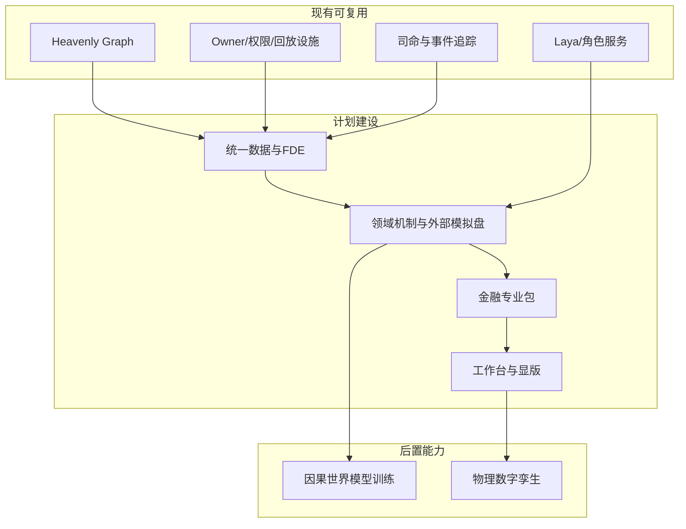

# 通用模拟底座 + 金融场景适配方案（完整版）

修订日期：2026-10-16｜合同版本：整合设计 v1.1｜建设状态：计划建设｜验证证据：专用静态校验入口见[README](README.md#文档状态与静态校验wog-r10)；本轮运行、适配、性能及预测未验证。

> 独立整合稿：从 00 到 26。原目录文档保持不变，本目录是统一术语、统一合同和统一依赖后的最新设计稿。

日期：2026-10-15｜整合设计 v1.1｜状态：design-draft / non-authorizing。27份编号文档构成整套方案；本入口、目录约定为配套文件。每份架构文档均包含架构图、主交互时序图和数据流图；总体交互与数据权威边界由[00](00-总纲与设计地图.md)三图统一定义。

本轮金融执行适配收敛为**美股、A股、港股、日本、韩国、台湾、新加坡七个股票市场**。按交易所、板块、品种、阶段、账户通道与生效日期装配；普通股票及已声明ETF二级交易优先，其他市场和衍生品执行后置。具体范围、七份专业profile设计、官方资料缺口及一致性验收见[17](17-外部模拟盘与跨市场数据对齐.md)。当前完成的是设计合同，未声称原生连接器或交易所认证已完成。

## 阅读顺序

在线图谱入口：[25-内存模拟方案在线图谱导航](25-内存模拟方案在线图谱导航.md)，使用 Gephi Lite 浏览218个单一概念节点、339条有向关系的交互网络，配套 GEXF、Graphology JSON 和可重新打开的 Gephi 工作区；关系均为设计示意，Mermaid 仅作附带结构说明。


## 00–26 文档索引

| 编号 | 文档 | 作用 | 状态 |
|---|---|---|---|
| 00 | [总纲与设计地图](00-总纲与设计地图.md) | 范围、原则、依赖、路线 | 设计入口 |
| 01 | [通用底座与扩展边界](01-通用底座与扩展边界.md) | 行业无关内核与适配边界 | 计划建设 |
| 02 | [底座分层与模块责任](02-底座分层与模块责任.md) | 数据、语义、演化、运行时分层 | 计划建设 |
| 03 | [类型化数据与统一记录合同](03-类型化数据与统一记录合同.md) | 数据类别、PointInTime、版本和不确定性 | 计划建设 |
| 04 | [实体关系图谱与动态边](04-实体关系图谱与动态边.md) | Heavenly Graph、节点/边、嵌套与可量化关系 | 计划建设 |
| 05 | [世界真相证据模型与修订回放](05-世界真相证据模型与修订回放.md) | 事实、证据、owner、receipt、replay | 计划建设 |
| 06 | [时间空间口径与适用域](06-时间空间口径与适用域.md) | 多时钟、空间、统计口径、法域 | 计划建设 |
| 07 | [FDE数据接入与机构适配](07-FDE数据接入与机构适配.md) | ERP/行情/新闻/模型映射与反馈 | 计划建设 |
| 08 | [模型机制与可插拔演化](08-模型机制与可插拔演化.md) | 因果、时序、规则、物理和外部引擎 | 计划建设 |
| 09 | [权限关系与运行时接纳](09-权限关系与运行时接纳.md) | 权限、保密、委托、owner 写入 | 计划建设 |
| 10 | [角色智能体心智与 Laya 接口](10-角色智能体心智与Laya接口.md) | 角色、快慢系统、记忆、信念、行动 | 计划建设 |
| 11 | [组织与动态群体一等结构](11-组织与动态群体一等结构.md) | 组织/群体区分、聚合、拆分、精度交接 | 计划建设 |
| 12 | [司命方案治理与全流程运行](12-司命方案治理与全流程运行.md) | 询问、装配、监督、实时更新、分支 | 计划建设 |
| 13 | [信息传播情绪与认知机制](13-信息传播情绪与认知机制.md) | 渠道、情绪、希望/知道递归、系统1/2 | 计划建设 |
| 14 | [金融数据专业包与数据分类](14-金融数据专业包与数据分类.md) | 金融数据全类别与质量合同 | 计划建设 |
| 15 | [金融市场参与者与多层规模建模](15-金融市场参与者与多层规模建模.md) | 机构、散户、账户、规模、利益关系 | 计划建设 |
| 16 | [订单管理、算法执行与交易场所仿真](16-金融订单行为量化执行与市场机制.md) | OMS/EMS、订单簿、撮合引擎、执行回报与行情 | 计划建设 |
| 17 | [七个股票市场适配与外部交易场所接入](17-外部模拟盘与跨市场数据对齐.md) | 七市场profile、规则/协议、订单/撮合/行情/交收一致性 | 计划建设 |
| 18 | [显版隐版与人司命工作台](18-显版隐版与人司命工作台.md) | 无限画布、视角、3D 显版、后台隐版 | 计划建设 |
| 19 | [金融历史回放训练与预测评估](19-金融历史回放训练与预测评估.md) | 历史回放、因果世界模型、评估与校准 | 后置逐步建设 |
| 20 | [光模块市场完整贯通案例](20-光模块市场完整贯通案例.md) | 私募发起、产业链、多参与者、五日下跌中继 | 设计推演 |
| 21 | [模拟fork通用图谱与主项目合同对齐附加设计修正](21-模拟fork通用图谱与主项目合同对齐附加设计修正.md) | C01–C10共同合同映射与显式版本迁移 | 计划建设 |
| 22 | [全球内存市场全面模拟与最细有效时间粒度方案](22-全球内存市场全面模拟与最细有效时间粒度方案.md) | 全球内存场景、多速率与量价；引用性能基准 | 设计推演 |
| 23 | [内存生产供应与技术研发全链路专项设计](23-内存生产供应与技术研发全链路专项设计.md) | 生产、供应、研发、资格与资源争用 | 设计推演 |
| 24 | [内存跨国产业链材料技术控制与规则机制设计](24-内存跨国产业链材料技术控制与规则机制设计.md) | 跨国产业与材料、授权、控制和规则机制 | 设计推演 |
| 25 | [内存模拟方案在线图谱导航](25-内存模拟方案在线图谱导航.md) | 派生设计导航及可视化资产，不是运行事实 | 导航资产 / 运行未验证 |
| 26 | [世界运行图谱与统一运行合同](26-世界运行图谱与统一运行合同.md) | WOG、统一记录、投影查询及Owner边界；§14登记十项已确认设计决议，§14.14定义首条合成交易纵切 | 计划建设 / 运行待验收 |

## 总体架构

附加设计修正（2026-10-16）：[21-模拟fork通用图谱与主项目合同对齐附加设计修正](21-模拟fork通用图谱与主项目合同对齐附加设计修正.md)负责C01–C10共同合同映射、B0–B3定义修正与显式版本迁移；各领域主合同按下文职责表负责。共同合同差异须登记迁移，不因21或配对文档较新就覆盖已确认的记录、Owner及存储查询边界；此状态不代表适配已实现。

新增场景方案（2026-10-16）：[22-全球内存市场全面模拟与最细有效时间粒度方案](22-全球内存市场全面模拟与最细有效时间粒度方案.md)覆盖DRAM/HBM与NAND相邻市场、全球产业链/信息/制度/资金参与者、实物与证券价量、模块输入输出、多速率离散事件和事故贯通推演。该篇是场景设计，不表示行业模型、数据或市场引擎已完成接入。

生产供应专项（2026-10-16）：[23-内存生产供应与技术研发全链路专项设计](23-内存生产供应与技术研发全链路专项设计.md)深化22，覆盖设备/材料/工序/批次、供应承诺、并行研发与实验阶段门、技术转移/客户资格、资源争用、爬坡和经济反馈，并附HBM瓶颈迁移合成推演。状态为设计草案，未接入真实工厂/研发系统或验证引擎性能。

跨国产业与规则专项（2026-10-16）：[24-内存跨国产业链材料技术控制与规则机制设计](24-内存跨国产业链材料技术控制与规则机制设计.md)依据本轮读取的2026官方产品/地点/公告深化22与23，覆盖原料和电子级加工材料、多国集群、技术权利与授权、国家/管理层/股东/供方/客户影响、必要条件关键性、规则/数值/角色联合机制及断供提价案例。现实关系与现行规则缺口显式登记，不声称已完整还原全球供应链。



## 核心原则

1. 数据表示、领域语义、世界演化分离；节点和边只是载体，机制才负责变化。
2. 角色驱动、事件驱动、实体驱动、观测驱动都作为可组合触发器。
3. 所有结果带时间、空间、口径、适用域、来源、权限和不确定性。
4. 工作台服务显版与隐版；显版须有物理引擎与3D数字孪生参与，金融图表和无限画布属于观察面，两种运行形态共享世界真相和回放，详见[18](18-显版隐版与人司命工作台.md)。
5. 任何预测都是条件分布和证据链，不承诺确定性或现实收益。

## 来源映射与合同优先级

旧稿编号与本套编号不同，引用必须带文件名。本套是对原00–20的重新分层整合；旧稿中的详细分析、资料来源和推演保留为参考。设计存在冲突时，以本套主合同解释新方案，旧稿引用不自动导入与主合同冲突的字段或执行权。

| 原稿主题与入口 | 本套归属 |
|---|---|
| [总纲](../00-模拟预测底座总纲与设计地图.md)、[通用扩展](../01-通用底座与场景专属扩展设计.md)、[整体方案](../04-通用模拟底座与行业场景适配整体设计方案.md) | 00–02 总纲、通用边界和模块责任 |
| [结构与演化](../02-类型化数据底座、制度与领域语义、可插拔演化机制设计.md)、[金融数据合同](../03-数据结构、金融数据类别与时间口径合同设计.md)、[时空域](../06-通用时空与适用域合同设计.md) | 03–08 数据、图谱、证据、时空、接入与机制；14 金融数据 |
| [铜矿场景](../05-露天铜矿生产调度与事故应对场景适配推演.md) | 01、06–08 通用适配检验；18 物理显版后置能力 |
| [行情传播](../07-光模块概念行情兴起与腰斩资金撤离场景推演.md)、[异质决策](../08-交易者异质信息与决策机制及金融模拟覆盖审查.md)、[权限合同](../09-权限关系与运行时信息接纳合同设计.md) | 09–10 权限与角色；13 传播认知；20 案例 |
| [群体运行](../10-全流程群体模拟运行设计.md)、[群体案例](../11-光模块行情全流程群体模拟案例推演.md)、[组织群体](../12-组织与动态群体一等结构设计.md) | 11–12 组织、动态群体和司命；18 工作台 |
| [情绪](../13-情绪利用与资金博弈机制设计.md)、[高阶认知](../14-高阶认知与希望逻辑设计.md)、[量化机构](../15-量化机构组织与速度资金优势设计.md) | 10 角色设定与快慢系统；13 信息、情绪与递归命题；15–16 量化机构和订单 |
| [全设计案例](../16-光模块市场全设计贯通案例.md)、[股东规模](../18-中际旭创股东结构与多层参与者规模建模方案.md)、[私募案例](../19-中际旭创私募基金多方博弈案例推演.md) | 15 规模与证据；19 回放评估；20 私募贯通案例 |
| [多市场接入](../17-外部模拟引擎与多市场数据对齐设计.md)、[订单体系](../20-金融订单行为与多方博弈机制体系.md) | 16 订单与执行；17 模拟盘、跨市场对齐 |

主合同分别由03（记录字段）、06（时间/空间/口径/域）、05与09（接纳和权限）、11（组织/群体/精度）、12（方案与运行）、16–17（订单/账本/市场桥接）负责。18的工作台方案视图引用12的方案与运行清单，不建立另一套事实源。现有仓库复用范围先看00状态表，再对照主线接口和真实验收证据；本套不改变游戏主线的接纳范围。

| 权威职责 | 唯一主合同 | 其他文档的引用边界 |
|---|---|---|
| 通用信封、RecordRef、PayloadRef | [03](03-类型化数据与统一记录合同.md) | 业务载荷不复制通用字段定义 |
| 时间、空间、口径和可得性 | [06](06-时间空间口径与适用域.md) | 不简化成全体同时知情 |
| 候选/回执、接纳及跨Owner一致性 | [05](05-世界真相证据模型与修订回放.md) | 保留R01/R02，投影不变事实 |
| 权限、数据用途、留存与删除 | [09](09-权限关系与运行时接纳.md) | 读取权不授训练/分享/跨境权 |
| 组织、群体与精度交接 | [11](11-组织与动态群体一等结构.md) | 共同B层映射由21明确登记 |
| 方案、运行、性能及恢复目标 | [12](12-司命方案治理与全流程运行.md) | 目标与实测证据分开 |
| 订单/场所与外部适配 | [16](16-金融订单行为量化执行与市场机制.md)、[17](17-外部模拟盘与跨市场数据对齐.md) | 规则、协议、行为、账本和恢复证据分轴 |
| WOG组合、投影与跨存储查询 | [26](26-世界运行图谱与统一运行合同.md) | 保留R01/R02/R04，不重定义通用信封 |
| 主项目共同合同的fork映射 | [21](21-模拟fork通用图谱与主项目合同对齐附加设计修正.md) | 语义冲突登记受影响合同版本和迁移，不笼统覆盖 |

### 文档状态与静态校验（WOG-R10）

修订日期表示文字变更；合同版本表示接口/语义发布；建设状态表示现有可复用、计划建设或后置能力；验证证据记录对应命令/报告及未验证范围。四者独立；未单独发布版本的文档仍为未发布草案，不能由日期推断升级。本文整合设计版本和26的WOG-0.1维持原声明，新增决议不等于运行发布。

R05/R09已回写08/10/13/15/19，R06回写17，R07回写03/05/07/09/19，R08回写12/22；本入口、00/21/26和目录约定同步治理。各项确认与证据缺口登记在[26 §14](26-世界运行图谱与统一运行合同.md#14-设计成熟度评估记录2026-10-16)。随后单独确认的R03已回写[26 §14.14](26-世界运行图谱与统一运行合同.md#1414-wog-r03-已确认决议合成双边交易最小纵切)及00/05/16/17：先验收TEST-X合成双边交易，再推进ABIDES候选适配。R01–R10设计裁决已确认；纵切实现、运行验收及各项适配/性能/有效性证据分别登记，不由文档回写自动通过。

从仓库根运行（标准库，无新增依赖）：

```powershell
python scripts/verification/check_simulation_foundation_docs.py
python scripts/verification/harness.py --profile docs
```

专用校验范围为本目录编号唯一、README索引完整、相对文件/章节链接、代码围栏、三类图示结构、状态声明和关键字段定义归属。三图配套：[00](00-总纲与设计地图.md)。目录约定不作为独立架构篇。字段检查只识别显式Record/RecordRef/PayloadRef等关键定义及已禁止的信封重复定义，不能自动证明所有自然语言语义一致。Mermaid仅检查图块及类型，不表示实际渲染通过；也不验证外网链接、现实规则、模拟器、性能、预测或安全实现。

## 审阅与验证边界

先读00–03确定方向和数据合同，再读06、09、11、12检查时空、权限与推进闭环；金融应用依次读14–17，以26 §14.14定义第一条可执行纵切，再以20讨论更广的场景。18是控制与观察面，19是历史重放、训练和评估面。

文档验收覆盖编号、相对链接、三类图示结构和状态标记；Mermaid实际渲染、金融市场模拟器接入、吞吐延迟、真实资料核验及预测有效性均须后续独立验收。19的训练能力不因本套文档齐全而成为已实现能力。未核验的股东户数、平均持股与机构画像在20继续作为缺口或合成参数处理。

## 验收不变量

- 未经 owner receipt 的候选不得成为世界事实。
- 同一父订单的数量守恒，买卖成交数量相等。
- 新观测不得篡改已发布历史 revision。
- 角色只读取其可见信息；司命不得越权读取私有记忆。
- 组织账户、岗位账户和群体投影不重复计算资金。
