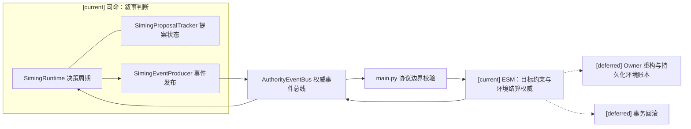
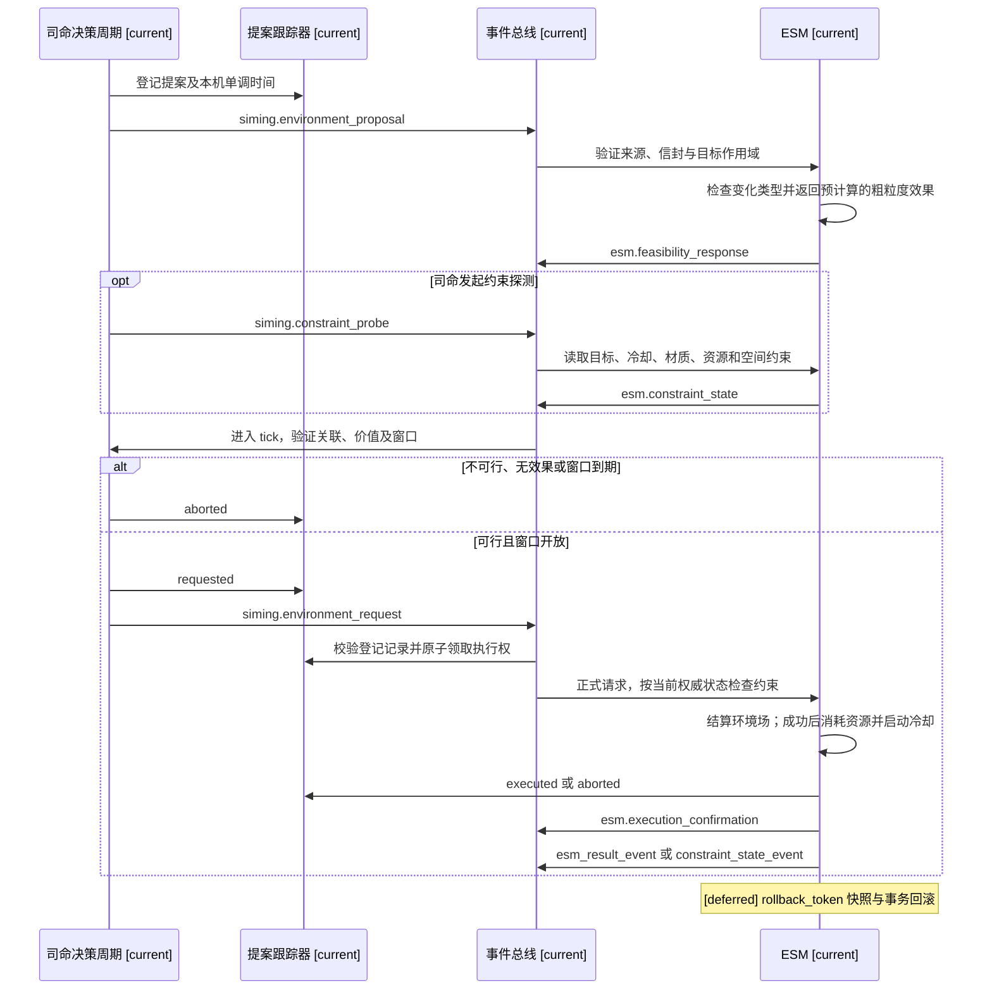
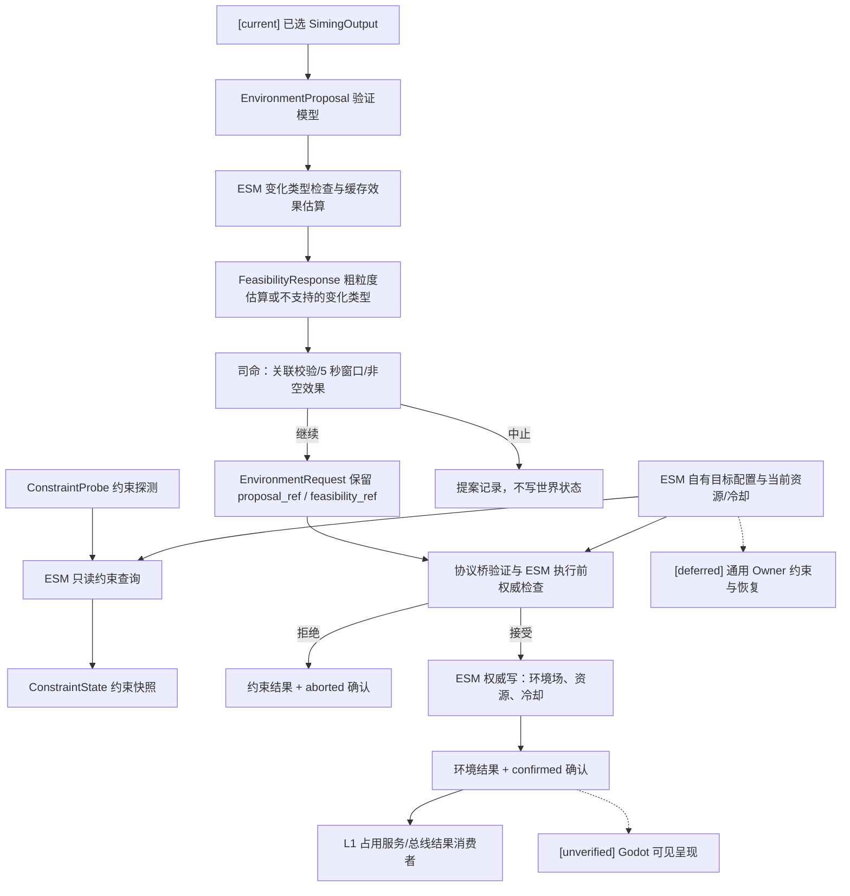

# Protocol 09：ESM 提案契约

日期：2026-11-16。实现范围：`[current]` 后端三阶段协商、只读约束探测、执行确认及旧请求通道。
Godot（场景引擎）可见结果与外机运行验收保持独立，不能由后端测试代替。

## 所有权与模块边界

司命只产生高层提案。ESM（环境状态机服务）拥有环境可行性、执行和最终状态；可行性结果不构成结算承诺。
`SimingRuntime._start_tick` 同步兼容入口与现有 owner（所有者执行线程）入口共用决策逻辑。
协议响应通过 `SimingEventPipeline.handle_event` 进入 `tick`，不发起模型调用，也不改变角色认知权限。
原有异步发布路径经生产者登记提案后再发布，保留现有持久发布记录的失败封闭语义。

## 主要时序

## 数据流与权威边界

## 消息与接口

| 消息 | 模型 | 接收方 | 行为 |
| --- | --- | --- | --- |
| `siming.environment_proposal` | `EnvironmentProposal` | ESM | 校验信封与模型中的作用域，按变化类型返回粗粒度效果 |
| `esm.feasibility_response` | `FeasibilityResponse` | 司命 | 在决策周期内继续或中止；拒绝不相关、重复或迟到响应 |
| `siming.environment_request` | `EnvironmentRequest` | ESM | 正式结算；新协议附 `proposal_ref`、`feasibility_ref` |
| `siming.constraint_probe` | `ConstraintProbe` | ESM | 由事件信封提供房间/场景/区域，避免跨作用域查询 |
| `esm.constraint_state` | `constraint_probe.ConstraintStateResult` | 司命 | 保存有界只读投影；与世界约束结算模型不同 |
| `esm.execution_confirmation` | `ExecutionConfirmation` | 总线消费者 | 仅真实结算成功后 `confirmed`，拒绝时 `aborted` |

`EnvironmentProposal`、`FeasibilityResponse`、`ConstraintProbe`、探测结果与 `ExecutionConfirmation`
采用 Pydantic（字段验证库）模型；使用 `model_dump` / `model_validate` 序列化和解析，拒绝额外字段、空白必填标识与非法枚举。
`constraints_known` 和 `fallback_options` 只是建议，不能覆盖 ESM 权威规则；当前不会自动执行备选提案。

`ESMService.evaluate_proposal(proposal)` 按变化类型返回粗粒度估算。服务初始化时使用正式执行的效果映射构建响应模板，每次评估生成独立响应。
目标存在性、冷却、材质、资源及空间条件由约束探测读取，并在正式执行时按当前状态检查。
现有粗粒度执行会把所有环境场维度投影到稳定态，因此估算给出完整的稳定态字段。强度沿用正式执行的粗粒度语义。

`ESMService.register_environment_target(room_id, scene_id, zone_id, target_environment_id, **constraints)`
是可信后端配置入口。可登记 `compatible_change_types`、`cooldown_ms`、`cooldown_until_ts`、`resource_available`、
`resource_cost`、`spatial_allowed`。材质兼容与空间许可由该目标的 ESM 配置表达，未实现通用材料仿真或空间规划。
生产组合根显式登记 `room_demo/scene_demo/zone_focus/env_lamp`；其他作用域与目标必须显式登记。
目标名称不能代替作用域登记。冷却与资源按完整作用域隔离。
正式执行在同一 ESM 锁内检查约束并结算，避免两个请求同时消费同一资源。

`probe_constraints(probe, *, room_id, scene_id, zone_id)` 返回指定约束面；未知目标返回 `target.exists=false`。
`execute_with_confirmation(request)` 返回确认与可选环境结果；普通协议处理保留原有 resolution（结算结果）与环境结果的两条回流。
`rollback_token=None` 明确表示尚无回滚能力；不把请求发送当成执行成功。

## 生命周期、时钟和兼容

- 默认 `SIMING_USE_PROPOSAL_PROTOCOL=true`。设为 `false` 保留单阶段直接请求；`emit_environment_intervention(..., use_proposal=False)` 可显式选择旧通道。
- `materialize_outputs` 保持无发布副作用；`publish_events` 在发布前冻结并登记提案。提案标识包含内容及作用域摘要，同一提案重投不重新登记或执行。
- `pending → requested → executing → executed`；不可行、无价值、超时或执行拒绝进入 `aborted`。重复响应和重复正式请求不会再次执行。
  一分钟后清理完整提案记录，进程内保留标识与摘要组成的精简去重回执，防止清理后重放重新打开窗口。
- 本机单调毫秒用于 5 秒窗口与 60 秒清理，不把 Godot 启动时钟与 Unix 时间比较。响应中的时间不能延长本机窗口。
- 生产司命轮询周期清理超时提案；同步工具入口在处理响应/登记新提案时清理。进程重启后不恢复挂起提案，旧响应不能重新产生正式请求。
- 单阶段旧通道保留原本无目录目标兼容语义；已登记的约束仍会在执行时检查。协商请求对未知目标拒绝。
- ESM 不可用时返回不可行响应并中止。自动降级重发、批量协商、复合请求、基于实时状态的预测缓存和事务回滚为 `[deferred]`。

## 实现与证据映射

| 层 | 实现 | 验证 |
| --- | --- | --- |
| 契约 | `backend/app/models/environment_proposal.py` 等 | `test_protocol_09_models.py` |
| 评估与执行 | `backend/app/services/esm_service.py` | `test_esm_proposal_evaluation.py` |
| 司命决策与跟踪 | `siming_runtime.py`、`siming_proposal_tracker.py` | `test_siming_proposal_lifecycle.py` |
| 总线与结果 | `backend/app/main.py` | `test_protocol_09_full_integration.py` |
| 生产组合根与所有者线程 | 应用 lifespan（生命周期）、`runtime_execution.submit` | `test_protocol_09_owner_integration.py` |
| 兼容 | `siming_event_producer.py`、`siming_environment_protocol.py` | `test_siming_event_producer.py`、`test_siming_environment_protocol.py`、`test_siming_esm_protocol_stub.py` |

全后端、性能与 Harness（仓库验收框架）的本轮结果以实施计划的验收记录为准，不以本页结构说明代替执行证据。
