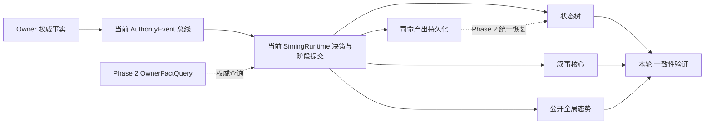
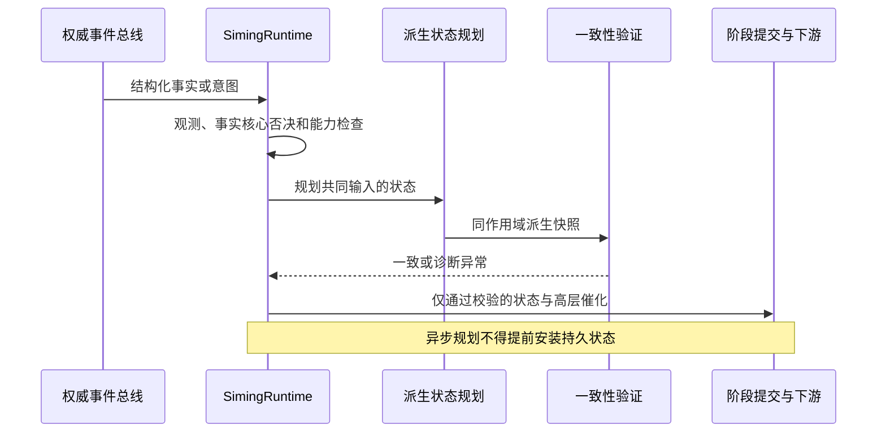
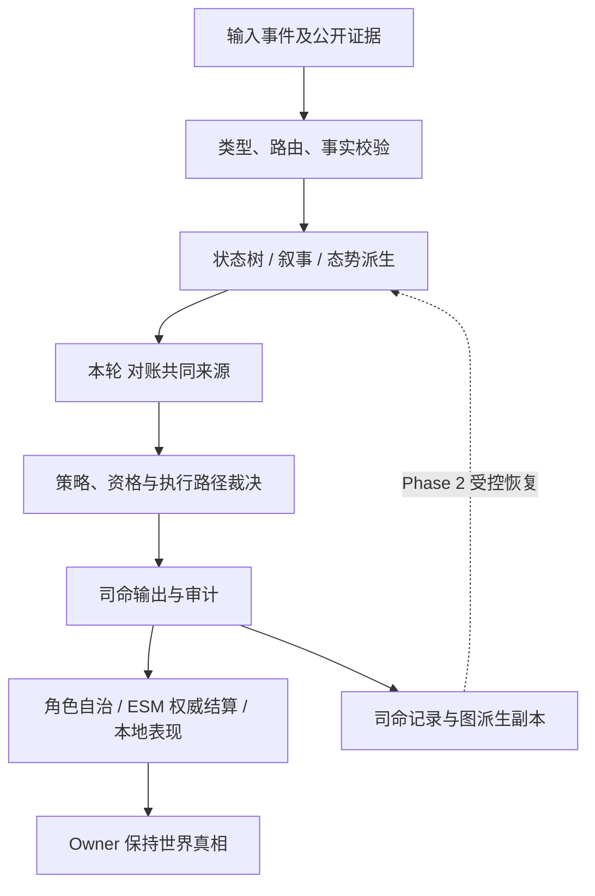

# 司命状态模型

本文件是四份契约的共同图表入口；另见 [输入](INPUT_CONTRACT.md)、[输出](OUTPUT_CONTRACT.md)、[投影](PROJECTION_CONTRACT.md)。以下“当前”描述本轮实现，“计划”及 Phase 2 明确不代表现有能力。

| 模型 | 当前所有权和用途 | 恢复边界 |
|---|---|---|
| InMemorySimingStateTree（内存状态树） | 最近事件的实体投影、叙事阶段、群体摘要；不是角色名册 | 确定性阶段效果安装快照 |
| SimingNarrativeCore（叙事核心） | 按房间累计 revision（本地修订号）和开放义务数量，生成状态与种子 | 安装 NarrativeRoomState（房间叙事状态），不重放累计 |
| SimingGlobalSituationLayer（全局态势层） | 公开证据、权威事件引用及非权威态势压力；不持有角色私有上下文 | 当前为内存派生状态；不充当恢复真相 |
| SimingDataLayer（司命持久事实层） | 保存司命产出的快照、候选、决策；与热缓存分离 | 三模型统一加载接口留待 Phase 2 |

状态树的 `sim_tick_ts`（司命处理时间）与叙事核心的“源时间 + 房间修订号”不是同一计数器。对账应检查输入作用域、来源事件、世界时间和目标引用；不得拿 Owner 修订号与本地时钟比较。

## 架构图

## 时序图

## 数据流图

Phase 2: 事件历史溯源、跨 Owner 版本向量对账及三模型统一持久恢复。群体与图专属路径未使用这些模型时不伪造空状态冒充对账成功。
