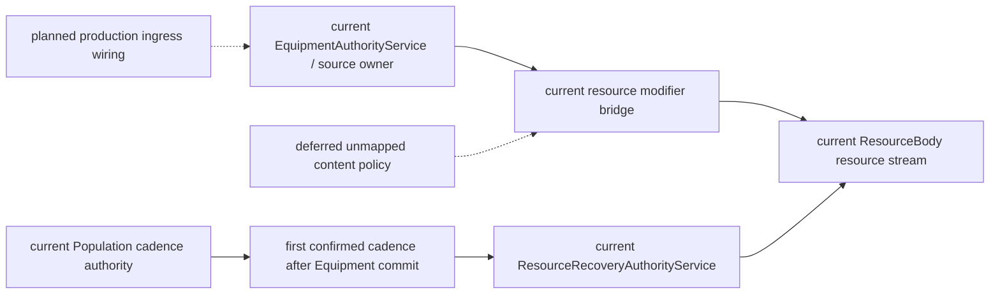
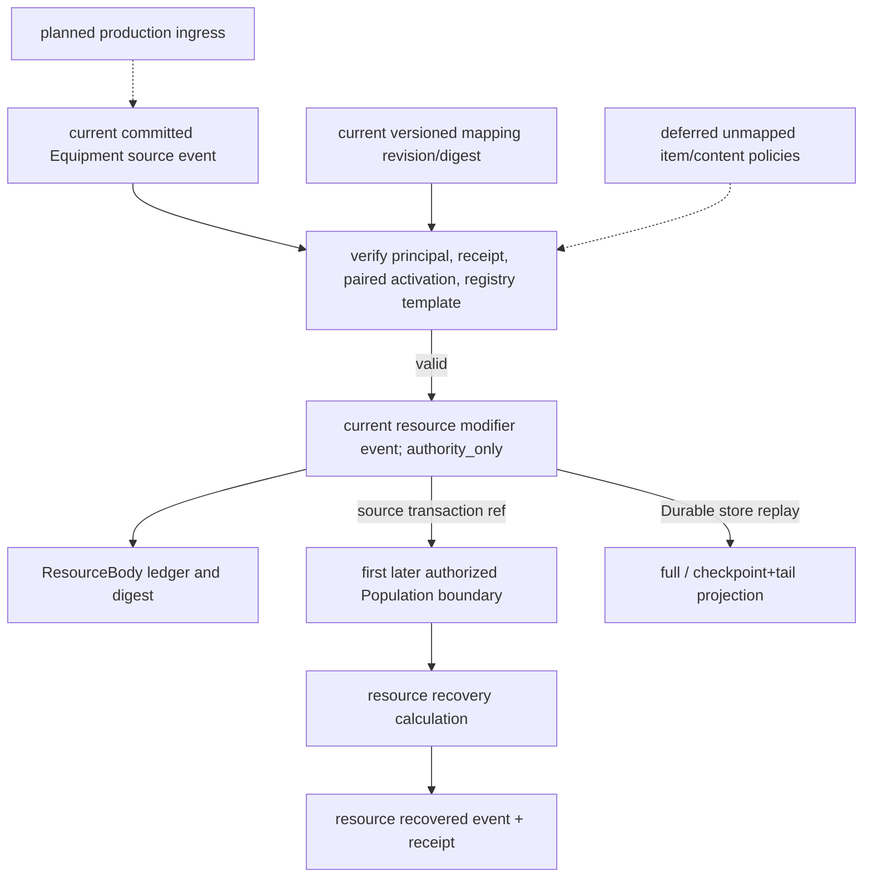
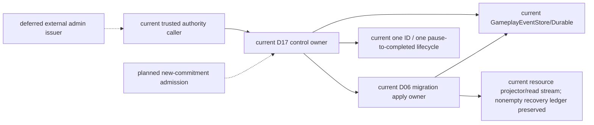
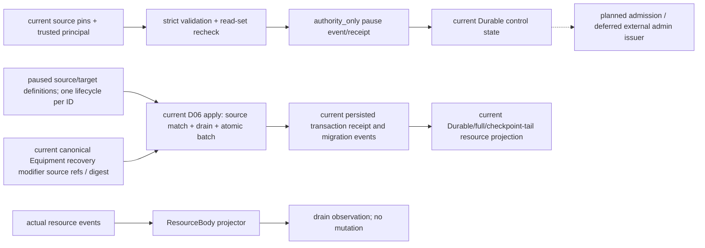
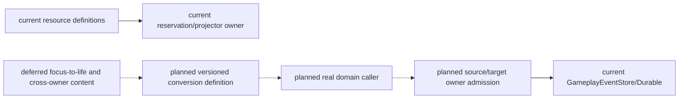
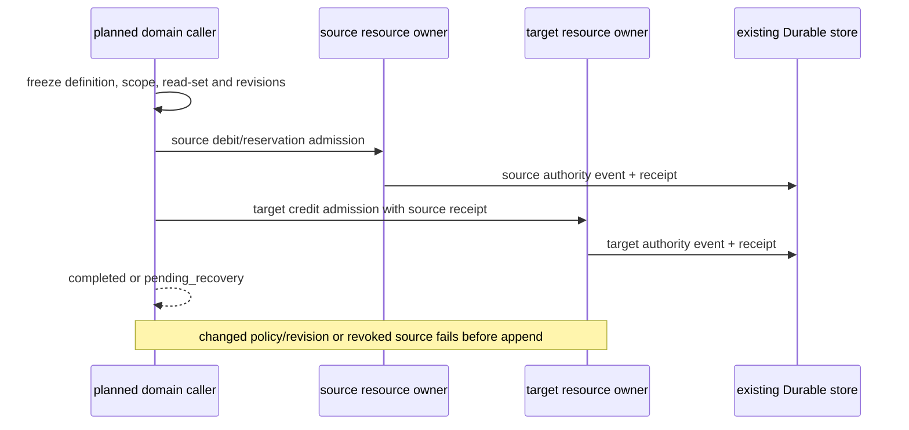
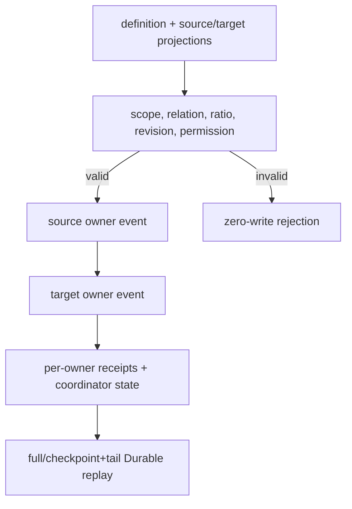
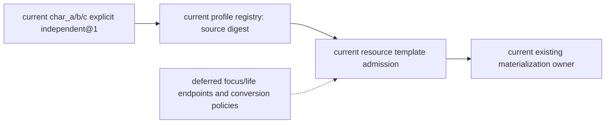
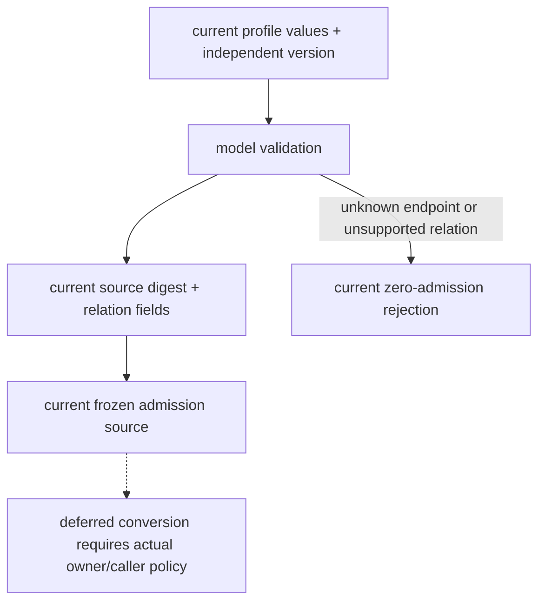

# Resource World-Time Recovery Implementation Plan

> **For agentic workers:** This bounded plan covers the remaining resource recovery slice for Stage 3 Task3/Task6.

**Goal:** Apply character-template recovery policies at confirmed Population world-time boundaries through the existing resource owner and durable event store.

**Architecture:** Population cadence confirmation is the only caller-side time source. A read-only caller freezes the confirmed timeline/tick and resource stream revision, then the resource owner re-reads materialized policy events and atomically appends recovery events to the same resource stream. Recovery is replayed by the existing `ResourceBodyRuntimeProjector`; no scheduler, clock, ledger, permission system, or replay truth is added.

**Tech Stack:** Python, Pydantic, existing GameplayEventStore/DurableGameplayEventStore, pytest.

## Global Constraints

- Recovery uses confirmed Population world time, while operational deadlines remain separate.
- Resource policy is the stage-three source designed and implemented in the character template registry; it is not historical content.
- Resource values are integer and debt is forbidden.
- Inventory custody remains separate from ResourceEntry.
- No facility-repair decision is changed and no forbidden calibration/evaluation workflow is run.

## Review Focus

- A later confirmed tick must recover only complete policy periods and never exceed maximum.
- Repeating the same idempotency key after a lost response or Durable reopen must return the original receipt without writing.
- A changed target tick, cadence source, or read revision must be rejected without mutation.
- Full replay and checkpoint plus tail must produce identical resource projections.
- Recovery must not run before materialization or after a conflicting resource stream head.

## Reservation duplicate receipt integrity (本次修复)

`ResourceReservationAuthorityService` duplicate lookup validates the persisted transaction's `result_digest` against the reservation event payload. For v2 operations it also validates both reservation and paired lock events: schema version, stream/transaction/command identity, causation/correlation, authority-only visibility, actor/resource/reservation/lock refs, and equal amount. This prevents an exact idempotency retry from returning a success receipt when the durable batch metadata or paired event contract has drifted. Regression coverage is in `backend/tests/test_resource_v2_locks.py` and is included in `infra-resource-world-time-recovery`.

### Task 1: Recovery owner and caller

**Files:**
- Create: `backend/app/gameplay/resource_recovery.py`
- Modify: `backend/app/gameplay/resource_body_runtime.py`
- Test: `backend/tests/test_resource_recovery.py`

The caller accepts only an already confirmed Population boundary. The owner scans materialization and prior recovery events, computes complete periods per resource, and appends one atomic batch. The event type is `gameplay.resource.recovered`; the projector treats it as an integer adjustment while retaining the recovery metadata.

### Modifier-to-resource bridge (本次设计并实现)

**Product mapping:** `item:mana-focus-charm@1` in the equipment registry grants `modifier-template:mana-focus-recovery@1`. Its canonical `ModifierTemplate` is `stat_id=resource.core.mana.recovery`, `operation=additive`, `value=Decimal("1")`. The versioned mapping `resource-modifier-mapping:mana-focus-recovery@1` pins that exact template and resolves to `core.mana`, `recovery_delta=+1` integer per already-confirmed resource recovery period. The mapping changes recovery quantity only; it does not change base capacity, current resource, world clock, or cadence. This item and policy are introduced by this stage-three design; they are not historical content.

**Source and authorization:** `EquipmentAuthorityService` remains the sole source owner. Its `actor_gameplay.equipment_domain` transaction writes the canonical `gameplay.modifier.source_activated` or `gameplay.modifier.source_deactivated` event to `gameplay:modifiers:{actor_ref}` along with the equipment activation/deactivation. The bridge receives only a committed source transaction/event reference; it re-reads the transaction and exact event from the shared GameplayEventStore, checks the persisted principal, actor, event/stream type, transaction and event refs, matching equipment activation/source_ref and registered ModifierTemplate. It rejects caller-supplied amounts, source refs, or mapping revisions. The bridge freezes mapping revision/digest and resource source event ref in `gameplay.resource.modifier_attached` / `gameplay.resource.modifier_detached` on the existing resource stream. Append uses the current resource revision and modifier source stream head as an atomic read-set; any intervening change rejects or causes retry.

**Recovery, receipt, and privacy:** ResourceBody replays the bridge event into its existing modifier ledger/digest; `ResourceRecoveryAuthorityService` adds the active integer recovery deltas to the template-authored amount at the existing Population-confirmed world tick. Resource modifier bridge receipts use the existing store idempotency/transaction index, keyed to the canonical source event; exact retry returns the same committed event refs after Durable reopen, while changed or incomplete receipts fail closed. Bridge events remain `authority_only`; no private cognition or inventory custody fields are copied. Full replay and checkpoint+tail must agree on ledger digest and recovery result.

**Temporal rule:** Equipment events do not invent world time. For this item, the first fully committed and still-authorized Population cadence event after the complete Equipment source transaction fixes the modifier's effective world tick. Recovery uses the normal resource policy periods from that boundary. Later cadence events do not change the pinned boundary; revoking the selected cadence invalidates recovery. Operational deadlines remain on their existing operational-time contract.

**Failure/recovery boundary:** Equipment source transaction and bridge write are separate committed transactions. If the bridge response is lost, the caller retries from the persisted Equipment transaction; resource writes are idempotent by source event. If bridge append fails on revision conflict, Equipment remains authoritative and the bridge is pending until retry; no projected resource modifier is claimed before its bridge event commits. This does not add a second ledger or permission system.



```mermaid
sequenceDiagram
  participant C as Equipment caller (current service API)
  participant E as Equipment owner
  participant B as Resource modifier bridge
  participant S as shared GameplayEventStore / Durable store
  participant P as Population cadence
  participant R as Resource recovery owner
  C->>E: equip or unequip
  E->>S: commit canonical Equipment transaction
  E->>B: sync committed transaction
  B->>S: verify source receipt, activation and pinned mapping
  B->>S: append resource modifier with CAS read-set
  Note over E,B: bridge failure leaves Equipment committed; exact retry repairs it
  P->>S: commit authorized cadence
  R->>S: resolve first cadence after Equipment transaction
  R->>S: append recovery at confirmed tick
  Note over C,R: production ingress wiring remains planned
```



### Task 2: Documentation and evidence

**Files:**
- Modify: `docs/10月分析/规格/10-通用资源状态效果影响源与装备领域规格.md`
- Modify: `docs/10月分析/计划/04-通用合同与领域服务实施计划.md`
- Modify: `docs/10月分析/回写/stage3-closure-20261016.md`

Record source, owner, caller, event, recovery, replay, and the focused test/Harness evidence. Preserve unresolved world-admin identity and T07/T09 as incomplete.

## D17 pause/drain control owner（本次设计并实现）

控制 owner 复用 GameplayEventStore/DurableGameplayEventStore，authority_only 控制流为 `gameplay:resource-migration-control:{actor_ref}`。pause 冻结 migration id、actor 范围、source/target definition revisions、schema/codec/migrator digests、resource/control revisions、read-set、显式受信 authority principal 与幂等身份。它不提供 world-admin 身份发行，当前 principal 仅是现有受信后端调用边界。未知或变更 source pins、revision 竞态、变载荷重复 key 都零写。

`observe_drain` 只重读整个 actor 资源流的 ResourceBody 投影，返回 drained/pending/unknown/revision_conflict、reservation refs 与 resource revision；它不写 drained、不取消预留、不伪造退款。原 owner 的 consume/release 按旧合同继续。控制 receipt 由原 store 查询；关闭 Durable 后新 owner 必须重放 pause receipt 与控制状态。full/checkpoint+tail 对比控制状态、事件 refs、revision。

## D06 resource migration apply owner（本次设计并实现）

### D06/D17 migration lifecycle correction and real nonempty-ledger evidence

本次先以两个失败用例复现控制漏洞：更换幂等 key 后，同一 migration ID 可以覆盖 active pause 的 source/target pins，或在 completed 后重新 pause。修复后 migration ID 在 actor/control stream 内只允许一个生命周期；exact 原 key 仍按原 receipt 重放，新 key 使用已有 ID 则 `resource_migration_id_already_used` 零写拒绝。apply 的新 key 遇到 completed ID 返回 `resource_migration_already_completed`；关闭 Durable 后也由原 control 事件重建该判定。该检查复用原权限边界，不把 pause 与 apply 的两个后端 principal 合并，不发行新管理员身份。

`test_d06_equipment_recovery_modifier_survives_durable_migration_and_recovery` 使用既有 `EquipmentAuthorityService.equip` 消费 authored `mana-focus-charm.v1.yaml`，经过正式 bridge 写入非空 recovery modifier ledger；D17 pause 后由 `ResourceMigrationOwner.apply` 将已登记 mana policy revision 切换。验证 ledger、mapping revision/source refs 与 ledger digest 保留，full/checkpoint+tail 整体投影一致；真实关闭并重新打开 SQLite Durable store，再建 migration/recovery owner，原迁移 receipt exact duplicate 可查，随后 Population cadence 驱动恢复，current 从 4 到 9（4个基础周期 + 边界20的装备增量1）。因此 D06 的这条证据不再局限于空 ledger。

该用例验证既有真实 domain service caller 链及本次 policy rebind 技术合同；迁移 source/target definition registry 和初始 mana materialization 是测试输入，不宣称其已成为 production migration ingress 或受信世界内容包。capacity modifier 的迁移后重新计算、全部消费方统一 source/target pins、管理员身份/撤权、跨 owner conversion 仍未闭合。R04 的 fused/coupled/focus→life 无正式内容和 caller，R05 的跨 owner 多资源转换无已登记转换政策/真实 caller；不能由这个 recovery modifier 用例宣布通过，也不新增转换业务来迎合验收。禁止欠值政策保持，debt 不开正值路径。

`ResourceMigrationOwner.apply` 只接受与 pause 事件冻结的 source/target definition revision 一致的请求；该匹配在规划资源前完成，迁移批次按实际已登记资源数生成，不假设角色一定拥有固定数量资源。应用前重新投影整个资源流，要求所有资源都来自同一 source definition，且 reservation 与 lock 均 drain。迁移事件和 control completion 进入既有 store 的一个多流原子 transaction。duplicate receipt 通过 Durable store 重新取 transaction、逐项比对 committed event refs、事件内容、command/principal、stream revision 与 global sequence；任何缺失或不一致均拒绝重放。旧事件维持 legacy decoder 路径，不自动升级。

本实现仍不提供 world administrator 身份 issuer；`authority_principal` 是后端可信调用边界传入值，不构成外部管理员身份事实。迁移后 owner 允许新 v2 reservation，且仍要求独立 lock_ref 配对。该 slice 的可验证边界是已登记的资源定义与现有 Durable store，不等同于规格 10 的完整资源内容政策、管理员授权或全资源迁移准入。

本切片实现控制 owner、已登记资源的 D06 apply 与 ResourceReservationAuthorityService admission 接线；其他新承诺入口仍由主线程逐项审定。完整资源内容准入与外部管理员 issuer 仍未覆盖，不能因此声称 D06/D17 整体完成。



```mermaid
sequenceDiagram
 participant C as trusted caller
 participant O as control owner
 participant S as existing store
 C->>O: pause frozen pins + expected revisions
 O->>S: reject ID reuse; exact key replays original receipt (current)
 O->>S: read control/resource revisions
 O->>S: atomic pause event + receipt (current)
 C->>O: observe_drain
 O->>S: read actual reservations
 O-->>C: pending/drained/unknown/conflict (current)
 C->>O: apply matching frozen source/target pins (current)
 O->>S: re-read projection and atomically append resource migration + completion
 O-->>C: durable receipt; duplicate replay validates transaction (current)
 Note over O,S: completed ID cannot reopen or apply with a new key
 Note over C,O: planned admission hookup; deferred external admin identity
```



## R04/R05 bounded design review (2026-10-19)

本次只审定规格10的 R04/R05 依赖，不把已有 resource reservation 或 recovery 事件误认为转换实现。当前可核对的运行入口是 `ResourceReservationAuthorityService`、`ResourceBodyRuntimeProjector` 和 `ResourceBoundsMigrationAuthorityService`；它们分别拥有 reservation/lock、资源投影和 definition migration。现有 `ResourceEntry` 的 `current/reserved/locked/debt` 仍由这些 owner 按已登记 policy 解释，尚无 fused/coupled/independent 关系注册或 focus-to-life 转换入口。`assets/gameplay/resource-equipment/mana-focus-charm.v1.yaml` 与 `resource_modifier_admission.py::register_mana_focus_content()` 的 `mana-focus` 是装备对 `core.mana` 的恢复 modifier；它不是 `mental:focus` resource definition，也不是 focus→life conversion。`FocusStateService` 表示交互焦点目标，同样不属于游戏认知资源。

### Policy decision

R04 的三个关系（`independent`、`coupled`、`fused`）是**必须被 schema/validator 明确表达并拒绝歧义的模式**；每个已发布 world/profile 还必须显式选一个，不能由模型推断。遵循本阶段“资源仅三项、debt forbidden”的 authored profile 政策，当前 char_a/b/c 选择 `independent`，且当前没有 `mental:focus` 或 `life` resource 定义。因此其本阶段可实现/验收的规则是：三项资源彼此独立；focus→life 请求因为任一端未注册必须 zero-write 拒绝。模式 validator 应覆盖 fused/coupled/independent 字面定义和不兼容字段，但不伪造这些模式对应的世界业务实例。未来明确注册两端 resource 和 conversion 后，才可以用成功 case 验收 focus→life。

R05 是跨 owner 调用合同要求，不意味着当前必须发明一次跨 owner 转换。若本阶段没有真实领域动作需要它，保留 `not_verified`，且验证零写拒绝、各 owner receipt/recovery API 契约即可；不得新增为测试服务的 synthetic conversion caller。将来存在真实动作时，必须为两个 owner 明确授权边界、分别提交 receipts，并按 spec09 恢复；不是全局 rollback。

### Minimal implementable contract when a source exists

* **Source:** versioned world/profile relation definition (`independent` now for the three current resources) plus, only when a real conversion is introduced, a conversion definition with `definition_ref/revision/digest`, source/target resource refs and owner refs, relation kind, integer ratio/rounding, actor/world/timeline scope, effective world tick, read principals, receipt lookup and revocation owner. `ResourceEntry` is the target state only; Inventory custody remains outside it (RW-44).
* **Caller:** a named domain consumer freezes the definition, source and target stream revisions, read-set, temporal authorization and idempotency key. It must not derive a conversion from a model, animation, item name or current balance.
* **Owner:** the source resource owner validates availability/reservation/debt policy and emits its authority receipt. For R05, the target owner validates its own policy and emits a second receipt; the coordinator records the dependency and recovery state in the existing event store rather than creating a global ledger.
* **Events/recovery:** append source debit/reservation and target credit only through existing atomic batch facilities when both streams are owned by the same authority boundary. Otherwise use a persisted `pending_recovery` coordinator record, retry exact source/target commands, and never claim a cross-owner atomic rollback. Duplicate receipts must be reloaded after Durable reopen and compare event refs, stream revisions, source/target definition pins, digest and visibility.
* **Privacy/revocation:** receipts are `authority_only`; projections expose only the caller's allowlisted resource fields. A revoked definition or changed source/target revision fails closed before any append. Replay must preserve relation, policy revision, event refs and per-owner receipts; full and checkpoint+tail must match.

### Current/planned/deferred boundary

`current`: reservation/lock, resource projection, recovery, bounded migration and three authored no-debt resource values. The independent relation is the recommended product choice in this review, not an already registered field. `planned`: a small relation definition validator that requires explicit `independent|coupled|fused` and rejects missing resource endpoints; it can be exercised through registered profile definitions without writing facts. `deferred`: focus-to-life business conversion (focus and life endpoints absent), coupled/fused world instances, and cross-owner conversion policy/caller. No external condition is needed to settle these product defaults because the user authorized policy choice; the remaining limitation is that a successful conversion has no actual business source or caller. Do not claim R04 successful conversion or R05 cross-owner success until those exist.







### Bounded implementation evidence: independent relation (本次设计并实现)

`CharacterResourceTemplate` 与 `ResourceTemplateSource` 现携带 `relation_policy_ref=resource-relation:independent@1` 和 `relation_kind=independent`。三份 char_a/b/c authored YAML 显式声明该政策；`CharacterProfileRegistry.resource_template_source()` 将它纳入完整 source digest 并带给 admission。模式类型保留三个已设计词的区分，但当前 validator 只准入上述 independent 版本；coupled/fused、未知词、其他 policy ref 均不准入，不产生转换事实。ResourceId 的三项限定继续拒绝 mental:focus/life 等未注册端点。

兼容路径只针对旧三资源模板的缺字段解码：按本次独立政策解释为 independent@1，保留原 template revision 且不写回文件或历史事件。它不迁移已提交资源流，也不把旧 receipt/source digest 改写成新 digest；旧冻结 source 与新 source 不一致时仍由既有 `source_changed` 重验拒绝。

显式 allowlist：`python -m pytest -q backend/tests/test_resource_template_admission.py backend/tests/test_character_profile_loader.py backend/tests/test_resource_materialization.py`，**56 passed**。测试先证实 coupled/fused 原先意外可准入，再加严 validator；覆盖正式 profile 来源、旧模板文件不变、未知端点与非法 relation 拒绝，并保留 materialization owner 的既有验证。该证据不声明 R04 focus→life 成功或 R05 跨 owner 转换通过。



```mermaid
sequenceDiagram
 participant Y as authored profile
 participant R as profile registry
 participant A as template admission
 Y->>R: explicit independent policy or legacy missing fields
 R->>R: decode independent@1; validate three resource endpoints
 R->>A: immutable source with relation + source digest
 A->>A: reject unsupported relation/policy; freeze/revalidate source
 Note over Y,A: current: no conversion write; deferred: coupled/fused execution
```


