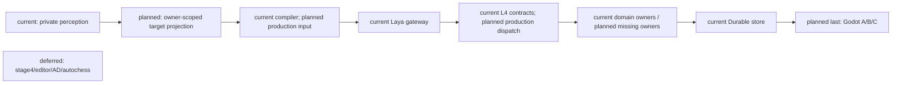
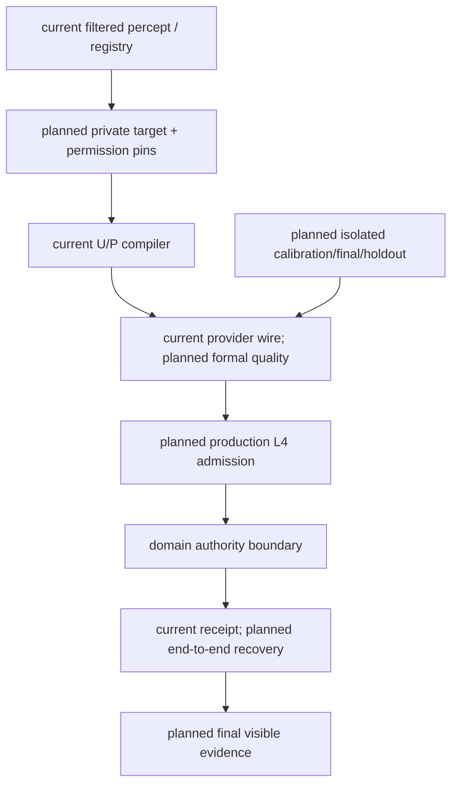

# October Mainline Stages 1–3 Implementation Plan

> **For agentic workers:** Use superpowers:executing-plans for task-by-task implementation. Native subagents may audit independent bounded lanes. Preserve other worktree changes.

**Goal:** 整体完成十月主线阶段一至三的实现与验收，包含完整 Laya、角色与真实领域 owner 闭环，以及最后集中完成的 Godot A/B/C。

**Architecture:** 复用现有 CharacterTurnContext、MindFrame、L1–L4、gateway/Laya、RuntimeExecution 和 GameplayEventStore。角色缺少领域能力时先完成对应 owner，再返回角色；模型与 Godot 只提交结构化 intent，不成为世界 authority。

**Tech Stack:** Existing Python/Pydantic/pytest/Harness backend, official Laya adapter, existing Godot actors and qualified motion assets; no new dependencies.

**Spec:** `docs/10月分析/规格/00-四域统一架构与执行顺序总规格.md`、规格01–12、17；2026-10-20 用户新授权。统一状态和验收边界见[矩阵](../../10月分析/回写/october-stages-1-3-acceptance-20261020.md)。原计划01–04继续定义领域语义，本计划整合依赖与验收，不重新定义对象。

## Global Constraints

- Godot 修改、启动、操作和场景验证最后集中进行；此前不启动引擎。
- 阶段四、通用编辑器、AD/Blender、自走棋和明确 deferred 项排除；复用合格动作。
- 保留真实 source、authority、隐私与 freeze 隔离；不能把 ack、choice、provider 可调用或合同测试当完整闭环。
- 不自动训练/微调。不为补证据运行全量 pytest/Harness all；最终确需扩大验证，先说明必要性。
- 小批次精准提交，保留用户历史 dirty。证据显式导出仓库外，清理只针对本轮资源。
- Goal 保持 active；工具目前无法改 objective，本计划记录扩展目标，不虚报旧目标完成。

## Review Focus

- 可见 target 不等于有权执行全部动作；按动作核验 affordance/owner/revision。
- source/request/turn/frame/candidate/contract/receipt 必须可关联；禁止 fallback 冒充原动作执行。
- 提交后丢响应不能重复结算；恢复读取原 owner receipt。
- 目标过期、撤权、旧 worker 迟到必须零写；后台 cognition 继续不发执行命令。
- 开发/校准暴露输入不能进入独立 final/holdout；source drift 不能只更新 hash。

## Task 0: 收尾管理员入口与建立统一状态

- [x] 修复 production spawn wiring、执行前身份重验、启动校验 secret 泄漏；定向 Task1/Task6/docs passed 且 cleanup passed。
- [x] 提交独立 credential 层 `c2ebb578`，保留其余历史混改。
- [x] 依据原规格/计划/回写/当前代码建立统一矩阵；准确区分四种状态与历史证据。
- [x] 文档门禁后以 `9929127` 提交本整合计划及矩阵，继续 Task1。

## Task 1: 真实私有输入、动作目标与同源能力

**Files:** `backend/app/models/character_agent_runtime.py`、`character_agent/reasoning/l1_perception.py`、`planning/l3_planner.py`、`runtime/runtime_loop.py`、`reasoning/l2_reasoner.py`；复用 `services/scene_affordance_registry.py`、`character_agent/skills/service.py`。测试在 `backend/tests/` 中沿已有 L1/candidate/capability 入口增加。

**Interfaces:** 已过滤的真实感知＋现有 registry/owner 的版本与权限→私有 target catalog、visible refs、action-specific affordance→既有 CandidateCompiler；同一 turn 的 envelope/policy→L2/L3/dialogue/recall。

- [ ] 先逐项映射真实 source 和已有 registry/owner API，再为生产路径缺失写 RED：无目录、动作权限交叉放行、空 visibility、跨 actor/scene、旧 revision。
- [ ] 最小接线；unknown/missing source 继续明确不可用，不猜当前玩家或 attention；不建第二候选编译器。
- [ ] 通过现有 typed snapshot/session serialization 证明输入不会被丢弃；定向 L1、candidate、capability/gateway tests 及对应 Harness，导出证据。
- [ ] 矩阵更新 R05/R06 的精确能力边界，提交该批实现。

**已提交子项（不关闭 Task 1）：** `10de477f` / `4fa9d0ea` 修复 perceived/self-body 的 canonical turn→L2 recall 传递，精确暂存隔离分别 52 / 57 passed。`19078684` 已将同一冻结 envelope/policy 扩展到 perceived、self-body、同步 Siming 的 L2/L3，精确暂存隔离 95 passed（run `f462954ad3ca4669af07a4b511b61c30`）；background/dialogue/recall 硬预算及可信 revisions 仍待完成，不关闭本任务。

## Task 2: 第一条真实 Laya→L4→owner 纵切

**Files:** `character_agent/runtime/runtime_loop.py`、`execution/l4_adapter.py`、`backend/app/main.py`、既有对应 domain owner/caller，以及原 cognition/runtime application tests。

**Interfaces:** 真实 Siming/获准 ingress→冻结 U/P→官方 Laya choice→canonical execution contract→执行时 admission→原 domain owner receipt→原 outcome/writeback。

- [ ] 选择无需 physics/Godot 的现有正式 owner 动作；确认该动作和 target 都有实际来源及执行合同，禁止为演示编造 world fact。
- [ ] RED 覆盖非 fallback 非空原动作、真实提交/receipt、权限变化零写；接通执行 admission 和 receipt feedback。melee 的 physics 仍留最后。
- [ ] 实际启动本轮拥有的 backend/Laya 服务，发送真实事实；保留同 turn/request/frame/candidate/contract/receipt 关联，不使用 fixture choice 冒充 live。
- [ ] 聚焦验收与矩阵 R07/R08 写回后提交；若缺 owner，先完成对应 D 行再回此任务。

**已提交前置修复（不关闭 Task 2）：** `055d5abf` 将既有 ESM policy/state/occupant 检查补到直接 authority 入口，绑定 request/event 的 actor/scope/target/action，canonical 重复键禁止跨 scope；精确暂存隔离 52 passed。ESM 仍缺 durable transition/receipt 与 canonical 距离来源；Equipment controller binding 不自动授权角色，work intent 注册不等于 owner，social delivery 不等于 played/heard。下一纵切必须显式补合法角色 caller 和 owner admission，禁止伪造 physics 或授权。

## Task 3: 纵切恢复与回放

**Files:** 原 cognition/session recovery、domain receipt/replay participant、Task2 应用测试。

- [ ] RED：owner 提交前/后中断、丢响应、新进程重开、exact/changed duplicate、旧 worker 迟到、receipt 后 writeback 重试。
- [ ] 复用原 Durable store/idempotency/session stages，不造平行 outbox truth。
- [ ] 同一实际 owner 的 full/checkpoint+tail 与零重复写证据；定向验证后更新 R09 并提交。

## Task 4: 按实际依赖交错收口角色与领域

**Files:** 原计划02/03/04各 task 指定文件；统一矩阵 D03–D11/R10–R14。

- [ ] 逐个真实角色 consumer 冻结需求来源、owner、权限、时间、receipt、恢复；已有 owner 优先复用。
- [ ] 正式 Resource capability/modifier/debt/conversion、学习、Soul、canonical faction/target、协同可信 clock、语音三路径按依赖逐项实现；每批沿原规格先 RED，再最小代码和定向验收。
- [ ] 正式准入 owner 加入同一 global cut，验证迁移/权限/隐私 parity；独立 participant 数量不代替共同 cut。
- [ ] 每个可审查批次提交并更新矩阵，历史证据按实际受影响路径失效。

## Task 5: 正式模型质量

**Files:** `character_agent/evaluation/`、既有 `prepare_character_evaluation.py`、`prepare_calibration_preclosure.py`、freeze/run/score scripts 与隔离 fixtures。

- [ ] 审查已有来源 drift 与失败诊断；先核 token/U/P/位置/描述/映射，记录证据后决定下一修复，不自动训练。
- [ ] 基于真实完整 action+target 构造有来源的独立 splits；保留 source revision、trajectory 隔离、truth/transport 分离。
- [ ] 开发归因后新 calibration，冻结预算/阈值/来源，再独立 final/holdout；封存后评分，分别报告完整选择、runtime legality、owner receipt 与角色轨。
- [ ] Q01–Q04 满足后提交正式验收静态索引；原始报告仓库外留存。

## Task 6: 最终 Godot A→B→C

**前置：** 后端可独立验证部分已收口，必要 owner/模型门已满足，接口冻结。到此前不修改/启动/操作 Godot。

- [ ] A 单角色跨情境；真实 backend/Laya、boundary 消息、owner receipt、可见结果及第二情境/恢复。
- [ ] B 单角色连续 Boss；真实 physics/contact、资源/生命/Threat/encounter 结果与恢复。
- [ ] C 双角色连续协同；两个身份、真实信号接收、短契约/语音、连续协同及失败恢复。
- [ ] 必要定向 engine/runtime Harness，导出图像/消息/receipt/trace；若需最终全量门禁，先说明理由，避免违背禁止无意义全量运行的要求。
- [ ] 审查矩阵全部在范围行与证据、精准提交、回收本轮进程/临时副本；只有此后可将整体 Goal complete。

## Architecture / sequence / data flow



```mermaid
sequenceDiagram
  participant B as Backend
  participant L as Laya
  participant O as Domain owner
  participant S as Durable store
  participant G as Godot (last)
  B->>B: current turn/frame; planned target/envelope wiring
  B->>L: complete frozen action+target input
  L-->>B: choice (existing adapter)
  B->>O: planned execution-time admission/dispatch
  O->>S: current owner commit
  S-->>B: durable receipt / exact replay
  B->>B: planned receipt-linked outcome/writeback
  B-->>G: final boundary messages
  G->>G: final visible A/B/C evidence
```



## 执行记录

- Task1：`fac6a634` 已提交独立私有目标目录；ESM inspect 之外仍未完成。
- Task2 前置：已修复 inspect 语义映射、冻结 scope 和 target/source pins；75 项组合回归与4项暂存隔离用例通过。生产 Laya、owner 提交和回执未验收。
- Task2 dependency ruling：原 canonical interact 只产生 accepted；不得将其记成领域提交。补真正 owner 提交时复用已有状态机/领域 event spine，不能以 ack 代替 receipt。

### Task2 owner dependency: bounded ESM object settlement

The existing ESM remains object-state owner. Add an opt-in shared GameplayEventStore to it and a separate explicit settlement method; legacy resolve remains preflight. The initial bounded method supports only registered object-only policies: plaque inspect and worktable use/finish_use. Archive door requires its embodied owner; bench has body effects; letter/switch have environment effects. Reject those routes until their actual owners participate atomically. A worktable transition does not imply work completion, wages or production.

Settlement requires canonical request identity and a finite supplied actor position against registered geometry. This owner-level requirement is not production range provenance or cognition authorization: production caller must still bind the legitimate source and admission/read revisions. Caller read revisions enter the same store batch CAS; no callback is claimed atomic. Resolve on an isolated copy, append the original result/state/owner receipt first, and only then rebuild the live projection. Per-scope object streams prevent scene aliasing; a global principal/key rejects changed scope duplicates. Exact retries return original receipt before rechecking transient range. Recovery validates type/version, owner principal, transaction membership, digest and scope, and never reinterprets old committed state through newer policies.

Acceptance for this sub-batch: real SQLite reopen/exact retry, changed duplicate, scope separation, append failure and lost response, concurrent object CAS, source-read conflict, malformed receipt/recovery, missing/nonfinite/out-of-range position, unsupported side effects zero-write. This closes only the durable owner prerequisite; production Laya/L4/source admission, feedback and full/checkpoint replay remain open. Existing three diagrams above retain current/planned boundaries; this adapter implements the planned Domain owner→Durable store edge only.


**Owner prerequisite committed:** `4a18a6f9` implements this bounded API, explicit schema registration, strict request/event identity before receipt lookup, same-store read CAS, original receipt recovery and a guard against legacy volatile writes for durable objects. Exact staged isolation: 73 passed, run `368161ea887f43db890f67b12870cb19`, export `D:/Users/User/Documents/paralls-evidence/october-stages-1-3-20261020-01/esm-object-owner-staged/`, cleanup passed. Production wiring remains pending.

**Source/admission ruling:** frozen execution contracts already exist in the canonical session execution stage. Admit from that original session record, not `ActionRequest.source`. The session SQLite and GameplayEventStore are separate stores: a session revision is not a world stream CAS. Recover the cross-store crash gap through the original world owner receipt and idempotently record the character outcome. `SessionInputRouter` move targets are intent, not arrival; the street pose path is scene/controller specific. Neither supplies generic canonical ESM range evidence. Preserve fail-closed production admission until a legitimate spatial source is bound, and record the final Godot producer/interface gate explicitly.


### Task 2 来源绑定子项（未关闭 Task 2）

`d13994bd` 已将原 session 冻结合同核验接入生产 canonical execution ingress；精确暂存隔离 39 passed，详情与两项 HEAD 已有 runtime 失败见统一矩阵。下一步保持原合同→可信空间/权限/时钟→L4→owner receipt 的依赖；来源一致不等于 world admission。legacy bundle 收敛仍待完成，不以兼容入口冒充正式闭环。

**Task1 recall budget prerequisite:** `cdaff0a2` caps aggregate memory recall and existing token estimates by the frozen policy before L3 recall and during gateway reselection; semantic card pruning also prunes returned memory. Exact staged isolation: 163 passed, run `84939863833b47b7a4a95367f3806e2a`; backend-contract run `c0948577424d45fd8d98015f5df71143` passed, cleanup passed. This is not total prompt/tokenizer enforcement. Background/dialogue/revision sources remain open. Continue Task2 spatial/admission/owner production wiring next; do not extend local budget tests without a new risk.
