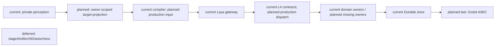
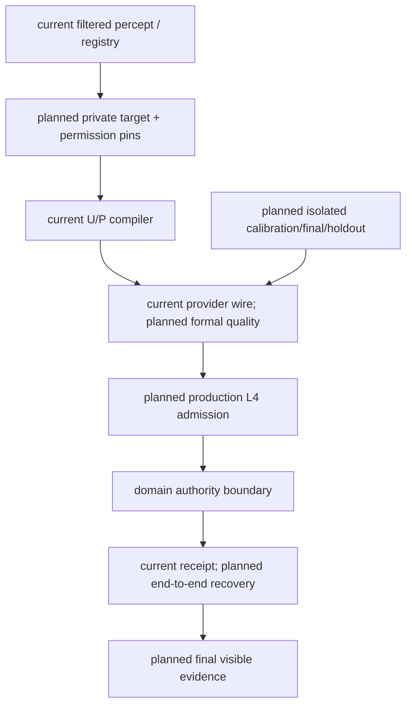

# October Mainline Stages 1–3 Implementation Plan

> **For agentic workers:** Use superpowers:executing-plans for task-by-task implementation. Native subagents may audit independent bounded lanes. Preserve other worktree changes.

**Goal:** 整体完成十月主线阶段一至三的实现与验收，包含完整 Laya、角色与真实领域 owner 闭环，以及最后集中完成的 Godot A/B/C。

**目标扩展确认（2026-10-21）：** 完整 Laya 的验收必须覆盖真实 backend 运行、输入与候选完整性、完整 action+target、L4 执行、真实领域 owner 提交、receipt、恢复与回放；正式模型质量必须按 calibration/final/holdout 隔离完成 Q01–Q04。服务可调用、choice 接纳、合同测试和单 owner slice 只能作为局部证据。Godot A/B/C 在上述后端与角色依赖收口后集中执行；阶段四、通用编辑器、AD/Blender 动作工具链和自走棋继续排除。Goal API 当前只能更新 status，因此扩展目标由本计划和统一矩阵承载，Goal 保持 active。

**Architecture:** 复用现有 CharacterTurnContext、MindFrame、L1–L4、gateway/Laya、RuntimeExecution 和 GameplayEventStore。角色缺少领域能力时先完成对应 owner，再返回角色；模型与 Godot 只提交结构化 intent，不成为世界 authority。

**Tech Stack:** Existing Python/Pydantic/pytest/Harness backend, official Laya adapter, existing Godot actors and qualified motion assets; no new dependencies.

**Spec:** `docs/10月分析/规格/00-四域统一架构与执行顺序总规格.md`、规格01–12、17；2026-10-20 用户新授权。统一状态和验收边界见[矩阵](../../10月分析/回写/october-stages-1-3-acceptance-20261020.md)。原计划01–04继续定义领域语义，本计划整合依赖与验收，不重新定义对象。

## Global Constraints

- Godot 修改、启动、操作和场景验证最后集中进行；此前不启动引擎。
- 阶段四、通用编辑器、AD/Blender、自走棋和明确 deferred 项排除；复用合格动作。
- 保留真实 source、authority、隐私与 freeze 隔离；不能把 ack、choice、provider 可调用或合同测试当完整闭环。
- 不自动训练/微调。不为补证据运行全量 pytest/Harness all；最终确需扩大验证，先说明必要性。
- 小批次精准提交，保留用户历史 dirty。证据显式导出仓库外，清理只针对本轮资源。
- Goal 保持 active；工具目前无法改 objective，本计划记录扩展目标，不虚报旧目标完成。

## Review Focus

- 可见 target 不等于有权执行全部动作；按动作核验 affordance/owner/revision。
- source/request/turn/frame/candidate/contract/receipt 必须可关联；禁止 fallback 冒充原动作执行。
- 提交后丢响应不能重复结算；恢复读取原 owner receipt。
- 目标过期、撤权、旧 worker 迟到必须零写；后台 cognition 继续不发执行命令。
- 开发/校准暴露输入不能进入独立 final/holdout；source drift 不能只更新 hash。

## Task 0: 收尾管理员入口与建立统一状态

- [x] 修复 production spawn wiring、执行前身份重验、启动校验 secret 泄漏；定向 Task1/Task6/docs passed 且 cleanup passed。
- [x] 提交独立 credential 层 `c2ebb578`，保留其余历史混改。
- [x] 依据原规格/计划/回写/当前代码建立统一矩阵；准确区分四种状态与历史证据。
- [x] 文档门禁后以 `9929127` 提交本整合计划及矩阵，继续 Task1。

## Task 1: 真实私有输入、动作目标与同源能力

**完整候选来源审查增量：** 统一矩阵顶部列明 ESM、其他目标动作、combat、协同/移动和质量准备来源的生产差距。旧三选项 authored 包不能替代完整动作/目标来源。本批先修复已复现的 CandidateCompiler 非视觉条件否定被忽略：RED30failed/1passed，typed L3准备与provider输入等精确 HEAD+两文件隔离110passed/4既有warnings（`db76736909f4435e84d5708c88cf6550`，cleanup passed）。保留延后核验的 `required` 及缺字段兼容，故不关闭规格05的肯定证据门槛。下批直接映射已有可信空间来源到 ESM 候选 range、再补原 faction/target 与角色 owner caller，不扩展此局部条件测试。Q01–Q04与完整角色/Godot门不升级。

**Files:** `backend/app/models/character_agent_runtime.py`、`character_agent/reasoning/l1_perception.py`、`planning/l3_planner.py`、`runtime/runtime_loop.py`、`reasoning/l2_reasoner.py`；复用 `services/scene_affordance_registry.py`、`character_agent/skills/service.py`。测试在 `backend/tests/` 中沿已有 L1/candidate/capability 入口增加。

**Interfaces:** 已过滤的真实感知＋现有 registry/owner 的版本与权限→私有 target catalog、visible refs、action-specific affordance→既有 CandidateCompiler；同一 turn 的 envelope/policy→L2/L3/dialogue/recall。

- [ ] 先逐项映射真实 source 和已有 registry/owner API，再为生产路径缺失写 RED：无目录、动作权限交叉放行、空 visibility、跨 actor/scene、旧 revision。
- [ ] 最小接线；unknown/missing source 继续明确不可用，不猜当前玩家或 attention；不建第二候选编译器。
- [ ] 通过现有 typed snapshot/session serialization 证明输入不会被丢弃；定向 L1、candidate、capability/gateway tests 及对应 Harness，导出证据。
- [ ] 矩阵更新 R05/R06 的精确能力边界，提交该批实现。

**已提交子项（不关闭 Task 1）：** `10de477f` / `4fa9d0ea` 修复 perceived/self-body 的 canonical turn→L2 recall 传递，精确暂存隔离分别 52 / 57 passed。`19078684` 已将同一冻结 envelope/policy 扩展到 perceived、self-body、同步 Siming 的 L2/L3，精确暂存隔离 95 passed（run `f462954ad3ca4669af07a4b511b61c30`）；background/dialogue/recall 硬预算及可信 revisions 仍待完成，不关闭本任务。

## Task 2: 第一条真实 Laya→L4→owner 纵切

**Task1 距离来源子项已补：** production resolver 连接当前 ESM 与已有可信空间来源；同 scope/新鲜/绑定有效且有位置映射时生成肯定 range，否则 unknown 或 blocked。typed L1→L3 验证、当前 source/owner 重启绑定、原执行及恢复共102项隔离通过（HEAD e3a5cf36 加4文件，run `1ff4684984624fe99ac3638bcc355b27`）；backend-contract passed，后续 cleanup passed。保留首次 RED 日志导出失败与首轮两项测试错误，详见统一矩阵。不关闭完整 R05/模型质量/角色/Godot。下一批返回正式 faction/target 与原角色 owner caller；本子项不继续扩测试。

**Files:** `character_agent/runtime/runtime_loop.py`、`execution/l4_adapter.py`、`backend/app/main.py`、既有对应 domain owner/caller，以及原 cognition/runtime application tests。

**Interfaces:** 真实 Siming/获准 ingress→冻结 U/P→官方 Laya choice→canonical execution contract→执行时 admission→原 domain owner receipt→原 outcome/writeback。

- [ ] 选择无需 physics/Godot 的现有正式 owner 动作；确认该动作和 target 都有实际来源及执行合同，禁止为演示编造 world fact。
- [ ] RED 覆盖非 fallback 非空原动作、真实提交/receipt、权限变化零写；接通执行 admission 和 receipt feedback。melee 的 physics 仍留最后。
- [ ] 实际启动本轮拥有的 backend/Laya 服务，发送真实事实；保留同 turn/request/frame/candidate/contract/receipt 关联，不使用 fixture choice 冒充 live。
- [ ] 聚焦验收与矩阵 R07/R08 写回后提交；若缺 owner，先完成对应 D 行再回此任务。

**2026-10-20 worktable owner slice:** L3 now expands only registered `use_object`/
`finish_use` descriptors, preserves action-specific target admission digests, and
L4 emits the corresponding canonical interaction request. Durable ESM execution
rechecks a single target, action/target pairing, scope and digest. The focused
worktree run is 47 passed; Harness backend-contract `20c68e3bb7144abfa592c2a64939bdb9`
and docs `eeb0f37f29c844d2a6ad08e15c86f3c0` passed with cleanup. An exact staged
snapshot passed the 5 directly scoped files (80 passed); adding the broader legacy
execution-contract file exposes one unsupported `obj_letter` assertion, reproduced
on unchanged HEAD (`e39e1dd0a0614e509aed6235cc8505dd`). This remains a bounded owner
slice, not live Laya or full R07/R08. Earlier run `c0c28134270c44ce8e21d9a5f9848c93`
is historical and predates the final contract projection tightening.

**已提交前置修复（不关闭 Task 2）：** `055d5abf` 将既有 ESM policy/state/occupant 检查补到直接 authority 入口，绑定 request/event 的 actor/scope/target/action，canonical 重复键禁止跨 scope；精确暂存隔离 52 passed。ESM 仍缺 durable transition/receipt 与 canonical 距离来源；Equipment controller binding 不自动授权角色，work intent 注册不等于 owner，social delivery 不等于 played/heard。下一纵切必须显式补合法角色 caller 和 owner admission，禁止伪造 physics 或授权。

## Task 3: 纵切恢复与回放

**Files:** 原 cognition/session recovery、domain receipt/replay participant、Task2 应用测试。

- [ ] RED：owner 提交前/后中断、丢响应、新进程重开、exact/changed duplicate、旧 worker 迟到、receipt 后 writeback 重试。
- [ ] 复用原 Durable store/idempotency/session stages，不造平行 outbox truth。
- [ ] 同一实际 owner 的 full/checkpoint+tail 与零重复写证据；定向验证后更新 R09 并提交。

**2026-10-21 goal proposal recovery probe:** the restored frozen request and
admission are observed before startup polling; polling safely terminates as
`stale` on actor-pin drift, with no goal event write and no provider call. The
focused test is green after asserting this fail-closed outcome. This is a
negative safety result only; valid provider resume, original goal-owner
acceptance, exact-once replay, and R09 remain open.

## Task 4: 按实际依赖交错收口角色与领域

**Files:** 原计划02/03/04各 task 指定文件；统一矩阵 D03–D11/R10–R14。

- [ ] 逐个真实角色 consumer 冻结需求来源、owner、权限、时间、receipt、恢复；已有 owner 优先复用。
- [ ] Combat/Laya 纵切必须先有真实 L4 contact evidence、Presence/LifeState/Faction source composition 和 authenticated caller，再把 `street_combat_attempt` 接到 `DurableEmbodiedCombatAdapter`/Threat owner；owner API、choice acceptance 或 contract tests alone do not close R07/R08/D08.
- [ ] 正式 Resource capability/modifier/debt/conversion、学习、Soul、canonical faction/target、协同可信 clock、语音三路径按依赖逐项实现；每批沿原规格先 RED，再最小代码和定向验收。
- [ ] 正式准入 owner 加入同一 global cut，验证迁移/权限/隐私 parity；独立 participant 数量不代替共同 cut。
- [ ] 每个可审查批次提交并更新矩阵，历史证据按实际受影响路径失效。

## Task 5: 正式模型质量

**Files:** `character_agent/evaluation/`、既有 `prepare_character_evaluation.py`、`prepare_calibration_preclosure.py`、freeze/run/score scripts 与隔离 fixtures。

- [ ] 审查已有来源 drift 与失败诊断；先核 token/U/P/位置/描述/映射，记录证据后决定下一修复，不自动训练。
- [ ] 基于真实完整 action+target 构造有来源的独立 splits；保留 source revision、trajectory 隔离、truth/transport 分离。
- [ ] 开发归因后新 calibration，冻结预算/阈值/来源，再独立 final/holdout；封存后评分，分别报告完整选择、runtime legality、owner receipt 与角色轨。
- [ ] Q01–Q04 满足后提交正式验收静态索引；原始报告仓库外留存。

## Task 6: 最终 Godot A→B→C

**前置：** 后端可独立验证部分已收口，必要 owner/模型门已满足，接口冻结。到此前不修改/启动/操作 Godot。

- [ ] A 单角色跨情境；真实 backend/Laya、boundary 消息、owner receipt、可见结果及第二情境/恢复。
- [ ] B 单角色连续 Boss；真实 physics/contact、资源/生命/Threat/encounter 结果与恢复。
- [ ] C 双角色连续协同；两个身份、真实信号接收、短契约/语音、连续协同及失败恢复。
- [ ] 必要定向 engine/runtime Harness，导出图像/消息/receipt/trace；若需最终全量门禁，先说明理由，避免违背禁止无意义全量运行的要求。
- [ ] 审查矩阵全部在范围行与证据、精准提交、回收本轮进程/临时副本；只有此后可将整体 Goal complete。

## Architecture / sequence / data flow



```mermaid
sequenceDiagram
  participant B as Backend
  participant L as Laya
  participant O as Domain owner
  participant S as Durable store
  participant G as Godot (last)
  B->>B: current turn/frame; planned target/envelope wiring
  B->>L: complete frozen action+target input
  L-->>B: choice (existing adapter)
  B->>O: planned execution-time admission/dispatch
  O->>S: current owner commit
  S-->>B: durable receipt / exact replay
  B->>B: planned receipt-linked outcome/writeback
  B-->>G: final boundary messages
  G->>G: final visible A/B/C evidence
```



## 执行记录

### Slow goal provider result admission (2026-10-21)

The character cognition driver now dispatches `goal_proposal_trigger` admissions to
the dedicated slow proposal preparation path. Provider output is validated against
the frozen `GoalProposalContext`, source event, evidence refs, and provider pin, then
persisted through `provider_pending -> result_ready` before the resumable owner
commit. A later poll resumes `accept_goal_proposal`, so a worker response cannot
directly write the active goal. Focused driver/coordinator/transition/atomic tests:
37 passed. This closes the provider-result persistence seam only; a production
trigger producer, complete Laya action/target path, formal model quality, and Godot
A/B/C remain open.

### Task2 spatial source dependency (next batch)

Design: [controller-bound source](../specs/2026-10-20-embodied-spatial-source-design.md). Implement a strict internally authored scope and authenticated pose admission over the existing shared world store. First RED: unbound/foreign controller, scope mismatch/nonfinite input, missing/stale/revoked source, first/reconnect teleport, tick-inflated movement, changed duplicate, restart freshness and owner read CAS. Then minimal source implementation and SQLite recovery; focused tests and backend-contract only. Production composition, message ingress, L4 admission and ESM consumer follow this prerequisite; no live/Godot claim from source tests. Keep Task2 open.

- Task1：`fac6a634` 已提交独立私有目标目录；ESM inspect 之外仍未完成。
- Task2 前置：已修复 inspect 语义映射、冻结 scope 和 target/source pins；75 项组合回归与4项暂存隔离用例通过。生产 Laya、owner 提交和回执未验收。
- Task2 dependency ruling：原 canonical interact 只产生 accepted；不得将其记成领域提交。补真正 owner 提交时复用已有状态机/领域 event spine，不能以 ack 代替 receipt。

### Task2 owner dependency: bounded ESM object settlement

The existing ESM remains object-state owner. Add an opt-in shared GameplayEventStore to it and a separate explicit settlement method; legacy resolve remains preflight. The initial bounded method supports only registered object-only policies: plaque inspect and worktable use/finish_use. Archive door requires its embodied owner; bench has body effects; letter/switch have environment effects. Reject those routes until their actual owners participate atomically. A worktable transition does not imply work completion, wages or production.

Settlement requires canonical request identity and a finite supplied actor position against registered geometry. This owner-level requirement is not production range provenance or cognition authorization: production caller must still bind the legitimate source and admission/read revisions. Caller read revisions enter the same store batch CAS; no callback is claimed atomic. Resolve on an isolated copy, append the original result/state/owner receipt first, and only then rebuild the live projection. Per-scope object streams prevent scene aliasing; a global principal/key rejects changed scope duplicates. Exact retries return original receipt before rechecking transient range. Recovery validates type/version, owner principal, transaction membership, digest and scope, and never reinterprets old committed state through newer policies.

Acceptance for this sub-batch: real SQLite reopen/exact retry, changed duplicate, scope separation, append failure and lost response, concurrent object CAS, source-read conflict, malformed receipt/recovery, missing/nonfinite/out-of-range position, unsupported side effects zero-write. This closes only the durable owner prerequisite; production Laya/L4/source admission, feedback and full/checkpoint replay remain open. Existing three diagrams above retain current/planned boundaries; this adapter implements the planned Domain owner→Durable store edge only.


**Owner prerequisite committed:** `4a18a6f9` implements this bounded API, explicit schema registration, strict request/event identity before receipt lookup, same-store read CAS, original receipt recovery and a guard against legacy volatile writes for durable objects. Exact staged isolation: 73 passed, run `368161ea887f43db890f67b12870cb19`, export `D:/Users/User/Documents/paralls-evidence/october-stages-1-3-20261020-01/esm-object-owner-staged/`, cleanup passed. Production wiring remains pending.

**Source/admission ruling:** frozen execution contracts already exist in the canonical session execution stage. Admit from that original session record, not `ActionRequest.source`. The session SQLite and GameplayEventStore are separate stores: a session revision is not a world stream CAS. Recover the cross-store crash gap through the original world owner receipt and idempotently record the character outcome. `SessionInputRouter` move targets are intent, not arrival; the street pose path is scene/controller specific. Neither supplies generic canonical ESM range evidence. Preserve fail-closed production admission until a legitimate spatial source is bound, and record the final Godot producer/interface gate explicitly.


### Task 2 来源绑定子项（未关闭 Task 2）

`d13994bd` 已将原 session 冻结合同核验接入生产 canonical execution ingress；精确暂存隔离 39 passed，详情与两项 HEAD 已有 runtime 失败见统一矩阵。下一步保持原合同→可信空间/权限/时钟→L4→owner receipt 的依赖；来源一致不等于 world admission。legacy bundle 收敛仍待完成，不以兼容入口冒充正式闭环。

**Task1 recall budget prerequisite:** `cdaff0a2` caps aggregate memory recall and existing token estimates by the frozen policy before L3 recall and during gateway reselection; semantic card pruning also prunes returned memory. Exact staged isolation: 163 passed, run `84939863833b47b7a4a95367f3806e2a`; backend-contract run `c0948577424d45fd8d98015f5df71143` passed, cleanup passed. This is not total prompt/tokenizer enforcement. Background/dialogue/revision sources remain open. Continue Task2 spatial/admission/owner production wiring next; do not extend local budget tests without a new risk.


**Spatial prerequisite committed:** `cdb424d8`, exact staged 62 passed (`93614848ee2e446199c8b2cd369ecd27`), backend-contract passed (`4693379c1044449c803bc686fc5fd254`), cleanup passed. Source uses head-only validated reads and original transaction lookup. Controller disconnect/rebind revokes old bindings. Auth revocation and world append are not a shared atomic transaction. Next batch connects internal settings, production shared-store composition and strict bound-sample ingress before L4/ESM consumption; R07–R09 remain open.


**Spatial production ingress committed:** `cafeaeed` (69 isolated tests, contract passed, cleanup passed) and `e7063bcc` (backend clock expiry regression, 70 isolated tests). Live run `2305abd50062465880574e1fc7e281c4` proves real HTTP enrollment/WebSocket sample original receipt and changed-duplicate rejection; cleanup failed and the subsequent exact-path cleanup was rejected by automatic approval policy. See matrix for owned residual paths. No Laya/Godot claim. Next: review existing dirty L4 lifecycle/model dependencies against HEAD, then production source admission and ESM owner/receipt recovery; do not extend spatial tests without a concrete new risk. Task2 remains open.

**Combat fixture regression (2026-10-21):** corrected the dirty Threat-consumer fixture to compose the existing `ActivationSourceReader` with the same producer binding required by production Presence. The focused adapter, Threat consumer, and street owner selection passes **20 tests** (`71c6e223`). This is controlled backend owner/replay evidence. The production `street_combat_attempt` route remains disconnected from Threat: a production caller still needs an authenticated `CombatSourceContext` and an explicit encounter admission/lifecycle decision. Do not infer either from the incoming `ActionAttempt`; retain fail-closed combat admission until those sources and policy exist. This does not count as the real L4 contact/Laya/Godot vertical.

### Task2/3 bounded object execution continuation

Production egress persists a separate dispatch-offered session event (not a nondeterministic L4 contract field); repeated egress does not renew the deadline. Public plaque inspect now commits through ESM on the shared world store with fresh source read CAS and original receipt-linked outcome. Receipt recovery repairs a session writeback gap after SQLite reopen; other actions remain unsupported by this bounded consumer. Exact staged 95 focused tests passed (`12b015bce3814ccfa82c53cfa34d57f6`), backend-contract passed (`5c881ad557714ce293f8890375f1c21b`), cleanup passed. Task2 and Task3 remain in progress: next obtain the real Laya production input→choice→original contract→owner receipt trace, then complete remaining lifecycle/replay and domain coverage. No model/Godot claim from the fixture tests.


### Task5 diagnostic admission and presentation attribution increment

- Committed `35282e65`: independently runnable envelope/runner/scorer and receipt-free calibration diagnostics; frozen-request membership, first-invalid stop, unique nonempty question coverage, strict zero-drop usage and no archive overwrite. Exact six-source isolation 80 passed, run `acd15a0771204bb889dba11eaea21c67`; historical unrelated worktree changes excluded.
- Real offline-cached official CPU Laya, 66/66 untruncated calls, run `85d3f2dfc5cd4681be53e66391217c63`. All three variants frozen before transport, no truth loaded. Reverse-order semantic agreement 7/22; rotated-label agreement 10/22. No new quality score or formal acceptance; no final/holdout exposure or training. Inspect declared checkpoint layout and description/input contract next, rather than selecting a favorable permutation. Q01–Q04 and all runtime/Godot completion gates remain open.
- Ruling: review and adopt the existing narrow untracked evaluation files as one six-file commit, because the repaired runner depends on their envelope and the original approval tests depend on the scorer. Do not stage other preparation scripts, fixtures, historical backend edits or broad policy pins. Goal API objective remains immutable; expanded objective remains authoritative in this plan and matrix, status active.


### Task1/R06 output-budget consumer increment

- `067f69df` enforces the existing frozen policy task output budgets in actual HTTP/SSE payloads and validates before provider routing/fallback. Exact two-source isolation186 passed (run `5c5fdc666d0a491792846a5dd289e5f6`, cleanup passed); no policy/model/world rule invented. Requests with no policy retain legacy behavior, so this does not close dialogue ingress or whole-input budgeting.
- Next: map DialogueService runtime context and canonical dialogue turn/lease to the shared frozen envelope/policy. Do not silently reuse the previous cognition turn. Separate source/revision and provider identity from output-token enforcement, and keep model quality/Godot gates open.


### R06 dialogue inheritance and assisted suggestion increment

`63739f10`: same-speaker dialogue fallback consumes the current original L2/L3 frozen contract; actual player reply recipient corrected. All three synchronous assisted sources and durable suggestion preparation now carry that same turn/contract through the third L3 request. Exact five-source isolation271 passed, run `e8f8bb4dd7384e9fae31f35238e6ea69`; backend-contract `165c62e3bec2462e9e093e59fe141306` passed; cleanup passed. Historical SpeechLease/runtime edits excluded. Cross-speaker fallback deliberately does not inherit recipient private policy; own speaker contract and no-cognition paths remain open. Next resolve those actual dialogue source/pin contracts before claiming R06 closure; preserve the matrix's full owner/model/Godot dependency order and do not extend narrow tests without a concrete new risk.


### Next R06 source ruling: own-speaker dialogue preparation

For a coordinator-owned fallback with no same-speaker cognition contract, freeze a fresh contract from the original typed DialogueSubmit, actual speaker profile/skills/learned state/dynamic state and current runtime pins. Reuse the existing compiler. A contextual turn source hashes the complete original event; record actual session/memory/snapshot revisions and current pin digest. This is request preparation, not a new perceived event, completed canonical turn, world write or permission to execute actions. Missing perception stays absent (no invented scene facts or ambiguity). Same-speaker cognition keeps its original contract. Keep both-participant stale checks and connection/activation deadlines. Standalone legacy DialogueService helpers remain compatibility surfaces; do not claim full all-ingress closure. RED: cross-speaker and no-cognition actual requests require own policy; changed event/source and actor revision produce distinct pinned contracts; no synthetic perception/timeline writes. Then exact snapshots and relevant dialogue/cognition tests, no model/Godot/all run.


**Own-speaker batch committed `c0d198da`:** exact five-source isolation285 passed (`f2c4004dcded42b68897e51cf454c047`), backend-contract passed (`beb333d414fa48eaa90c4c76a4249a62`), cleanup passed. Includes original effective profile and a deterministic HEAD background-lease race fix adopted as a narrow existing main patch. No full pytest/all/model/Godot. R06 partial for legacy helpers/full input/revision governance. Next return to D10 actual source dependencies (four gates, registered rule owner, receipt/replay and private L1), retaining deferred true-name/reincarnation/general rule engine and no field-default gate permission. Read-only source audit may run independently while lead integrates evidence; no new truth writer until source/rule admission design is mapped.


### D10 dependency lane: registered Soul domain

Design: [bounded Soul owner](../specs/2026-10-20-bounded-soul-owner-design.md), implementing existing specs08/12 and user-authorized expanded goal. Next concrete unit: immutable registered source/policy contracts and source admission against original GameplayEventStore events/receipts, with strict identity/schema/principal/stream/world/actor/incarnation matching and read revisions. Files: new `backend/app/gameplay/soul_contracts.py`, `soul_sources.py`, focused source admission tests. No duplicate Resource/LifeState writer; no default-enabled package, caller bool gate, forged perception or public endpoint. Record original rule version for replay. After source unit, add complete bounded Soul fact lifecycle/gates/operations in `soul_runtime.py`, then common-cut replay/private consumer and production original-action caller. Do not close D10 from source tests or a single effect. Timed production operations wait for legitimate confirmed backend-time source; no use of mere admitted cadence. Full truth/receipt/recovery/privacy acceptance remains in design and main matrix.

**Source audit dependency correction:** HEAD has no production Resource genesis owner. Materialized events in committed fixtures/local probes cannot admit Soul. First review/adopt the existing bounded authored-template materialization owner, its typed admission and profile resource hunks; preserve unrelated historical changes. Repair original-receipt recovery before current content lookup, so revocation/removal prevents new materialization but cannot hide an already committed result. Persist original typed source snapshot in owner events; exact retries reconstruct/validate the complete original batch without consulting newer content. Explicit changed source/scope/tick/read-set rejects; no-registry new commands reject. Caller must delegate receipt lookup before source freezing. Do not adopt the dirty resource.v2 projector, recovery/modifier/lock owners or claim those semantics from metadata. Immutable resource policy is captured per service composition; mutable concurrent content publishing needs a serialized/versioned source boundary and remains unverified. This prerequisite closes neither D06 nor D10. Focused isolated materialization/admission/profile tests, backend-contract and docs; no full pytest/all/model/Godot. Then return to the closed source adapters, complete four gates and role receipt chain.

**Reviewed dependency refinement:** the existing materializer writes v2, so omitting its v2 decoder would silently discard capacity/lock/debt semantics. Adopt `resource_body_runtime.py` as a reviewed finite dependency with its existing focused body/resource/v2 locks/migration tests, rather than create a second v1 writer. Fix discovered maximum/capacity, unpaired-lock, action exact-receipt and source-head race defects before acceptance. No adoption of separate recovery/modifier/migration-control modules or main routes. Static profile snapshot lifetime, singleton world/timeline, time-unavailable and authored publication metadata boundaries are frozen in the Soul design's Resource genesis section. This supersedes the previous sentence excluding the v2 projector, while keeping all broader owner/model/Godot gates open. Subagent owns only that runtime and its three test files; lead owns materializer/admission/profile/assets, isolation, integration and commits.

**Dependency batch committed `8af22a6a`:** exact HEAD+13 source isolation110 passed, run `70500ea8636946ef8b8d955d6a65071d`; backend-contract `0d23b439fe2647f8a80b5f161de1159e` and corrected docs `bb056c07e2cf40578f7a855b9c5904c8` passed, cleanup passed. Matrix records source limitations and failed RED/docs evidence. No full tests/all/model/Godot. Next implement code-supported original Resource receipt/source adapter; Population/Presence anchor sources require their own reviewed adoption. No arbitrary principal/path contract and no implicit stamina/mana→life/mind mapping. Then complete D10 and return to role original-action receipts; do not continue adding unrelated resource unit tests.


### Worktable procedure production increment

Map registered worktable intents to existing procedure capability instead of absent interaction family. Exact HEAD+two sources37 passed (b12eb914bdc5423a9a710de987d2357c), backend-contract5d66626c72bc4d17b7044c04eb863076 passed; cleanup passed. Live official Laya ee14e70f72ef49be88c63e14f8548da6 selected use_object:obj_worktable and received original ESM new_commit/world_result; next turn selected observe instead of finish_use. Both full inputs untruncated. Recovery script incorrectly demanded two receipts; recovery failed and state was cleaned, so no recovery claim. Authenticated developer controller spatial sample is not physics/Godot. Keep Tasks2/3, Q01–Q04 and A/B/C open. Return next to full-action quality sources/frozen datasets; do not multiply local worktable tests or rerun models solely to repair evidence.


## 只读 vulnerability 来源计算（2026-10-20）

`soul_vulnerability.py` 实现冻结的显式 life/mind→resource/definition/整数阈值注册、有限 comparator、三值 OR、当前 Presence/anchor 与原 Resource 来源前缀核验，返回当前 read revisions、source refs 及包含注册与投影的确定性摘要。读取不写任何 owner；合法资源结算后仍可验证 anchor 连续性。测试中的 stamina→mind 是显式测试注册，不是产品 life/mind 语义。

精确 HEAD d7fdc2d7 加两份新增源码/测试的隔离 Soul 回归 **67 passed**，run `b024191aa9fe4d11bc7bd38bdc4f62b1`；backend-contract `080e84cf103c4035bcaa843bd5e56a27` passed；均 cleanup passed。外部证据根 `D:/Users/User/Documents/paralls-evidence/october-stages-1-3-20261020-01/` 下 `soul-vulnerability-continuity-red/`（目录名不代表 RED，实际 exit0）及 `soul-vulnerability-contract/`。最初 RED 17 failed/49 passed；首轮实现 1 failed/65 passed 为伪造夹具默认 project visibility 比 owner 白名单更早被拒绝，改为 authority_only 夹具后证明精确 unsupported-owner 拒绝；不削弱源校验。

D10 仍局部：生产 life/mind semantic registry、有限 effect/value owner、四门组合、读集与 effect 写入同一 CAS、schema/composition、checkpoint/common-cut/private projection、L4 均未关闭。Q01–Q04、R07–R09/R14 和 Godot A/B/C 状态不提升。未运行全量 pytest/Harness all、模型或 Godot。下一批回到完整 action+target 质量来源与角色闭环，避免继续扩展 reader 局部测试。

### Worktable recovery follow-up

The focused `test_worktable_process_recovery.py` regression now exercises a real
`use_object` then `finish_use` pair against the durable ESM object owner, closes
the original process after the finish owner commit but before session writeback,
and reopens from SQLite with no live controller/source/snapshot. The reopened
execution repairs the missing outcome from the original receipts, rejects a
changed contract, and leaves the world sequence unchanged on exact retry. The
D-drive isolated run passed 1 test. This closes only the worktable R09 recovery
sub-item; live backend/Laya evidence, production output, multi-domain recovery,
Q01-Q04, and Godot A/B/C remain open.


### Task5 bounded runtime development source export

Implement a read-only `evaluation/runtime_trace_export.py` parser and focused tests. Rebuild the exact wire request through the existing pinned provider/tokenizer, verify the complete compiler U/P/pruned/diagnostic digest and ordered mapping, then associate model choice with the original L4 turn/actor/action/target/candidate pins and committed boundary world_result. Reject presented candidates omitted from a rehashed universe, duplicate candidates, incomplete tokenizer usage, non-domain observe candidates, and contradictory boundaries. Reject ambiguous overlapping calls and changed/missing source associations; retain explicit rejection reasons. Export only actual wire input, frozen candidate contract and allowlisted provenance/association fields, never the raw hidden preparation context or credentials. Source-byte SHA256 and source line refs bind this development artifact to the archive. All exported records remain development-only, quality unscored, owner-store validation and recovery unverified; boundary result and unrelated continuity receipts cannot stand in for owner proof. No final/holdout inputs or labels, model calls, training, Godot or broad verification in this unit. Test RED→GREEN, run existing provider/evaluation contracts as relevant, export evidence outside repo and commit exact new files plus this plan/matrix. Existing three diagrams define the source→model→L4→owner boundary; this is a diagnostic consumer, no new truth writer.

### R06 typed stage contract adoption

Adopt only the existing cognition_frame validation draft after repairing typed content digests, strict actor/turn conjunction, exact envelope policy revision pins and optional stage source/pins. Missing/null partial contracts reject; no-contract legacy frames remain compatible. validate_frame binds external actor without requiring field refs; freeze rejects before receipt writes. No adoption of dirty coordinator/admission/runtime source-governance changes. Existing compiler/digest APIs remain authority; structural self-consistency does not prove original source admission. Exact HEAD bef917e2 plus two files and committed production manifests: 70 passed, 27 pre-existing warnings, run f41c3ab96e9943279fb9a148b3a892ed. backend-contract de9aa7d371e1401f84068797ca4aa811 passed, cleanup passed. Initial isolation omitted manifests: 16 failed/54 passed, retained as failure. No full pytest/all/model/Godot. R06 remains partial. Next prioritize complete action/target quality source and actual role/owner dependency from the unified matrix; do not keep expanding this structural helper as a substitute for production stage/source integration or formal model acceptance.

HEAD wiring correction and final resume check: committed coordinator already carries the original contract, and existing admission/session-store validate_frame calls now enforce it. Only extra source_pins draft is unadopted. Final real pending receipt test changes policy body and rehashes outer progress: both read_progress and prepare_l2 reject without database writes. Same six-file isolation71passed/27existingwarnings, run68e7ee796ae84f07b51dfa1191bba203 cleanup passed. Matrix corrected accordingly; self-consistently replaced source ownership remains unproved, R06 partial.


### D09 生产生命周期前置批次

采用初始 Activation→Presence→alive 的现有 owner/service，显式部署 grants 与精确 producer，在实际 RuntimeExecution 组合中验证提交、重启与丢响应恢复。精确暂存隔离最终56 passed，run `e30f1cf4db6e455c881d3e6b587ce16f`；backend-contract `ba2565110552457fb6b9f8302503284c` passed，cleanup passed。历史资源时钟、case-death 与其他 main 改动未收编；无 Godot/全量pytest/Harness all/模型评估。本批仅关闭 Task2/D09 的 initial-life composition 前置，不关闭完整角色纵切。接下来推进 D08 的真实 faction source、target eligibility 与原角色 caller，physics 最后。范围、状态与失败证据详见统一矩阵新增 D09 节。

### D08 authenticated faction source 批次

复用 world-admin verifier 和 RuntimeExecution，新增严格 HTTP 命令与真实 faction owner receipt，队列执行前再次认证并核对当前 world。明确 timeline 是管理员显式作用域，不授予 encounter 或 physics 事实。精确 HEAD fd48888a 加三文件隔离24 passed/4既有warnings，包含独立 uvicorn 真实 HTTP、进程重启原 receipt 与 SQLite 单事件验证；run 5aded566ac5d42bf98b701c3598cfba4，backend-contract 103c59e0a50e42ba928086aaf40dfd63 passed，cleanup passed。修复前的测试观察器竞态22pass1fail保留，见矩阵。仅采用 faction 部分，不收编历史 Threat/encounter/adapter/main cadence 路由。下一批直接连接角色 target admission 与执行时 source CAS，模型正式质量/完整角色/Godot 不升级。

### D01/D08 runtime timeline 来源前置

Ruling: adopt only existing four typed time values, rational clock mapping and backend-owned Population timeline in the actual driver. Keep fixed seconds profile and existing durable publisher cursor; do not adopt historical grants, migration, scheduling or broad main/publisher changes. Process-local timeline authoritative_revision is not a durable CAS pin. Actual main runtime RED lacked timeline; exact HEAD d37d9c81 plus four staged files now68passed/4existingwarnings (46803e72aad24c43ad2eac68eb274fb7), including failed publisher/no advance, wrong mapping zero-write and durable reopen. Cleanup passed; evidence and limits in matrix D01/D08. Next original canonical target source/caller; not more local temporal tests. No fullpytest/all/model/training/Godot. D02 matrix corrected to distinguish credential commit from historical uncommitted cadence route.


### Task1/D08 combat target source sub-batch

Actual main now joins explicit private visible actors to current backend timeline and durable Presence/initial Life/faction sources through an identity-only reader. ESM remains on its original resolver. No action grants or fake physics: combat descriptors stay unavailable pending actual action registration and execution admission. Exact staged 90 passed (run `02972e53d74343d181cc531155aa22b0`), backend-contract passed, cleanup passed; full evidence and failed iteration provenance in matrix. Task1/Task2 remain open. Next return to non-physics ESM live Laya→L4→owner; do not expand this source-only slice into a substitute for complete character acceptance.


### D02 production boundary adoption

Adopt only original cadence revocation owner and authenticated application/spawn transport. Exact HEAD290ce0df plus six staged sources/tests:62passed, bb6eb9bdb65246d098eadda94e62409b; backend-contract648c9b3904674815b1dfbcc56d243967 passed, cleanup passed. Preserve failed RED/first-green and historical drafts. D02 consumer/CAS and deployment remain open. Next fix faction route missing from production spawn route table, then return to full role action/target dependencies. This does not close Tasks1–4, formal quality or GodotA/B/C.


### D08 faction production spawn correction

The default spawn host now includes the original authenticated faction handler. RED3failed404 cd31f3617c924337b57601fbbc8d4291; exact HEADaed7164b+two staged files41passed/4existingwarnings 41800777a7484251b45283598a135f93, cleanup passed. Component and actual child durable receipt/reopen verified; ASGI scheme is not deployed TLS. Explicit policy timeline grants no encounter/action/physics. Next return to Stage1 MindFrame→L3 production input: committed planner dereferences unimplemented frame pins when a real frame is supplied; reproduce before adopting only the required turn-binding subset, then wire original private sources. No fullpytest/all/model/Godot.


### R01 actual MindFrame planning boundary repair

Ruling: preserve the existing layered frame and original L3 compiler; adopt only canonical turn pin fields/JSON serialization and binding validation from the historical draft, fixing its unstable rebind digest, missing body validation and MappingProxy JSON failure. Do not adopt regulation/self/external projection drafts. A supplied frame is bound against the actual CharacterTurnContext before recall/compiler work; a bound frame without context, changed actor/branch/revisions or changed body rejects. Legacy unbound diagnostic frames remain compatible without authority claims. RED11failed (55179ca124d744d6bf782381ff69dbe4) confirms committed planner attribute access to absent model fields. Scope: mind_frame.py, l3_planner.py, new test_mind_frame_turn_boundary.py. Focused exact-index isolation + original frame/builder/L3 tests and relevant contract profile; no fullpytest/all/model/Godot. This is the prerequisite for real stage/private source integration, not completion of R01/R06 or input authority.

Exact staged MindFrame boundary90passed 96b45e76e6974f879b282745c365e797, RED11failed55179ca124d744d6bf782381ff69dbe4, backend-contract2205567e73954ed28675703abc9d65cc passed, cleanup passed. Only turn pins/serialization/validation adopted, historical workspace/regulation preserved unstaged. Next original durable stage L2/L3 same-frame source integration. R01/R06 still partial.

### R01/R06 durable same-frame integration

Ruling: build the existing layered MindFrame inside L2 only after bounded semantic recall from its actual private snapshot, effective profile, selected memory and frozen runtime context. Persist that exact JSON in the durable source context and reuse it at L3 after restart; never rebuild from live runtime state. Start with durable Siming/background; synchronous callers remain a separate open lane. Digest validation proves frozen content consistency, not independently authenticated source ownership. No regulation/self/external draft adoption, model calls, training or Godot. RED new actual coordinator/restart test; focused original durable/shared-contract and L3 regressions, backend-contract.

### R01/R06 durable MindFrame production integration (2026-10-20)

- Existing L2 now builds the original layered frame after semantic recall from its actual private snapshot, effective profile, selected memory and runtime context, binds canonical turn/source pins and serializes plain JSON. Durable Siming/background persist that exact frame and feed it to original L3, including restart from provider-pending. Legacy requests without a frame remain recoverable. Synchronous L3 propagation remains open.
- New actual coordinator/restart tests prove identical L2/L3 frame JSON and candidate/execution frame pins; changed body rejects before provider. Selected-memory test proves excluded memory does not reenter via frame. No raw live-state recomputation is used on resume. This is frozen content consistency, not independent source authentication, full MindFrame semantics or complete Laya/owner closure.
- RED 2 failed: c626a5b9e64f44149cbbc2a65fa11f9b. First integration 88passed/2failed (81bbc2fa7d604c7d8f9f4690380cd0df): error-message regex and missing background mode restoration in the test. Next 90passed/1failed (3530a420ab2f40668926fe941163b338): incomplete private snapshot fixture. Both preserved; production source unchanged after first GREEN implementation. Final exact HEAD fe436ce5 + three staged files: **91 passed**, run **755417df1a9e4482b35193860de065c6**; original durable/shared/runtime contracts, frame builder and L3 regressions included. backend-contract **22788d6f09304cf59019aefe5a0b28d6** passed. All cleanup passed. External evidence root `D:/Users/User/Documents/paralls-evidence/october-stages-1-3-20261020-01/`, prefix `durable-mind-pipeline-`.
- Backend R01/R06 remain partial. Model Q01-Q04 unchanged; character complete action/target/owner/recovery remains open; Godot A/B/C deferred, not run. No full pytest/Harness all, live model or training. Historical modifications and .harness contents preserved. Next wire same-frame through synchronous real role entrypoints, then return to full action/target quality sources and owner dependencies.

### R01/R06 synchronous frame propagation

Ruling: capture the actual prepared L2 frame at the existing interpretation helper into the per-turn cognition context; restore it through the same validator for synchronous perceived/self-body/Siming/background L3 and assisted suggestions. Use JSON at the model gateway boundary for safe copying. Preserve fallback compatibility when L2 preparation never produced a frame. Existing pre-L2 envelope/policy remains unchanged; no live recomputation or new source authority. Extend original four-entry runtime regression RED then GREEN; relevant durable/boundary/L3 regressions and backend-contract only.

### R01/R06 synchronous MindFrame integration (2026-10-20)

- The existing interpretation helper captures prepared L2 JSON into the per-turn context; original perceived/self-body/Siming/background planners restore and validate that frame. L3 sends plain frame JSON across the gateway boundary, avoiding deepcopy of frozen mapping proxies. Pre-L2 contract compilation stays once per turn. No live rebuild at L3.
- Actual four-entry regression RED4failed missing L3 frame, run 2ec739abec844e8dbb967ffe866730d2. Exact HEAD62135cc7 plus three staged files GREEN **102 passed**, run **c161e1b43c8a48d9aeb045b21a4d1524**, cleanup passed. Includes durable restart, excluded memory, boundary/model pins, original L3 and frame builder. Export prefix `sync-mind-pipeline-` at the existing external evidence root. Backend-contract evidence is recorded with this batch below.
- Ruling adjustment: assisted suggestion propagation is a separate open lane; this batch covers only the four ordinary entrypoints tested. Legacy no-frame fallback remains compatible. Complete private/self/external frame semantics, authoritative revision sources, role/owner closure, Q01-Q04 and Godot A/B/C stay open. No broad pytest/all/model/training/Godot. Return next to complete action/target source and formal quality dataset freeze, rather than more local frame tests.

Synchronous batch backend-contract6c03fc98506d436a82e96f52fb827682 passed, cleanup passed.

### Q02 next source unit: original ESM snapshot association

Extend the existing development exporter with optional --owner-snapshot (the original Gameplay JSON snapshot, never a writable SQLite open). Read bytes once, bind their digest, restore via GameplayEventStore.from_snapshot and original ESMService recovery validation. For each accepted serial trace, match the selected ESM action/target/actor/turn/scope/idempotency and canonical L4 request pins to the original owner event/transaction/receipt and boundary identities. Missing, corrupt or mismatched supplied owner evidence fails closed. Emit allowlisted receipt/event digests only; never dump authority-only event payloads. No supplied snapshot preserves existing unverified association behavior. Snapshot consistency is not independently authenticated provenance, quality approval, production replay, or formal eligibility: keep development_only, unscored, recovery unverified, formal_eligible false. Use actual durable ESM commits in bounded tests, including wrong same-key action and corrupt snapshots; verify no source writes. Existing diagrams cover this diagnostic consumer. Run focused RED/GREEN and backend-contract, export outside repo, clean only owned artifacts and commit this unit. Do not repair historical info-only packages by refreshing their pins.

## Q02 original owner snapshot association (2026-10-20)

- Audit: existing `prepare_character_evaluation.py` authors only observe/ask_probe/defer with unassigned owners and empty envelope/policy. Both it and `prepare_calibration_preclosure.py` call historical `event_inbox`/workspace builder APIs absent from committed HEAD; old source pins also drift. These packages retain their historical diagnostic identity, not a reproducible complete action/target formal dataset. No sealed final/holdout data or labels were read, no source pins refreshed.
- The existing runtime development exporter accepts optional `--owner-snapshot`, reading original Gameplay JSON bytes once, restoring the original store and ESM owner, then checking canonical L4 request identity/pins, original event/transaction/receipt and boundary result. Supplied corrupt snapshots fail rather than degrading to unverified. Only event/receipt digests and identifiers are exported, no authority-only payload. No writable SQLite open or authority execution occurs; snapshot bytes remain unchanged. Without a snapshot, legacy archive consistency stays explicitly unverified.
- Exact HEAD `1e74ec2d` plus three staged source/test files: RED **7 failed/21 passed**, missing optional source API, run `ae27c78b56954c5db4d4834d141f3e12`; GREEN **112 passed**, run `80646d3a89194154b55045f84d824eeb` after tightening wrong same-key action/actor/correlation/boundary/missing-receipt rejection assertions. Durable ESM commits/reopen and existing gateway tests included. First GREEN `22b619cad23744b186b957bc2149fdf9` also 112 passed, but weaker action test superseded. Evidence prefix `owner-source-association-` at the existing external root; all cleanup passed. Backend-contract `b6bf061fc34f4d1283a5f901ec1d3f4d` passed/cleanup passed.
- Backend: source association subitem complete. Model quality: Q01-Q04 remain open; `snapshot_matched` proves consistency of supplied artifacts, not independent authenticity, source reviewer approval or quality. Role closure: synthetic model-choice tests with actual durable owner commits are not new live Laya receipt/recovery proof; R07-R09 stay partial. Existing live run owner DB was cleaned, so no retrospective owner validation is claimed. Godot A/B/C remain unmodified/unstarted/unverified. No full pytest/Harness all, model calls or training.
- Next: return to missing original domain owner/caller dependencies for complete action/target coverage; do not keep expanding trace parser tests or promote exposed diagnostic archives into calibration/final/holdout.

### Task 4 D02 有界进展：Inventory 原 owner 撤权 CAS

后续 R08/R09 批次：真实 current HEAD backend/Laya 选择 worktable use，原 ESM 提交，新进程两次恢复同一回执且零写；第二选择 observe，连续 use/finish 未通过。generic visibility 与 local L2 preserve_continuity 不是有来源的完成任务，不能作为正式质量失败。原 owner 快照暴露 exporter source.system 身份错误，修正为原 character_agent_l4，保留严格 digest；原 L3/L4/owner 回归 RED1failed，GREEN88passed/4既有warnings（5a73187d830b42e1a36d8bc99011b032），backend-contract c5ef2d90976d464fa07eb3777a220ec2 passed，cleanup passed。同一 live trace accepted1/snapshot_matched，仅 development。证据及边界见统一矩阵当前批次；下一项实际任务/目标及 L2 来源，不再盲重试模型或扩展 parser 测试。Godot 最后。

已补原 cadence 回执/事件/事务与精确输入关联，缺准入/已撤权零写；准入与撤权流版本进入 Inventory 最终 command read-set CAS。实际 publisher、原认证/Inventory 提交与 seed、内存/SQLite 撤权竞态、SQLite 重开定向33 passed（run `694911dd6ed94343b699a1cf997dafc3`），backend-contract passed（`a359f759e5cf42f3988eb4eb5492fe71`），cleanup passed。测试失败及修正记录见统一矩阵。仅关闭此子项；完整时间授权、生产领域投递及跨域角色 caller 继续执行。没有新模型质量结果，Godot 继续最后执行。


### Laya credential routing isolation (2026-10-20)

The original shared provider forwarded the reasoning API key when L3 routed to Laya. RED two cases reproduced missing dedicated key and overridden dedicated key. The fix only permits native provider_kind=laya to use its constructor key; routed Laya uses CHARACTER_LAYA_API_KEY exclusively. Exact HEAD 2ad3d7e1 plus provider/test overrides: GREEN **100 passed**, run bb9318dab4ca4aac9ad720d96ca6eb9f; backend-contract a981e1a7f7a44951af8e76c6c4ebeb65 passed. Cleanup passed for both. External evidence: credential-route-green/ and credential-route-contract/ under the existing evidence root. RED97b88aedeb5b4afda4361d9ed6ecf342 retained.

Backend: credential isolation complete; integrated online L2/Laya not yet proven. Model Q01-Q04: unchanged, no new quality score. Role: live continuous use/finish and complete owner closure remain open. Godot A/B/C: not operated or verified. No broad pytest/Harness all, formal split access, new model calls or training. Next return to sourced task/goal admission and original domain owner dependencies; Godot stays last.


### Real online L2 + Laya worktable cycle (2026-10-20)

Exact HEAD 4895e7be, run d7df5cbf74f046b48f88ceecc92f46a6, export laya-worktable-real-l2-diagnostic/ under the existing external evidence root. Actual component_app/RuntimeExecution, authenticated WS and controller samples, DeepSeek L2 (deepseek-v4-flash, api.deepseek.com, succeeded/no fallback), official CUDA Laya, original L4/ESM. Laya selected use_object:obj_worktable then finish_use:obj_worktable; owner transactions 5efe5d357f4378db0475365744a690496317250267f93e6fc161f855e4d8ba90 and 921c5bcd783aefb99cb5aeff6f0b268cdc3d04bd0d6a5d07c8b957ee930ec52b (transaction:esm-object: prefix). Final state ready. Fresh subprocess reopened original session/gameplay stores and restored both receipts twice with zero new world writes, original sequence509. Input6508/7962 required tokens, no truncation or option loss. Cleanup passed; owned backend and Laya stopped, listeners8765/18766 absent. This adds a live continuous worktable cycle to R08/R09, not complete coverage.

Inputs remain generic object availability and original continuity goal shell, not a sourced completion task. Development-only/unscored, formal_eligible=false, no final/holdout access or training. Full task/goal admission, cross-target/multi-owner role closure, Q01-Q04 remain open. Authenticated development spatial samples do not prove physics. Godot A/B/C not operated.

The live archive exposed a generic evidence defect: the routed provider reported Laya provider_kind with the reasoning host/model. Actual Laya endpoint, pinned checkpoint, call/result and budget were separately captured by the original Laya wrapper. Preserve the original archive and discrepancy; do not rewrite its evidence as corrected. Subsequent minimal fix adds explicit actual endpoint/model overrides to Laya success/failure evidence. RED2failed/4passed run4642d305dce347f88c9db91d394be535; exact HEAD4895e7be plus two changed files GREEN102passed run d9376b7e2ee746f7a627086817838026, cleanup passed. Prefix laya-transport-metadata-. No repeat live model calls solely to refresh metadata. Next sourced player request via original DialogueSubmit cognition ingress and original domain owner dependencies; Godot last.


### Sourced dialogue ESM dispatch repair

Run 508bccb8d021488f9644017cab4e7e18 accepts the original player DialogueSubmit and generates the correct L2 interpretation and Laya finish_use contract, but DialogueCoordinator discards non-speech cognition output. Keep the existing backend egress lease and client echo to canonical L4/ESM. Route only existing inspect/use/finish ESM contracts from the completed cognition result, before subsequent dialogue/TTS providers. Drain once on the runtime owner; recheck connection, actor authorization, activation and frozen context immediately before transport. Cancelled/stale/replayed cognition must not create another dispatch. Retain existing direct speech behavior and do not treat dispatch as an owner receipt. Targeted RED/GREEN covers the original coordinator and network websocket, adjacent dialogue lifecycle and object executor; export outside repo. No new model call until this source defect is fixed. Goal state and L2 goal arbitration remain separate open work.

Implemented bounded ESM egress with frozen commands, one-shot drain, connection/actor/activation/context checks and original offer/echo/owner path. Refresh the pin after the offer's session write, then recheck at the wire frame. Corrected RED 3eca282d592d415ab697ff9cd808975e (5 failed/81 passed); exact HEAD16357069 plus clean repair GREEN 8af0de7885f240a59ef77d7d30e7c184 (88 passed), authenticated WS receipt and owner-thread mutation included. Backend-contract511c438a83f04c34b6f831fdc3424e62 passed; cleanup passed. Initial fixture/representation/scope and offer/pin failure archives retained outside repo. No live model repetition; sourced archive remains engaged/one receipt and does not become a post-fix success. Next audit authoritative goal admission and existing role/domain dependencies; Q01-Q04 and Godot A/B/C remain open.


### Sourced dialogue post-fix failure and canonical actor authorization (2026-10-21)

Real run `5319ab0490a8491f88cadfc71a3e8006`, exact HEAD `45eae25a`, exported `laya-worktable-sourced-dialogue-postfix/`: online DeepSeek L2 and official CUDA Laya selected use_object then finish_use from the actual player DialogueSubmit. Both cognition completions and the second canonical L4 contract were persisted, but only one execution reached the original ESM owner; final state engaged, sequence515. Fresh-process retries restored only the original use receipt with zero new world writes. Launcher/recovery exit0 and trace errors=[] do not constitute acceptance. Preserve this failed development archive, unscored/formal_eligible=false. Owned backend/Laya stopped and run cleanup passed.

Root cause: DialogueCoordinator compared raw runtime actor ID `char_a` to binding refs `character:char_a`; existing main boundary uses the canonical prefixed ref. Prior authenticated regression accidentally issued raw-ID credentials. Corrected real WS regression RED1failed/87passed (`7c1bc46750204ba49282f75ca513940d`); final focused RED also exposes bare-ID overgrant, 2failed/6passed (`c9069454b58944b9af9ccb2dc863bb41`). One production comparison now uses the canonical ref; test credentials match production, and bare IDs reject. Exact HEAD45eae25a plus clean repair GREEN **89 passed/104 existing warnings**, run `97418c91c32c4d1ca6a7554b1cf66c84`; backend-contract `9b73e5d7247a46c2824091bbc244d485` passed. Exports `dialogue-dispatch-canonical-scope-{red,red-final,green,contract}/`; all cleanup passed. Historical speech-lease changes in the working production file are excluded from this patch.

Slow goal audit: `LayaSystemOneProvider.complete` returns the input active_goal_frame; `prepare_intent_plan` supplies a persisted frame or preserve_continuity shell. Existing goal event/store projection admits and records a proposed frame but does not perform slow model reasoning. Thus there is no independent triggered slow-model goal reorganization on the Laya path. Keep this R01/R07 gap explicit; do not promote L2 goal_hints directly, fake a finish goal, or force every fast turn to await slow reasoning. Next design the bounded asynchronous proposal using existing gateway/coordinator/frozen admission and original goal owner; stale/expired/context-changed proposals must zero-write. No second scheduler/lock/store.

#### Slow goal reorganization dependency and acceptance

The review against role specs 01/02 and `角色/02-Laya快循环与快慢思考战斗设计.md` confirms the intended ownership but not a complete persisted request/result contract. Keep R01/R07 **not implemented** until that bounded child design and its end-to-end evidence exist.

Existing `PreparedCognitionJob` continuation is asynchronous and validates generation, deadline, activation and the captured cognition pin before resuming its generator on the owner thread. It is not an independent same-actor branch: `prepare_cognition_job` rejects a second pending turn as `actor_busy`, and its continuation receipts are in-memory. Existing `CharacterCognitionProgress` is a durable linear admission stage and likewise does not support a concurrent slow proposal. Do not use either boundary to claim same-actor parallelism or durable slow-result replay without extending the owning lifecycle.

The child design must define a frozen proposal request from admitted `CharacterMindFrame`, current goal state/history, permitted interpretation and evidence, lawful capability/policy projection, trigger/source identity, actor and goal revisions, expiry and cancellation identity. The fast Laya action+target selection remains independent and available while that request is pending. The response is a typed goal proposal with no authority effect; the original goal owner rechecks trigger, actor activation, expiry, current goal/revision, allowed transition fields and idempotency before producing the existing `goal_state_event`. A stale, cancelled, expired, conflicting or provider-failed proposal must produce zero goal/world writes and must not replace the current Laya action with an old continuity floor. L2 `goal_hints` remain hints.

Required evidence: no-trigger no-call; triggered request freezes only permitted inputs; Laya continues while the provider is pending; valid result reaches the original goal owner exactly once with receipt and replay behavior; cancelled/late/expired/revision-conflicting results produce zero writes; restart recovery preserves the exact request and original receipt if persistence is required by the accepted contract. Select focused tests and harness from the child design once its owner/lifecycle interfaces are explicit. No Godot work is part of this child batch.

Next active work resumes with the unified acceptance matrix: advance stage 1/2 role and domain dependencies through small owner-backed slices, reusing the live sourced use/finish evidence already recorded at the end of the acceptance matrix. Do not repeat that model call to refresh evidence. Keep stage 3 retained and open only for uncovered sources/owners; model Q01-Q04 and Godot A/B/C remain their own final gates.

Backend: canonical actor scope defect fixed and controlled WS owner path verified. Model quality: Q01-Q04 open; these are development diagnostics, no quality pass. Role: sourced live post-repair cycle still requires one measurement on the corrected code; multi-domain/slow-goal closure open. Godot G-A/B/C unstarted, last. No broad pytest/Harness all, formal split access or training. Overall objective remains stages1-3; Goal status active, objective-edit API unavailable.


## 修复后 sourced DialogueSubmit 真实闭环（2026-10-21）

- 精确 HEAD `d791d273`，run `4acb2162822c475f80be5c945ee67009`，外部证据根下 `laya-worktable-sourced-dialogue-canonical-scope/`。实际 backend/RuntimeExecution、认证 WS、在线 DeepSeek L2（deepseek-v4-flash，transport_succeeded=true/fallback_used=false）、官方 CUDA Laya、原 L4/ESM。先 use_object，再从真实玩家 DialogueSubmit“完成当前工作台操作并停止使用”选 finish_use；两个原合同 source 分别为 visual_fact:10000:char_a 和 dialogue_submit:11000:player:char_a。
- 原 ESM 提交两条 transaction:esm-object 回执，后缀分别 `5efe5d357f4378db0475365744a690496317250267f93e6fc161f855e4d8ba90`、`63fcff4957fb65ee1bbc710c488aaee214122fd0f32934586776c14c5206c45c`；最终 ready。独立新进程重开原 session/gameplay store，两次 exact retry 恢复原两条回执，sequence514、零新 world 写入，仍 ready。不是仅依据 launcher exit0 判定。
- **后端**：修复后的 sourced worktable dispatch/owner/recovery 子项已验证。**角色闭环**：R08/R09新增这一真实连续子项；完整 action+target、多 owner、慢目标重组、完整回放仍开放。**模型质量**：development-only、formal_eligible=false，Q01–Q04未验收；未读取 final/holdout、未训练。**Godot**：A/B/C未修改、启动或验证；spatial 来源为认证开发控制器，不能证明 physics。
- runner cleanup passed，临时根已不存在，8765/18766无监听。WSL清理命令退出0；外层 subprocess 文本解码出现 UnicodeDecodeError，保留输出，不将其等同产品失败或独立清理证明；最终端口及临时目录检查确认回收。原始失败证据保留，无全量 pytest/Harness all。
- 后续源码核对确认 Soul timeline 审查项已经由 `9d25d89b` 修复；不重复修改或测试该项。下一批处理慢目标重组的冻结提案输入和路由，随后接现有 coordinator/driver 重新准入；单纯请求准备不能关闭R01/R07。


### Slow goal proposal contract batch (2026-10-21)

Continue through the [child design](../specs/2026-10-21-character-slow-goal-proposal-design.md) and [five-batch plan](2026-10-21-character-slow-goal-proposal-implementation-plan.md). Batch 1 is contract-only; batches 2–5 remain open. R01/R07 are not closed by gateway success.
