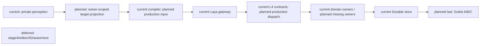
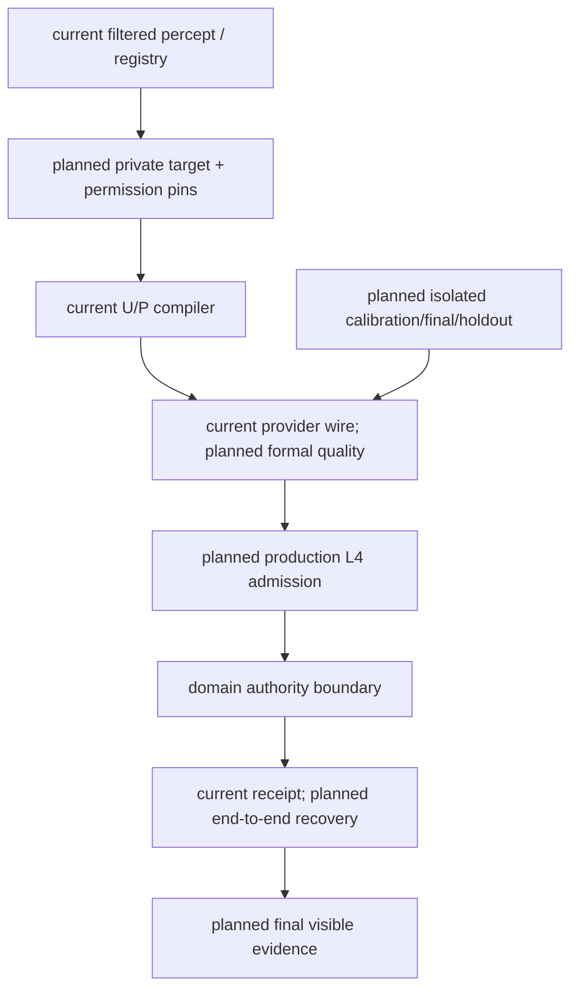

# October Mainline Stages 1–3 Implementation Plan

> **For agentic workers:** Use superpowers:executing-plans for task-by-task implementation. Native subagents may audit independent bounded lanes. Preserve other worktree changes.

**Goal:** 整体完成十月主线阶段一至三的实现与验收，包含完整 Laya、角色与真实领域 owner 闭环，以及最后集中完成的 Godot A/B/C。

**Architecture:** 复用现有 CharacterTurnContext、MindFrame、L1–L4、gateway/Laya、RuntimeExecution 和 GameplayEventStore。角色缺少领域能力时先完成对应 owner，再返回角色；模型与 Godot 只提交结构化 intent，不成为世界 authority。

**Tech Stack:** Existing Python/Pydantic/pytest/Harness backend, official Laya adapter, existing Godot actors and qualified motion assets; no new dependencies.

**Spec:** `docs/10月分析/规格/00-四域统一架构与执行顺序总规格.md`、规格01–12、17；2026-10-20 用户新授权。统一状态和验收边界见[矩阵](../../10月分析/回写/october-stages-1-3-acceptance-20261020.md)。原计划01–04继续定义领域语义，本计划整合依赖与验收，不重新定义对象。

## Global Constraints

- Godot 修改、启动、操作和场景验证最后集中进行；此前不启动引擎。
- 阶段四、通用编辑器、AD/Blender、自走棋和明确 deferred 项排除；复用合格动作。
- 保留真实 source、authority、隐私与 freeze 隔离；不能把 ack、choice、provider 可调用或合同测试当完整闭环。
- 不自动训练/微调。不为补证据运行全量 pytest/Harness all；最终确需扩大验证，先说明必要性。
- 小批次精准提交，保留用户历史 dirty。证据显式导出仓库外，清理只针对本轮资源。
- Goal 保持 active；工具目前无法改 objective，本计划记录扩展目标，不虚报旧目标完成。

## Review Focus

- 可见 target 不等于有权执行全部动作；按动作核验 affordance/owner/revision。
- source/request/turn/frame/candidate/contract/receipt 必须可关联；禁止 fallback 冒充原动作执行。
- 提交后丢响应不能重复结算；恢复读取原 owner receipt。
- 目标过期、撤权、旧 worker 迟到必须零写；后台 cognition 继续不发执行命令。
- 开发/校准暴露输入不能进入独立 final/holdout；source drift 不能只更新 hash。

## Task 0: 收尾管理员入口与建立统一状态

- [x] 修复 production spawn wiring、执行前身份重验、启动校验 secret 泄漏；定向 Task1/Task6/docs passed 且 cleanup passed。
- [x] 提交独立 credential 层 `c2ebb578`，保留其余历史混改。
- [x] 依据原规格/计划/回写/当前代码建立统一矩阵；准确区分四种状态与历史证据。
- [x] 文档门禁后以 `9929127` 提交本整合计划及矩阵，继续 Task1。

## Task 1: 真实私有输入、动作目标与同源能力

**Files:** `backend/app/models/character_agent_runtime.py`、`character_agent/reasoning/l1_perception.py`、`planning/l3_planner.py`、`runtime/runtime_loop.py`、`reasoning/l2_reasoner.py`；复用 `services/scene_affordance_registry.py`、`character_agent/skills/service.py`。测试在 `backend/tests/` 中沿已有 L1/candidate/capability 入口增加。

**Interfaces:** 已过滤的真实感知＋现有 registry/owner 的版本与权限→私有 target catalog、visible refs、action-specific affordance→既有 CandidateCompiler；同一 turn 的 envelope/policy→L2/L3/dialogue/recall。

- [ ] 先逐项映射真实 source 和已有 registry/owner API，再为生产路径缺失写 RED：无目录、动作权限交叉放行、空 visibility、跨 actor/scene、旧 revision。
- [ ] 最小接线；unknown/missing source 继续明确不可用，不猜当前玩家或 attention；不建第二候选编译器。
- [ ] 通过现有 typed snapshot/session serialization 证明输入不会被丢弃；定向 L1、candidate、capability/gateway tests 及对应 Harness，导出证据。
- [ ] 矩阵更新 R05/R06 的精确能力边界，提交该批实现。

**已提交子项（不关闭 Task 1）：** `10de477f` / `4fa9d0ea` 修复 perceived/self-body 的 canonical turn→L2 recall 传递，精确暂存隔离分别 52 / 57 passed。`19078684` 已将同一冻结 envelope/policy 扩展到 perceived、self-body、同步 Siming 的 L2/L3，精确暂存隔离 95 passed（run `f462954ad3ca4669af07a4b511b61c30`）；background/dialogue/recall 硬预算及可信 revisions 仍待完成，不关闭本任务。

## Task 2: 第一条真实 Laya→L4→owner 纵切

**Files:** `character_agent/runtime/runtime_loop.py`、`execution/l4_adapter.py`、`backend/app/main.py`、既有对应 domain owner/caller，以及原 cognition/runtime application tests。

**Interfaces:** 真实 Siming/获准 ingress→冻结 U/P→官方 Laya choice→canonical execution contract→执行时 admission→原 domain owner receipt→原 outcome/writeback。

- [ ] 选择无需 physics/Godot 的现有正式 owner 动作；确认该动作和 target 都有实际来源及执行合同，禁止为演示编造 world fact。
- [ ] RED 覆盖非 fallback 非空原动作、真实提交/receipt、权限变化零写；接通执行 admission 和 receipt feedback。melee 的 physics 仍留最后。
- [ ] 实际启动本轮拥有的 backend/Laya 服务，发送真实事实；保留同 turn/request/frame/candidate/contract/receipt 关联，不使用 fixture choice 冒充 live。
- [ ] 聚焦验收与矩阵 R07/R08 写回后提交；若缺 owner，先完成对应 D 行再回此任务。

**2026-10-20 worktable owner slice:** L3 now expands only registered `use_object`/
`finish_use` descriptors, preserves action-specific target admission digests, and
L4 emits the corresponding canonical interaction request. Durable ESM execution
rechecks a single target, action/target pairing, scope and digest. The focused
worktree run is 47 passed; Harness backend-contract `20c68e3bb7144abfa592c2a64939bdb9`
and docs `eeb0f37f29c844d2a6ad08e15c86f3c0` passed with cleanup. An exact staged
snapshot passed the 5 directly scoped files (80 passed); adding the broader legacy
execution-contract file exposes one unsupported `obj_letter` assertion, reproduced
on unchanged HEAD (`e39e1dd0a0614e509aed6235cc8505dd`). This remains a bounded owner
slice, not live Laya or full R07/R08. Earlier run `c0c28134270c44ce8e21d9a5f9848c93`
is historical and predates the final contract projection tightening.

**已提交前置修复（不关闭 Task 2）：** `055d5abf` 将既有 ESM policy/state/occupant 检查补到直接 authority 入口，绑定 request/event 的 actor/scope/target/action，canonical 重复键禁止跨 scope；精确暂存隔离 52 passed。ESM 仍缺 durable transition/receipt 与 canonical 距离来源；Equipment controller binding 不自动授权角色，work intent 注册不等于 owner，social delivery 不等于 played/heard。下一纵切必须显式补合法角色 caller 和 owner admission，禁止伪造 physics 或授权。

## Task 3: 纵切恢复与回放

**Files:** 原 cognition/session recovery、domain receipt/replay participant、Task2 应用测试。

- [ ] RED：owner 提交前/后中断、丢响应、新进程重开、exact/changed duplicate、旧 worker 迟到、receipt 后 writeback 重试。
- [ ] 复用原 Durable store/idempotency/session stages，不造平行 outbox truth。
- [ ] 同一实际 owner 的 full/checkpoint+tail 与零重复写证据；定向验证后更新 R09 并提交。

## Task 4: 按实际依赖交错收口角色与领域

**Files:** 原计划02/03/04各 task 指定文件；统一矩阵 D03–D11/R10–R14。

- [ ] 逐个真实角色 consumer 冻结需求来源、owner、权限、时间、receipt、恢复；已有 owner 优先复用。
- [ ] 正式 Resource capability/modifier/debt/conversion、学习、Soul、canonical faction/target、协同可信 clock、语音三路径按依赖逐项实现；每批沿原规格先 RED，再最小代码和定向验收。
- [ ] 正式准入 owner 加入同一 global cut，验证迁移/权限/隐私 parity；独立 participant 数量不代替共同 cut。
- [ ] 每个可审查批次提交并更新矩阵，历史证据按实际受影响路径失效。

## Task 5: 正式模型质量

**Files:** `character_agent/evaluation/`、既有 `prepare_character_evaluation.py`、`prepare_calibration_preclosure.py`、freeze/run/score scripts 与隔离 fixtures。

- [ ] 审查已有来源 drift 与失败诊断；先核 token/U/P/位置/描述/映射，记录证据后决定下一修复，不自动训练。
- [ ] 基于真实完整 action+target 构造有来源的独立 splits；保留 source revision、trajectory 隔离、truth/transport 分离。
- [ ] 开发归因后新 calibration，冻结预算/阈值/来源，再独立 final/holdout；封存后评分，分别报告完整选择、runtime legality、owner receipt 与角色轨。
- [ ] Q01–Q04 满足后提交正式验收静态索引；原始报告仓库外留存。

## Task 6: 最终 Godot A→B→C

**前置：** 后端可独立验证部分已收口，必要 owner/模型门已满足，接口冻结。到此前不修改/启动/操作 Godot。

- [ ] A 单角色跨情境；真实 backend/Laya、boundary 消息、owner receipt、可见结果及第二情境/恢复。
- [ ] B 单角色连续 Boss；真实 physics/contact、资源/生命/Threat/encounter 结果与恢复。
- [ ] C 双角色连续协同；两个身份、真实信号接收、短契约/语音、连续协同及失败恢复。
- [ ] 必要定向 engine/runtime Harness，导出图像/消息/receipt/trace；若需最终全量门禁，先说明理由，避免违背禁止无意义全量运行的要求。
- [ ] 审查矩阵全部在范围行与证据、精准提交、回收本轮进程/临时副本；只有此后可将整体 Goal complete。

## Architecture / sequence / data flow



```mermaid
sequenceDiagram
  participant B as Backend
  participant L as Laya
  participant O as Domain owner
  participant S as Durable store
  participant G as Godot (last)
  B->>B: current turn/frame; planned target/envelope wiring
  B->>L: complete frozen action+target input
  L-->>B: choice (existing adapter)
  B->>O: planned execution-time admission/dispatch
  O->>S: current owner commit
  S-->>B: durable receipt / exact replay
  B->>B: planned receipt-linked outcome/writeback
  B-->>G: final boundary messages
  G->>G: final visible A/B/C evidence
```



## 执行记录

### Task2 spatial source dependency (next batch)

Design: [controller-bound source](../specs/2026-10-20-embodied-spatial-source-design.md). Implement a strict internally authored scope and authenticated pose admission over the existing shared world store. First RED: unbound/foreign controller, scope mismatch/nonfinite input, missing/stale/revoked source, first/reconnect teleport, tick-inflated movement, changed duplicate, restart freshness and owner read CAS. Then minimal source implementation and SQLite recovery; focused tests and backend-contract only. Production composition, message ingress, L4 admission and ESM consumer follow this prerequisite; no live/Godot claim from source tests. Keep Task2 open.

- Task1：`fac6a634` 已提交独立私有目标目录；ESM inspect 之外仍未完成。
- Task2 前置：已修复 inspect 语义映射、冻结 scope 和 target/source pins；75 项组合回归与4项暂存隔离用例通过。生产 Laya、owner 提交和回执未验收。
- Task2 dependency ruling：原 canonical interact 只产生 accepted；不得将其记成领域提交。补真正 owner 提交时复用已有状态机/领域 event spine，不能以 ack 代替 receipt。

### Task2 owner dependency: bounded ESM object settlement

The existing ESM remains object-state owner. Add an opt-in shared GameplayEventStore to it and a separate explicit settlement method; legacy resolve remains preflight. The initial bounded method supports only registered object-only policies: plaque inspect and worktable use/finish_use. Archive door requires its embodied owner; bench has body effects; letter/switch have environment effects. Reject those routes until their actual owners participate atomically. A worktable transition does not imply work completion, wages or production.

Settlement requires canonical request identity and a finite supplied actor position against registered geometry. This owner-level requirement is not production range provenance or cognition authorization: production caller must still bind the legitimate source and admission/read revisions. Caller read revisions enter the same store batch CAS; no callback is claimed atomic. Resolve on an isolated copy, append the original result/state/owner receipt first, and only then rebuild the live projection. Per-scope object streams prevent scene aliasing; a global principal/key rejects changed scope duplicates. Exact retries return original receipt before rechecking transient range. Recovery validates type/version, owner principal, transaction membership, digest and scope, and never reinterprets old committed state through newer policies.

Acceptance for this sub-batch: real SQLite reopen/exact retry, changed duplicate, scope separation, append failure and lost response, concurrent object CAS, source-read conflict, malformed receipt/recovery, missing/nonfinite/out-of-range position, unsupported side effects zero-write. This closes only the durable owner prerequisite; production Laya/L4/source admission, feedback and full/checkpoint replay remain open. Existing three diagrams above retain current/planned boundaries; this adapter implements the planned Domain owner→Durable store edge only.


**Owner prerequisite committed:** `4a18a6f9` implements this bounded API, explicit schema registration, strict request/event identity before receipt lookup, same-store read CAS, original receipt recovery and a guard against legacy volatile writes for durable objects. Exact staged isolation: 73 passed, run `368161ea887f43db890f67b12870cb19`, export `D:/Users/User/Documents/paralls-evidence/october-stages-1-3-20261020-01/esm-object-owner-staged/`, cleanup passed. Production wiring remains pending.

**Source/admission ruling:** frozen execution contracts already exist in the canonical session execution stage. Admit from that original session record, not `ActionRequest.source`. The session SQLite and GameplayEventStore are separate stores: a session revision is not a world stream CAS. Recover the cross-store crash gap through the original world owner receipt and idempotently record the character outcome. `SessionInputRouter` move targets are intent, not arrival; the street pose path is scene/controller specific. Neither supplies generic canonical ESM range evidence. Preserve fail-closed production admission until a legitimate spatial source is bound, and record the final Godot producer/interface gate explicitly.


### Task 2 来源绑定子项（未关闭 Task 2）

`d13994bd` 已将原 session 冻结合同核验接入生产 canonical execution ingress；精确暂存隔离 39 passed，详情与两项 HEAD 已有 runtime 失败见统一矩阵。下一步保持原合同→可信空间/权限/时钟→L4→owner receipt 的依赖；来源一致不等于 world admission。legacy bundle 收敛仍待完成，不以兼容入口冒充正式闭环。

**Task1 recall budget prerequisite:** `cdaff0a2` caps aggregate memory recall and existing token estimates by the frozen policy before L3 recall and during gateway reselection; semantic card pruning also prunes returned memory. Exact staged isolation: 163 passed, run `84939863833b47b7a4a95367f3806e2a`; backend-contract run `c0948577424d45fd8d98015f5df71143` passed, cleanup passed. This is not total prompt/tokenizer enforcement. Background/dialogue/revision sources remain open. Continue Task2 spatial/admission/owner production wiring next; do not extend local budget tests without a new risk.


**Spatial prerequisite committed:** `cdb424d8`, exact staged 62 passed (`93614848ee2e446199c8b2cd369ecd27`), backend-contract passed (`4693379c1044449c803bc686fc5fd254`), cleanup passed. Source uses head-only validated reads and original transaction lookup. Controller disconnect/rebind revokes old bindings. Auth revocation and world append are not a shared atomic transaction. Next batch connects internal settings, production shared-store composition and strict bound-sample ingress before L4/ESM consumption; R07–R09 remain open.


**Spatial production ingress committed:** `cafeaeed` (69 isolated tests, contract passed, cleanup passed) and `e7063bcc` (backend clock expiry regression, 70 isolated tests). Live run `2305abd50062465880574e1fc7e281c4` proves real HTTP enrollment/WebSocket sample original receipt and changed-duplicate rejection; cleanup failed and the subsequent exact-path cleanup was rejected by automatic approval policy. See matrix for owned residual paths. No Laya/Godot claim. Next: review existing dirty L4 lifecycle/model dependencies against HEAD, then production source admission and ESM owner/receipt recovery; do not extend spatial tests without a concrete new risk. Task2 remains open.

### Task2/3 bounded object execution continuation

Production egress persists a separate dispatch-offered session event (not a nondeterministic L4 contract field); repeated egress does not renew the deadline. Public plaque inspect now commits through ESM on the shared world store with fresh source read CAS and original receipt-linked outcome. Receipt recovery repairs a session writeback gap after SQLite reopen; other actions remain unsupported by this bounded consumer. Exact staged 95 focused tests passed (`12b015bce3814ccfa82c53cfa34d57f6`), backend-contract passed (`5c881ad557714ce293f8890375f1c21b`), cleanup passed. Task2 and Task3 remain in progress: next obtain the real Laya production input→choice→original contract→owner receipt trace, then complete remaining lifecycle/replay and domain coverage. No model/Godot claim from the fixture tests.


### Task5 diagnostic admission and presentation attribution increment

- Committed `35282e65`: independently runnable envelope/runner/scorer and receipt-free calibration diagnostics; frozen-request membership, first-invalid stop, unique nonempty question coverage, strict zero-drop usage and no archive overwrite. Exact six-source isolation 80 passed, run `acd15a0771204bb889dba11eaea21c67`; historical unrelated worktree changes excluded.
- Real offline-cached official CPU Laya, 66/66 untruncated calls, run `85d3f2dfc5cd4681be53e66391217c63`. All three variants frozen before transport, no truth loaded. Reverse-order semantic agreement 7/22; rotated-label agreement 10/22. No new quality score or formal acceptance; no final/holdout exposure or training. Inspect declared checkpoint layout and description/input contract next, rather than selecting a favorable permutation. Q01–Q04 and all runtime/Godot completion gates remain open.
- Ruling: review and adopt the existing narrow untracked evaluation files as one six-file commit, because the repaired runner depends on their envelope and the original approval tests depend on the scorer. Do not stage other preparation scripts, fixtures, historical backend edits or broad policy pins. Goal API objective remains immutable; expanded objective remains authoritative in this plan and matrix, status active.


### Task1/R06 output-budget consumer increment

- `067f69df` enforces the existing frozen policy task output budgets in actual HTTP/SSE payloads and validates before provider routing/fallback. Exact two-source isolation186 passed (run `5c5fdc666d0a491792846a5dd289e5f6`, cleanup passed); no policy/model/world rule invented. Requests with no policy retain legacy behavior, so this does not close dialogue ingress or whole-input budgeting.
- Next: map DialogueService runtime context and canonical dialogue turn/lease to the shared frozen envelope/policy. Do not silently reuse the previous cognition turn. Separate source/revision and provider identity from output-token enforcement, and keep model quality/Godot gates open.


### R06 dialogue inheritance and assisted suggestion increment

`63739f10`: same-speaker dialogue fallback consumes the current original L2/L3 frozen contract; actual player reply recipient corrected. All three synchronous assisted sources and durable suggestion preparation now carry that same turn/contract through the third L3 request. Exact five-source isolation271 passed, run `e8f8bb4dd7384e9fae31f35238e6ea69`; backend-contract `165c62e3bec2462e9e093e59fe141306` passed; cleanup passed. Historical SpeechLease/runtime edits excluded. Cross-speaker fallback deliberately does not inherit recipient private policy; own speaker contract and no-cognition paths remain open. Next resolve those actual dialogue source/pin contracts before claiming R06 closure; preserve the matrix's full owner/model/Godot dependency order and do not extend narrow tests without a concrete new risk.


### Next R06 source ruling: own-speaker dialogue preparation

For a coordinator-owned fallback with no same-speaker cognition contract, freeze a fresh contract from the original typed DialogueSubmit, actual speaker profile/skills/learned state/dynamic state and current runtime pins. Reuse the existing compiler. A contextual turn source hashes the complete original event; record actual session/memory/snapshot revisions and current pin digest. This is request preparation, not a new perceived event, completed canonical turn, world write or permission to execute actions. Missing perception stays absent (no invented scene facts or ambiguity). Same-speaker cognition keeps its original contract. Keep both-participant stale checks and connection/activation deadlines. Standalone legacy DialogueService helpers remain compatibility surfaces; do not claim full all-ingress closure. RED: cross-speaker and no-cognition actual requests require own policy; changed event/source and actor revision produce distinct pinned contracts; no synthetic perception/timeline writes. Then exact snapshots and relevant dialogue/cognition tests, no model/Godot/all run.


**Own-speaker batch committed `c0d198da`:** exact five-source isolation285 passed (`f2c4004dcded42b68897e51cf454c047`), backend-contract passed (`beb333d414fa48eaa90c4c76a4249a62`), cleanup passed. Includes original effective profile and a deterministic HEAD background-lease race fix adopted as a narrow existing main patch. No full pytest/all/model/Godot. R06 partial for legacy helpers/full input/revision governance. Next return to D10 actual source dependencies (four gates, registered rule owner, receipt/replay and private L1), retaining deferred true-name/reincarnation/general rule engine and no field-default gate permission. Read-only source audit may run independently while lead integrates evidence; no new truth writer until source/rule admission design is mapped.


### D10 dependency lane: registered Soul domain

Design: [bounded Soul owner](../specs/2026-10-20-bounded-soul-owner-design.md), implementing existing specs08/12 and user-authorized expanded goal. Next concrete unit: immutable registered source/policy contracts and source admission against original GameplayEventStore events/receipts, with strict identity/schema/principal/stream/world/actor/incarnation matching and read revisions. Files: new `backend/app/gameplay/soul_contracts.py`, `soul_sources.py`, focused source admission tests. No duplicate Resource/LifeState writer; no default-enabled package, caller bool gate, forged perception or public endpoint. Record original rule version for replay. After source unit, add complete bounded Soul fact lifecycle/gates/operations in `soul_runtime.py`, then common-cut replay/private consumer and production original-action caller. Do not close D10 from source tests or a single effect. Timed production operations wait for legitimate confirmed backend-time source; no use of mere admitted cadence. Full truth/receipt/recovery/privacy acceptance remains in design and main matrix.

**Source audit dependency correction:** HEAD has no production Resource genesis owner. Materialized events in committed fixtures/local probes cannot admit Soul. First review/adopt the existing bounded authored-template materialization owner, its typed admission and profile resource hunks; preserve unrelated historical changes. Repair original-receipt recovery before current content lookup, so revocation/removal prevents new materialization but cannot hide an already committed result. Persist original typed source snapshot in owner events; exact retries reconstruct/validate the complete original batch without consulting newer content. Explicit changed source/scope/tick/read-set rejects; no-registry new commands reject. Caller must delegate receipt lookup before source freezing. Do not adopt the dirty resource.v2 projector, recovery/modifier/lock owners or claim those semantics from metadata. Immutable resource policy is captured per service composition; mutable concurrent content publishing needs a serialized/versioned source boundary and remains unverified. This prerequisite closes neither D06 nor D10. Focused isolated materialization/admission/profile tests, backend-contract and docs; no full pytest/all/model/Godot. Then return to the closed source adapters, complete four gates and role receipt chain.

**Reviewed dependency refinement:** the existing materializer writes v2, so omitting its v2 decoder would silently discard capacity/lock/debt semantics. Adopt `resource_body_runtime.py` as a reviewed finite dependency with its existing focused body/resource/v2 locks/migration tests, rather than create a second v1 writer. Fix discovered maximum/capacity, unpaired-lock, action exact-receipt and source-head race defects before acceptance. No adoption of separate recovery/modifier/migration-control modules or main routes. Static profile snapshot lifetime, singleton world/timeline, time-unavailable and authored publication metadata boundaries are frozen in the Soul design's Resource genesis section. This supersedes the previous sentence excluding the v2 projector, while keeping all broader owner/model/Godot gates open. Subagent owns only that runtime and its three test files; lead owns materializer/admission/profile/assets, isolation, integration and commits.

**Dependency batch committed `8af22a6a`:** exact HEAD+13 source isolation110 passed, run `70500ea8636946ef8b8d955d6a65071d`; backend-contract `0d23b439fe2647f8a80b5f161de1159e` and corrected docs `bb056c07e2cf40578f7a855b9c5904c8` passed, cleanup passed. Matrix records source limitations and failed RED/docs evidence. No full tests/all/model/Godot. Next implement code-supported original Resource receipt/source adapter; Population/Presence anchor sources require their own reviewed adoption. No arbitrary principal/path contract and no implicit stamina/mana→life/mind mapping. Then complete D10 and return to role original-action receipts; do not continue adding unrelated resource unit tests.


### Worktable procedure production increment

Map registered worktable intents to existing procedure capability instead of absent interaction family. Exact HEAD+two sources37 passed (b12eb914bdc5423a9a710de987d2357c), backend-contract5d66626c72bc4d17b7044c04eb863076 passed; cleanup passed. Live official Laya ee14e70f72ef49be88c63e14f8548da6 selected use_object:obj_worktable and received original ESM new_commit/world_result; next turn selected observe instead of finish_use. Both full inputs untruncated. Recovery script incorrectly demanded two receipts; recovery failed and state was cleaned, so no recovery claim. Authenticated developer controller spatial sample is not physics/Godot. Keep Tasks2/3, Q01–Q04 and A/B/C open. Return next to full-action quality sources/frozen datasets; do not multiply local worktable tests or rerun models solely to repair evidence.


## 只读 vulnerability 来源计算（2026-10-20）

`soul_vulnerability.py` 实现冻结的显式 life/mind→resource/definition/整数阈值注册、有限 comparator、三值 OR、当前 Presence/anchor 与原 Resource 来源前缀核验，返回当前 read revisions、source refs 及包含注册与投影的确定性摘要。读取不写任何 owner；合法资源结算后仍可验证 anchor 连续性。测试中的 stamina→mind 是显式测试注册，不是产品 life/mind 语义。

精确 HEAD d7fdc2d7 加两份新增源码/测试的隔离 Soul 回归 **67 passed**，run `b024191aa9fe4d11bc7bd38bdc4f62b1`；backend-contract `080e84cf103c4035bcaa843bd5e56a27` passed；均 cleanup passed。外部证据根 `D:/Users/User/Documents/paralls-evidence/october-stages-1-3-20261020-01/` 下 `soul-vulnerability-continuity-red/`（目录名不代表 RED，实际 exit0）及 `soul-vulnerability-contract/`。最初 RED 17 failed/49 passed；首轮实现 1 failed/65 passed 为伪造夹具默认 project visibility 比 owner 白名单更早被拒绝，改为 authority_only 夹具后证明精确 unsupported-owner 拒绝；不削弱源校验。

D10 仍局部：生产 life/mind semantic registry、有限 effect/value owner、四门组合、读集与 effect 写入同一 CAS、schema/composition、checkpoint/common-cut/private projection、L4 均未关闭。Q01–Q04、R07–R09/R14 和 Godot A/B/C 状态不提升。未运行全量 pytest/Harness all、模型或 Godot。下一批回到完整 action+target 质量来源与角色闭环，避免继续扩展 reader 局部测试。

### Worktable recovery follow-up

The focused `test_worktable_process_recovery.py` regression now exercises a real
`use_object` then `finish_use` pair against the durable ESM object owner, closes
the original process after the finish owner commit but before session writeback,
and reopens from SQLite with no live controller/source/snapshot. The reopened
execution repairs the missing outcome from the original receipts, rejects a
changed contract, and leaves the world sequence unchanged on exact retry. The
D-drive isolated run passed 1 test. This closes only the worktable R09 recovery
sub-item; live backend/Laya evidence, production output, multi-domain recovery,
Q01-Q04, and Godot A/B/C remain open.


### Task5 bounded runtime development source export

Implement a read-only `evaluation/runtime_trace_export.py` parser and focused tests. Rebuild the exact wire request through the existing pinned provider/tokenizer, verify the complete compiler U/P/pruned/diagnostic digest and ordered mapping, then associate model choice with the original L4 turn/actor/action/target/candidate pins and committed boundary world_result. Reject presented candidates omitted from a rehashed universe, duplicate candidates, incomplete tokenizer usage, non-domain observe candidates, and contradictory boundaries. Reject ambiguous overlapping calls and changed/missing source associations; retain explicit rejection reasons. Export only actual wire input, frozen candidate contract and allowlisted provenance/association fields, never the raw hidden preparation context or credentials. Source-byte SHA256 and source line refs bind this development artifact to the archive. All exported records remain development-only, quality unscored, owner-store validation and recovery unverified; boundary result and unrelated continuity receipts cannot stand in for owner proof. No final/holdout inputs or labels, model calls, training, Godot or broad verification in this unit. Test RED→GREEN, run existing provider/evaluation contracts as relevant, export evidence outside repo and commit exact new files plus this plan/matrix. Existing three diagrams define the source→model→L4→owner boundary; this is a diagnostic consumer, no new truth writer.

### R06 typed stage contract adoption

Adopt only the existing cognition_frame validation draft after repairing typed content digests, strict actor/turn conjunction, exact envelope policy revision pins and optional stage source/pins. Missing/null partial contracts reject; no-contract legacy frames remain compatible. validate_frame binds external actor without requiring field refs; freeze rejects before receipt writes. No adoption of dirty coordinator/admission/runtime source-governance changes. Existing compiler/digest APIs remain authority; structural self-consistency does not prove original source admission. Exact HEAD bef917e2 plus two files and committed production manifests: 70 passed, 27 pre-existing warnings, run f41c3ab96e9943279fb9a148b3a892ed. backend-contract de9aa7d371e1401f84068797ca4aa811 passed, cleanup passed. Initial isolation omitted manifests: 16 failed/54 passed, retained as failure. No full pytest/all/model/Godot. R06 remains partial. Next prioritize complete action/target quality source and actual role/owner dependency from the unified matrix; do not keep expanding this structural helper as a substitute for production stage/source integration or formal model acceptance.
