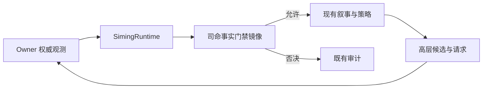
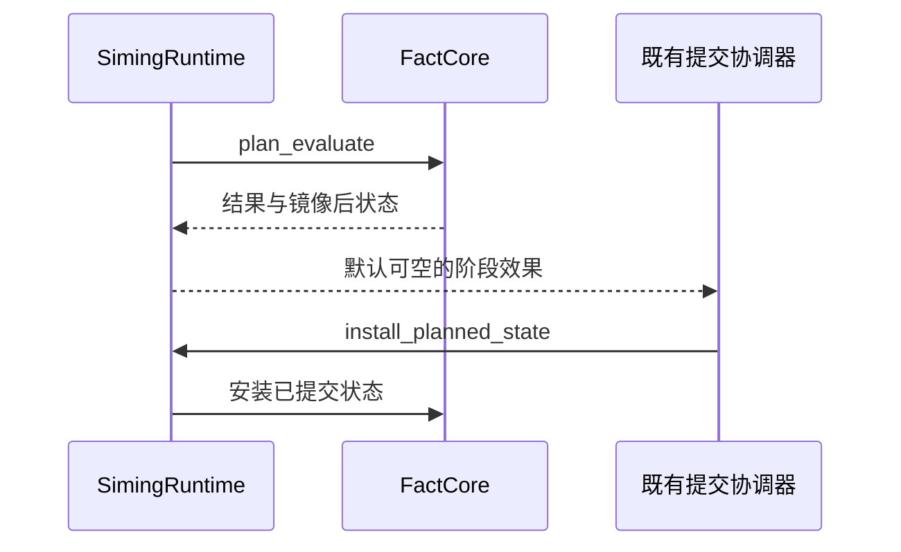
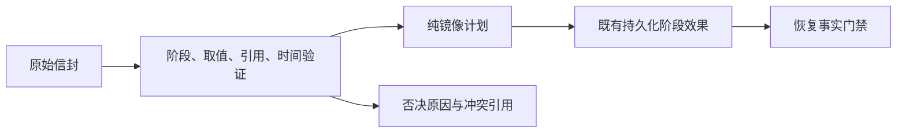

# 司命 Phase 2 事实核心实施计划

依据：用户已授权的 P2.1/P2.2 任务，以及《司命设计文档》2.7、3.1。

目标：在司命侧实现本局真相的 T0→T1→T2→T3 锁定与矛盾、证据校验；不写世界真值，不修改 Owner（事实所属域）。

## 范围与裁定

- 保留 `evaluate(observed_events)` 和旧 `locked_fact_conflict` 否决行为。
- 使用既有 `world_fact_event` 信封携带 `fact_operation`：`write`、`advance_phase`、`reveal`、`deduce`。
- `write` 携带 `fact_id`（或既有 `established_fact_id`）、`fact_value`（或既有 `state_value`），可带 `world_anchor_id`、`state_key`、`evidence_refs`、`source_event_refs`。显式事实声明与普通 Owner 观测分开；缺操作但有事实标识与取值也视为写入。
- `advance_phase` 携带 `fact_phase`，允许重复当前阶段或前进一阶段。阶段按显式事件在 tick 中推进，不设隐式自动倒计时。
- 门禁状态按 room/scene 隔离，与当前司命准入 scope 一致；不把客户端 payload 中自称的世界/分支当作可信隔离标识。
- 已接纳真相记录不可改写；同锚点同属性的不同取值视为矛盾。T2/T3 不允许新增真相；重复记录可重放。T3 仅保留揭示、演绎与既有 Owner 事实观测。
- T0 基础事实在进入 T1 后不再新增；T1 案件框架在进入 T2 后不再新增。类别默认 `session`，可显式为 `foundation` / `case`。
- 证据须引用已接纳事实、带事实标识的 L1 权威观测或来源事件，不能引用未来、缺失、自引用或断裂来源；一个批次全成或全拒。
- 规划必须纯计算，状态经默认可空的阶段效果保存与安装；续跑保留同房间所有场景的事实状态，恢复后继续守门。原始准入信封不变。

## 边界图（本次实现）

## 实施与验收

1. 先跑 `python -m pytest backend/tests -k siming -q` 基线。
2. 为锁定、原子否决、隔离、重放与纯规划写失败测试，再实现 P2.1。
3. 为事实/锚点矛盾、证据缺失、时间倒序、来源链断裂写失败测试，再实现 P2.2。
4. 接入运行时审计和既有阶段效果，测试计划不落地、安装后冻结、JSON 恢复与续跑。
5. 专项、司命回归、独立审查通过后冻结源码，运行 `harness.py --profile phase0` 并导出仓库外证据。
6. 仅暂存本轮文件，中文提交并附指定共同作者署名。`all` 单列被档案门阻塞。

不处理：档案门、旧临时目录、角色演示回退、环境有效期时钟、Owner 适配。

## 执行记录

- 基线：司命范围 1284 passed，日志 `D:/HarnessEvidence/siming-p2-baseline-20261113.log`。
- P2.1：锁阶段、重放、纯规划、批次原子性先失败后通过。
- P2.2：矛盾、证据、来源与时间校验先失败后通过。
- 运行时：规划无副作用、阶段效果 JSON 恢复、数据库重启、续跑均有专项验证。
- 独立审查发现两项重要问题：跨场景持久化锁丢失、普通权威观测不能供证；均已补失败复现后修复，组合专项 142 passed。
- 裁定：用显式阶段事件推进，不设自动计时；阶段只约束司命本局真相镜像，不冻结 Owner 的普通世界观测。该边界避免把实时世界状态误作不可变案件事实；若上游未声明事实操作，仅作为观测处理。
- 不改检查点引用结构，新增默认空阶段效果由现有提交/恢复链保存。

## 本轮验收结果

- 最终司命范围：1317 passed、8736 deselected，退出码 0；日志 `D:/HarnessEvidence/siming-p2-regression-final-20261113.log`。
- 全后端：10045 passed、6 skipped、2 xfailed，1970.44 秒。
- phase0 首次运行：失败，退出码 1；观测台 `dialogue_pair_count=0`，面板、关系台账与司命压力三项缺失。该结果不单独证明由本次改动引入。
- 随后当前提交上的观测台专项复测通过：`dialogue_pair_count=2`，面板和两项台账指标均通过，表明该失败具有间歇性。
- phase0 最终复跑：通过，退出码 0；全后端 10045 passed、6 skipped、2 xfailed，Godot 验证通过，清理通过。证据：`D:/HarnessEvidence/siming-p2-phase0-final-20261114/harness-run-report.json`。
- all：本轮未执行；按已知档案门阻塞状态单列为“被档案门阻塞”，不声称通过。档案门仍由独立线排查。
- 旧中断目录未动。
