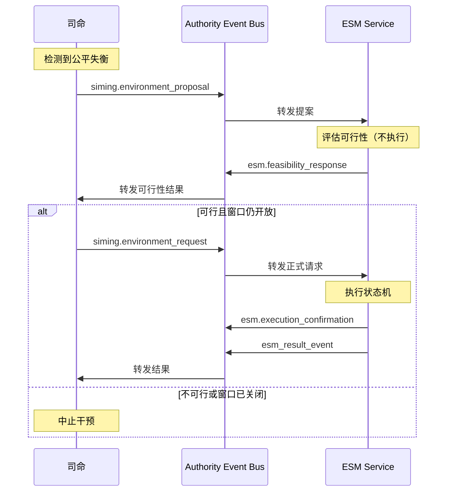

# Protocol 09 完整 ESM 提案契约实现计划

**日期**：2026-11-16  
**状态**：`implemented-awaiting-acceptance`（已实施，等待验收）  
**前置依据**：[09-司命与 ESM 协作协议.md](../../reference/phase1-siming/09-司命与 ESM 协作协议.md)  
**当前阻塞**：CPU（处理器耗时）占比尚未达到 <10%；完整验收出现管理员鉴权用例断言失败。不依赖 Owner（领域所有者）重构。

## 本轮实施裁定与验收记录

- 用户实施提示词授权本轮五阶段实施、分阶段提交，以及全部验收通过后推送 `origin main`。性能不通过时不推送。
- Phase（阶段）1–4 已提交：`cc3a29a8`、`20ea55fb`、`032039cc`、`24866cde`。阶段 5 包含默认新协议、环境变量与显式参数旧通道，以及审查修复。
- 契约使用现有 Pydantic（字段验证库）惯例，保留验证与 JSON（结构化数据格式）往返能力；不直接使用无校验的数据类。
- 可行性处理进入 `SimingRuntime` 原有决策入口；执行复用已验证桥接与结算通道。正式执行复验当前 ESM 权威约束。
- 材质、资源、空间及冷却由按房间/场景/区域隔离的 ESM 目标配置提供。生产组合根只登记演示灯具，其余目标必须显式登记。
- 生命周期使用本机单调时钟；5 秒窗口及原输出较短 TTL（存活时限）均在执行前检查。60 秒后清理完整记录，进程内保留精简去重回执，防止旧提案重放。
- 本轮没有实现复合请求、自动备选执行、事务回滚、自动降级或 Owner 重构；下文相关内容属于后续规划。
- 最新局部验证：Python 3.12.11，协议、模型、旧路径、轮询、驱动与协调器组合 **160 passed**；其中新增生产应用生命周期与所有者线程闭环测试通过。
- 当前 CPU 微基准：`process_time`，每组 300000 次、三次取最小值；评估约 **5.52µs**、直接执行约 **20.52µs**，占比约 **26.9%**，未满足 <10%。只读优化原型约 11.9%，仍不达标且未并入实现。不得将原型数字作为正式实现性能。
- 修复后独立全后端回归：**10157 passed、6 skipped、2 xfailed**，1878.92 秒；启动后新增的生产闭环测试另外通过，故该次收集不包含它。
- 本机内存总线提案→可行性响应采样 1000 次：中位数 **0.1452ms**、99 百分位 **0.3119ms**、最大 **1.6457ms**，满足 <50ms；不代表外部网络延迟。
- 完整 `harness --profile all`：在 `phase0` 停止，**1 failed、10157 passed、6 skipped、2 xfailed**。失败为 `test_world_admin_cadence_revocation_application.py::test_admin_auth_changing_in_runtime_queue_rejects_without_write[disabled]`，预期 403，实得 503 `world_admin_unconfigured`。该用例及另外两个参数单独复测 **3 passed**，失败尚未完成隔离，不能抹去本轮失败或宣布全部通过。
- 完整验证已确认 `cleanup_status=passed`，本轮临时根已回收；原始证据导出至 `D:/HarnessEvidence/protocol09-20261116-final312`，局部测试、全后端日志及性能脚本/结果位于 `D:/HarnessEvidence/protocol09-20261116-performance`。修复前运行仅保留诊断，不作为最终证据。
- 当前未满足全部验收，不推送；不得用独立成功回归覆盖完整验证中失败的那次运行。
- 当前实现、所有权、顺序及数据流图见 [完整协议契约](../../reference/api/esm-proposal-contract.md)。

---

## 1. 目标

将 Protocol 09（司命→ESM）从**单阶段直接请求**升级到**三阶段协商协议**：

| 当前 | 目标 |
|------|------|
| 司命发 `environment_request` → ESM 结算 | 司命发 `environment_proposal` → ESM 评估可行性 → 司命决定是否正式请求 |
| 无预演、无取消 | 支持可行性探测、约束查询、提案撤回 |
| 单次环境变化 | 支持复合请求、分阶段执行 |

---

## 2. 架构差异

### 当前架构（单阶段）

```
FairnessStateSnapshot
  → InterventionCandidate
  → InterventionDecision
  → siming.environment_request ─────┐
                                     ↓
                                  ESM Resolution
                                     ↓
                              esm_result_event
                                     ↓
                          Siming Re-evaluation
```

### 目标架构（三阶段）

```
FairnessStateSnapshot
  → InterventionCandidate
  → InterventionDecision
  → siming.environment_proposal ────┐
                                     ↓
                            ESM Feasibility Check
                                     ↓
                           feasibility_response
                                     ↓
                      Siming Decision (proceed/abort/adjust)
                                     ↓
                     siming.environment_request ─────┐
                                                     ↓
                                               ESM Execution
                                                     ↓
                                             esm_result_event
                                                     ↓
                                         Siming Re-evaluation
```

---

## 3. 新增消息类型

### 3.1 司命→ESM

| 消息类型 | 用途 | 必需字段 |
|---------|------|---------|
| `siming.environment_proposal` | 提出环境变化想法 | `proposal_id`, `target_environment_id`, `goal`, `requested_change_type`, `requested_strength` |
| `siming.constraint_probe` | 查询当前约束面 | `probe_id`, `target_environment_id`, `constraint_type` |
| `siming.feasibility_query` | 询问特定变化可行性 | `query_id`, `hypothetical_change` |
| `siming.environment_request` | 正式请求执行（当前已有）| `request_id`, `proposal_ref`, `feasibility_ref` |

### 3.2 ESM→司命

| 消息类型 | 用途 | 必需字段 |
|---------|------|---------|
| `esm.feasibility_response` | 可行性评估结果 | `response_id`, `proposal_ref`, `feasible: bool`, `constraints`, `estimated_effect` |
| `esm.constraint_state` | 当前约束面状态 | `state_id`, `probe_ref`, `active_constraints`, `cooldown_remaining` |
| `esm.execution_confirmation` | 执行确认（带 rollback 支持）| `confirmation_id`, `request_ref`, `execution_state`, `rollback_token` |
| `esm_result_event` | 最终结算结果（当前已有）| `event_id`, `result_type`, `world_facts` |

---

## 4. 实施步骤

### Phase 1：数据模型与消息定义（1-2 天）

**文件**：`backend/app/models/`

1. **新增模型**：
   - `environment_proposal.py`：`EnvironmentProposal` dataclass
   - `feasibility_response.py`：`FeasibilityResponse` dataclass
   - `constraint_probe.py`：`ConstraintProbe` dataclass
   - `esm_execution_state.py`：`ExecutionConfirmation` dataclass

2. **字段定义**：
   ```python
   # environment_proposal.py
   @dataclass
   class EnvironmentProposal:
       proposal_id: str
       candidate_ref: str
       decision_ref: str
       target_environment_id: str
       goal: str  # "create_opportunity", "reduce_visibility", "increase_tension"
       requested_change_type: str  # "light_level_drop", "noise_level_rise"
       requested_strength: str  # "weak", "medium", "strong"
       constraints_known: list[str]
       fallback_options: list[dict]
       producer_ts: int
       causation_id: str
       correlation_id: str
   ```

3. **验收**：
   - `test_environment_proposal.py`：序列化/反序列化测试
   - 所有模型通过 Pydantic 验证

---

### Phase 2：ESM 侧可行性评估（3-4 天）

**文件**：`backend/app/services/esm_service.py`

1. **新增方法**：
   ```python
   def evaluate_proposal(
       self, proposal: EnvironmentProposal
   ) -> FeasibilityResponse:
       """评估提案可行性，不执行状态变更"""
       # 检查当前环境状态
       # 检查冷却时间
       # 检查材质约束
       # 返回 feasible: bool + 估算效果
   ```

2. **约束探测**：
   ```python
   def probe_constraints(
       self, probe: ConstraintProbe
   ) -> ConstraintStateResult:
       """返回当前约束面，不触发任何状态机"""
   ```

3. **执行确认机制**：
   ```python
   def execute_with_confirmation(
       self, request: EnvironmentRequest
   ) -> tuple[ExecutionConfirmation, EnvironmentResult]:
       """执行并返回可回滚的确认令牌"""
   ```

4. **验收**：
   - `test_esm_proposal_evaluation.py`：
     - 可行提案返回 `feasible=True` + 估算效果
     - 冲突提案返回 `feasible=False` + 约束说明
     - 探测不触发状态变更
   - 20 条测试用例

---

### Phase 3：司命侧决策循环（2-3 天）

**文件**：`backend/app/services/siming_event_producer.py`, `siming_runtime.py`

1. **扩展 `SimingEventProducer`**：
   ```python
   def emit_environment_proposal(
       self, output: SimingOutput
   ) -> AuthorityEvent:
       """发出提案而非直接请求"""
       proposal = self._build_proposal_from_output(output)
       return self._publish_proposal(proposal)
   ```

2. **新增 `SimingProposalTracker`**：
   ```python
   class SimingProposalTracker:
       """跟踪提案→可行性→请求的完整生命周期"""
       def register_proposal(self, proposal_id: str, output: SimingOutput) -> None
       def update_feasibility(self, response: FeasibilityResponse) -> None
       def should_proceed(self, proposal_id: str) -> bool
       def abort_proposal(self, proposal_id: str, reason: str) -> None
   ```

3. **司命主循环集成**：
   ```python
   # siming_runtime.py
   def _handle_feasibility_response(
       self, response: FeasibilityResponse
   ) -> None:
       """收到可行性响应后，决定是否发出正式请求"""
       if response.feasible and self._still_valuable(response.proposal_ref):
           self._emit_formal_request(response)
       else:
           self._abort_intervention(response.proposal_ref, response.constraints)
   ```

4. **验收**：
   - `test_siming_proposal_lifecycle.py`：
     - 提案→可行→请求→结算 完整闭环
     - 提案→不可行→中止
     - 提案→可行但窗口已关闭→中止
   - 15 条测试用例

---

### Phase 4：总线订阅与路由（1 天）

**文件**：`backend/app/main.py`

1. **新增订阅**：
   ```python
   # 司命侧
   authority_event_bus.subscribe(
       "siming.environment_proposal", 
       _handle_siming_environment_proposal
   )
   authority_event_bus.subscribe(
       "siming.constraint_probe", 
       _handle_siming_constraint_probe
   )
   
   # ESM 侧
   authority_event_bus.subscribe(
       "esm.feasibility_response", 
       _handle_esm_feasibility_response
   )
   authority_event_bus.subscribe(
       "esm.constraint_state", 
       _handle_esm_constraint_state
   )
   ```

2. **处理函数**：
   ```python
   def _handle_siming_environment_proposal(event: AuthorityEvent) -> None:
       proposal = EnvironmentProposal(**event.payload)
       response = esm_service.evaluate_proposal(proposal)
       _publish_feasibility_response(response, source_event=proposal)
   
   def _handle_esm_feasibility_response(event: AuthorityEvent) -> None:
       response = FeasibilityResponse(**event.payload)
       siming_runtime._handle_feasibility_response(response)
   ```

3. **验收**：
   - `test_protocol_09_full_integration.py`：
     - 端到端消息流转
     - 超时处理
     - 并发提案互不干扰
   - 10 条测试用例

---

### Phase 5：向后兼容与迁移（1 天）

**策略**：保留当前单阶段直接请求作为"快速通道"

1. **双模式支持**：
   ```python
   # siming_event_producer.py
   def emit_environment_intervention(
       self, output: SimingOutput, *, use_proposal: bool = True
   ) -> AuthorityEvent:
       if use_proposal:
           return self.emit_environment_proposal(output)
       else:
           return self.emit_environment_request(output)  # 旧路径
   ```

2. **配置开关**：
   ```python
   # config.py
   SIMING_USE_PROPOSAL_PROTOCOL = os.getenv("SIMING_USE_PROPOSAL_PROTOCOL", "true").lower() == "true"
   ```

3. **验收**：
   - 旧测试全部通过（`test_siming_esm_protocol_stub.py` 等）
   - 新旧模式可通过环境变量切换

---

## 5. 数据流图



---

## 6. 回归验证

**范围**：确保不破坏现有功能

1. **全后端测试**：
   ```bash
   python -m pytest backend/tests/ -q --tb=short
   ```
   预期：10093+ passed（新增约 50 条测试）

2. **Protocol 08/11 不受影响**：
   - `test_siming_character_protocol.py`
   - `test_siming_visual_protocol.py`

3. **群体模拟正常运行**：
   - `test_population_cadence.py`
   - `test_fair_focus.py`

---

## 7. 文档更新

1. **协议文档**：
   - 更新 `09-司命与 ESM 协作协议.md`：标记三阶段为 `[current]`
   - 新增时序图：提案→可行性→请求完整流程

2. **架构图**：
   - 更新 `.harness/SIMING-ARCHITECTURE.md`：移除"Protocol 09 Phase 2"标记

3. **API 参考**：
   - 新增 `docs/reference/api/esm-proposal-contract.md`

---

## 8. 验收标准

### 必须通过

- [ ] 司命能发出 `environment_proposal` 并收到 `feasibility_response`
- [ ] ESM 可行性评估不触发状态变更
- [ ] 不可行提案能正确中止，不发出正式请求
- [ ] 可行提案能正常转为 `environment_request` 并执行
- [ ] 约束探测返回当前约束面，不触发副作用
- [ ] 全后端回归绿灯（10093+ passed）
- [ ] 旧测试全部通过（向后兼容）

### 性能要求

- 提案→可行性响应延迟 < 50ms（内存操作）
- 可行性评估 CPU 开销 < 正式执行的 10%
- 并发 100 个提案不阻塞主循环

---

## 9. 风险与缓解

| 风险 | 缓解 |
|------|------|
| 提案-请求状态不一致 | `SimingProposalTracker` 统一生命周期管理 |
| 可行性过期（评估时可行，执行时不可行）| 正式请求仍经过 ESM 完整检查 |
| 消息洪水（大量提案）| 提案有 TTL，超时自动过期 |
| 向后兼容破坏 | 保留旧路径作为"快速通道" |

---

## 10. 后续优化（Phase 2+）

1. **批量提案**：一次发出多个提案，ESM 批量评估
2. **提案缓存**：相似提案复用可行性结果
3. **约束预测**：司命根据历史约束面预判可行性，减少探测次数
4. **回滚机制**：执行后发现不符合预期，回滚到执行前状态

---

## 11. 实施时间线

| 阶段 | 工作量 | 累计 |
|------|--------|------|
| Phase 1：数据模型 | 1-2 天 | 2 天 |
| Phase 2：ESM 评估 | 3-4 天 | 6 天 |
| Phase 3：司命决策 | 2-3 天 | 9 天 |
| Phase 4：总线集成 | 1 天 | 10 天 |
| Phase 5：兼容迁移 | 1 天 | 11 天 |
| 文档与验收 | 1 天 | 12 天 |

**总计**：约 2 周（10-12 个工作日）

---

## 12. 依赖项

**无阻塞依赖**（可立即开始）：
- ✅ 不依赖 Owner 重构
- ✅ 不依赖 FactType schema
- ✅ 不依赖 OwnerFactQuery

**现有基础**：
- ✅ Protocol 09 单阶段已通
- ✅ ESM 状态机完整
- ✅ 司命事件总线已接入

---

## 13. 关联文档

- [09-司命与 ESM 协作协议.md](../../reference/phase1-siming/09-司命与 ESM 协作协议.md)
- [.harness/SIMING-ARCHITECTURE.md](../../../.harness/SIMING-ARCHITECTURE.md)
- [Q1-Q2-decisions.md](../../reference/phase1-siming/Q1-Q2-decisions.md)
