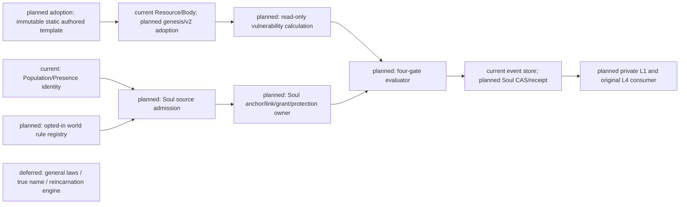
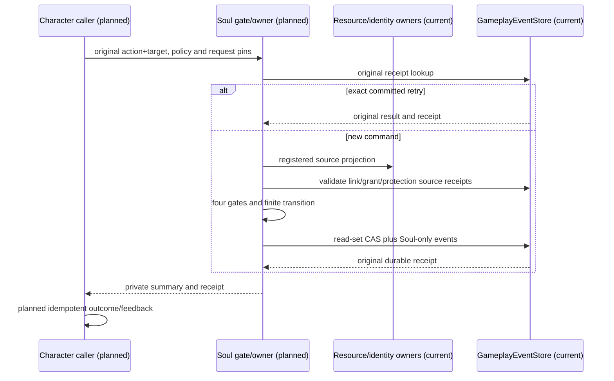
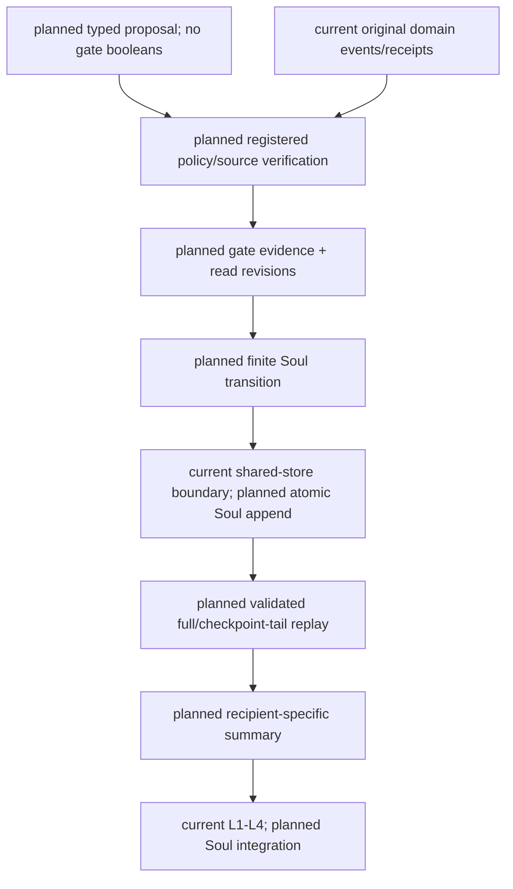

# Bounded Soul owner admission

Status: implementation authorized by the 2026-10-20 stages1–3 continuation; source mapping and bounded policy choices are lead-agent rulings, not pre-existing product facts.

## Authority and scope

Implements matrix D10 and returns to R14 after domain admission. Source specs are October specifications08 §6 and12 L04/L09, combat05 §6–8, and review07. Reuse GameplayEventStore receipts/read CAS, existing Resource/Body projections, Population/Presence identity and private perception. Do not add soul_hp, rewrite LifeState/profile, infer vulnerability from personality, treat a tag as a grant or turn a model answer into an owner event. Full true-name, contract, reincarnation and general rule-priority engines remain deferred.

Current: resources/body, lifecycle/presence slices and event store. Planned: the entire bounded spiritual-rule domain described here. No current Soul runtime or registered production spiritual package has been found. Backend infrastructure may be implemented before a world opts in; an empty production registry is unavailable, never implicit allow. A source fixture does not prove a production caller or a model/scene result.

## Registered policy and provenance

One immutable world/package rule registration identifies version/digest, effect operations, issuer service, allowed caller, entity source contract, resource vulnerability branches, link creation source contract, grant issuer source contract, blocker source contract and private recipient policy. Registration must reject duplicate world/package/version and contradictory operation settings. Registry changes cannot reinterpret committed receipts. No implicit latest version or defaults granting access.

Source adapters are a closed code enum, not package-defined event names, principals or payload paths. Fetch original events from the shared store, require original committed receipt and transaction membership, validate identity and source order, then collect read revisions. A caller cannot provide allowed/vulnerable/link_valid flags. Packages select supported adapters and policy values; they cannot designate themselves an issuer or define a new trusted owner.

| Adapter (planned) | Concrete source and admission | Availability / boundary |
| --- | --- | --- |
| `population_presence_v1` | `PopulationPresenceAuthority`, `presence:{world}`, schema2 spawned/despawned, principal `population.presence_authority`; original spawn references `population.activation.committed` on `population:{world}` and its validated transaction | Presence implementation currently historical/untracked; review and admit dependency before this adapter ships. Require current activation and current active incarnation, not only an old spawn receipt. |
| `resource_body_v1` | `ResourceBodyRuntimeProjector.rebuild_resources` from bounded `gameplay:resources:{actor}` history and pinned ResourceDefinitionRegistry; each supported event checked against its code-owned authority/receipt mapping | Scalar projection alone is insufficient. Reject unsupported source events, including new resource.v2 behavior until its owner mapping is admitted. No package-supplied principal whitelist. |
| `soul_issued_v1` | New typed Soul link/grant/protection issuance/revocation events on canonical Soul streams; original Soul transaction and registered issuer identity | Only a service object constructed by trusted backend composition can issue. No serialized issuer/principal argument, no public route and no content bootstrap grant. Composition injects issuer capability separately from content registration. |
| `confirmed_population_time_v1` | Future adapter over `PopulationRuntimePublisher` validated recovery checkpoint and `confirmed_time_pins` | `population.cadence.admitted` is explicitly insufficient. Adapter must prove successful confirmed publication and same-cut source before enabling expiry. |

The only future external issuer ingress is a typed trusted-composition service. An authenticated WorldAdmin identity may provision a registered package; it does not grant an actor Soul authority. Actor grants require an explicit issuance policy and original Soul event. Until that service is implemented, issuance is unavailable in production. Test-only composition is never production acceptance.

### Resource genesis dependency ruling

HEAD at source audit (`77fd4bb`) has only fixture/probe materialization. Review and adopt existing authored-template admission, profile resource blocks, materialization owner and its required v2 Resource projector/finite reservation owner before creating a Soul resource adapter. The three profile blocks are existing proposed content now explicitly admitted as static authored stamina/mana/AP policies; their values are not historical world facts or universal defaults. Stamina, mana and AP are not automatically life/mind vulnerability. A separate registered semantic mapping and appropriate owner facts remain required; absent life/mind definitions keep the Soul gate unavailable.

Materialization consumes a deep immutable profile snapshot per service composition. External mutable registry references cannot alter it; deployment content replacement requires a new composition. No hot-reload/revocation atomicity is claimed. New materialization accepts only static templates (`valid_from=0`, no expiry); timed admission awaits a confirmed-time adapter. Caller world_tick is retained request metadata. Authored issuer/owner/publication-key fields identify static content, not independently verified publisher receipts or Soul permissions. The real durable evidence is the Resource owner's original transaction.

`gameplay:resources:{actor}` is actor-global and singleton-bound to its first world/timeline. A second world cannot initialize it; future cross-world migration requires a separate admitted owner. Source consumers must compare the stored binding, never infer it from stream text. `expected_revision` is a strict nonnegative operational CAS hint: new genesis requires head0; exact committed retries may pass a newer hint. Actor/world/timeline/tick, original source snapshot and caller read-vector remain request identity. Recovery first validates the original full transaction/receipt and reconstructs from its persisted typed source snapshot without current content or clock lookup. Changed identity rejects and never rematerializes. The caller must enter this recovery boundary before source lookup.

The v2 projector is adopted with its existing finite locks/reservations and migration planner to avoid silently decoding v2 as v1. Audit fixes must reject invalid maximum/capacity and unpaired lock writes and validate original action receipts plus source CAS. Adoption does not admit unrelated recovery/modifier/migration-control services or their production routes, nor does it complete D06/D10.

Soul owns its own anchor/identity binding, links, grants, protection and effect facts. Initial anchor references a real registered identity/presence admission receipt. It does not infer alive or create a population member. Authoritative grant/link/protection changes enter an explicit trusted service interface with registered issuer/source evidence, not a public principal string accepted from a model. Revoke/replace are versioned events on the same scope and invalidate future admission. No deployment credential implies actor capability.

## Four gates and transitions

Vulnerability is a read-only rule calculation over registered life/mind resource definitions and original Resource owner events. An absent resource is unknown; an OR branch passes only if at least one available branch satisfies its explicit threshold. Thresholds are package data with finite bounds and pinned definition versions, never universal health percentages. Resource read-set is rechecked with Soul writes. No new vulnerability truth store.

The finite predicates are `current_at_most` (integer current <= integer threshold in definition units) and `current_at_least` (>=). Threshold lies within the pinned definition bounds. No float ratios, implicit percent, bool-as-int, unknown comparator or implicit unit conversion. OR is true if any branch is true, false if all are false, otherwise unknown; unknown never admits. An absent resource or definition-version mismatch is unknown; corrupt/unsupported history rejects rather than disappearing as unknown. Read the full current canonical resource stream through a captured head. World/actor must match the active Presence/Soul anchor; Resource has no incarnation field, so an explicit anchor resource-source cut must bind its continuity. Without that binding the gate is unavailable, never inferred from matching actor text.

Spiritual link and attacker authority require active matching Soul-owned facts for world/actor/target/incarnation/operation. Protection uses a finite registered precedence table: known higher blocker rejects; equal contradictory rules reject; missing policy rejects. Registered counterplay updates or revokes only facts owned by Soul, never another domain's resources/status. Initially supported effect families are possession, binding, banishment, severance, curse, sealing and identity alteration as bounded fact changes; block_reincarnation is only a blocking fact and never a reincarnation engine. Unsupported operations reject explicitly. Each registered operation has a finite from/to table and named reversals; no arbitrary payload writer.

| Operation / reversal | Soul-owned key and typed value | Legal transition and counterplay |
| --- | --- | --- |
| possess / release_possession | target incarnation `controller_binding`: attacker anchor ref | absent -> bound; reversal requires the original active effect ref, bound -> absent |
| bind / unbind | target incarnation `binding`: registered binding rule ref | absent -> bound -> absent |
| banish / recall | target incarnation `banishment`: registered spiritual destination ref | absent -> banished -> absent; does not despawn Presence or move an embodied actor |
| sever / restore_link | original Soul link ref, active boolean | active -> severed -> active; restore requires current anchors and fresh issuer admission, never deletes another owner's link |
| curse / lift_curse | target incarnation plus registered curse rule ref | absent -> active -> absent; no Resource/Status write implied |
| seal / unseal | target incarnation plus registered seal rule ref | absent -> active -> absent |
| block_reincarnation / lift_reincarnation_block | stable anchor identity plus registered rule ref | absent -> blocked -> absent; only a Soul fact, no reincarnation engine |
| alter_identity / restore_identity | stable anchor `identity_binding`: registered Soul identity ref | original -> registered alternative -> original, pinned original effect ref; authored profile is never rewritten |

All mutations require expected canonical owner revision and original fact refs. No overwrite of an active conflicting effect. Registered precedence is an integer rank; greater blocking rank rejects, equal contradictory rank rejects, lower rank does not block. Reversals require explicit registered counterplay grant/link policy and current anchors, not a caller boolean. Stable-identity facts survive an incarnation change only as historical records until explicitly readmitted; they confer no automatic rights on a new incarnation. Despawn invalidates active incarnation-scoped links/grants/effects for new admission. Exact old receipt recovery remains possible without reactivating facts. Both attacker and target require head-current anchors.

Expiry must use a verified backend world-time source, never player producer_ts or wall-clock supplied by the request. The current caller-driven clock and an admitted-but-unconfirmed cadence cannot be silently treated as a durable confirmed clock. Map a legitimate confirmed source before exposing timed production links/grants; untimed and timed semantics must be explicit. This remains a required integration dependency, not permission to invent a clock owner.

The source-only batch rejects all timed/expiry fields. An untimed registration must explicitly say `until_revoked` and identify its revoke operation; omitted expiry is not interpreted as infinity. Full D10 still requires the named confirmed-time adapter and expiry acceptance; disabling timed policies does not close that requirement.

## Commit, recovery, replay and privacy

Commands carry immutable request identity, registered policy digest and expected Soul/read revisions; reject changed duplicates before any new write. Original exact receipt lookup precedes reevaluation of transient current gates, after validating prior owner/type/version/request/scope/transaction membership and result integrity. New settlement evaluates all gates, constructs Soul facts, and appends through one shared-store CAS batch. No cross-store atomic claim. A committed Soul effect remains committed if downstream receipt delivery fails; idempotent consumer writeback recovers it.

Read-set includes canonical anchor/link/grant/protection/effect stream heads for both participants even when empty (revision0), plus Population, Presence, resources and confirmed-time sources used. Pin before evaluating absence; read only through captured heads. Immutable package snapshots are construction-time fixed. A future mutable registry must use a versioned policy stream in the same CAS; an in-memory mutable policy recheck is not atomic. Any source advance causes rejection/retry from original intent, never silent gate reuse.

Full history reconstruction validates event schema, owner transaction, policy identity, transitions, stream sequence and digest. A checkpoint carries the original source cursor, applied IDs, rule pins and projection digest; tail replay must equal full replay and cannot silently use a newer registration. Add the domain to the existing common cut only after an actual replay participant is implemented; isolated reopen is insufficient.

Actor-private projection exposes only registered recipient summaries tied to original authority refs. Hidden grant strength, link medium or blocker reasons do not enter Laya/dialogue/debug. Revocation refreshes projections; no direct writes to emotion, rationality or animation. The production L4 consumer submits the original selected action/target and receives the real owner receipt before producing the role outcome. Until this route exists, D10/R14 remain open.

Projection allowlist: own actor_ref/world_ref/incarnation, registered visible effect label, active/inactive state, original public-or-authorized private receipt ref, projection revision and source cut. Recipients come only from the actual participant anchor or explicit registered disclosure event; requester text cannot add recipients. Revoke invalidates cached projections by canonical source head; old summaries cannot authorize execution. Historical replay uses original immutable policy snapshots/digests; current admission reads current registered policy. Common-cut participant must validate Soul projection plus every referenced original source through the same cut, not merely retain receipt IDs.

## Ownership diagram

## Principal sequence

## Data flow

## Acceptance and order

1. Frozen registration/source contracts; no default-enabled world package. Prove original owner/type/version/scope/receipt membership, strict inputs, unknown rejection and read revision capture using existing real domain owners where available.
2. Soul fact lifecycle, four gates and complete registered finite operations. Reject each failed gate and fabricated caller claims with zero Soul writes. Exercise source change between evaluation and commit; actual CAS failure must prevent mutation.
3. Durable receipt recovery and full/checkpoint-tail equivalence, shared cut participant, revoke/expiry/counterplay and private projection. Do not substitute unit reopen for common cut or a single bind for all operations.
4. Bind authenticated production caller and legitimate world-time source; then original Laya action+target→L4→Soul owner receipt→private L1/feedback recovery. Formal model quality remains separate.
5. Godot A/B/C only after backend closure under the main plan. No Godot work in this batch.

Relevant focused tests, backend-contract/docs and source isolation; never full pytest/all just to fill evidence. Export via run_scope and preserve historical dirty files. Matrix statuses upgrade only per acceptance result.
