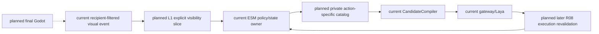
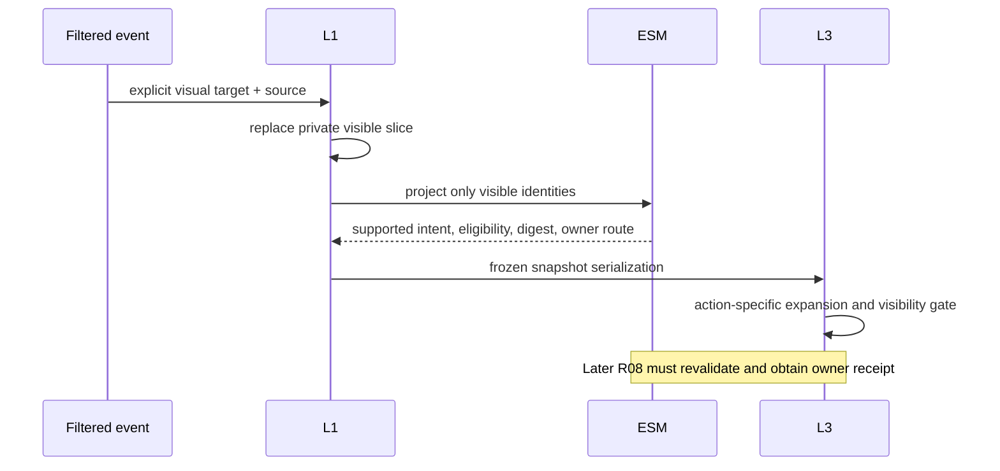
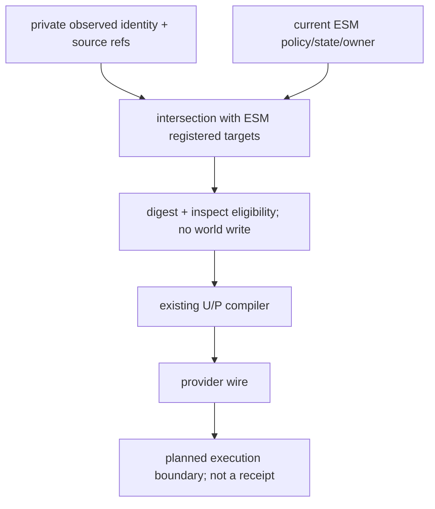

# Character Owner Target Projection Design

Status: implementation authorized by the user's 2026-10-20 stages 1–3 instruction; bounded execution of specs03/05/07 and the unified plan Task1. This design fills R05 production input, not the complete Laya/owner milestone.

## Ownership and choices

`[current]` L1 receives actor-filtered `CharacterPerceivedEvent`; its `visible_entities` contain summaries, not canonical identities. L3 consumes `target_catalog` and `visible_target_refs` but no production producer exists. ESM already registers object interaction policy and checks current state/ownership.

`[planned]` Add private snapshot fields for explicit visible identities and their observation refs, plus a target catalog. The latest visual event replaces the visible target slice, matching the existing latest-visual-summary behavior. Auditory events, Siming attention and model inference never grant visibility. A changed room/scene/zone clears the visible target slice. Copies and session serialization retain these fields.

An optional trusted projection callback is injected through the existing runtime constructor into L1. Production binds the existing ESM instance's `project_character_targets(snapshot)` immediately after constructing that instance during reset; ESM does not exist yet when the runtime is built. Each reset binds the new owner, never the previous instance. It receives only the actor's private visible identities. L1 restricts returned descriptors to those identities and attaches the observed provenance. Default without a resolver is an empty catalog, not assumed permission.

For this slice, ESM projects its already registered `inspect` interaction to `inspect_object` only. Stateful/owner mismatch is blocked. Other actions do not inherit this route. This is candidate eligibility, not successful execution: range remains required, no contact/physics evidence is invented. Unknown objects get no executable descriptor. Each descriptor binds a canonical digest of target, actor, scene scope, actual object state/owner and registered policy. ESM has no numeric source revision for this catalog, so the digest is used explicitly rather than inventing a revision. Exact owner receipt and execution-time revalidation remain R08.

L3 consumes the descriptor's explicit `supported_intents`; an unsupported action remains diagnostic and never enters U/P. Existing descriptors without that field retain compatibility for historical compiler fixtures. Explicit empty visibility means no target is visible; `None` alone retains the historical unconstrained compiler mode. The existing compiler, ordering, provider choice and action IDs remain the sole selection path.

`[deferred]` Stage4/editor, AD/Blender, autochess and explicitly deferred facility repair. Physical/contact realization remains the final Godot batch. L2 envelope, actual Laya quality, L4 dispatch and owner receipts remain in the active unified plan, not deferred by this slice.

## Architecture

## Principal sequence

## Data flow

## Acceptance and rollback

The next bounded execution projection preserves `target_admission_digest` and the received room/scene/zone in the canonical contract's expected observation. Only the registered `inspect_object` + `action:inspect` pair maps to ESM's `interact` / `inspect` vocabulary. ActionRequest uses that frozen scope rather than relocating the actor to the demo. This is transport preparation; it does not satisfy R08 owner admission, range, durable commit or feedback. Existing contracts without scope retain their historical demo compatibility pending their own migration.

RED/GREEN tests must prove actual L1→ESM→typed snapshot→L3→compiler flow, action isolation, explicit-empty visibility denial, unknown target denial, actor privacy, scope change, and changed owner/state digest. A real production composition test verifies constructor injection. No provider or Godot is needed to verify this input slice, and none is claimed.

Remove only the optional injection/fields and action-specific expansion to disable the slice; never remove committed ESM events or historical evidence. Implementation plan: [target projection plan](../../superpowers/plans/2026-10-20-character-owner-target-projection-implementation-plan.md).
