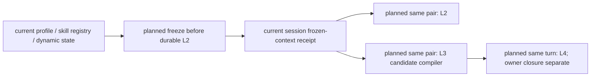
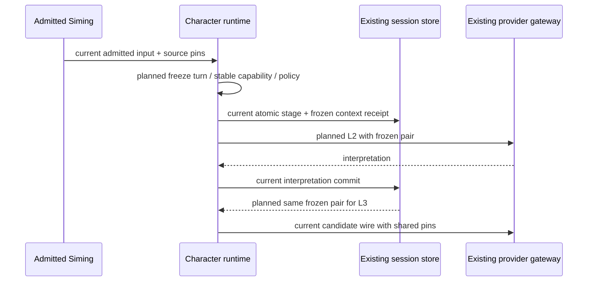
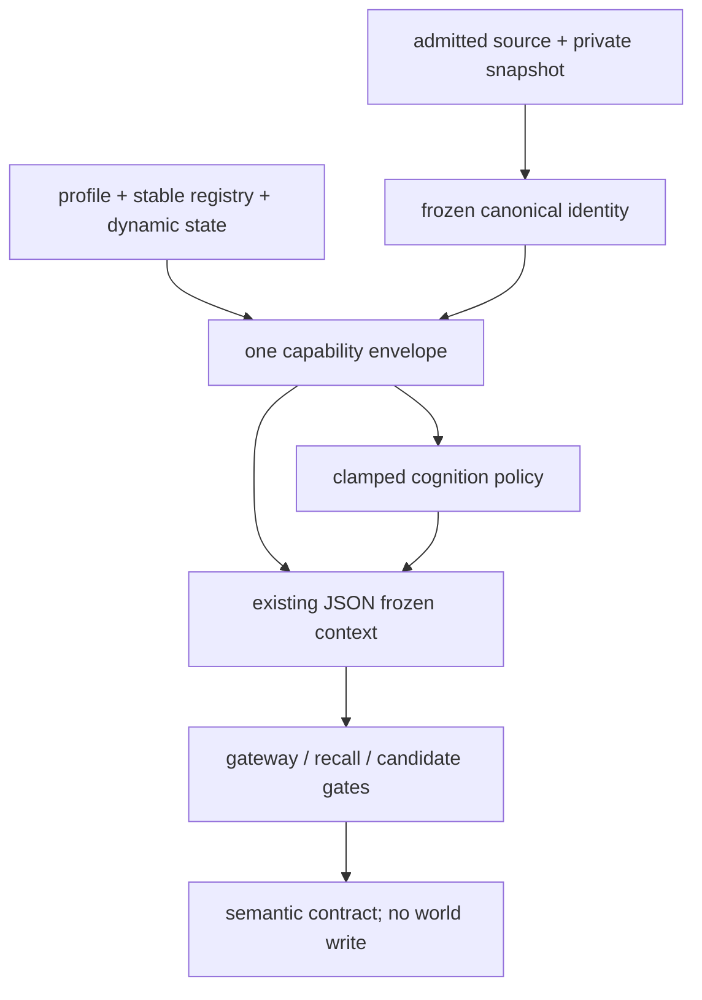

# Durable cognition shared contract

Status: implementation authorized by the 2026-10-20 stages 1–3 request; implements unified plan Task1/R06. No new authority or provider.

## Boundary and decision

`[current]` Durable Siming freezes L2 context, but L3 independently compiles an envelope with a synthetic prepared actor turn. Execution reconstructs its turn later. Existing CapabilityEnvelope, CognitionPolicy, stable skill compiler and stage receipts are retained.

`[planned]` Freeze the existing canonical turn identity, authored/effective profile, stable skill snapshot, dynamic state and one envelope/policy pair before the durable Siming L2 provider request. Event complexity comes from the admitted input, never from a later model output. L2 and L3 receive identical typed contracts and turn identity. L3 validates actor, turn, envelope/policy digests and revision equality before consuming a supplied pair; partial pairs fail closed. The existing candidate compiler remains the only compiler. Store the pair with the existing frozen context and carry its digest pins in stage progress. Reopening provider-pending work reads those bytes without recompiling. Execution uses the same frozen turn identity; legacy stored frames retain their existing recovery path.

The stable skill snapshot uses the existing service's current profile-backed skill states and registry revision; it does not claim a learned-state authority that the runtime does not expose. Current canonical input/memory revision semantics are preserved and remain a separate R01 limitation. This slice supplies policy to existing gateway/recall consumers; memory and dialogue hard enforcement and direct/background entry alignment remain R06 follow-on work. Background cognition remains `commands=[]`.

`[deferred]` Stage4/editor, animation tools, autochess and previously explicit deferred work. Godot remains the final batch. This change does not establish Laya quality, owner receipt or scene success.

Acceptance: real durable coordinator L2→L3 digest/turn equality; pending-stage reopening preserves exact contract; mismatched actor/turn/pair rejects without provider invocation or authority writes. Plan: [shared contract implementation](../plans/2026-10-20-durable-cognition-shared-contract-plan.md).
