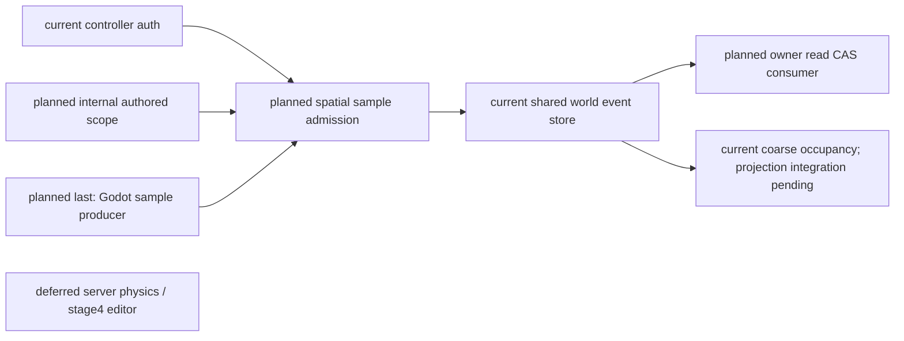
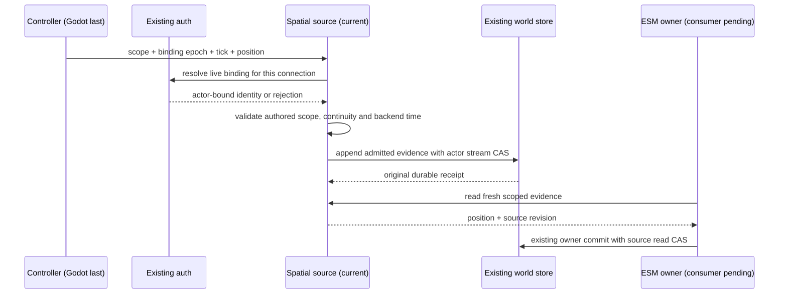
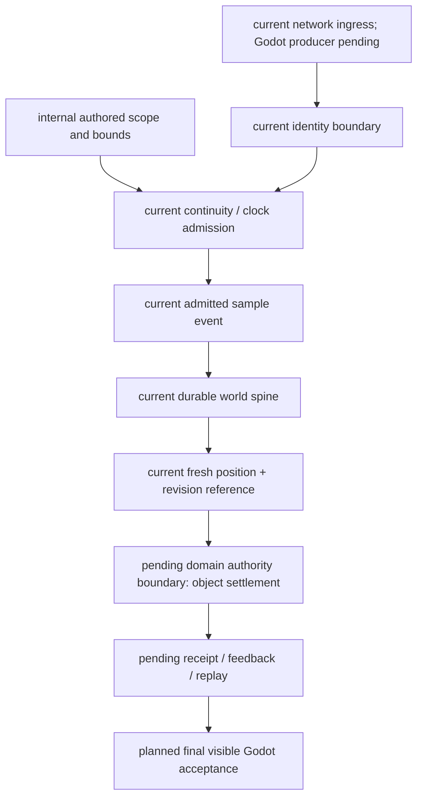

# Controller-bound spatial source for the October owner vertical

Scope: implement the missing source prerequisite in the authorized October stages 1–3 plan, Task2. Godot work remains last. This is the lead agent's implementation ruling under the user's instruction to resolve necessary reversible work from existing designs.

Godot owns local embodiment; backend admission turns an authenticated sample into bounded spatial evidence. MoveIntent remains intent. Reuse EmbodiedControllerAuthService for identity and revocation, and GameplayEventStore for durable provenance and CAS. SpatialOccupancyService remains a coarse projection, not a precise pose producer. Street-combat pose stays scenario-specific.

The internal composition caller supplies an immutable actor/room/scene/scene-instance/zone scope, authored source revision, spawn position, bounds, speed, tick rate and freshness. No websocket method may register or alter these definitions. Defaults are conservative engineering choices, not gameplay tuning acceptance. Initial sample must match the authored spawn; reconnect samples must continue from the last committed position. Physics ticks must increase within a binding and cannot buy more movement than elapsed backend monotonic time. The first sample of each binding must remain at the last admitted position. Exact duplicates return their original receipt without refreshing freshness; changed duplicates reject.

Each actor has one shared-store stream across scopes, preventing scene aliasing. Accepted samples retain the deployment scope digest, controller binding, connection epoch, physics tick, backend receipt time and process clock epoch. Append precedes projection. A consumer receives the position and source stream revision, and includes that revision in the owner's existing atomic read CAS. Missing, foreign, stale, revoked, changed-scope or previous-process samples are unusable. A fresh authenticated report is necessary after restart; persisted history cannot revive an elapsed monotonic clock or controller binding. Recovery validates event ownership, transaction identity, schema and sample digest before use.

This source proves admission of controller evidence within declared bounds, not independent server physics, path clearance, contact, character permission or world effects. Production L4 lifecycle/target admission and ESM result/receipt recovery remain separate required edges. No source registration or evidence-only test closes R07–R09 or Godot A/B/C.

## Architecture

## Sequence

## Data flow

## Acceptance and implementation map

`backend/app/world_runtime/embodied_spatial_source.py` implements strict scope/sample models and the admitted source. `backend/tests/test_embodied_spatial_source.py` covers authenticated subject/connection, scope and nonfinite rejection, first/reconnect continuity, backend-time speed limits, stale/duplicate handling, revocation, SQLite recovery and owner CAS races. Event registration is opt-in using the existing EventSchemaRegistry. Production composition and strict network ingress are implemented in `cafeaeed`; network binding expiry uses backend time in `e7063bcc`. A real HTTP/WebSocket probe verifies original spatial receipt and duplicate handling, with cleanup failure separately recorded in the unified matrix. The ESM/L4 consumer remains pending. This is not a live Laya/character or Godot result.
