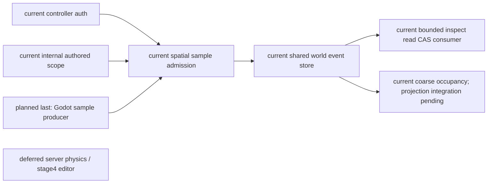
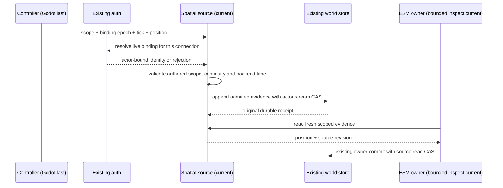
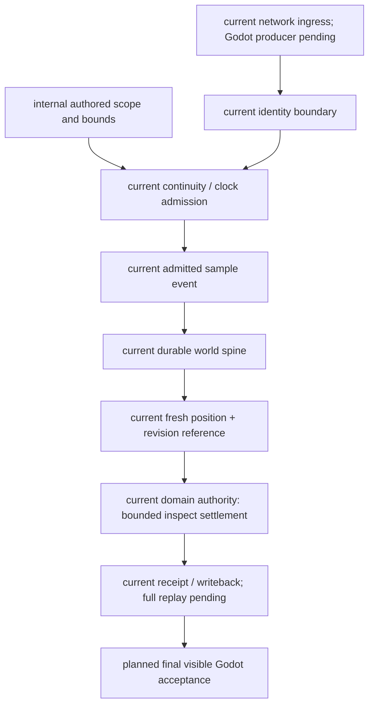
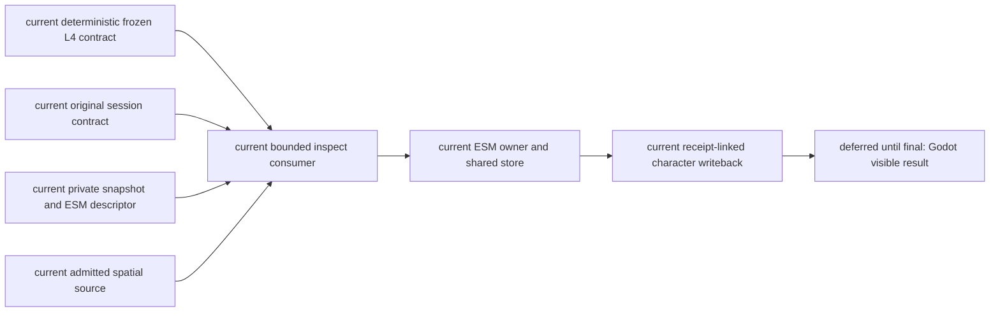
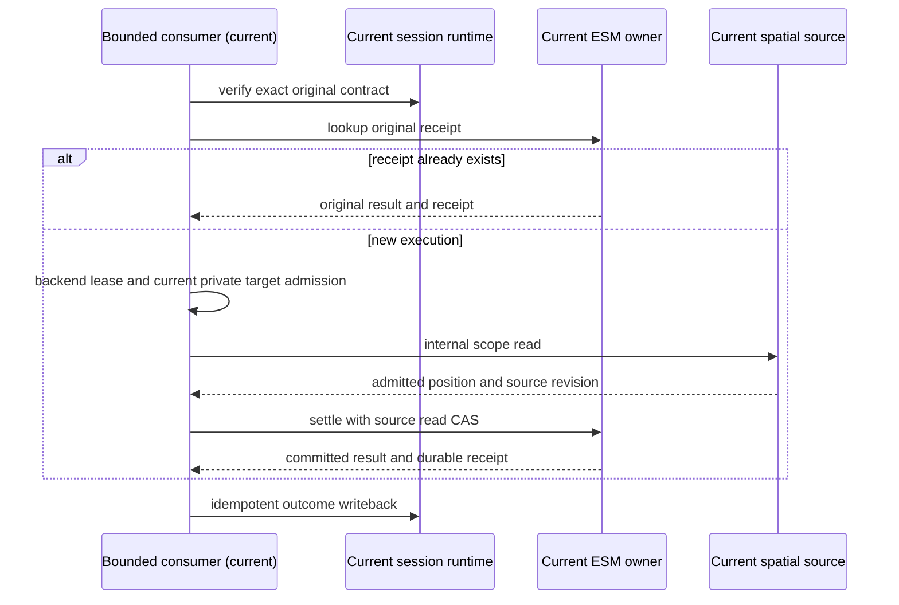
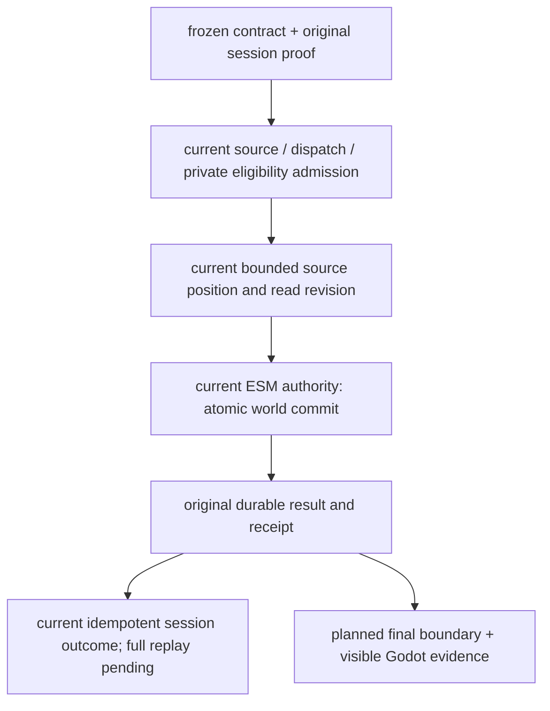

# Controller-bound spatial source for the October owner vertical

Scope: implement the missing source prerequisite in the authorized October stages 1–3 plan, Task2. Godot work remains last. This is the lead agent's implementation ruling under the user's instruction to resolve necessary reversible work from existing designs.

Godot owns local embodiment; backend admission turns an authenticated sample into bounded spatial evidence. MoveIntent remains intent. Reuse EmbodiedControllerAuthService for identity and revocation, and GameplayEventStore for durable provenance and CAS. SpatialOccupancyService remains a coarse projection, not a precise pose producer. Street-combat pose stays scenario-specific.

The internal composition caller supplies an immutable actor/room/scene/scene-instance/zone scope, authored source revision, spawn position, bounds, speed, tick rate and freshness. No websocket method may register or alter these definitions. Defaults are conservative engineering choices, not gameplay tuning acceptance. Initial sample must match the authored spawn; reconnect samples must continue from the last committed position. Physics ticks must increase within a binding and cannot buy more movement than elapsed backend monotonic time. The first sample of each binding must remain at the last admitted position. Exact duplicates return their original receipt without refreshing freshness; changed duplicates reject.

Each actor has one shared-store stream across scopes, preventing scene aliasing. Accepted samples retain the deployment scope digest, controller binding, connection epoch, physics tick, backend receipt time and process clock epoch. Append precedes projection. A consumer receives the position and source stream revision, and includes that revision in the owner's existing atomic read CAS. Missing, foreign, stale, revoked, changed-scope or previous-process samples are unusable. A fresh authenticated report is necessary after restart; persisted history cannot revive an elapsed monotonic clock or controller binding. Recovery validates event ownership, transaction identity, schema and sample digest before use.

This source proves admission of controller evidence within declared bounds, not independent server physics, path clearance, contact, character permission or world effects. Production L4 lifecycle/target admission and ESM result/receipt recovery remain separate required edges. No source registration or evidence-only test closes R07–R09 or Godot A/B/C.

## Architecture

## Sequence

## Data flow

## Acceptance and implementation map

`backend/app/world_runtime/embodied_spatial_source.py` implements strict scope/sample models and the admitted source. `backend/tests/test_embodied_spatial_source.py` covers authenticated subject/connection, scope and nonfinite rejection, first/reconnect continuity, backend-time speed limits, stale/duplicate handling, revocation, SQLite recovery and owner CAS races. Event registration is opt-in using the existing EventSchemaRegistry. Production composition and strict network ingress are implemented in `cafeaeed`; network binding expiry uses backend time in `e7063bcc`. A real HTTP/WebSocket probe verifies original spatial receipt and duplicate handling, with cleanup failure separately recorded in the unified matrix. The bounded ESM/L4 inspect consumer is implemented; complete action coverage and the live Laya vertical remain pending. This is not a live Laya/character or Godot result.

## Bounded production object consumer (Task2 continuation)

First consumer is the existing public plaque inspect policy only. It consumes the original frozen L4 contract, verifies its session source, and reconstructs its ActionRequest from the same canonical InteractIntent including turn and execution identity. Recompute the current actor-private visible target descriptor, owner route and admission digest; require the frozen room/scene/zone to match both current snapshot and internal spatial scope. Do not promote a controller binding into cognition permission. Other actions remain explicit unsupported routes until their actual owner admission is implemented.

Keep the frozen L4 contract deterministic. Backend egress records a separate `character_agent_execution_dispatch_offered` event in the original session, binding the execution key and original source event to a service process epoch and backend monotonic offer time. Ingress cannot mint an offer; repeating egress returns the original event without renewing it. Before a new world commit, the latest execution request must still be this contract, including supersession by a later legacy request. Use this original offer as the process-bound execution lease. This is a bounded dispatch deadline, not a new world clock/scheduler; producer_ts is not interpreted as backend wall time. Default 1000ms matches the existing proposed commitment window; it is an engineering default, not model quality acceptance. A missing lease, reversed/elapsed clock or previous-process lease cannot authorize a new commit. Existing original owner receipts are queried after source identity verification and before transient lease/snapshot/spatial revalidation, so a crash after owner commit can complete character writeback after restart. No receipt means restart requires a new cognition turn.

The owner validates exact request identity and returns the original result/receipt or commits with same-store source-read CAS. Only a committed receipt is written back as completed world outcome. A rejected preflight or local animation cannot become success. Session and world stores remain separate atomic domains; retry repairs their gap idempotently. The production consumer must not route legacy bundles through durable authority.

## Bounded consumer evidence and remaining scope

`CharacterObjectExecution` consumes only public plaque inspect. `main.py` offers at backend egress and dispatches canonical interact to this consumer; ESM uses the shared world store. A committed original receipt repairs the separate session-store writeback gap without requiring a fresh pose or dispatch after restart. Other actions and complete lifecycle/revocation atomicity remain pending. Exact staged isolation (HEAD plus only this patch) passed 95 focused tests, run `12b015bce3814ccfa82c53cfa34d57f6`; backend-contract passed `5c881ad557714ce293f8890375f1c21b`, both cleanup passed. Tests use an injected private snapshot and frozen contract: this is not real Laya input/choice, a new live network vertical, formal quality, or Godot acceptance. Evidence is indexed in the unified matrix.
