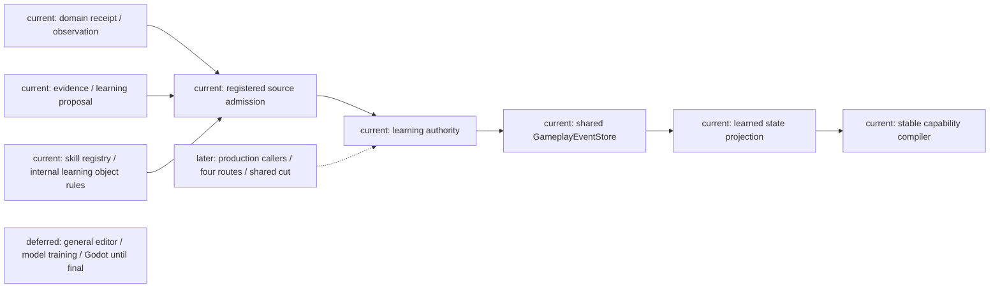
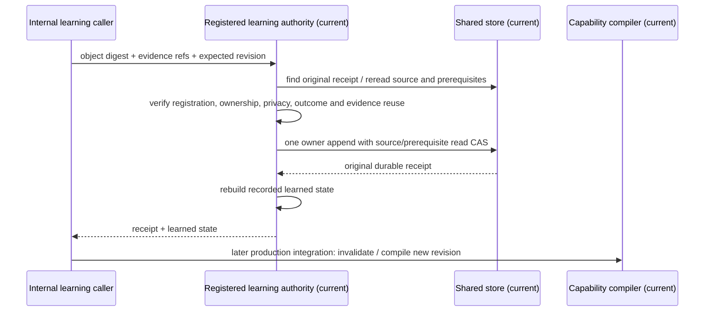
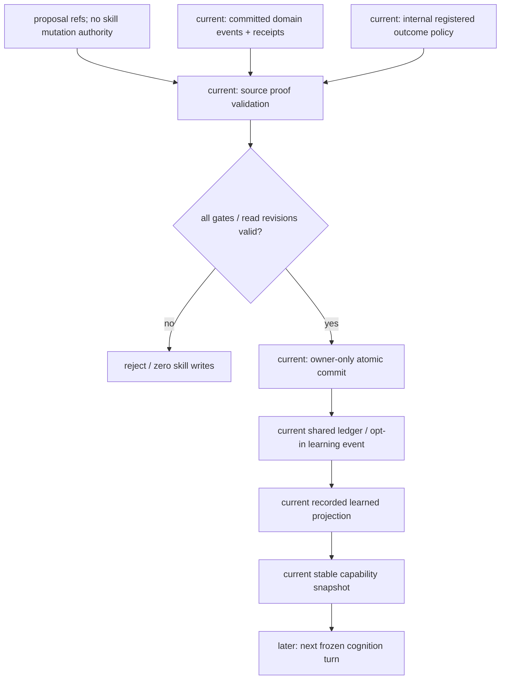

# Registered Learning Authority

Status: bounded owner prerequisite implemented; focused verification recorded in the unified matrix. Production callers and complete learning routes remain planned.

Parent requirements: [October learning specification](../../10月分析/规格/06-角色学习模仿与技能演化规格.md), [unified matrix R10](../../10月分析/回写/october-stages-1-3-acceptance-20261020.md), and [implementation plan](../plans/2026-10-20-registered-learning-authority-implementation-plan.md).

## Current implementation and problem

`skills.learning`, `evidence`, `store` and `service` provide candidate collection, gates and skill projections. The working-tree `SkillLearningSettlement` accepts a nonempty authority-event string and increments an in-memory counter. It is not proof that an authority committed a learning outcome. No production learning authority caller was found. The four route fixtures do not close this gap.

## Owner and source contract

Add the actual registered learning authority under `character_agent/skills/learning_authority.py`, using the existing GameplayEventStore and CharacterSkillRegistry. The existing SkillEvidenceStore remains an evidence cache; it does not become a second skill-fact ledger. The new authority owns actor-scoped learned skill events and receipt lookup. CharacterSkillService remains the stable capability compiler. The authority returns learned CharacterSkillState projections, which the existing compiler can consume; authored profiles remain authored inputs.

Registrations are internal immutable content: object/version, source rule/version, skill id, permitted operation, learning stage/method, prerequisites, minimum distinct committed evidence and the registered resulting rank/proficiency/confidence. Model requests carry references, never mastery numbers or permission booleans. A registration may authorize upgrade, branch, mutation, fusion or evolution separately. Both the evolution operation and evolved stage require an explicitly registered Siming source owner. Only natural/trained skills are admitted; granted/locked skills fail closed until a separate grant proof path exists. Registration is not a runtime grant issuer or automatic learning policy.

Each evidence reference is reread from the shared store. A registered source policy binds event type/version, committing principal, subject field, visibility policy and successful-outcome predicate. Event membership and original receipt must agree. Caller-provided strings, cache records, fabricated principals, another actor's private event, unsuccessful source outcomes and missing/stale stream revisions are rejected. Evidence stream heads enter the append batch read CAS. Prerequisites are reconstructed from the same actor learning stream, protected by its write CAS. Authorization of a production caller, source availability/expiry, time costs and teacher/visibility admission remain mandatory before this internal API can be exposed; no unauthenticated public learning endpoint is added in this prerequisite batch.

Requests bind actor, object registration digest, ordered distinct evidence ids, expected skill revision, command/idempotency/cause/correlation. Exact retries are checked against the original committed command before checking transient heads or current registrations. Changed duplicates reject. One piece of evidence cannot repeatedly produce an outcome for the same actor/object_id using new command ids. Separately registered object ids can reuse evidence; this is not a global evidence-spend ledger. A rejected command writes no skill fact. Successful append precedes projection rebuild, so lost response is recovered from the original receipt.

Projection reconstructs the registered outcome recorded at commit time; later registry edits do not reinterpret historical learning. It validates event schema, principal, stream/actor, transition revision, command identity, payload digest, receipt and transaction membership. Projection supports a bounded full rebuild. Checkpoint/tail participation and global-cut integration are subsequent tasks, not inferred from a successful SQLite reopen.

## Scope and acceptance

This is the durable owner prerequisite for R10, not acceptance of the four complete learning routes. Object registration and a source policy are mandatory; worlds with no registration remain unavailable. No arbitrary code/expression policy, new event store, profile mutation, model training, Godot changes or automatic progression is introduced.

The module exports an opt-in schema registration; production shared-store composition has not yet registered the event. Strict stores reject it until explicitly registered. Stage/method and operation values are admission labels here; the complete episode state machine, mastery dimensions, resource/time rules, fusion graph and Siming producer remain subsequent work. A successful receipt in this prerequisite test does not establish those semantics.

Required focused evidence: reject absent/forged/wrong-actor/private/stale/failed evidence, wrong registration and missing prerequisite with zero writes; real atomic owner append/receipt; exact/changed retry; evidence reuse rejection; source/prerequisite read CAS conflict; append failure/lost response; strict schema registration; SQLite reopen and replay validation; learned projection accepted by the existing stable capability compiler. Subsequent production and four-route evidence must separately show actual source→episode→gate→owner→capability invalidation and recovery.

## Architecture

## Principal sequence

## Data flow and authority boundary

