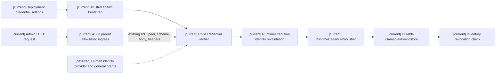
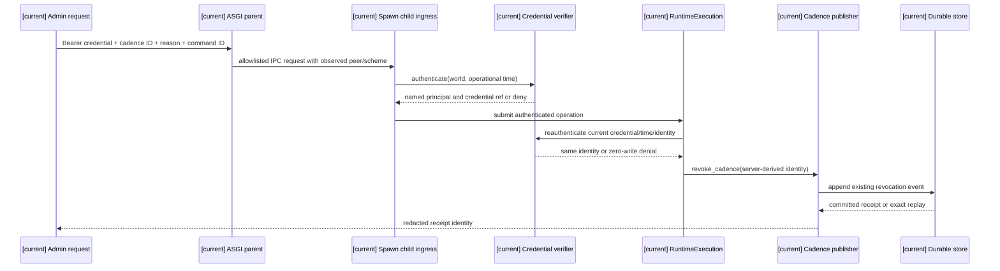
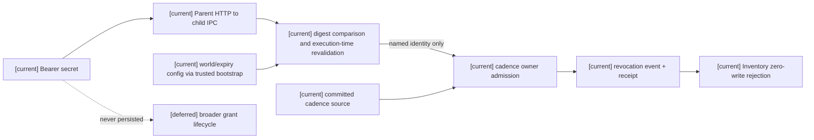

# Authenticated World Admin Cadence Revocation

Status: approved for this stage-three execution by the user's standing authorization to resolve missing product policy and implement real call chains. This is one Task1 source slice, not Task1–Task6 closure.

## Intent and decision

The current `RuntimeCadencePublisher.revoke_cadence()` accepts a backend caller-supplied `world_admin` string. It does not authenticate an external caller. Add a dedicated, deployment-provisioned world-admin service credential for the existing cadence revocation operation. A credential has a stable public reference, a named admin principal, a nonempty world allowlist, a minimum 32-character secret, and an operational expiry. It is separate from launcher secrets, WebSocket advisory sessions, controller execution grants, and gameplay item credentials.

The backend starts with this external operation disabled when no credential is configured. The deployment operator supplies credentials through `WORLD_ADMIN_CREDENTIALS_JSON`; secrets are excluded from model representations, responses, events, reports, and logs. The existing trusted spawn bootstrap explicitly serializes this nested configuration, and the child rebuilds its verifier after applying the bootstrap settings. The production ASGI parent forwards the allowlisted route, observed peer and HTTP/HTTPS scheme through the existing IPC request. The HTTP request carries a Bearer credential. Authentication compares a digest in constant time, checks world scope and expiry, and then submits the existing publisher operation on the runtime execution thread. Immediately before the owner call, the current verifier reauthenticates at the current operational time and requires the same identity; a queued request cannot retain expired, removed or replaced authority. A successful revocation records the authenticated principal and credential reference in the existing Durable event payload while the original `world_admin` owner principal, cadence source, stream, receipt, and Inventory revocation checks remain in force. No new event store, clock, scheduler, or broad permission router is created.

This design chooses an operator-issued service account as the first real administrator identity source. It does not claim a human login provider, facility-owner grants, resource capability grants, or general admin delegation. A production acceptance claim requires an actually provisioned deployment credential and a live request; a test credential proves only the application boundary.

## Boundaries

- A request without configured credentials, with an invalid/expired credential, outside the credential's world scope, over non-TLS non-loopback transport, or with a mismatched runtime world makes zero writes.
- The request cannot choose `caller_principal_ref`, source event, stream, issuer, authenticated subject, or receipt. The server derives these after authentication.
- Exact retry returns the prior Durable receipt. A changed payload under the same command ID is rejected. Authentication is checked again on every retry.
- The stored event contains credential reference and principal reference, never the secret or its digest. Legacy trusted-backend revocations remain readable but do not prove external identity.
- Both credential and outer Settings validation hide input values in error text; invalid deployment configuration must not print a secret during startup or trusted child-bootstrap validation. Structured validation error inputs must not be logged.

## Architecture

## Principal sequence

## Data flow

## Acceptance

Focused tests prove absent/invalid/expired/cross-world credential zero-write, HTTP/HTTPS scheme and loopback admission, named identity in a real owner event, exact/changed duplicate, Durable close/reopen, and Inventory admission rejection after revocation. Real spawn-child tests use the production ASGI entry, preserve configured credentials and observed scheme, verify default-off, and replay the receipt after a fresh child starts on the same Durable path. A separate fresh-process test loads `WORLD_ADMIN_CREDENTIALS_JSON`. These controlled credentials and ASGI scheme tests do not prove a deployed credential or an actual TLS handshake. The relevant Task1 Inventory and Task6 allowlists plus docs run from one frozen revision. The stage-three global gate stays incomplete until other Task1 consumers, production credential provisioning, Task2–Task5 sources, and all-owner Task6 parity have evidence.
