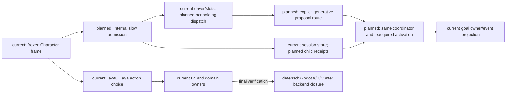
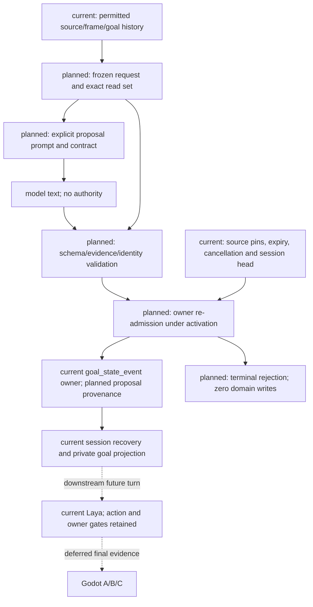

# Character slow goal proposal lifecycle

Status: request/response contract implemented and verified in batch 1; owner lifecycle, durable acceptance, driver coexistence and live closure remain planned and runtime unverified. Implementation authorized by the current October stages 1–3 request.

This is an implementation refinement of role specs 01 §3.1 and 02 §4 and plan01 Task6A. It preserves the single Character owner, original goal event/store and existing gateway/provider slots. It does not authorize Godot work, training, new model quality claims or a second scheduler/store/actor writer.

## Problem and acceptance

The actual sourced DialogueSubmit → online L2 → official Laya → L4 → ESM use/finish → fresh-process receipt chain already exists. Its goal frame still comes from persisted goal state or a continuity shell. Laya returns that frame unchanged; L2 goal_hints are not goal arbitration. There is no independently triggered slow goal reorganization.

The accepted behavior must let the current lawful Laya loop proceed while a slow provider computes. A provider response is a proposal only. The same Character coordinator must reacquire the existing actor activation, revalidate the original source/read set and submit a valid goal transition exactly once through the original session transaction and goal_state_event projection. Stale, cancelled, expired, conflicting or failed proposals cannot write a new goal, action, floor, world result or memory update.

## Existing ownership and implementation mapping

| Responsibility | Existing owner | Required change |
|---|---|---|
| Source, revision and expiry admission | CharacterCognitionAdmissionService | Bounded slow-proposal lifecycle using the existing session store; no externally supplied arbitrary source |
| Result validation and effect planning | CharacterCognitionCoordinator | Proposal acceptance under current activation and exact frozen pins, without executing an action |
| Provider capacity and polling | CharacterCognitionDriver / DialogueProviderSlots | Dispatch frozen computation without holding actor activation; poll acceptance on existing owner queue |
| Request and response contract | CharacterModelGateway / prompt policy / output validator | Explicit goal-proposal contract distinct from action-choice output |
| Goal truth and recovery | RuntimeLoop._plan_goal_state_event / session store / session_recovery | Reuse original goal transition calculation, atomic receipt/event and projection |

PreparedCognitionJob is not a ready-made parallel lane: the runtime rejects another pending same-actor turn and its continuation receipts are in-memory. CharacterCognitionProgress is a durable linear stage machine; adding a stage after L3 would serialize slow thinking with Laya. Neither mechanism alone satisfies this design.

## Frozen contract and routing

The request is internal and identified by actor, triggering admitted source event, trigger kind, exact source revision vector, expiry and request digest. The allowed trigger kinds preserve plan01 Task6A: repeated failure, phase change, context conflict, goal conflict and complex/high-risk/persistent information failure. A locally resolvable information gap does not trigger a slow request. Trigger evidence must come from the permitted frozen frame or committed actor-private outcome; model confidence alone is not a source.

Freeze the admitted MindFrame, current goal state/history, interpretation, permitted evidence refs, capability envelope and cognition policy. The request includes the original actor/turn/source IDs and expiry, the goal read-set digest, and an explicit `goal_proposal:v1` output-contract identity. These fields belong to the request; the model cannot amend them. No hidden authority data, raw dossier, reviewer truth or evaluation labels enter provider input. No hint-to-goal promotion is allowed.

Reuse gateway task kind l3_planning with a discriminated output contract; do not send a proposal through existing candidate_intents validation or Laya choice mapping. The generative slow route must be explicit and reject Laya/local-only routes for this contract. It uses the configured reasoning provider and its existing credential isolation. No fabricated candidate selection or default continuity goal is added to make the response fit L3 action output. Deep routing remains a distinct trigger/route record and is not implicit fallback.

The v1 model response contains only a typed CharacterActiveGoalFrame and evidence refs from the frozen request. Extra fields, blank primary goal, unknown evidence refs and invalid portfolio entries are rejected. The envelope carrying request ID, actor, expiry and source pins is reconstructed from the frozen request, never trusted from model text. Generated prose is subjective goal/strategy content, not new evidence or permission.

## Lifecycle, cancellation and fairness

One bounded outstanding slow proposal per actor is sufficient. Admission deduplicates the exact request identity. The request/progress/terminal receipt live in the existing session store, with schema migration and readback validation following current receipt/index patterns. No new database, clock, lock or scheduler is introduced. The child lifecycle is explicit: admitted → provider_pending → result_ready → commit_started → completed, or terminal stale/cancelled/failed. A conflicting retry is rejected; retries retain the original bytes, digest and expiry.

The driver releases the existing activation after freezing the request and before provider work. Provider computation owns only a shared provider slot. Current Laya work continues to use the existing activation. The completion callback queues data to the existing owner; it may wait for the current activation and cannot create another actor writer. The coordinator reacquires activation for acceptance and atomic commit, then releases it. Fair polling must reserve progress for fast work; at most one slow request per actor and bounded shared capacity prevent unbounded slow accumulation. Slot cancellation follows actual worker lifetime, not local future cancellation.

The first implementation uses exact original source pins at result acceptance and again immediately before effect commit. A newer turn that changes any captured pin makes the old proposal stale. It does not rebase the old proposal onto a new frame, refresh expiry or ignore goal/memory/control/privacy revisions. Identical goal prose does not by itself prove read-set equivalence. This conservative policy may discard proposals under frequent fast-loop changes; measure that explicitly before considering any separately reviewed semantic-pin relaxation. Never suppress the fast loop to make acceptance succeed. A later qualifying trigger may create a new request after the old one terminates; that is a new identity and not a retry.

Explicit cancellation persists a terminal state before acknowledging cancellation; shutdown preserves resumable pending state and changes worker generation. Old worker completions are never accepted after shutdown/restart. Recovered dispatch reads the original bytes, expiry and source pins, rechecks them, and recomputes only if the original request is still lawful. Provider failure terminates this proposal with diagnosis; it cannot replace a current fast action with a stale floor. Existing fast-loop fallback remains governed by its own current admission.

## Original goal commit and replay

Plan a goal transition through the existing goal owner; do not build a CharacterIntentDecision with a fictitious selected action. Extract the minimal goal-frame transition helper from _plan_goal_state_event so synchronous L3 and slow proposal acceptance share transition_kind, changed fields and reason tags. Preserve existing event payload semantics for action decisions; slow proposals carry explicit provenance and no selected executable intent. Review session recovery consumers before admitting the new event provenance.

Use the existing session transaction to atomically commit the goal_state_event, request terminal receipt and progress CAS. The expected session head is captured under the reacquired activation immediately before commit, after original pin validation; a head mismatch rejects rather than silently recalculating. A prior exact receipt is returned without new writes. Changed completion/request identity fails closed. Crash after event commit but before in-memory projection restores via the existing session recovery; a fresh process must recover the same terminal receipt and goal projection with zero duplicate events. This is Character goal truth only, never a gameplay authority receipt.

## Architecture



## Principal sequence

```mermaid
sequenceDiagram
  participant O as Character owner/coordinator
  participant S as Existing session store
  participant D as Existing driver/slots
  participant P as Slow provider
  participant L as Current Laya loop
  Note over O,P: planned lifecycle; current owner/store/slot primitives reused
  O->>S: Freeze admitted request, pins and expiry
  O->>D: Dispatch data; release actor activation
  D->>P: Frozen generative goal proposal request
  L->>O: Continue lawful fast work
  P-->>D: Proposal or error
  D->>O: Queue completion on existing owner
  O->>O: Reacquire activation; check original pins/cancellation/expiry
  alt valid original context
    O->>S: Atomic original goal event + terminal receipt + CAS
    S-->>O: Exact receipt
  else stale, failed or cancelled
    O->>S: Terminal diagnosis only; zero goal/world effects
  end
  Note over S,L: deferred Godot validation supplies no backend acceptance shortcut
```

## Data flow



## Gates and batch order

1. Contract preparation/validation tests: no live model calls and no persistence claim.
2. Original goal helper plus proposal event/recovery compatibility: no fabricated action.
3. Internal source admission, durable child lifecycle and coordinator atomic acceptance/replay: include SQLite reopen and injected crash tests.
4. Existing driver/slots integration: pending slow provider must not block an unrelated lawful fast turn of the same actor; changed pins reject old result. Verify cancellation, original expiry, worker generation and fair capacity.
5. Bounded development live slow provider + Laya + original goal receipt + later lawful owner execution + fresh-process recovery. Quality remains separate from service/contract success; no calibration/final/holdout access in this engineering batch.

Use targeted RED/GREEN and relevant backend contract/role profiles with external evidence and cleanup. Full pytest/Harness all are not required solely to add evidence; revisit only for a concrete final acceptance risk with prior explanation. Godot remains last. Generic editor, phase 4, AD/Blender and autobattler remain outside the expanded goal.

[current] This document is a lifecycle design, not working slow replanning. [planned] Batches 1–5 above. [deferred] Godot A/B/C belongs to final integration; no new backend feature is deferred out of the October acceptance requirement.

Execution: [child implementation plan](../plans/2026-10-21-character-slow-goal-proposal-implementation-plan.md); [unified acceptance matrix](../../10月分析/回写/october-stages-1-3-acceptance-20261020.md).
