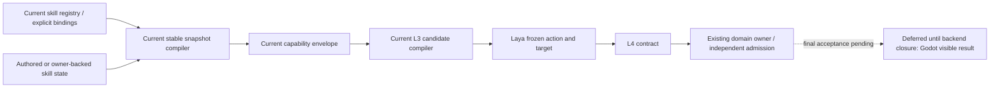
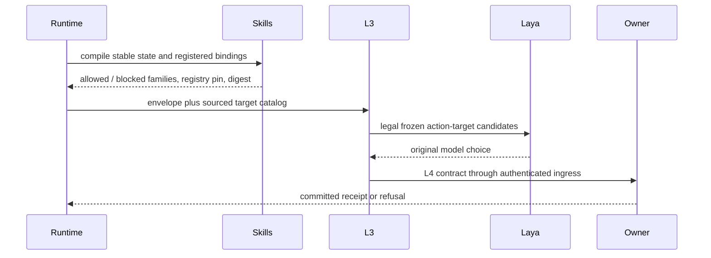
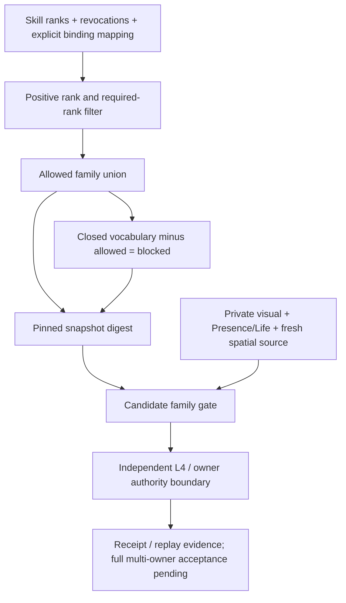

# Registered action-family projection repair

Status: implementation repair under the authorized October stages 1–3 plan.

The production stable snapshot previously projected skill knowledge domains into L3 action-family gates. These vocabularies differ: `social` and `boundary_enforcement` are knowledge domains, while L3 consumes `communication` and `movement`. Real authored profiles therefore lost registered candidates before reaching Laya.

`SkillActionBinding.action_families` explicitly registers the projection. The closed vocabulary matches current L3 families: observation, communication, movement, combat, procedure and protection. Missing mapping grants nothing. A binding contributes only when its skill is present, unrevoked, has positive rank and satisfies the registered required rank. The complement is blocked, including when no binding qualifies. Registry revision and snapshot digest include the registration through normal serialization. Domains remain descriptive; this projection grants no owner permission.

The six core registrations follow their existing primitive sequences: survey → observation; mediation → movement/communication; room protocol → procedure; threat assessment → observation/protection; boundary enforcement → movement/communication/protection; perimeter discipline → observation/procedure/protection. No core binding grants combat. New owner capabilities, model quality and Godot evidence remain separate acceptance work.

Verification covers authored char_a/char_b snapshots through the real candidate compiler, missing-map refusal, low/none/blocked rank refusal, revocation, and neighboring capability/learning/social owner tests. This repair does not refresh sealed evaluation pins or claim formal model quality.
