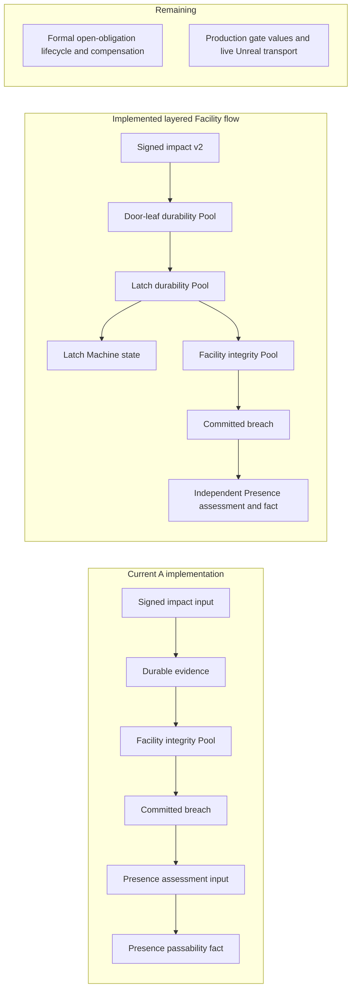
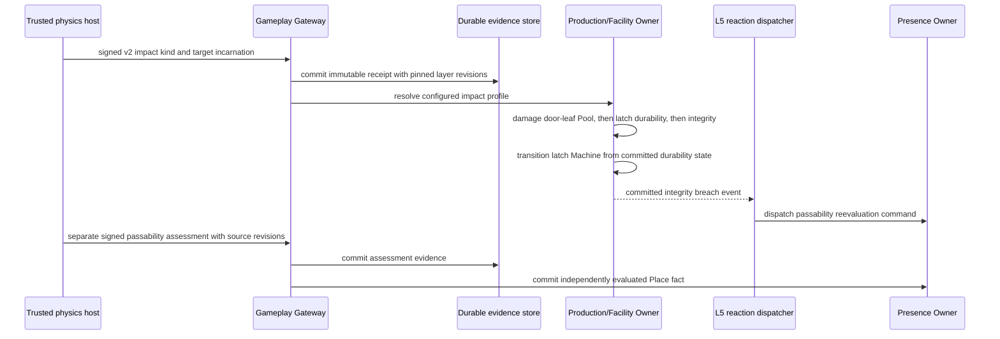
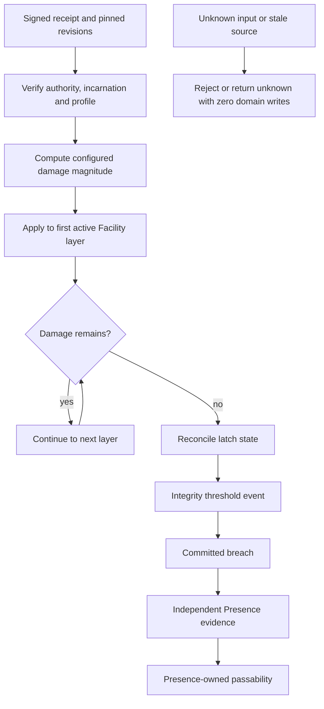

# M6-5 Gate Impact Layered Execution Design

## Status

Implementation design for A-owned M6-5 work. It uses explicit demo content and does not add production defaults. No B domain delivery is required.

## Intent

Complete the Paralls-side ordered impact resolution for the formal `impact_gate` pipeline and retain Presence as an independent UE-side decision. The current A implementation authenticates gate-impact evidence and writes only the integrity Pool. This design adds the missing Facility durability stages and durable recovery across those stages.

## Goals

- Resolve one trusted impact class through door-leaf durability, latch durability, and gate integrity in order.
- Keep all Facility facts under the existing Production/Facility authority and keep passability under Presence.
- Commit same-host Facility layers in one Owner-authorized multi-stream transaction.
- Recover an interrupted impact from the immutable signed input and committed Owner events without a second workflow ledger.
- Preserve replay of existing v1 gate-impact receipts and integrity events.
- Provide a deterministic `gate-03` M6-5 demo profile while leaving production startup unconfigured unless content explicitly supplies a profile.

## Formal source reconciliation

The hit profile describes door-leaf durability and latch durability as Pool layers. The complete FactType example declares `fact:facility:gate-03:latch` as a Machine using `machine_def/gate_latch@1`. The runtime will represent both concepts separately. `fact:facility:<gate>:latch-durability` is the Facility-owned Pool used by impact resolution. `fact:facility:<gate>:latch` is the Facility-owned Machine projection of latch condition, transitioning from `secured` to `damaged` and then `broken` as the durability Pool crosses configured thresholds. The existing `fact:facility:<gate>:integrity` Pool remains the breach-bearing source. This prevents a continuous value from being stored in a discrete state fact.

## Decisions

- A new, explicitly selected profile version resolves impact classes to positive damage magnitudes. The signed UE receipt continues to identify the impact kind and gate incarnation. It does not supply a numeric damage value.
- A strike applies damage to the first non-depleted layer. Excess damage continues to the next Facility layer. All same-host Facility Pool changes and the derived latch transition share one idempotent Owner commit. Presence remains outside this Facility cascade.
- The stable signed input is the durable retry source for the atomic Facility commit. Recovery applies the commit when missing and recognizes it when already committed.
- Existing v1 signed inputs retain their current integrity-only interpretation. The layered path uses an explicit v2 receipt and EventSchema so historical evidence does not acquire new semantics.
- The M6-5 demo profile uses lower bound `0`, upper and initial `100` for the two durability Pools and integrity Pool. The `impact_kind:battering-ram@1` magnitude is `20`. Integrity breach enters below `40` and resets above `45`. These values are demo content only and are not production game tuning.
- The latch Machine begins in `secured`, enters `damaged` below full durability, and enters terminal `broken` at zero. It never writes passability.

## Current and planned flow

The diagrams separate current behavior, planned layered behavior and deferred live transport or production balance work.

## Failure and compatibility behavior

- Missing profile, unknown impact kind, invalid signature, incarnation mismatch or stale source revision rejects before any Facility write.
- A crash before the Facility multi-stream commit is resumed from the signed receipt. A retry after the commit returns its original result without applying damage again.
- Exact replay returns the original receipt and does not repeat damage. Reusing a receipt identity with changed content rejects.
- Presence remains `unknown` with zero Place writes unless its separate signed assessment cites the committed breach and current independently owned evidence.
- Old v1 signed input events keep their integrity-only behavior during normal startup recovery.

## Formal obligation boundary

The project lead selected continued Presence evaluation without rollback of already committed physical damage. A future reversible reservation may use an Owner-authorized compensation step.

The runtime reconstructs impact_gate step receipts from the signed physical input, Facility Owner transaction, Presence assessment input and Presence-owned Place output. The open-obligation view is derived on demand from those immutable records and is not another workflow ledger. It remains open until a committed Place decision exists. An unknown Presence result writes no Place fact and leaves the obligation open.

The current UE assessment contract requires a committed integrity breach event. A non-breaching impact therefore has no valid Presence assessment source yet and remains open in the projection. M6-5 remains incomplete until the source contract covers that case or the workflow specification narrows its Presence step to breach transitions.

## Verification requirements

- Test ordered damage, residual damage, depleted and undamaged layers, latch state transitions and integrity breach hysteresis.
- Test invalid and stale receipts, zero writes, exact retries and changed retries.
- Close and reopen a SQLite Gameplay store after the input commit and Facility multi-stream commit, then verify recovery completes without duplicate damage.
- Run the authenticated HTTP path, production EventSchema and pack loading, L5 breach dispatch, independent Presence assessment, and recipient-specific Information report flow.
- Run the M6-5 and frozen selections, compare the full suite on exact parent and implementation commits, and report unclassified failures without attributing them to a slice.

## Boundaries

- No B domain code or the read-only documentation repository is modified.
- No EventStore or shared model changes are planned.
- No production balance values or live UE transport behavior are claimed by the demo profile.
