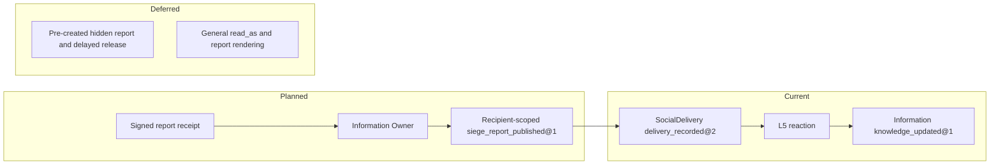
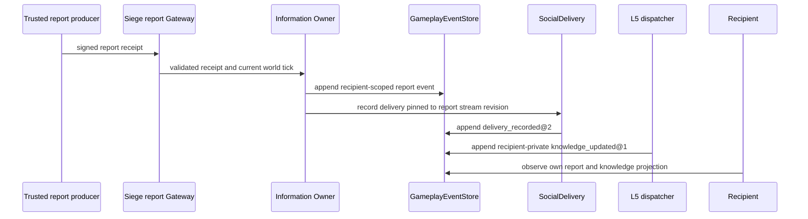
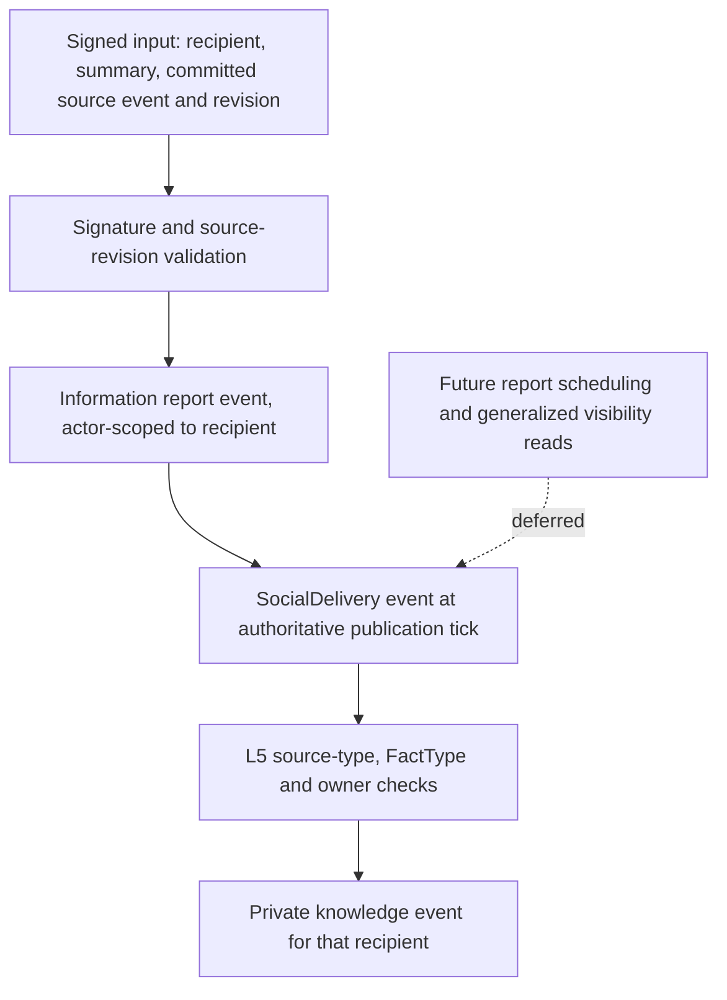

# M6-5 Information Report Source Design

## Status

Proposed for project-lead review. The project lead selected an A-owned Information report producer and report creation at publication to the recipient. This document records the implementation details proposed by A.

## Intent

Create a real, registered Information-owned report source event so the production SocialDelivery and L5 path can be verified from a trusted report publication input. The current L5 test fabricates `gameplay.social.knowledge_observed` directly and does not exercise a production source writer.

## Goals

- Add an authenticated production input for publishing one siege report to one recipient.
- Persist a recipient-scoped Information report event with a committed source event reference and its exact stream revision.
- Record SocialDelivery from that committed report event and let the existing L5 reaction create the recipient-private knowledge fact.
- Verify signature rejection, source revision validation, idempotent retry, recipient visibility, replay, and the complete production route.

## Non-goals

- Generate or infer report content from world events. A trusted report producer supplies a bounded summary.
- Store a report before it is published to its recipient or model a future delivery schedule.
- Implement general `read_as`, report rendering, or the remaining `impact_gate` obligation stages.

## Approaches

1. **Recipient-scoped event created at publication.** A signed Information input creates the report event with `actor:<recipient>` visibility, then uses existing SocialDelivery and L5. This matches the selected lifecycle and the current SocialDelivery source-visibility contract.
2. **Owner-private report created ahead of delivery.** This requires changing how SocialDelivery authorizes hidden sources and how report content becomes readable after arrival. It crosses the current visibility boundary and is deferred.

Approach 1 is the project lead's selected lifecycle. A chooses a signed input because the writer is a production trust boundary, and uses source-event references so the writer does not invent a second copy of world facts.

## Proposed event and input contract

- Report source event type: `gameplay.information.siege_report_published@1`.
- FactType: `fact:information:siege:report`.
- The signed receipt carries `authority_ref`, `receipt_id`, `report_ref`, `recipient_ref`, `summary`, `source_event_id`, `source_stream_id`, `source_revision`, `effective_from`, `effective_to`, and `signature`.
- The Information Owner verifies the signer, the source event's committed identity, and that its stream revision is still current before writing.
- The server's authoritative world tick must be inside the signed delivery window. Future-scheduled publication is rejected, so the report source does not become visible before its publication time.
- The report event is written by the Information Owner to a recipient-specific stream and uses `actor:<recipient>` visibility. Its payload carries the same report identity, summary, and source reference.
- Production signing keys use a dedicated `SIEGE_INFORMATION_REPORT_AUTHORITY_SECRETS_JSON` setting. The physical-input signing map remains scoped to physical evidence.
- The existing SocialDelivery writer records publication at the current authoritative world tick. The L5 matcher recognizes only the registered Information report event committed by the Information Owner.
- Delivery and the resulting `gameplay.information.knowledge_updated@1` remain recipient-scoped. Retrying the signed receipt with the same identity must return the original source and delivery receipts, including after the original delivery window has closed.

The proposed summary is a non-empty string bounded to the EventSchema `str` limit of 512 characters. It is supplied by the trusted report producer and is not treated as verified merely because it has a source reference. The source reference establishes provenance and revision, while the signing authority owns the content assertion.

## Current and planned flow

The diagrams show the current delivery-to-knowledge path, the planned source producer, and deferred delayed-publication/read behavior separately.

## Acceptance evidence

- The production EventSchema factory registers the report source and existing delivery/knowledge schemas.
- An invalid signature, unknown authority, missing source event, stale source revision, mismatched recipient, or replay with changed content performs zero writes.
- An exact retry returns the original report and delivery receipts without duplicate source or knowledge facts.
- A valid HTTP request creates the Information-owned report source, a committed SocialDelivery event, and exactly one recipient-private knowledge event through L5.
- A second recipient cannot see the first recipient's report or knowledge event.
- Report-source, Information, M6-5, and frozen selection verification are recorded against the exact A commit.

## Calls left to the implementer

- Keep report identity and source references in the existing GameplayEventStore. Do not introduce a second report ledger.
- Reuse the existing signed-receipt validation pattern for physical inputs, with a dedicated Information key map and authority principal.
- Before editing `main.py`, record the shared-file change in A's coordination communication log as required by `BOUNDARIES.md`.
