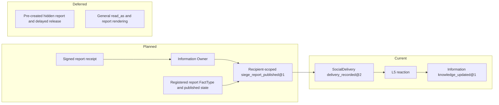
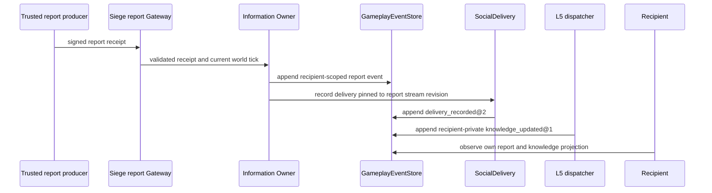
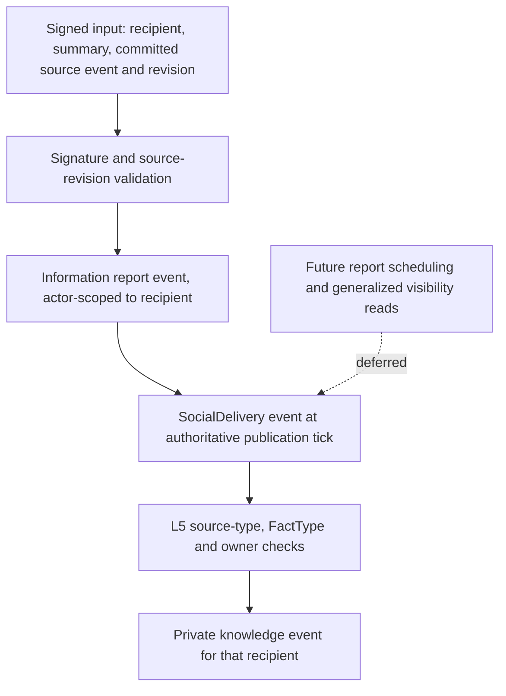

# M6-5 Information Report Source Design

## Status

Proposed for project-lead review. The project lead selected an A-owned Information report producer and report creation at publication to the recipient. This document records the implementation details proposed by A.

## Intent

Create a registered Information-owned report source event so the production SocialDelivery and L5 path can be verified from a trusted report publication input. The current L5 test constructs `gameplay.social.knowledge_observed` directly as a fixture. It does not exercise a production source writer.

## Goals

- Add an authenticated production input for publishing one siege report to one recipient.
- Persist a recipient-scoped Information report event with a committed source event reference and its exact stream revision.
- Record SocialDelivery from that committed report event and let the existing L5 reaction create the recipient-private knowledge fact.
- Verify signature rejection, source revision validation, idempotent retry, recipient visibility, replay, and the complete production route.

## Scope boundary

This unit covers one recipient publication, its source event, the SocialDelivery record, and the resulting knowledge event. A trusted report producer supplies a bounded summary. Report derivation, pre-created scheduled reports, general `read_as`, report rendering, and the remaining `impact_gate` obligation stages can be planned as separate units.

## Approaches

1. **Recipient-scoped event created at publication.** A signed Information input creates the report event with `actor:<recipient>` visibility, then uses existing SocialDelivery and L5. This matches the selected lifecycle and the current SocialDelivery source-visibility contract.
2. **Owner-private report created ahead of delivery.** This requires changing how SocialDelivery authorizes hidden sources and how report content becomes readable after arrival. It crosses the current visibility boundary and is deferred.

Approach 1 is the project lead's selected lifecycle. A chooses a signed input for the production trust boundary. Source-event references preserve provenance to the authoritative world fact.

## Proposed event and input contract

- Report source event type: `gameplay.information.siege_report_published@1`.
- FactType: `fact:information:siege:report`.
- The Information pack declares the report FactType as a recipient-private, event-cadence machine fact with a single terminal `published` state and `event_schema_ref` pointing at the source EventSchema. Its resolution order precedes `fact:information:siege:report_knowledge`.
- The pack command catalog declares `information.publish_siege_report` as an authority-required command. The authenticated HTTP Gateway invokes the Information Owner publication method and returns its source and delivery receipts.
- The Gateway route is `POST /api/v2/siege/information/report-publication-input` and accepts a signed JSON receipt. The signing key map is isolated under `SIEGE_INFORMATION_REPORT_AUTHORITY_SECRETS_JSON`.
- The signed receipt carries `authority_ref`, `receipt_id`, `report_ref`, `recipient_ref`, `summary`, `source_event_id`, `source_stream_id`, `source_revision`, `effective_from`, `effective_to`, and `signature`.
- The Information Owner verifies the signer, the source event's committed identity, and that its stream revision is still current before writing.
- The server's authoritative world tick must be inside the signed delivery window. Future-scheduled publication is rejected, so the report source does not become visible before its publication time.
- The report event is written by the Information Owner to a recipient-specific stream and uses `actor:<recipient>` visibility. Its payload carries the same report identity, summary, and source reference.
- Production signing keys use a dedicated `SIEGE_INFORMATION_REPORT_AUTHORITY_SECRETS_JSON` setting.
- The existing SocialDelivery writer records publication at the current authoritative world tick. The L5 matcher recognizes the registered Information report event when its committed transaction belongs to the Information Owner. The free-form source-event environment allowlist is removed after this source type is registered.
- Delivery and the resulting `gameplay.information.knowledge_updated@1` remain recipient-scoped. Retrying the signed receipt with the same identity must return the original source and delivery receipts, including after the original delivery window has closed.

The proposed summary is a non-empty string bounded to the EventSchema `str` limit of 512 characters. The trusted signing authority attests to its content. The source reference pins the supporting event identity and revision.

## Current and planned flow

The diagrams show the current delivery-to-knowledge path, the planned source producer, and deferred delayed-publication/read behavior separately.

## Acceptance evidence

- The production EventSchema factory registers the report source and existing delivery/knowledge schemas. The Information pack loads the report FactType, terminal state, and publication command.
- An invalid signature, unknown authority, missing source event, stale source revision, mismatched recipient, or replay with changed content performs zero writes.
- An exact retry returns the original report and delivery receipts without duplicate source or knowledge facts.
- A valid HTTP request creates the Information-owned report source, a committed SocialDelivery event, and exactly one recipient-private knowledge event through L5.
- Each recipient view contains only that recipient's report and knowledge events.
- Report-source, Information, M6-5, and frozen selection verification are recorded against the exact A commit.

## Calls left to the implementer

- Keep report identity and source references in the existing GameplayEventStore, the report ledger of record.
- Reuse the existing signed-receipt validation pattern for physical inputs, with a dedicated Information key map and authority principal.
- Before editing `main.py`, record the shared-file change in A's coordination communication log as required by `BOUNDARIES.md`.
