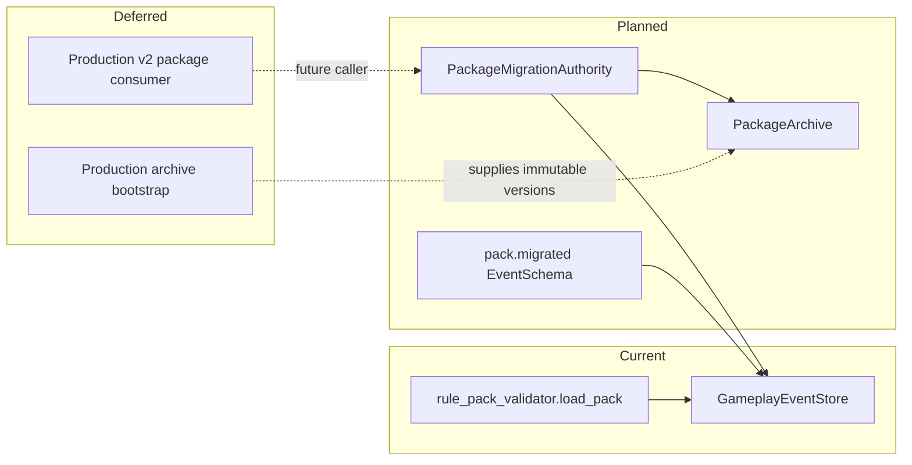
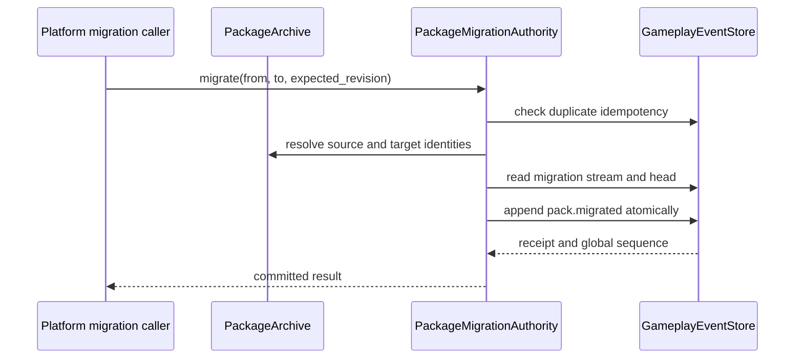
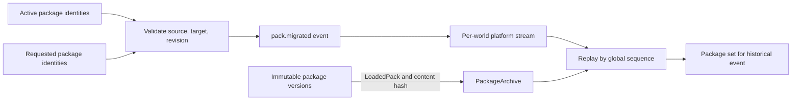

# M5-3 Package Migration Design

## Intent

Record rule-package activation changes as L4 platform control-plane events. Historical replay must use the package set active at each event's global sequence. The event is not a gameplay FactType and does not add a gameplay Owner.

## Goals and limits

- Register the formal `pack.migrated` schema and commit it through the existing event store API.
- Store the complete active package set before and after migration, plus `migration_ref` and `affected_fact_types`.
- Resolve a package set at a replay sequence from the migration stream and immutable package-version archive entries.
- Preserve idempotent retry and zero-write rejection on stale source pins, missing archives, and revision conflicts.
- Keep `event_store.py`, `models.py`, and `main.py` unchanged. No existing production v2 `load_pack` caller exists to wire.

The event payload follows the formal shape:

```text
pack.migrated {
  from: [{pack, version}],
  to: [{pack, version}],
  migration_ref,
  affected_fact_types: []
}
```

The event is written to a per-world control stream. The platform migration principal is its authority. It does not use an Owner fragment because it is runtime package metadata rather than a gameplay fact.

## Approaches

1. Pin a package revision on every gameplay event. This touches the shared event envelope and changes all producers.
2. Add a gameplay `RuleSet` Owner. This conflicts with the approved decision to keep package migration outside gameplay Owners.
3. Write a dedicated platform lifecycle event and resolve versions by its global sequence. This preserves the existing event envelope and follows the formal migration-event payload. This is the selected approach.

## Runtime shape

`PackageArchive` is a read-only mapping of immutable `(pack_id, pack_version)` identities to compiled `LoadedPack` snapshots. Construction requires a trusted content-hash manifest for every loaded identity and rejects a loaded hash that differs from its pin. The migration event stores identities, preserving the formal payload. Deployment-owned archive materialization and delivery of its immutable hash manifest remain separate work because the current application has no v2 rule-pack consumer.

`PackageMigrationAuthority` owns one world-specific control stream. It accepts explicit source package identities, target identities, `expected_revision`, command/idempotency identifiers, `migration_ref`, and affected FactTypes. It verifies the source set against the latest migration state before appending. The first migration's `from` set records the pre-migration package set. With no migration events, callers provide the initial package set.

Replay validates the event chain in global-sequence order. Before a migration event it returns `from`; at and after the event it returns `to`. A broken `from` chain, unknown archive identity, malformed payload, or ambiguous sequence fails closed.

## Diagrams

### Ownership and module boundary



### Migration sequence



### Data flow



The diagrams show current loader/store capability, planned migration and replay modules, and deferred production bootstrap/caller wiring.

## Verification

Tests cover schema registration, a normal migration, source-pin rejection with zero writes, revision conflict with zero writes, duplicate retry, package archive lookup and hash-pin mismatch, migration-chain corruption, durable reopen, and package-set reads before and after the migration sequence. The exact M5-3 regression nodes are registered in `docs/verification/selection/m5-3-package-migration.json`.
