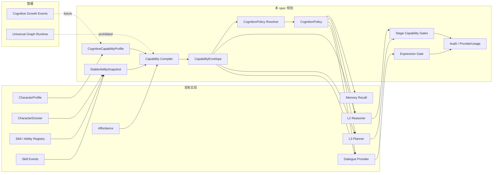
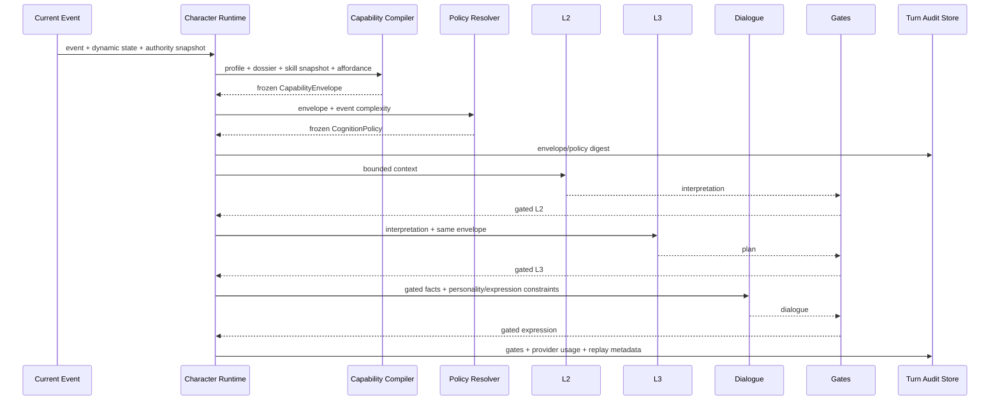
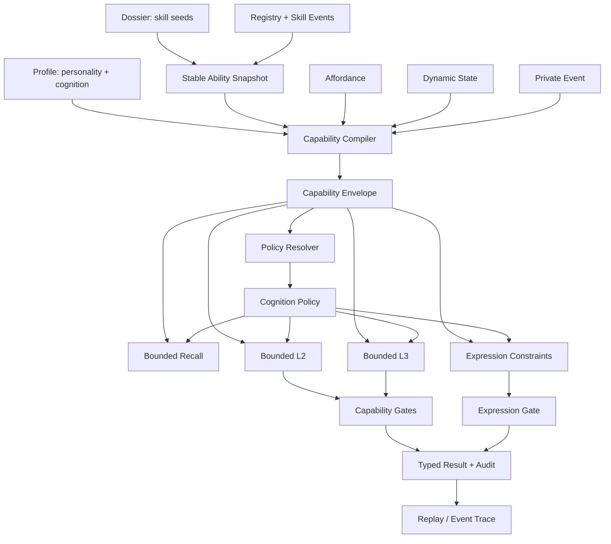

# 角色能力包络、人格映射与动态认知算力设计

状态：`awaiting-user-review`

日期：2026-10-06

本 spec 将 [10 月分析：角色能力图谱、认知包络与动态算力设计](../../../10月分析/13-角色能力图谱、认知包络与动态算力设计.md) 转换为可实现、可验收的主线合同。它只定义角色智能体的能力约束与认知策略，不授权本文件之外的角色心智、世界事实 authority 或新的图数据库实现。

## 1. 问题与目标

所有角色使用相同基础模型，但角色不能因此都拥有相同的智力、技能、推理跨度和资源消耗。本设计要求：

1. 每个角色具有可审计的一般认知上限，不能通过更高 token 或更强 provider effort 突破。
2. 领域技能复用现有 Skill / Ability Graph，并与一般认知能力分离。
3. Big Five 和既有人格投影影响候选排序、风险偏好、社交策略和表达方式，不伪装成智力分数。
4. 同一事件下，能力差异反映到 L2 理解、L3 规划、行动选择、对话和记忆写回。
5. 低能力角色默认使用更少的召回、候选、上下文和 provider 预算。
6. 所有阶段使用同一个冻结的 `CapabilityEnvelope`，结果可以重放和审计。

## 2. 范围与非目标

### 2.1 范围

- profile 中的一般认知能力、硬限制、表达约束和算力默认值。
- dossier、技能 registry、技能事件到稳定技能快照的编译。
- 当前事件和动态状态到回合能力包络的编译。
- `fast`、`balanced`、`deep` 认知策略与 provider usage 记录。
- Recall、L2、L3、Dialogue、Memory Writeback 的能力门禁。
- Big Five 到行动偏好与表达风格的明确映射。
- 同事件多角色 fixture 和 Harness 验收要求。

### 2.2 非目标

- 不创建通用图数据库或第二套技能运行时。
- 不把能力图与 Heavenly Graph、关系图或 Siming Knowledge Graph 合并。
- 不让模型输出直接改变一般认知能力、长期技能或世界事实。
- v1 不实现一般认知能力的事件驱动成长。
- 不要求低能力角色公开说出错误的世界事实。
- 不在本 spec 内实现完整角色成长、剧情编排或 Godot 表现。

## 3. 术语与责任边界

| 对象 | 含义 | 唯一写入责任 |
|---|---|---|
| `PersonalityLayer` | 角色倾向如何选择和表达 | profile authoring |
| `CognitiveCapabilityProfile` | 角色一般认知能力与长期硬上限 | profile authoring / schema validator |
| `StableAbilitySnapshot` | 技能 registry、dossier 种子和技能事件的投影 | Skill Service |
| `CapabilityEnvelope` | 当前事件冻结后的可处理范围 | Capability Compiler |
| `CognitionPolicy` | 当前回合资源预算与 provider effort | Policy Resolver |
| `GateResult` | 阶段输出的校验、裁剪、修复、回退证据 | Capability Gate |
| `ProviderUsage` | 实际调用和 token/effort 记录 | Provider Adapter |

模型只能生成阶段候选输出；它不能写入以上长期或回合合同。

## 4. 架构边界



能力图与其他图只共享治理值对象：`GraphEvidenceRef`、`SourceLineage`、`PrivacyScope`、`AuthorityScope`、`LifecycleState`、`ConflictRef` 和 `ExplanationPayload`。能力节点不能作为世界事实进入公共事实链或普通 memory recall。

## 5. Profile 合同

### 5.1 `CognitiveCapabilityProfile`

以下字段加入 `CharacterProfile` 的认知层。所有数值范围为 `[0, 1]`；硬限制必须为正整数或枚举值。

```yaml
cognitive_capability_layer:
  general_facets:
    working_memory: 0.74
    evidence_discrimination: 0.86
    causal_reasoning: 0.67
    abstraction: 0.55
    social_inference: 0.82
    spatial_reasoning: 0.36
    numerical_reasoning: 0.42
    metacognition: 0.79
  hard_limits:
    max_context_items: 8
    max_active_hypotheses: 3
    max_reasoning_hops: 2
    max_candidate_intents: 3
    max_concurrent_goals: 2
    planning_horizon: short
    confidence_ceiling_without_evidence: 0.68
  expression_constraints:
    vocabulary_band: plain
    explanation_depth: concrete
    uncertainty_style: qualified
  compute_defaults:
    preferred_effort: balanced
    maximum_effort: deep
    memory_recall_limit: 8
    l2_max_tokens: 550
    l3_max_tokens: 900
    dialogue_max_tokens: 160
```

`general_facets` 不合并为单一 IQ 字段。开放性、尽责性和分析投影不能替代 `causal_reasoning` 或 `working_memory`。

### 5.2 默认值与缺省 profile

认知层是正式 profile 合同的一部分。v1 不允许静默缺省为“全能”：

- 新 profile 缺少认知层时，authoring validator 产生 `missing_cognitive_capability_profile` 诊断。
- 兼容读取只允许显式选择一个版本化的低能力安全默认，并写入 `default_source` 与诊断。
- runtime activation 对缺少认知层的 profile fail-closed，不能生成无界 envelope。

## 6. 技能图复用与投影

### 6.1 canonical skill id

runtime 只接受 registry 中的 canonical `skill_id`。作者档案可以使用 alias，但编译时必须保存：

```yaml
skill_resolution:
  source_value: threat assessment
  canonical_skill_id: skill:threat_assessment
  resolution_mode: alias
  registry_revision: skills:v3
```

未知技能：authoring 保存并产生诊断；runtime 不物化技能、不生成 affordance，并以 `unresolved_skill_reference` 记录失败原因。

### 6.2 `StableAbilitySnapshot`

```yaml
stable_ability_snapshot:
  actor_id: char_b
  capability_revision: capability:char_b:17
  registry_revision: skills:v3
  skills:
    - skill_id: skill:threat_assessment
      source: authored
      rank: trained
      proficiency: 0.68
      confidence: 0.72
      domains: [security_protocol, threat_assessment]
  allowed_action_families: [safety_assessment, access_control]
  blocked_action_families: [complex_motive_analysis]
  source_refs: [profile:char_b:v1, dossier:char_b:v1, skill_registry:skills:v3]
```

投影优先级为：`authority/active restriction > dynamic state > skill event > dossier seed > profile authored default > tier default`。当前实现中 profile skill 会被 `CharacterSkillService.initial_skill_states()` 默认成 `basic, 0.5, 0.5`；正式实现必须改为由 dossier seed 和 registry 编译，避免所有作者技能获得相同初始能力。

技能事件可改变 proficiency、confidence、rank 和 affordance，但不能改变一般认知层字段。技能事件沿用既有 `SkillLearned`、`SkillRankPromoted`、`AbilityGrantActivated`、`AbilityGrantRevoked`、`AbilityRestrictionApplied` 语义。

## 7. 回合能力包络

### 7.1 编译输入

```text
Profile cognitive layer + Personality projection
+ StableAbilitySnapshot
+ CurrentAffordance
+ DynamicState
+ CurrentEvent
+ Authority / Permission
=> frozen CapabilityEnvelope
```

### 7.2 `CapabilityEnvelope`

```yaml
capability_envelope:
  actor_id: char_b
  turn_id: turn:char_b:204
  capability_revision: capability:char_b:17
  envelope_revision: envelope:char_b:204
  cognitive_limits:
    max_context_items: 6
    max_active_hypotheses: 2
    max_reasoning_hops: 1
    max_candidate_intents: 3
    max_concurrent_goals: 2
    planning_horizon: immediate
    confidence_ceiling_without_evidence: 0.55
  active_domains:
    security_protocol:
      effective_proficiency: 0.81
      confidence: 0.76
  allowed_action_families: [safety_assessment, access_control]
  blocked_action_families: [complex_motive_analysis]
  degradation_reasons: [ambiguity_pressure]
  source_refs: [capability:char_b:17, affordance:char_b:204, dynamic_state:char_b:204]
```

硬上限包括上下文项、假设数、推理跳数、候选意图、并发目标、规划跨度、无证据置信度、允许领域、行动族和 authority permission。事件风险或 provider effort 只能增加资源投入，不能抬高这些上限。

领域匹配倍率固定为：`direct=1.00`、`adjacent=0.75`、`weak_transfer=0.45`、`unknown=0.20`。有效能力为：

```text
min(authored_ceiling,
    authored_ceiling * domain_match * dynamic_state_modifier * memory_modifier)
```

动态状态分别影响工作记忆、证据辨识、因果推理和社会推理；不能用一个压力系数覆盖所有维度。

## 8. 人格映射

已有 `PersonalityProjectionResolver` 继续作为人格投影入口。人格影响“允许候选中的选择和表达”，不改变 `CapabilityEnvelope` 的硬上限：

| 人格投影 | 行动偏好 | 表达偏好 |
|---|---|---|
| 高尽责/高审慎 | 先查记录、列步骤、延迟承诺 | 程序化、证据引用、少跳步 |
| 高宜人/高共情 | 先稳定关系、询问他人状态 | 缓和措辞、降低归责强度 |
| 高外向/高主动 | 更快发起询问、公开提出方案 | 主动、直接、较少沉默 |
| 高开放/高歧义容忍 | 保留更多解释路径、探索性询问 | 使用假设语气和多种可能 |
| 高神经质/高焦虑 | 提高风险权重、偏向确认和自保 | 更多限定语、重复确认 |
| 低元认知 | 不能提高能力；只影响自我校准倾向 | 仍必须受 confidence ceiling 门禁 |

人格影响候选排序、风险权重、冲突策略、社交入口、句长和不确定性样式；认知能力决定最多保留多少候选、走几步推理链和规划多长时间。

## 9. 动态认知策略与成本合同

### 9.1 `CognitionPolicy`

```yaml
cognition_policy:
  policy_id: cognition-policy:char_b:204
  actor_id: char_b
  turn_id: turn:char_b:204
  tier: balanced
  provider_thinking_effort: medium
  memory:
    recall_limit: 6
    token_budget: 900
  reasoning:
    l2_max_tokens: 500
    l3_max_tokens: 700
    max_active_hypotheses: 2
    max_reasoning_hops: 1
  dialogue:
    max_tokens: 140
    explanation_depth: concrete
  reasons: [event_risk:high, domain_match:high, social_ambiguity:medium]
  source_refs: [envelope:char_b:204]
```

事件复杂度固定为：

```text
0.20*ambiguity + 0.20*risk + 0.15*goal_conflict
+ 0.15*actor_count + 0.15*domain_crossing + 0.15*causal_distance
```

`fast`、`balanced`、`deep` 是资源层级，不是能力等级。实际 effort：

```text
clamp(requested_effort, minimum_effort, character.maximum_effort)
```

高风险事件可以提高 `minimum_effort`；低能力角色仍受原有 envelope 限制。`max_tokens` 只代表输出上限，不代表隐藏思考强度。

### 9.2 `ProviderUsage`

每回合必须记录：

```text
recall_card_count / recall_input_tokens
l2_input_tokens / l2_output_tokens / l2_calls
l3_input_tokens / l3_output_tokens / l3_calls
dialogue_input_tokens / dialogue_output_tokens / dialogue_calls
requested_tier / requested_thinking_effort / actual_thinking_effort
provider_support_status / fallback_reason
```

provider 不支持 thinking effort 时记录 `unsupported` 或 `disabled`，不得伪装成已执行的 low/medium/high。

## 10. 受控失误与可重复性

v1 允许三类受控失误：`working_memory_omission`、`evidence_confusion`、`confidence_overreach`。它们改变内部证据保留、候选排序、行动选择或表达置信度，不直接伪造公共世界事实。

```text
error_seed = sha256(
  scenario_seed + turn_id + actor_id
  + capability_revision + policy_revision
)
```

事实越界、权限越界和不可见证据引用必须拒绝。行动选择不佳、解释不完整和证据遗漏可以在 envelope 内保留，并写入 gate/audit。

## 11. 阶段门禁

### 11.1 Gate 行为

每个 gate 返回 `accepted`、`accepted_with_degradation`、`repaired` 或 `rejected_fallback`，并包含 `original_digest`、`final_digest`、`capped_fields`、`pruned_items`、`reasons` 和 `source_refs`。

| 阶段 | 可修复 | 拒绝/回退 |
|---|---|---|
| Recall | 按证据优先级裁剪到 `max_context_items`；低置信卡片降为 suspected | 隐私/authority 越界、注入不可见事实 |
| L2 | 裁剪超限假设、推理跳数和无证据置信度 | 引用不可见事实或无法映射证据 |
| L3 | 删除越界 action family、并发目标和规划步骤 | 无合法候选时回退 observe/ask_probe/defer/self_protect |
| Dialogue | 将无证据断言改为限定表达；约束词汇、深度和句长 | 仍含不可见事实、权限承诺或世界真值写入 |
| Memory writeback | 推断写为 suspected，或仅写可观察事实 | 将猜测写为 confirmed/enduring truth |

### 11.2 `GateResult`

```yaml
gate_result:
  gate_id: gate:l2:char_b:204
  actor_id: char_b
  turn_id: turn:char_b:204
  stage: l2
  status: accepted_with_degradation
  checks:
    evidence_scope: passed
    hypothesis_limit: passed
    reasoning_depth: degraded
    confidence_ceiling: repaired
    domain_boundary: passed
  capped_fields:
    - field: confidence
      original: 0.78
      final: 0.55
  pruned_items: []
  reasons: [confidence_exceeded_without_evidence]
  source_refs: [envelope:char_b:204, l2-output:char_b:204]
```

## 12. 回合时序与数据流





## 13. 典型角色 fixture

固定事件：档案室门锁被动过；乔任要求封锁；沈墨紧张；无人知道是谁动的。四个角色的预期结构化行为：

| 角色 | 能力包络 | 人格与行动 | 默认成本 |
|---|---|---|---|
| 林月 | 证据辨识、工作记忆和社会推理较强；中长规划 | 查记录，保留责任假设，延迟归责 | balanced；复杂冲突可 deep |
| 乔任 | 空间和安全流程强；动机分析弱 | 封锁、隔离、确认授权，不解释复杂动机 | balanced；高风险可 deep |
| 沈墨 | 社会推理和抽象联想强；正式证据链弱 | 识别关系压力、调解、询问，不把情绪当事实 | fast/balanced |
| 阿博 | 工作记忆、因果推理、元认知较低；固定流程可靠 | 执行清单、停用入口、通知主管 | fast；最高 balanced |

验收不能只比较最终文本；必须比较每个角色的 hypothesis count、reasoning hops、allowed action family、expression constraints、envelope digest 和 ProviderUsage。

## 14. 现有实现改造点

本 spec 对现有实现的最小改造面：

1. `backend/app/character_agent/profile/models.py`：增加认知能力层的严格模型和版本化缺省诊断。
2. `backend/app/character_agent/profile/dossier_models.py`：保留 `CapabilitySeedProfile`，增加 canonical skill resolution 结果和诊断引用。
3. `backend/app/character_agent/skills/service.py`：由 dossier seed/registry 编译稳定技能状态，移除 profile skill 的统一 `0.5/0.5` 假设。
4. 新增 capability compiler、cognition policy resolver、stage gates 的 typed contracts；不得把逻辑散落到 provider prompt 中。
5. `CharacterTurnContext` 或其等价回合对象保存 envelope/policy revision 与 digest。
6. `memory_recall.py`、L2、L3、dialogue provider 消费同一个冻结 envelope 和 policy。
7. `model_provider.py` 按 provider 支持矩阵传递 effort，并记录 requested/actual/fallback。
8. 增加 fixture、focused tests 和 Harness profile；不以全仓库 pytest 通过替代本功能证据。

## 15. 验收矩阵

| 验收编号 | 断言 |
|---|---|
| CE-01 | 缺少认知层不会生成无界 envelope |
| CE-02 | alias 解析为 canonical skill id；未知技能 runtime fail-closed |
| CE-03 | dossier proficiency/confidence 被保留；不会所有 authored skill 默认 0.5/0.5 |
| CE-04 | 技能成长不修改一般认知层 digest |
| CE-05 | L2、L3、Dialogue 使用同一 envelope digest |
| CE-06 | 假设、推理跳数、候选、置信度、领域和权限不能越界 |
| CE-07 | 人格改变候选排序和表达，但不能突破认知上限 |
| CE-08 | 压力/疲劳降低当前发挥，不修改 authored ceiling |
| CE-09 | 相同 seed、输入、revision 可重放失误和 gate 结果 |
| CE-10 | 不可见事实不能进入对话或 confirmed memory |
| CE-11 | 阿博默认 recall/context/token/effort 低于高能力角色，风险 floor 例外可解释 |
| CE-12 | provider 不支持 effort 时明确记录 unsupported/disabled |
| CE-13 | 四角色固定事件产生不同且符合 profile 的行动和表达 |
| CE-14 | gate、裁剪、回退、成本和 source refs 可审计 |

## 16. 分阶段实施边界

### 第一阶段：合同与编译

- profile/dossier/registry 的 typed contract。
- canonical skill resolution 和稳定技能快照。
- `CapabilityEnvelope` 编译、digest 和回合冻结。

### 第二阶段：消费与门禁

- Recall、L2、L3、Dialogue、Memory Writeback 消费 envelope/policy。
- GateResult、回退动作和事实/推断分类。

### 第三阶段：provider 与成本证据

- `fast/balanced/deep` provider 映射。
- ProviderUsage、unsupported/fallback 记录。
- 四角色固定 fixture 与 Harness profile。

### 暂缓

- 一般认知能力成长和跨角色能力传播。
- 通用能力图平台。
- 模型自动创建技能、认知能力或长期事实。

## 17. 评审问题

请在进入 implementation plan 前重点评审：

1. `general_facets` 与硬限制字段是否足够表达你要的智力差异，是否需要加入或删除维度。
2. `fast/balanced/deep` 与 provider effort 的分层是否符合成本预期。
3. 四个典型角色及固定事件是否代表目标体验。
4. 缺少认知层时采用 runtime fail-closed 是否符合已有兼容策略。

本 spec 获得书面批准后，下一步才是调用 `writing-plans` 生成实现计划。
