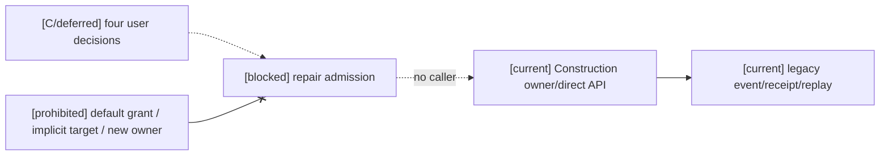
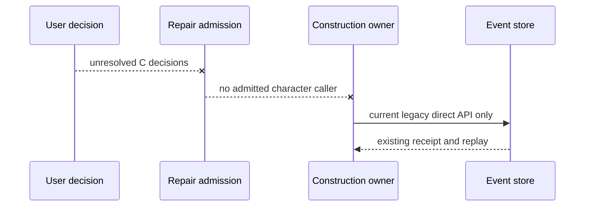
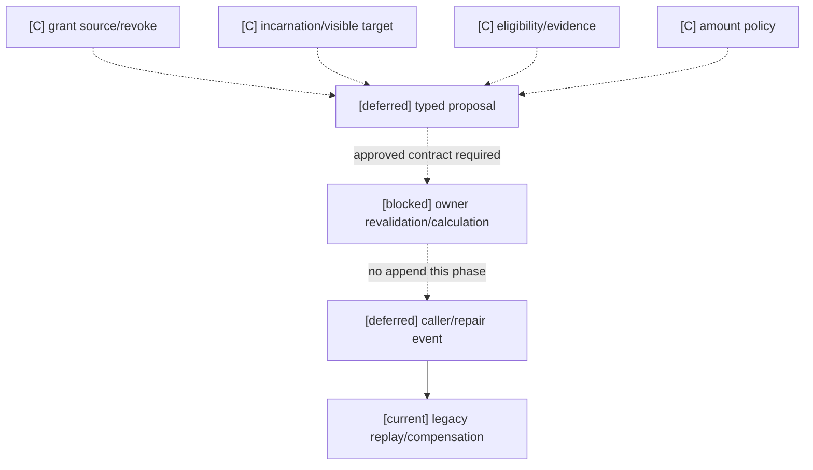

# INF-1AE Construction Action Owner-Contract Audit

Status: `implemented narrow vertical; verified 2026-08-17`

## Row

The next INF-1 lifecycle row was narrowed to one Construction facility repair
outcome. The existing Construction authority owns the facility stream, and the
approved contract now names one repair event and one explicit compensation
event. Transform, payment, and other action inputs remain unsupported.

| Contract field | Evidence | Disposition |
| --- | --- | --- |
| owner and append path | `ConstructionProductionAuthority` owns the facility stream through the existing store | verified |
| event family and revision | `facility_repaired` and `facility_repair_compensated`, schema version 1, facility revision pin | verified |
| privacy and idempotency | project scope, owner principal, expected stream revision, changed-duplicate zero-write | verified |
| receipt, replay, compensation | append receipt, scoped outbox, projector full/checkpoint-tail replay, latest-repair compensation | verified |

The implementation uses `GameplayCommandEnvelope -> SettlementPlan ->
GameplayEventStore.append_batch()` and leaves all unlisted Construction
actions at the existing zero-write boundary.

Evidence: `backend/tests/test_infra_construction_facility_repair.py` (9
focused tests) and `infra-construction-facility-repair` prove success,
zero-write rejection, privacy, revision, idempotency, receipt, compensation,
full replay, and checkpoint-tail replay.

## Remaining boundary

This does not admit Construction transform, payment, material, service
completion, or generic action routing. Those remain owner-contract blocked or
unimplemented until a separate exact contract exists.

## Rejected near-miss authorities

`StateGroupLifecycleAuthorityService` and `StatusTagAuthorityService` were
checked as possible existing writers. They own separate Gameplay foundation
event families (`gameplay.state_group.*` and `gameplay.status_tag.*`) and their
own projections; neither publishes an INF semantic effect/state owner row,
Construction target stream, or the required INF receipt/replay/compensation
binding. Treating either as the missing Construction authority would create an
unapproved cross-domain owner substitution, so both remain out of scope.

## 2026-10-16 Character Action Admission Addendum

Status: `design-only; character facility repair blocked/not_verified`. The verified
direct Construction operation above remains a narrow condition writer. Its
`gameplay.construction_production.repair_facility` command type and
`inf:construction-facility-repair@1` owner contract are not a registered
character `semantic_action_id`. There is no application/service repair caller.
The direct API accepts caller-selected `repair_amount`, `facility_ref`,
`source_ref`, `submitted_at`, stream revision and idempotency; it does not
receive or revalidate character grant, visible target/incarnation, affordance,
timeline/profile/mapping/window or a complete source/read-set. The existing
compensation remains tied to the original repair event and current condition;
it cannot roll back other owners or committed history.

The proposed character ingress must preserve the existing event schema,
receipt, idempotency, privacy and replay contract, while Construction owns
the final amount rule and pre-append revalidation. Missing grant provenance,
facility target identity/visibility and repair eligibility/amount policy are
business decisions, not defaults. The [Task4 admission decision and three
diagrams](../../../../10月分析/回写/stage3-task4-construction-audit-20261016.md#2026-10-16-动作准入设计收口仅设计未实施)
record the A/B/C gaps and compatibility requirements. No runtime API or
registered character action changed in this addendum.

## 2026-10-16 Formal B/C closure

All four decisions are **C: formally deferred pending user decision**. The
existing narrow Construction contract remains a read-compatible legacy slice.

| Decision | Status | Release condition |
| --- | --- | --- |
| repair grant issue, revoke, and owner | C / deferred | Approve grant owner, source events, scope, revoke query, and Construction revalidation |
| facility incarnation, character visibility, and target admission | C / deferred | Approve incarnation identity/lifecycle, privacy projection, target admission, and owner identity check |
| repair affordance and eligibility policy | C / deferred | Approve eligibility dimensions, evidence, freshness, blockers, and pre-append recomputation |
| `repair_amount` proposal/owner calculation boundary | C / deferred | Approve typed proposal and versioned Construction amount policy, bounds, rounding, failure, and migration rules |

Until all four decisions and formal interface designs are approved, no caller
or repair event is created, no default grant or role repair permission is
allowed, and `facility_ref` alone is not a legal target. The direct API does
not become a character caller. Caller/model input may be a typed proposal only;
Construction owns amount calculation and condition writes. See the [stage-three
closure register](../../../../10月分析/回写/stage3-task4-construction-audit-20261016.md#bc-阻断正式收口四项待用户决策-2026-10-16).

### Architecture diagram

### Sequence diagram

### Data-flow diagram

