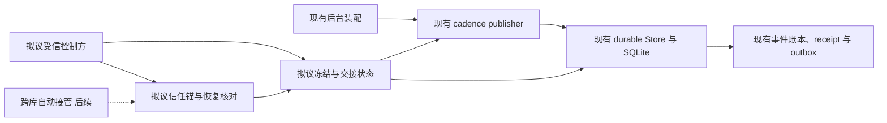
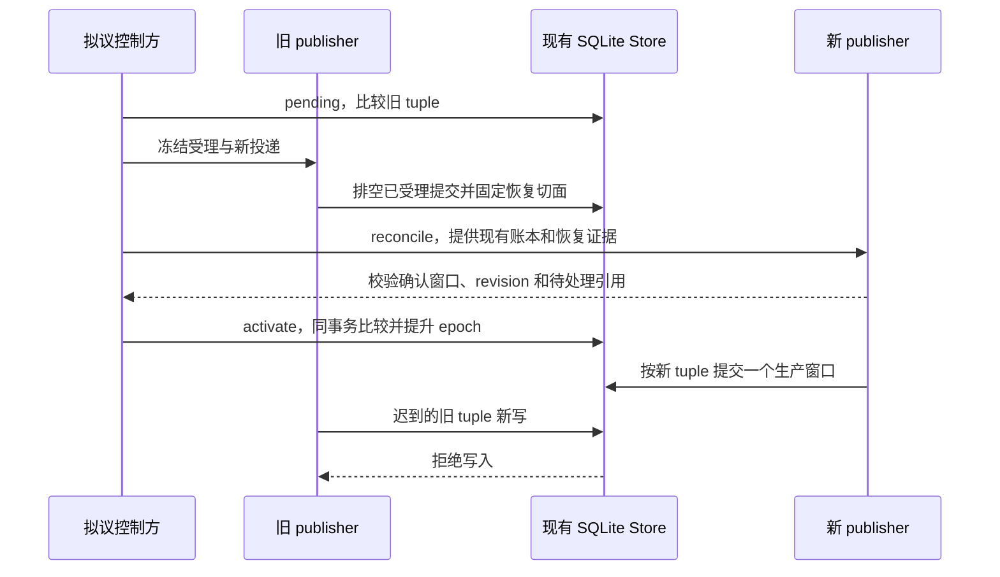
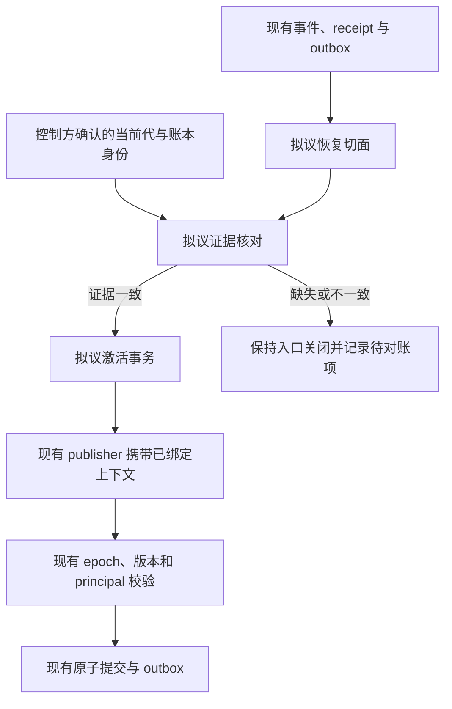

# M2-5 B4 前置设计

本设计接续 [G2 epoch 设计](epoch-design.md)，以 11-22 迁移计划的 M2-5 为范围。源码核对基点为 `a600f65e`。建议以 `population-cadence:<world_ref>` 作为 M2-6 候选，这沿用 11-09 执行规格中的首流设想。11-22 账本将首流列为负责人待决。当前交付为设计，运行时验收与生产启用均待后续交付。

## 当前路径与写入边界

- `backend/app/main.py:788` 装配 `RuntimeCadencePublisher`。它在 `backend/app/population_continuity/runtime_publication.py:137` 选流，在第 674–690 行构造 `population.cadence.admitted`、幂等记录与 outbox，然后调用 `append_batch`。现有调用未带旁置 authority context。撤销路径写 `population-cadence-revocation:<world_ref>`，是另一个流。
- `backend/app/gameplay/event_store.py:1106` 和第 1132 行提供流登记与单调换代。实际 append 可传 `authority_contexts`。同库 SQLite 事务是写入裁决点。现有接口没有交接冻结、恢复进度和跨恢复副本的可信进度合同。
- publisher 在重试时按 cadence 查询原记录，继续处理 outbox 和已确认窗口。已有 receipt 应保留。仅切换写流 epoch 无法阻止旧进程继续投递已经存在的 outbox，因此交接也必须移交该流的投递与确认职责。

## 拟议交接

| 阶段 | 责任与证据 | 失败恢复 |
|---|---|---|
| `pending` | 控制方按当前 `stream/scope/epoch/writer` 比较并登记本次交接，持久化目标 writer 身份。旧 writer 停止受理该流的新窗口，也停止启动新投递。已受理的提交与进行中的投递排空或记为未决。新 writer 保持入口关闭。 | 重启先读交接状态并保持冻结。对未决投递，按 outbox ID 查交付回执，缺回执则保留原 ID 和 payload 以供对账。 |
| `reconcile` | 在旧 writer 停止派送后取交接切面。记录流 revision、全局 cursor、最后确认窗口和摘要、已受理的命令及原 receipt 引用、未决 outbox ID 和开放义务。新 writer 在只读状态从该切面重建并核对摘要。找不到原结果的命令保持未决。 | 旧 writer 的提交如果先于冻结落盘，应进入切面。比较时若发现流 revision 已变，重新核对该切面，保留冻结。副本早于受信切面时，先补齐可验证日志。 |
| `activate` | 校验恢复证据和预期交接状态。在同库写事务内比较旧 tuple 与交接 revision，登记更高 epoch 和新 writer，并提交激活状态。新 writer 开始受理前再读取该状态。后续生产 append 使用装配时分配的 writer 身份和 epoch，不借当前登记为过期实例续权。 | 激活结果未知时先查询原交接状态和 tuple，以本次交接标识重试。确认旧 epoch 的迟到新写被拒；准确重试按原命令与 digest 查回原 receipt。错过投递回执时按原 outbox ID 继续核对。 |

同库原子换代只能覆盖当前这份 durable store。恢复生产写入前，控制方还须用受信部署来源核对最新 `ledger identity + stream + scope + epoch + writer + 已确认 revision/cursor`，避免从同一份旧备份同时读取事件和低代授权。部署来源的签发、保留和查询由受信运维控制面负责，事件事实、receipt、投影仍以原账本为准。控制来源不可用、账本身份不符或所需日志无法恢复时保持入口关闭。首个试点使用单一在线库及可信控制来源，跨库自动接管留给后续设计。

成功写入的 writer 身份需取自提交端认证上下文，并与原 receipt 或 transaction ID 对应。若同一 `stream/scope/epoch` 下存在两个已认证 writer 的成功记录，冻结受理与投递，按 transaction ID、revision、事件 ID、outbox 状态和 receipt 对账。保留两边证据，告警给控制方。旧账户字符串、单独的拒绝日志和调用方自报的 writer 不足以判定双写。现有 receipt 未提供完整的成功 writer 历史，实施前须确定可审计关联方式。

## 架构

## 时序

## 数据流

## 实施顺序与验收

1. 负责人确定首流与控制方，确认在 Store 哪个事务边界统一比较冻结状态、交接 revision、epoch 与激活状态。预计需要修改共同边界 `event_store.py`，按 A/B 协议登记范围和负责人决定后才能实施。
2. 在隔离库为交接状态建立可崩溃恢复的测试，分别在 `pending`、切面确认、激活前后中断。断言旧窗口不会重复结算，未决命令仍能查询，旧备份受信检查失败时写入口关闭。覆盖双连接竞争下的同库原子换代及已确认双写走对账路径。
3. 接入实际装配及 publisher 的受理、append 和投递三条路径。验证启用前的兼容路径，启用后缺 context、错 writer 和旧 epoch 的新写零写入。运行恢复后真实生产入口，核对 stream revision、outbox 投递、相同命令的原 receipt 与派生投影。
4. 生产首流验收后才记录 M2-6 的实测结果。激活前可撤销接线配置并保持冻结。激活后如需换回原进程，按同一协议换到更高 epoch，并复用与该代兼容的代码。

本单元仅静态核对当前调用关系和事务接口。上述测试、恢复可信进度和生产流接入在 M2-5 未执行。
