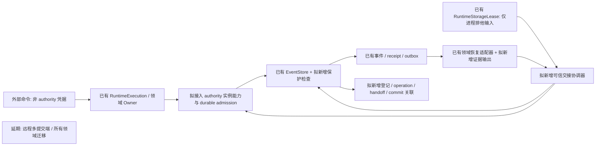
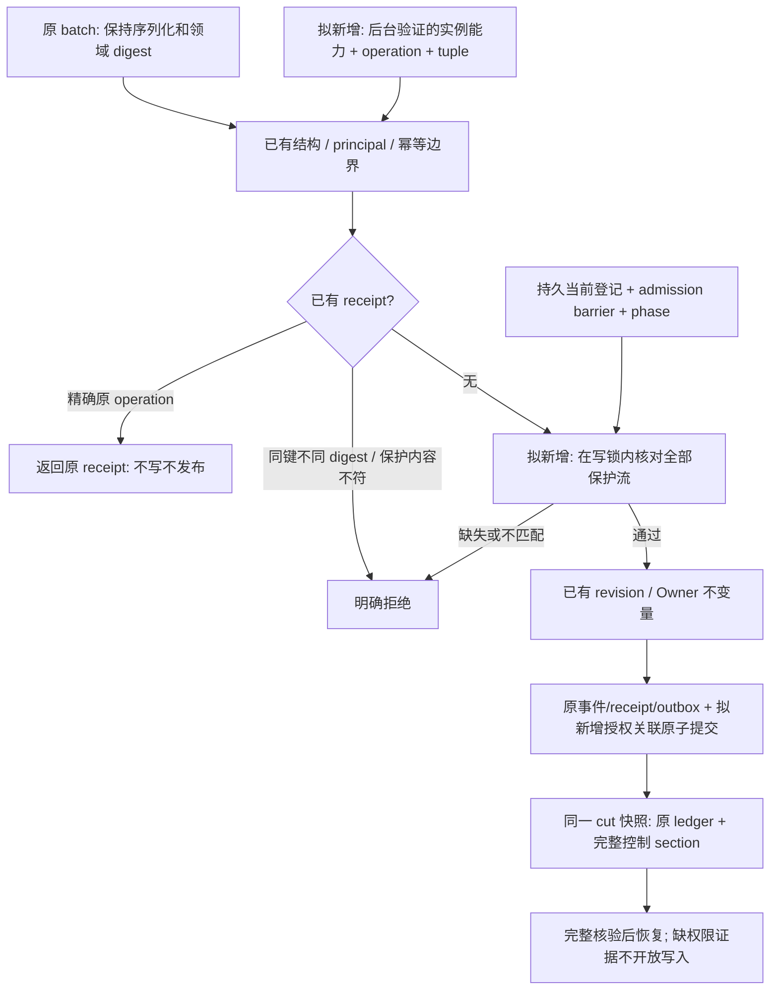

# 受保护流 authority epoch 栅栏设计

- 日期：2026-11-11。
- 状态：`awaiting-user-review`。只有设计；本文中的接口、表、状态和错误码均为提议，尚未实现或通过验收。用户确认后才能制定实现步骤及修改代码。
- 代码依据：`c70afb48833d0ed7ff3fb05caf67eb0bf66a3c9e`，工作区 `D:/Temp/paralls-g0-b3-ingress-20261109`，分支 `codex/g0-b3-ingress-20261109`。
- 直接依据：[epoch 边界审计](epoch-boundary-audit.md)。其首组实际列出五条要求：前四条是写入拒绝、并发/恢复、精确重试、交接证据；第五条旧数据兼容同样保留，不能因任务简称“四条”而省略。
- 上位合同：文档仓库 `docs/architecture-v2/01-内核/03-权威栅栏与提交.md` 的 `(stream, scope)`、唯一 writer、epoch 单调及交接顺序；`06-存档回放与恢复.md` 的完整恢复输入、未知结果和历史版本合同。本设计不改变这些合同，不解决 session 身份/known_time 的待决问题。

## 1. 目标、范围与方案选择

只对显式登记的物理流启用写入栅栏。未登记流继续走现有 append、revision、principal、幂等和回放合同；不为全部调用者新增必填字段，不把读取流自动纳入写入权限。本设计不把 connection epoch、Population timeline 的固定 epoch_ref 或 caller principal 当作 authority epoch。

选择**旁置的提交授权上下文、持久登记及交接记录**，不向 `GameplayEvent`、`AtomicEventBatch`、`IdempotencyRecord` 或 `AppendBatchResult` 添加字段。这样既有调用的 `model_dump` 形状、事件哈希、领域 payload/result digest 和旧批次序列化保持原语义。新的授权上下文有自己的显式版本和摘要，与原事务关联而不回写原批次。

不采用两个替代方案：向旧 batch 加一个可空 epoch 会改变 dump/hash 且无法表达多流授权；每 Store 实例维护计数器不能串行化共用 SQLite 的实例。数据库触发器只能做冻结的一个构件，不能证明 writer 身份、排空或完整 handoff，本方案不把它当作在线兼容旧程序的保证。

推荐首个接入候选为真实的 `population-cadence:<world_ref>`，scope 为后台配置中该确切 world 的身份。它由 `main.py:743` 构造的 `RuntimeCadencePublisher` 写入（`runtime_publication.py:137,673–690`），具备可复核的恢复路径。此处只是**待确认的首流选择**，不是已经批准保护所有 Population 流；世界流、member ledger、撤销流及其他领域仍不自动纳入。启用前必须闭合该流全部实际写入口及窗口/副作用依赖；发现不可冻结来源时保持未启用，不能用测试 registry 替代真实边界。

## 2. 当前可用基础与明确缺口

| 当前证据 | 可以复用 | 不能据此声称 |
|---|---|---|
| `backend/app/gameplay/event_store.py:177–196` | 内存 append 全程 `RLock` | 跨实例共享权威状态 |
| 同文件 `:244–254` | 原幂等记录先于 revision 检查；同键同 digest 返回原 receipt | caller 自称的 digest 是完整内容证明或是身份凭证 |
| 同文件 `:1037–1087,1195–1222` | durable append/group commit 使用 `BEGIN IMMEDIATE`，当前每个写事务检查 schema | 更早版本进程、任意 SQL 连接均不能绕过 |
| 同文件 `:581–605,647–846,1442–1468` | 完整 ledger、batch、result、幂等、outbox/checkpoint 的快照核验及一致性读快照 | 旧 snapshot 已含权限登记和交接状态 |
| `backend/app/world_runtime/storage_lease.py:7–47` | 已有 graph 存档的 OS 进程锁 | 任意直连 Store 都持有该锁；进程退出等于排空完成 |
| `backend/app/services/runtime_execution.py:140–170` | 停止接收、队列排空、超时可观察 | 每流 durable admission、开放义务和未知结果已完整登记 |
| `backend/app/population_continuity/runtime_publication.py:285–432` | 已确认窗口、checkpoint/receipt、bounded tail 和 outbox 恢复证据 | 旧 writer 已停、所有 DomainOwner 工作和义务已清零 |

审计末段“改 schema 后已打开连接仍可写”的历史实验须按版本阅读：当前 `_transaction` 和 `group_commit` 已调用 `_require_current_schema`。本轮只是静态核对，没有重新执行历史实验；不能由此宣称部署中不存在更早版本长连接。

## 3. 受保护流声明、登记与身份

### 3.1 声明不能来自 batch

由可信启动装配中的显式清单声明：确切 `stream_id`、确切 `scope_ref`、拥有写权的 authority 组件和恢复适配器。不采用任意前缀推断、请求动态创建登记或“缺 scope 则默认 world”。初次启用必须经过第 8 节的离线边界和现有流 revision 核对。

本切片限定**一个受保护物理 stream 对应一个 scope**，数据库对 `stream_id` 施加唯一约束，逻辑主键仍为 `(stream_id, scope_ref)`。若一个现有流跨多个 scope，本设计拒绝启用，不能让调用方挑一个较宽 scope 绕过；多 scope 分区授权另行设计。这不把 `(stream, scope)` 简化成全库单 epoch。

### 3.2 保存位置

SQLite 新 schema 中保存下表；内存 Store 在同一 `RLock` 下保存等价状态。SQLite 表名为设计名称，不是已存在 API。

| 表/集合 | 内容与约束 |
|---|---|
| `authority_streams` | `stream_id, scope_ref, epoch, writer_instance_ref, phase, control_revision, activation_revision, handoff_ref`。epoch 只增不减；phase 只走下文状态机；禁止普通 caller 删除保护。 |
| `authority_operations` | 受保护命令的受理身份：原 principal/key、原请求的规范输入及摘要、可信 writer、完整保护向量、受理顺序、准备后的原批次及内容承诺、状态及 receipt/未决证据引用。只登记受保护写入；多流一次原子受理。 |
| `authority_commits` | 每个**新**受保护事务的 `transaction_id`、原 batch 摘要版本/值、获准 `(stream,scope,epoch,writer)` 向量、operation 和控制记录引用。与原事件/receipt/outbox 同事务写入；不另造领域 receipt。 |
| `authority_handoffs` | 冻结、排空、切换、恢复的追加式控制记录及清单内容/摘要、源和目标 writer、revision/cursor cut、未决项。引用须在同存档内可解析，不能只保留一个外部路径。 |

声明生效和历史边界由控制记录解释：保护激活 revision 之前的历史仍是原始无 epoch 事件；之后的新写入必须有 `authority_commits`。缺失授权关联不是“旧数据”，而是坏存档，拒绝恢复。

### 3.3 writer 不是 principal 字符串

`writer_instance_ref` 绑定到后台实际创建的 authority 实例及其当前进程/恢复 incarnation，不等于 `world_runtime.cadence` 等幂等命名空间。后者及 Owner/fragment principal 的既有权限检查继续保留，不能用 epoch 绕过。

可信启动 owner 在取得对应存档的独占启动资格、核对声明和恢复状态后建立 writer 实例；Store 的内部 authority 管理入口发给该实例不可由外部 JSON 构造的能力句柄。句柄绑定存档身份、scope、实例和允许的操作；另一 Store 实例需通过同一可信装配验证，不因共享数据库或提供相同字符串自动取得权限。内部适配器根据此句柄构造提交上下文，Store 比较上下文声明与被验证的实例身份。

跨进程只允许既有 backend owner/IPC 的已验证调用来源进入该入口；来自 HTTP/WebSocket、Godot、Agent 的数据不能创建管理句柄或指定可信 writer。若实际部署没有这层来源保证，则该部署不开放保护流写入，本设计不虚构远程身份系统。

SQLite 文件、备份来源和拥有 DDL/任意 SQL 权限的维护者属于存档信任边界。拥有文件修改权的恶意程序可删除登记或改库，不能声称应用级栅栏能抵抗它。应用调用者缺 tuple、伪造 tuple、跨正常 Store 实例并发属于必须强制的范围。

## 4. append、跨多流与精确重试

新增显式内部 protected-append 入口，接收原 `AtomicEventBatch` 和独立的 typed authority context；普通 `append_batch(batch)` 保持签名，但在 Store 内同样检查登记，**不是**绕过通道。上下文含显式版本、operation 引用、每个保护写流的 tuple 及经过验证的 writer 能力。普通数据中未知字段按现有严格模型拒绝；不把缺信息变成 epoch=0、空 scope 或当前 writer。

在同一内存锁/SQLite 写事务内按以下顺序处理：

1. 复用既有 schema 和 batch 结构校验；校验真实调用者的访问资格。幂等查询不能成为新的公开 receipt 接口，内部恢复可查原结果不等于客户端获准读取 receipt。
2. 查询原 `(principal_ref, idempotency_key)`。已有记录且 digest 不同，仍返回 `idempotency_key_reused`，不通过换 epoch 遮蔽这个拒绝。无保护提交关联的历史精确重试保留既有语义，返回原 receipt，不套用后来启用的 epoch。
3. 对已有**受保护**提交，除原 digest 外，还核对保存在 `authority_commits` 的稳定批次内容承诺及原 operation 身份。此处采用不含授权上下文的、显式版本的请求批次规范形状：排除 Store 分配的 global sequence/stream revision 及 outbox 可变投递状态，保留原事务/命令、事件内容、revision 向量、Owner fragments、digest、outbox 投影和 refresh hints；初次提交与重试使用同一规范化规则。同 digest 但内容变化也明确拒绝 `authority_retry_content_mismatch`，不返回假成功。该新增边界只适用于有保护关联的新事务，不能重算并替换旧领域 digest。
4. 经过原 operation 身份核对的精确重试可在旧 epoch、冻结或 handoff 后取回**原 receipt**（沿用 `duplicate_replayed` 状态）。不要求旧 writer 仍有新写权限，不补写 `authority_commits` 或 outbox；不能给一个新 operation 冒用旧结果。读收据失败/损坏明确报错，不能按“未提交”走新 append。
5. 无既有 receipt 时，枚举 `batch.events` 实际写流；按数据库当前登记得到所有受保护流，不只遍历 caller 给的向量。向量缺失、重复、多出/错 scope、epoch 错、writer 错（含同 epoch 不同 writer）、operation 不属于该 writer 或未获受理均拒绝整个批次。只有读集 CAS 的流不因读取而被要求写能力。额外 expected revision 仍按原 CAS 处理。
6. 对新提交在事务中检查 phase、受理顺序及内容承诺，再走原 revision/principal/Owner 不变量和重复事件校验。保护跨多个 writer 时，每个真实 Owner/authority 适配器提供自己的授权片段，由可信提交端合并，不能由一个调用者自签所有 writer。
7. 一次写入原 transaction/event/head/outbox/receipt 和 `authority_commits`，并把 operation 标记为已提交；任何失败全部回滚。不发布总线事件或执行领域副作用后才检查 epoch。

提议拒绝码：缺 tuple/operation 用 `authority_evidence_required`；scope/格式不符用 `authority_scope_mismatch` / `invalid_authority_context`；旧 epoch 用合同已有的 `stale_epoch`；同 epoch 错 writer 用 `authority_writer_mismatch`；冻结/未恢复用 `authority_frozen` / `authority_recovery_required`。未知 code/版本不回退到普通 append。SQLite schema 不兼容须保留 `gameplay_snapshot_schema_unsupported` 的根因，不能把业务栅栏拒绝伪装成泛化 IO 成功或静默重试。

精确 retry 的“不重复副作用”有边界：Store 不新增事件、outbox 或操作执行；caller 仅恢复原 receipt，不再次调用 post-commit 领域动作。已有 outbox 尚未投递时可继续其原有恢复合同；不能宣称消息系统因此成为 exactly-once。验收须同时检查该真实 caller 的副作用计数和既有 outbox 状态。

## 5. 两个 Durable 实例如何串行化

`admit_operation`、`begin_handoff`、控制证据安装、`advance_epoch`、`activate_recovered_writer`、protected append 全部在**同一数据库的 `BEGIN IMMEDIATE`** 内读取并修改登记；实例不缓存 epoch 作为提交依据。控制更新使用旧 control_revision/phase/epoch 的 CAS，重复控制请求用 handoff/step 身份回查既有结果，不能重复增代。

| 并发顺序 | 必须看到的结果 |
|---|---|
| A append 先取得写锁，B freeze 等待 | A 完成或回滚后 B 才取得冻结 cut；已提交结果纳入 B 的排空清单。 |
| B freeze 先提交，A 再写 | 新受理被拒；冻结前已持久受理的明确 operation 仅能在 draining 阶段、冻结 barrier 内完成；frozen 以后也不能新提交。 |
| B 切换 epoch 后 A 用旧 epoch 发新批次 | A 在自己的写事务读到新 tuple，明确拒绝，无论其 Store 在何时打开。 |
| 两个 handoff 同时切换 | control CAS 只允许一个；另一个重读既有步骤或得到冲突，不得再加一次 epoch。 |
| 任一受保护流校验失败 | 混合批次含未保护事件也不能部分写入或先创建 outbox。 |

`group_commit` 也持有同一写事务：handoff 不可在该事务内部嵌套执行，明确拒绝该调用形状，避免未对外提交的切换被当作完成；另一个实例的 handoff 等待外层事务提交/回滚。批次结果在 group 内只是待最终持久化，不得提前发送 receipt 或副作用。内存实现保证单 Store 的同等状态机，不声称两个独立内存 Store 共享同一权威。

## 6. 冻结、排空、恢复的证据生产者

需要新增的不是 `handoff_done=True`，而是**绑定真实 runtime owner 的持久交接控制与受理记录**。由可信启动装配持有管理能力的协调器组织，原 runtime execution owner/域恢复适配器提供可核验输入；Store 负责保存、CAS 和检查引用，不能替领域猜测义务已经结清。

### 6.1 状态机及证据

| 步骤 | 生产者与实际证据 | Store 状态和拒绝规则 |
|---|---|---|
| 初始登记 | 可信启动 owner：显式流/scope、源库身份和 schema、完整历史 cut、原 receipt/outbox 核验、独占迁移记录 | 创建初始 tuple、activation revision 和控制记录；不是为历史事件追填 epoch。 |
| freeze | 协调器先令旧 runtime 停止受理，Store 原子封闭该 tuple 的 admission，记录已受理 operation barrier、流 heads、控制 revision、未完成工作引用 | `active -> draining`；barrier 后命令明确拒绝；已受理的写入只允许相应旧 writer 在界内完成。 |
| drain | 旧 execution owner 排空队列与该 scope 的异步 continuation；Population 适配器核对最后确认窗口、checkpoint/receipt、来源 revision、未决 cadence、DomainOwner 工作、outbox 与游标 | 每个已受理 operation 必须关联 durable receipt、明确取消/拒绝证据或可恢复的 unknown 描述；队列深度=0 或文件锁释放不能代替它。 |
| seal | Store 在写锁下复核所有受理记录被覆盖，待写 operation 不再可提交，形成不可修改的 cut、窗口/义务/游标及 unknown 清单 | `draining -> frozen`；此后旧 writer 仅能查询原 receipt，不能继续 drain 写入。 |
| switch | 管理能力调用，Store 核对同一 handoff 的 freeze/drain/seal 引用、完整清单和未变 cut | epoch 严格递增、登记新实例，`frozen -> recovering`，与切换控制记录同事务。此时新旧 writer 都不能执行新的领域命令。 |
| recover | 新 writer 从指定 cut 重建；恢复适配器核对 checkpoint/receipt/tail/outbox、版本 pins，逐项接管开放义务和 unknown，产生与该 cut/digest 对应的恢复证据 | Store 核对记录及当前登记，不接受 caller 布尔值；证据齐全后 `recovering -> active`。 |

受理操作先持久记录，再交给真实 authority 执行；不能先执行后补 admission。冻结期间只允许 barrier 中有对应记录的操作完成，因此排空不是无限接收命令。crash 后内存队列丢失的 operation 仍可由记录发现，不能默认成功/失败或“队列已空”。

受理时还未产生批次的命令先记录其不可变规范输入；真实 Owner 完成准备后，由原实例把具体 batch、原领域 payload_digest 和内容承诺一次绑定到该 operation，再进入提交。准备记录只接受原始输入对应的授权结果，不接受外部填入“已准备”。批次一旦绑定不可更换；幂等恢复使用持久保存的原批次，不按此刻 head 重建另一批次。准备/受理状态与 receipt 的差异是 crash 恢复检查的一部分；只有摘要而没有可恢复输入或原批次，不算完整未决记录。

未决清单至少引用原 principal/key/digest、原确认事件/receipt、待完成步骤、开放义务、确认游标、窗口 cut、来源版本以及未知结果的查询状态。Store 验证受理全集与清单一致、引用属于本存档且在 cut 内；领域适配器验证它负责的窗口/义务来源。清单摘要用于完整性比较，**摘要本身不是签发者身份**。

unknown 查询失败时保持 unknown，禁止换新幂等键重算。可在 sealed 清单中显式带入 unknown，但恢复时必须先核对原 receipt/域状态；若不能证明新的独立命令与该未决义务不冲突，首切片保守地保持 `recovering`，不开放该流新写入。不能删掉 unknown 以获取 active 状态。

进程崩溃后由可信恢复 owner 检查持久 operation 与原 receipt，补作恢复性 drain/seal 证据；这不是证明崩溃前队列已排空。切换到 `recovering` 的前提是所有受理项、窗口和异步工作都已逐项归档为已知结果或带有完整恢复输入的 unknown/开放义务，而非要求 unknown 在切换前全部解决。首切片激活为 `active` 则要求上述冲突未决项全部被核验解决；否则保留新 epoch 的 `recovering` 状态。

`recovering` 只允许可信恢复者查询原 receipt、只读重建和核对原有待投递 outbox；不授权重算未知领域结果或向保护流写新事件。无法解决的项维持停写并报告，不能为了排空开一个绕过 epoch 的旧 writer 通道。原程序不愿停或无法证明没有遗漏工作来源时，尚不具备 seal/switch 条件，保持冻结。

### 6.2 为什么不是调用者自称完成

普通 writer handle 无权写控制表或提交管理步骤；外部请求不能传入现成控制证据 dict 安装成功。控制记录只能由绑定到实际 runtime/恢复适配器的内部入口生成，Store 在同事务从原 ledger、operation、heads、receipt/outbox 检查 cut 和覆盖性。原 writer 拿旧 handle 不能为新 writer 签发恢复证据；仅换一个 writer 字符串也不能得到管理权。

当前 RuntimeExecution/Population 恢复没有这份完整持久工作清单，所以此部分是**必须实施和故障注入验证的扩展**，不是现有能力已可直接接入。首流启用前须枚举其所有命令/异步来源；没闭合的来源不静默归为“无义务”。实现若发现要修改额外领域核心才能取得证据，应回到设计审查，不扩成全域 handoff 框架。

## 7. 新字段、哈希、快照与历史兼容

### 7.1 哈希边界

审计已证明添加可空 batch 字段也会改变序列化 SHA-256。本方案不添加该字段，故不重新生成或更新任何既有事件/batch、payload/result digest、replay prefix hash 或历史冻结 hash。原数据中已有 Decimal/字节/JSON codec 的规则保持不变。

新增内容只在独立 control schema 中有字段与摘要：控制记录和授权上下文使用显式版本；`authority_commits` 保存原请求 batch 的规范化内容承诺，原领域 digest 仍原样保留。快照整体多出保护元数据后其**整个文件哈希必然变化**，新归档应产生新的 manifest/hash；这不允许改写旧证据文件以声称 hash 没变。

### 7.2 格式与读取策略

提议新保护库采用 SQLite schema `4`，新保护快照采用 snapshot schema `3`，明确列为**拟定版本号**，实施前需确认未被其他变更占用。支持旧 SQLite `3` 和旧 snapshot `1/2` 的兼容读取，不因版本旧而默认创建任何 tuple。未启用保护的库默认继续既有格式，不自动全库升级。

| 输入/动作 | 兼容方案 |
|---|---|
| 旧事件、旧事务、旧 receipt | 原对象原语义加载；不追填 epoch。已有流首次启用时以 activation revision 标记历史边界，旧精确重试仍可恢复。 |
| snapshot 1/2 | 继续现有完整核验后加载为未声明保护的历史存档；不能拿它覆盖已有保护库或在声明该流必须受保护的生产配置中静默启动。后者要求显式迁移/恢复，否则 `authority_archive_state_missing`。 |
| SQLite 3 | 未选择保护时不改变；启用时先离线备份审计，再一次迁移到 schema 4，登记和边界一起落盘。 |
| 更早 SQLite 1/2 | 保留现有验证后迁移到 3 的历史路径；不能跳过原迁移核验直接登记为保护库。后续启用仍遵守独占流程。 |
| 新保护快照 3 | 原 ledger/batches/results 加完整 control section：登记、activation boundary、operation、授权提交关联、交接/恢复记录、archive identity 和控制 schema。老 reader 必须因顶层版本拒绝，禁止“忽略未知 key”降级读取。 |
| 新 SQLite 4 | schema 检查支持显式新格式，不能把缺控制表/坏关联当作未保护；旧 reader 不支持，拒绝打开/写入。 |
| JSON 到 SQLite | 保留现有先验证、临时库构造、最终原子替换模式；schema 3 JSON 完整验证控制 section 后写 schema 4 SQLite。旧 JSON 1/2 仍按旧迁移路径得到未保护库，启用另走独占流程。迁移前显式保留原文件及 manifest；现有 `os.replace` 本身不提供永久备份。 |

“只限受保护流”指 epoch 写入语义不扩到其他流；选择保护后的同一个物理数据库会升级格式，**该文件内未保护流的旧程序也不能继续写**。这项部署影响必须在确认中接受，不能宣称不影响同库旧消费者。另一个未选择保护的数据库保持原默认行为。

### 7.3 导出、重开与恢复

导出使用一个 SQLite read transaction，原数据和控制 section 来自同一 cut；不能先导出 ledger、另查最新 registry 拼装。内存导出用同一锁。导入先构造隔离候选并完整核验原 ledger 以及新增控制关系，全部通过才安装，不向运行库逐条合并保护状态。

新增关系核验包括：唯一 scope/stream、epoch 和 control_revision 单调、切换引用的完整步骤、保护边界后的事务授权覆盖、每个授权提交与原事务/receipt/operation/tuple 匹配、未决状态覆盖及 cut 不超出 ledger。旧段不要求不存在的 tuple，新段不能用“旧段兼容”逃过校验。

重开原数据库保留当前 epoch、writer 和 frozen/recovering 状态；重建的是进程能力句柄，不能由任意新进程声明自己是已登记实例。失去原进程的 writer 需要恢复控制过程才能重新获得新写权限。快照导入也不复制可执行能力：恢复环境先只读/`recovering`，撤销旧环境的 writer 交付通道，检查 archive 身份和当前已确认 head，再建立新 incarnation 和更高 epoch；不能因快照里 phase=active 就向旧 writer 重新发证。

恢复 handoff 后的快照必须保留新 tuple，旧 epoch/writer 新写入仍失败。若恢复的是更老、handoff 前的归档，单靠该归档不能知道后续 epoch：禁止把它当作当前 authority 直接启用。需要可信部署管理保存的最新控制 head/备份 manifest，并证明原实例停止；没有该外部 head 则仅供历史只读核验，不能自动认领最新身份。本切片不发明能在任意恶意备份回滚后仍判断全局最新 epoch 的共识服务，也不把文件 hash 当作新鲜度或来源认证。

## 8. 首次启用、升级与旧连接

采用**离线独占迁移**，不承诺带旧程序在线热升级。启动 owner 已有的 `RuntimeStorageLease` 只是一项必要输入，不能覆盖直连 SQLite 的脚本/进程。

启用记录必须包含：实际存档规范路径及身份、可回退原始归档/manifest、所有参与 writer/工具的版本和停用记录、原 execution 停止接收并排空/保留未决证据、直连 Store/维护任务关闭及禁止重新启动的部署边界、migration 前后的完整核验及声明清单。SQLite 的写锁只能串行化事务，不能证明没有旧空闲连接；WAL 下 `BEGIN EXCLUSIVE` 也不是这个证明。

无法确认全部旧连接被关闭时，不升级不启用。schema 切换事务同样使用 `BEGIN IMMEDIATE`、核对源 schema 和 cut 后写控制表/初始登记/新 schema；失败整体回滚。必须先完成 durable commit 再启动新 writer。

当前含 `6383df5a` 的旧 Store 会在下一写事务看到不支持的 schema 并拒绝，这有助于防止误启动；不把它作为更早程序和直接 SQL 的保证。拟验证实际旧版本进程、已经打开的连接和并发写事务，而非只把 metadata 从 3 改成 4 就声称兼容。

迁移边界期间不得发布从旧程序得到的“提交成功”；未知结果按原 principal/key 查 receipt。新程序准备好保护库前，不允许同时存在两个可发领域命令的运行环境。

## 9. 随时停止与回退的后果

随时能执行的安全动作是**停止受理并冻结保护流**、保留原事实和控制记录；不是随时允许旧二进制写新库。冻结/排空失败保留状态和未知结果，不自动清登记、不递减 epoch。

| 回退时点 | 可执行方案及后果 |
|---|---|
| 仅设计/未启用 | 文档或代码提交可独立撤销；没有新格式或领域事实影响。 |
| 启用事务尚未提交 | 事务回滚，不留下半登记；原格式继续有效，但重启前仍需核对旧 in-flight 结果。 |
| 已启用、需要回退业务代码 | 冻结并排空；使用**仍支持新 schema 和栅栏**的兼容版本，从现存 ledger 恢复，保留所有新数据。切回原组件也必须新 incarnation/更高 epoch，不能重新激活旧能力。 |
| 必须使用完全不理解保护的旧程序 | 旧程序只读分析或保持停机。只有明确、另行审查的降级迁移，或显式选择保护前归档，才可写；普通 `git revert` 不能使其安全支持新库。 |
| 回到保护前归档 | 之后已确认事件、receipt、outbox/义务及 handoff 都不会出现在旧归档中。不得自动丢弃这些数据或称为无损回退；原新库保留，离线对账并由用户决定灾难恢复的数据舍弃/补偿。不能把新事件直接复制进去并删 tuple。 |

不提供“删新表/删 epoch 字段/调低 schema 就降级”的操作。无损降级到旧程序需要另写兼容迁移设计并核验历史、未决结果和 writer 关闭；本设计不宣称它已经存在。旧备份不是暂停状态的替代品。

## 10. 架构、时序和数据流

图中“已有”表示当前源码基础，“拟新增/拟接入”须用户确认后实施；远程 authority 和全域迁移延期。



```mermaid
sequenceDiagram
    participant W as 旧 writer A
    participant C as 拟新增可信协调器
    participant DB as 共用 SQLite
    participant N as 新 writer B
    W->>DB: 写事务: 登记 operation 后执行原命令
    C->>W: 停止该 scope 新受理
    C->>DB: BEGIN IMMEDIATE: freeze + admission barrier
    DB-->>C: durable freeze cut
    W->>DB: draining: 完成 barrier 中操作 / 查 receipt
    C->>DB: 复核全集和清单: seal -> frozen
    C->>DB: 写事务: CAS epoch + writer -> recovering
    W->>DB: 迟到旧 epoch 新命令
    DB-->>W: 拒绝 stale_epoch
    W->>DB: 已提交原 operation 精确 retry
    DB-->>W: 原 receipt; 无新事件/outbox
    N->>DB: 从 sealed cut 恢复并核对未决项
    C->>DB: 核验恢复证据 -> active
    N->>DB: 新 operation + 新 tuple + 原 batch
    DB-->>N: 同一事务提交事实与授权关联
```



## 11. 确认后实施的验收与证据计划

以下是待执行用例，不是本轮已通过。针对真实首流调用者、两个 Store 实现、两个独立 durable 连接/进程以及真实恢复入口验证；不以测试自填 registry/完成标记代替可信管理路径。

| 对应审计 | 需要观察的结果 |
|---|---|
| 1: 缺 tuple / 错 tuple | 未登记流保持原合同；已登记流缺 stream/scope/epoch/writer、错 scope、旧 epoch、同 epoch 错 writer、假身份、未知上下文版本都明确拒绝。混合多流批次将坏保护流放在不同位置，事件/head/outbox/receipt/授权关联均无部分变更；已有 principal/revision 拒绝仍成立。 |
| 2: 并发及恢复 | 两个 durable Store 实例共库，用同步点控制 append-first/freeze-first/switch-first，另覆盖两个进程和已有 group transaction；检查真实事务顺序、control CAS、原子 rollback 和错误码。切换后旧实例、重开后旧 writer、导出/完整恢复后旧 writer 都不能新提交。 |
| 3: 精确重试 | 在首次提交响应丢失、冻结中、handoff 后、重开/快照恢复后，用原 operation 和键/digest 获取原 receipt；事件/事务/outbox/领域副作用计数不增加。同键不同 digest、同 digest 内容被改仍拒绝；原缺失/坏 receipt 不能转成新写入。未完成 outbox 只恢复原投递合同。 |
| 4: 交接证据 | 通过真实 owner 受理、冻结和恢复产生记录；伪造完成布尔值、错 cut、缺义务、漏 operation、未结窗口、未认证 producer、查询失败均不能激活。分别在 freeze、drain、seal、switch、recover 后崩溃，验证状态持久、unknown 不丢、不会双结算；crash 锁释放不能让新实例跳过恢复。 |
| 5: 历史兼容 | 冻结真实旧 fixture 的事件/batch dump、领域 digest 和 replay prefix hash，启用前后逐项对比，不能更新旧 expected hash 让测试变绿。旧 snapshot 1/2、SQLite 3、JSON->SQLite 原路径可读；保护 snapshot/DB 新版本被旧 reader 拒绝；新格式漏控制关联/坏摘要拒绝且不安装半状态。 |
| 迁移和回退 | 显式独占升级、实际旧进程、已打开连接、并发迁移写；验证无独占证据不启用。恢复老备份缺最新 control head 只能只读。冻结后兼容代码回退保留新事实；保护前归档的数据损失必须被明确识别，禁止自动降级。 |

后续验证命令的基础选集为审计所列 `test_gameplay_event_store_persistence.py`、`test_gameplay_event_store_contract.py`、`test_gameplay_event_store_connection.py`，并加入实际保护流 caller、checkpoint/JSON 迁移、lease/runtime drain 和新交接用例。Store 核心变更实施后须跑相同冻结后端集合对照及相关 harness；具体节点、版本、命令、原始输出和失败签名在实施计划中固定，不以本轮静态阅读代替。

## 12. 本轮检查、待确认与停止点

本轮只进行了 Git 状态检查、源码/合同定位和静态设计审查。没有运行 epoch 探针、后端测试、迁移、性能、Godot/UE 或 runtime harness；未启用任何保护流，不修改 inventory 的“已强制”标签。没有 G2 或 authority epoch 验收通过结论。

需要确认本设计整体，尤其是：首流选择 `population-cadence:<world_ref>`；一个物理保护流一个 scope 的边界；旁置授权上下文及持久受理/交接记录；离线独占升级且同库旧程序停止；无损回退须保留支持栅栏的新格式代码。具体启用 world、备份位置、部署实例清单和恢复 control head 的可信来源在实施/部署前固定，未固定则不启用，不能由实现者猜成生产配置。

停止于本设计交付。根据用户“第一步只写设计……然后停下等我确认”的指令，确认前不编写实现计划、不改运行时代码、不启动迁移或切片实现。
