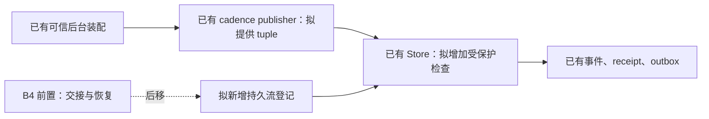
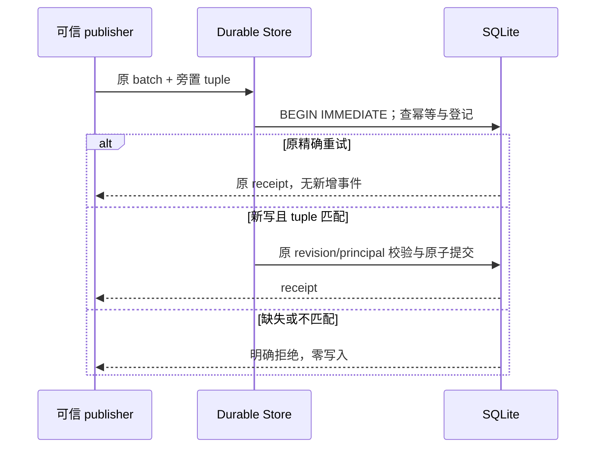
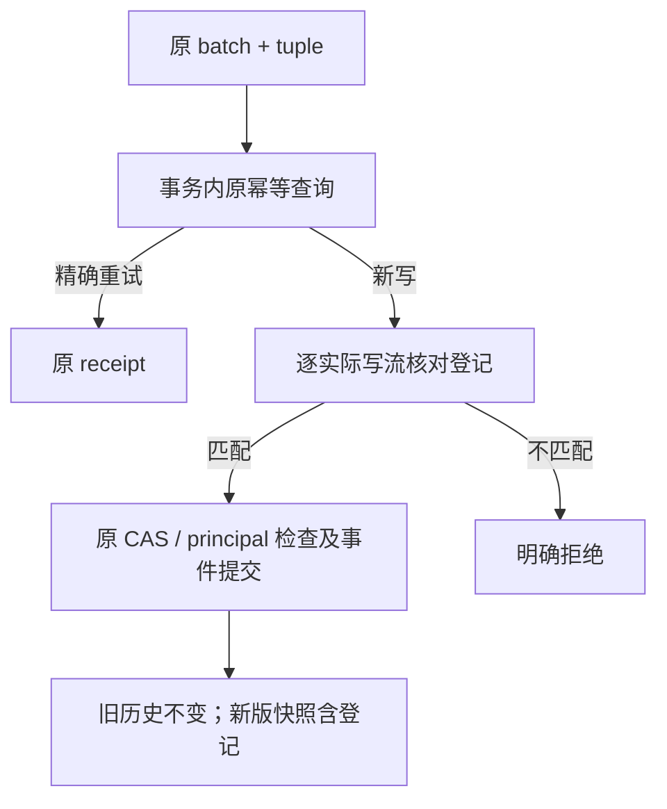

# Authority epoch 栅栏：G2 与 B4 两层设计

- 日期：2026-11-11；状态：仅设计，等待项目负责人审阅，未批准实现。
- 依据：[epoch 边界审计](epoch-boundary-audit.md)及文档仓库 `docs/architecture-v2/01-内核/03-权威栅栏与提交.md`。
- “代码依据”表示静态阅读当前源码；“推断”表示拟议设计或待验证假设，不代表现有功能。

## 1. 两层范围

**G2，推断：** 只对显式登记的受保护流启用写入栅栏。每个受保护写入携带 `(stream, scope, epoch, writer)`；Store 在同一 SQLite `BEGIN IMMEDIATE` 事务内读取登记并校验。缺失、错误 scope、旧 epoch、同 epoch 不同 writer 均明确拒绝；跨多流批次全成或全不成。既有 principal、revision、幂等、隐私和 fail-closed 要求不变，未登记流保持现有默认行为。两个 Durable Store 共库时以数据库事务串行。旧事件、旧快照和 JSON 到 SQLite 的既有事件、batch、digest 哈希不改写。

**B4 前置设计项，后移：** 受理、冻结、排空；恢复证据；`pending` / `reconcile` / `activate`；双 writer 已成功提交后的告警与对账；可信 control head。G2 不实现或证明上述能力，也不证明在线 handoff、备份新鲜度、跨提交端一致性或 UE 本地权威。各项留待 B4 独立设计。

**项目负责人既定决定：** 首流为 `population-cadence:<world_ref>`，一条物理流一个 scope；采用旁置授权上下文、离线独占升级。首流只证明一条流的机制。已受保护流始终强制拒绝；`warn_only` 仅用于未保护流观察或已保护流的诊断，不改变已生效门禁。这是对迁移文档 `08-迁移/01-迁移路径.md:181` “epoch 校验可降级为告警”的收紧解释，理由是放行旧 epoch 会违反唯一 writer 和 fail-closed。迁移文档由项目负责人处理，本设计不修改。

**推断：** G2 对登记的更新只验证 Store 的比较和事务顺序，不代表 B4 handoff 已完成。启用前由可信部署方明确指定唯一 writer 并完成离线旧进程停用；无法确认时不启用。G2 不新增跨进程能力签发，也不声称字符串可证明远程身份，或阻止拥有数据库任意 SQL 权限的程序。

## 2. 最小持久记录与上下文

**推断：** 只新增一组持久登记 `authority_streams`：`stream_id`（唯一）、`scope_ref`、`epoch`、`writer_ref`。可信离线管理/启动装配建立初始登记并更新 epoch/writer；更新在 `BEGIN IMMEDIATE` 中核对当前 tuple，epoch 只增不减且不重用。首切片不支持一条物理流对应多个 scope。缺值、格式不合法及未知上下文版本明确拒绝，不默认 epoch 或 writer；不可信网络请求、事件 payload 和 batch 不得创建登记。

**代码依据：** `backend/app/gameplay/event_store.py:237` 的 `_prepare_append` 已按 `(principal_ref, idempotency_key)` 比较 `payload_digest` 并返回原结果或拒绝；durable `append_batch:1195` 在写事务内读取 `transactions` 中的 digest 与 result。

**推断：** 原 `transactions` 及幂等记录继续保存原 key、digest 和 receipt，G2 不增加 operation、handoff 或提交关联表。原 receipt 损坏或缺失时明确失败，不把未知当成未提交。若现有记录不能满足所需历史校验，停止并重审，不擅自增加持久记录。

**代码依据：** `backend/app/main.py:750` 创建 `RuntimeCadencePublisher`；`backend/app/population_continuity/runtime_publication.py:131`、`:137` 确定 world 与流，`:671`–`:690` 构造并提交 batch。目前调用没有 epoch/writer 参数或可信 writer 身份绑定。

**推断：** 可信后台装配为 publisher 提供明确 `scope_ref`、epoch 和代表该运行实例的 `writer_ref`；publisher 每次写入时以旁置 typed context 提供 tuple，stream 来自实际 batch 的事件流，Store 逐流与登记核对。数据来自受信后台配置及部署装配，不由 HTTP、WebSocket、Godot、Agent 或领域 payload 自称；不设计跨进程能力签发。普通 `append_batch` 同样检查登记，不能成为绕过路径。确切接口及 publisher 接线尚待审阅。

## 3. 提交、精确重试与并发

**代码依据：** `event_store.py:237` 的 `_prepare_append` 在 revision 检查前处理幂等：同键同 digest 返回原 receipt，同键异 digest 返回 `idempotency_key_reused`。durable `append_batch:1189` 在 `:1195`–`:1215` 的事务中读取、准备并写入；`_transaction:1043` 和 `group_commit:1064` 使用 `BEGIN IMMEDIATE`。当前没有 epoch 登记或检查。

**推断：** 在既有真实调用方权限边界和 batch 校验之后、同一写事务内先查原幂等记录。同键异 digest 拒绝；已提交的同键同 digest 精确重试返回原 receipt，即使登记已升代，也不新增事件或 outbox。查询失败或 receipt 损坏明确失败。此方案沿用现有 digest 契约；相同的 caller 提供 digest 本身不证明任意内容相同，caller 必须维持既有 digest 生成和身份约束，不能扩大为公开 receipt 查询权限。

**推断：** 无原 receipt 的新写入按 batch 所有实际事件流查询登记；每条受保护流必须恰有匹配的 scope、epoch、writer。缺失、重复、多余或不匹配的上下文均拒绝；仅作为 CAS 读集的流不自动变成写授权。任一受保护流失败时事件、head、receipt、outbox 均不部分落盘。通过 epoch 检查后仍须通过原 revision 和 principal 校验。

**推断：** 两个 durable 实例对同一 SQLite 数据库的登记更新和 append 均使用 `BEGIN IMMEDIATE`，事务内重新读取登记而不依赖进程内缓存。append 先持锁则更新等待；更新先提交则后续旧 tuple 写入被拒。`group_commit` 外层事务未提交前不能声称结果已持久。内存 Store 只保证单实例锁内一致。数据库锁不证明 B4 的冻结、恢复、writer 真身或跨提交端效果。

## 4. 拟修改的 Store 函数

以下文件均为 `backend/app/gameplay/event_store.py`；行号是当前工作树的代码依据，具体修改是**推断**。

- `GameplayEventStore.__init__:152`、`append_batch:177`、`_prepare_append:237`、`_install_batch:368`：增加内存登记与旁置上下文校验，在同一锁内保留原幂等顺序，不修改原 batch 模型。
- `DurableGameplayEventStore.__init__:913`、`_load_database:1091`、`_migrate_schema_one:1124`、`_migrate_schema_two:1156`、`_require_current_schema:1037`：识别新格式及登记，保留旧格式读取和迁移。新 schema 版本号实施前需核对是否已占用。
- `_transaction:1043`、`group_commit:1064`、`append_batch:1189`、`_write_delta:1224`：在现有数据库事务边界内串行登记更新和检查，维持原写入原子性；普通 append 不得绕过受保护检查。
- 内存 `export_snapshot:581`、`save_snapshot:609`、`from_snapshot:641`；durable `_snapshot_from_connection:1442`、`export_snapshot:1465`、`save_snapshot:1470`：同一 cut 导出登记并严格恢复新版快照；旧快照不凭空生成 epoch。
- **推断：** 可能需要新增最小登记初始化/更新入口和 publisher 接线；入口、函数名及权限约束当前尚不存在。若需要修改其他 Owner 或引入跨进程身份机制，停止并重新审阅。

## 5. 旧数据与具体验证

**代码依据：** 内存快照当前版本 2，`event_store.py:641` 接受 snapshot 1/2；durable `__init__:913` 将旧 JSON 校验恢复到临时 SQLite 后于 `:956` 原子替换；`_snapshot_from_connection:1442` 与 `export_snapshot:1465` 在读事务中导出。

**推断：** 不给 `GameplayEvent`、`AtomicEventBatch`、旧 receipt 或原 idempotency 模型增加字段；旧事件、旧 batch 的规范序列化、payload/result digest 和冻结 replay hash 保持原值。旧 snapshot 1/2 作为无登记历史读取，不自动声明保护；要求保护的部署不能静默把缺登记当作无保护。新版受保护快照显式包含最小登记并以新顶层版本区分。新增元数据会改变整个快照文件 hash，需新 manifest；保持原哈希指旧内容和旧文件，不指新旧完整文件 hash 相等。新数据库格式会影响同库未保护流的旧程序；未升级的独立库不变。

**推断，拟验证且尚未执行：**

1. 对实际旧 snapshot 1/2 fixture 固定原文件 hash、event/batch 原始与规范 dump、领域 digest、receipt 和 replay prefix hash。旧 reader、新 reader 分别读取，逐项比较事件顺序、字段、revision、receipt 和冻结 hash，不更新预期值。
2. 对 fixture 副本走旧 JSON→SQLite 入口，迁移前后及重开后导出，逐事件/批次比较规范结果和冻结 hash。JSON 在替换前记录文件 hash 并备份；不把 SQLite 文件 hash 与 JSON 文件 hash 作等值比较。
3. 在副本显式登记后导出新版快照，导入隔离库；比较旧历史内容/digest 不变、登记 tuple 保留、原 receipt 可重试。新版快照缺登记或登记损坏必须拒绝安装；旧 reader 明确拒绝新版。模拟迁移中断，验证原副本未半写入覆盖。
4. 两个独立 durable 实例共库，以同步点测试 append-first 和登记更新-first，再重开及导出恢复；验证旧 writer 新写拒绝、旧精确重试返回原 receipt、同键异 digest 拒绝、事件与副作用计数不增。该用例只证明 Store 栅栏，不证明 B4 handoff。

**提交 2 的预先定义验收用例（提交 1 不实施）：** 在已登记流上以原 `append_batch` 不提供授权上下文提交新批次，必须明确拒绝且事件、head、receipt 和 outbox 均不变；同时验证未登记流的原调用仍按既有契约执行。已提交的精确重试另按原 receipt 合同核验，不将该用例解释成允许新写入。

## 6. 两个提交及回退

**推断：** 每个提交在隔离 fixture 上运行针对性测试，且与现有全量基线逐节点、阶段和失败签名对照；启用前保留原始存档及 manifest。下列现有测试命令之外的 epoch 测试尚不存在，实施时须固定名称与命令；本设计未运行这些测试。

1. **格式与最小登记。** 前置：冻结旧 fixture/hash、确认 schema 版本、明确离线独占与旧程序停用。默认不启用地加入登记、版本化快照/迁移及兼容验证，不改原 batch 序列化。拟运行 `python -m pytest backend/tests/test_gameplay_event_store_persistence.py backend/tests/test_gameplay_event_store_codec_compatibility.py backend/tests/test_gameplay_event_store_connection.py -q`，再加入新增迁移测试及全量对照。未生成新格式数据且提交 2 尚未依赖时可单独 revert；一旦新格式落盘，旧二进制不能安全写新库，应停写、保留库并使用支持新格式的兼容版本。恢复旧备份会缺失之后的事实，须另行决定，不能自动降级。
2. **事务内栅栏与真实首流接线。** 依赖提交 1 的登记与格式，增加旁置 tuple、两个 Store 的检查、幂等/双实例测试及可信装配 publisher 接线；未经批准不启用。拟运行 `python -m pytest backend/tests/test_gameplay_event_store_contract.py backend/tests/test_gameplay_event_store_connection.py backend/tests/test_world_runtime_population_cadence.py backend/tests/test_population_durable_cadence_recovery.py -q`，再运行新增 epoch、迁移/重开测试及全量对照。未启用且无受保护写入时可先关闭接线、回退本提交，保留提交 1；启用后不含栅栏的旧代码不能写受保护库，须停写并使用仍支持登记和栅栏的兼容版本，不能删除登记或调低 schema 绕过。回退提交 1 前须先移除依赖并处理新格式数据。

## 7. 架构、时序与数据流

## 8. 待确认及停止点

**推断：** 首流 writer 的可信部署身份和离线登记更新方式、schema 版本、完整实际调用点、快照格式及两个提交的最终文件边界仍须确认。G2 不提供 B4 受理冻结或可信 control head，因此不能保障在线交接或从旧备份自动恢复最新 epoch；须保留这些限制。项目负责人审阅前不写实现、不运行迁移、不启用栅栏。
