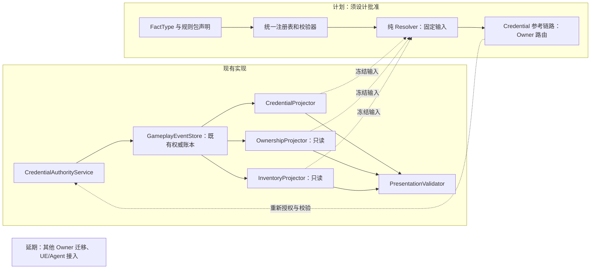
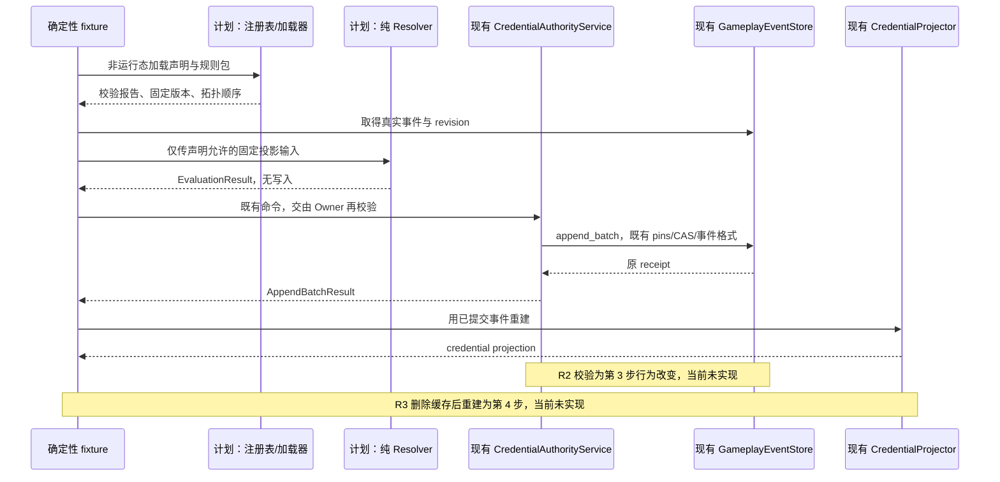
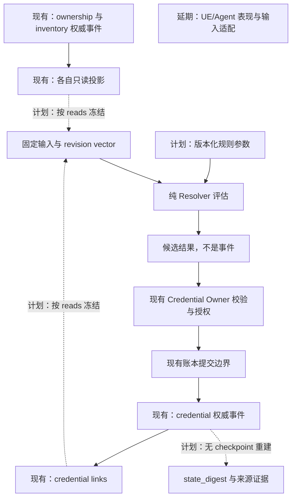

# G3 credential 首域 L2–L5：只读设计

- 日期：2026-11-16；状态：`awaiting-user-review`。
- 本提交只增加本文件；没有实现注册器、校验器、Resolver、规则包或回放改动。
- 目标：以 credential 的真实提交与投影链路建立参考设计，为随后“只增加声明和规则包”的 FactType 探针准备可审查边界。本文件不宣布 G3 满足。
- 起点仓库：`D:/Temp/paralls-g0-b3-ingress-20261109`。
- 分支：`codex/g0-b3-ingress-20261109`。
- 起点 HEAD：`d6c30d58bc6e89f042cd727643f494460f00451a`，与预期一致。
- 起点 `git status --porcelain=v1`：空输出，工作区干净。
- 预算：仅文档、静态阅读与串行 Python 测试；不启动 UE/Godot，不操作美术资源。

## 已验证

### 来源与命令

以下指定文件在运行时仓库中不存在；本次只读使用
`D:/Users/User/Documents/Unreal Projects/Paralls-docs` 中的对应文件：

1. `docs/superpowers/specs/2026-11-09-architecture-v2-execution-spec.md`，重点为 G3。
2. `docs/architecture-v2/03-事实类型/01-FactType定义.md`。
3. `docs/architecture-v2/03-事实类型/04-FactType完整schema.md`。
4. `docs/architecture-v2/05-规则包/03-校验器规则.md`。
5. `docs/architecture-v2/05-规则包/04-规则包文件格式.md`。
6. `docs/architecture-v2/06-模型与结算/01-Resolver合同.md`。

文档仓库 HEAD 为 `3d209c7b2b751da6327398181ab2dc6d603d56e5`；其中执行规格有用户已有的未提交修改，不能用该 HEAD 代指本次阅读的全部内容。六份文件的原始字节副本与 SHA256 保存在仓库外
`D:/Temp/g3-credential-design-20261116/references/` 和 `source-provenance.json`。
执行规格 SHA256 为 `4d58615d6c8bb681285ba35340e6379b82d5b626f74747e157fb84297b32de7d`。
本次没有修改或提交文档仓库的文件。

起点命令（cwd 为运行时仓库）：

```powershell
git rev-parse HEAD
git branch --show-current
git status --porcelain=v1
```

原始输出（第三条为空）：

```text
d6c30d58bc6e89f042cd727643f494460f00451a
codex/g0-b3-ingress-20261109
```

### 五组冻结节点：提交前实跑

使用 G0 原有 `run_baseline.py`，没有添加测试替身或改变现有测试。
从五个 `G1-*-nodeids.txt` 逐行读取 nodeid，各组单独串行执行。
可复现命令：

```powershell
$g3Python = 'D:/Temp/paralls-g0-py312/Scripts/python.exe'
$g3Repo = 'D:/Temp/paralls-g0-b3-ingress-20261109'
$g3Evidence = 'D:/Temp/g3-credential-design-20261116'
foreach ($g3Group in @('ownership','modifier','equipment','inventory','shared-replay')) {
    $g3Args = @('docs/verification/g0-939c6746/run_baseline.py',
        '--repo', $g3Repo, '--output', "$g3Evidence/pre-$g3Group")
    foreach ($g3Node in Get-Content "docs/verification/g0-939c6746/G1-$g3Group-nodeids.txt") {
        if ($g3Node.Trim()) { $g3Args += @('--test', $g3Node.Trim()) }
    }
    & $g3Python @g3Args *> "$g3Evidence/pre-$g3Group.log"
    if ($LASTEXITCODE -ne 0) { throw "Stop: $g3Group" }
}
```

上述目录已经存在；复跑需更换输出目录。提交后同样运行五组，输出到 `post-<group>`，不覆盖提交前证据。
每组原始日志、`invocation.json`、`environment.json`、`results.json`、`collected-nodeids.json` 和 JUnit 均在证据根目录。

逐组比较脚本的原始输出：

```json
{"group": "ownership", "collected": 5, "counts": {"passed": 5}, "baseline_failures_total": 39, "baseline_failures_in_scope": 0, "new_failures": 0, "collection_errors": 0}
{"group": "modifier", "collected": 11, "counts": {"passed": 11}, "baseline_failures_total": 39, "baseline_failures_in_scope": 0, "new_failures": 0, "collection_errors": 0}
{"group": "equipment", "collected": 72, "counts": {"passed": 72}, "baseline_failures_total": 39, "baseline_failures_in_scope": 0, "new_failures": 0, "collection_errors": 0}
{"group": "inventory", "collected": 49, "counts": {"passed": 49}, "baseline_failures_total": 39, "baseline_failures_in_scope": 0, "new_failures": 0, "collection_errors": 0}
{"group": "shared-replay", "collected": 201, "counts": {"passed": 201}, "baseline_failures_total": 39, "baseline_failures_in_scope": 0, "new_failures": 0, "collection_errors": 0}
```

比较依据：`docs/verification/g0-939c6746/run2/results.json` 确有 39 个失败；按实际收集的 nodeid 取交集，再比较失败的 `(test_name, phase, error_type)`。五组选集共 338 个节点，与 39 个失败的交集为空，全部节点 outcome 为 passed、退出码为 0、无收集错误，**满足本次选集无新增失败的要求**。没有重跑完整 9,922 节点基线，不能据此声称全部 39 项在当前 HEAD 仍保持原状。

### credential 相关现有节点：实跑与清单

额外执行以下命令，cwd 同上：

```powershell
& 'D:/Temp/paralls-g0-py312/Scripts/python.exe' `
  docs/verification/g0-939c6746/run_baseline.py `
  --repo 'D:/Temp/paralls-g0-b3-ingress-20261109' `
  --output 'D:/Temp/g3-credential-design-20261116/credential-existing' `
  --test 'tests/test_credential_runtime.py' `
  --test 'tests/test_adventure_basic_scenario4.py' `
  --test 'tests/test_adventure_basic_closure_evidence.py::test_each_adventure_basic_scenario_rebuilds_a_facade_with_canonical_replay_evidence[scenario-4-_scenario4]' `
  --test 'tests/test_adventure_basic_mirror_source.py::test_remaining_scenario_mirror_states_change_only_with_their_committed_facades'
```

原始输出末行：

```text
======================= 20 passed, 2 warnings in 0.56s ========================
```

20 个实际收集节点如下，精确参数化 ID 也保存在 `credential-existing/collected-nodeids.json`：

```text
tests/test_credential_runtime.py::test_credential_is_replayable_evidence_not_title_truth
tests/test_credential_runtime.py::test_credential_records_issuance_holder_attestation_without_becoming_current_holder_truth
tests/test_credential_runtime.py::test_revoke_and_supersede_change_only_credential_link_state
tests/test_credential_runtime.py::test_unknown_right_rejects_without_event_and_retry_is_idempotent
tests/test_credential_runtime.py::test_credential_presentation_requires_item_presence_and_right_holder
tests/test_credential_runtime.py::test_issuance_rejects_item_not_currently_held_without_link_event
tests/test_credential_runtime.py::test_credential_replay_boundaries_for_each_command[issue]
tests/test_credential_runtime.py::test_credential_replay_boundaries_for_each_command[revoke]
tests/test_credential_runtime.py::test_credential_replay_boundaries_for_each_command[supersede]
tests/test_credential_runtime.py::test_credential_stale_commit_rejects_without_partial_writes[issue]
tests/test_credential_runtime.py::test_credential_stale_commit_rejects_without_partial_writes[revoke]
tests/test_credential_runtime.py::test_credential_stale_commit_rejects_without_partial_writes[supersede]
tests/test_adventure_basic_scenario4.py::test_scenario4_purchase_atomically_transfers_land_deed_and_right_then_dropping_the_deed_does_not_transfer_title
tests/test_adventure_basic_scenario4.py::test_scenario4_rejects_title_transfer_without_present_credential_then_transfers_only_by_the_explicit_authority_command
tests/test_adventure_basic_scenario4.py::test_scenario4_rejects_wrong_holder_or_stale_right_revision_without_partial_mutation
tests/test_adventure_basic_scenario4.py::test_scenario4_replays_an_identical_land_right_transfer_without_a_second_title_mutation
tests/test_adventure_basic_scenario4.py::test_land_right_replay_rejects_changed_revision_and_missing_receipt
tests/test_adventure_basic_scenario4.py::test_land_right_stale_commit_rejects_without_partial_writes
tests/test_adventure_basic_closure_evidence.py::test_each_adventure_basic_scenario_rebuilds_a_facade_with_canonical_replay_evidence[scenario-4-_scenario4]
tests/test_adventure_basic_mirror_source.py::test_remaining_scenario_mirror_states_change_only_with_their_committed_facades
```

其中 scenario4 首个节点是场景邻接回归，不直接调用 credential；保留它以覆盖“纸契位置与产权独立”的边界。closure 的 scenario-4 节点覆盖域 facade 的全量回放和 checkpoint+tail 等价。`scripts/verification/verify_adventure_basic.py` 另有 credential 场景验证调用，本次只静态阅读，没有运行该脚本。搜索使用 credential 的领域类、三种完整事件名及 `issue_deed_credential`，未把登录/模型供应商的认证 credential 测试冒充本域覆盖。

## 仅静态检查

### 当前真实链路与三个生产导入者

阅读 `backend/app/gameplay/credential_runtime.py`（269 行）及以下三个生产导入者；测试导入者另计：

| 文件 | 实际用途 | 边界 |
|---|---|---|
| `backend/app/gameplay/adventure_basic_reference.py` | Scenario4 构造真实 CredentialAuthorityService，`issue_deed_credential()` 调用 issue；后续调用土地转让 authority | fixture 由真实 inventory/ownership 服务建数据，凭证不直接转移产权 |
| `backend/app/gameplay/land_right_runtime.py` | CredentialProjector + CredentialPresentationValidator 读取凭证并验证出示者；另检查配置的容器范围 | 此 Owner 写 ownership 事件；本任务不得修改它 |
| `backend/app/gameplay/adventure_basic_closure.py` | scenario-4 facade 重建 credential links，比较在线、snapshot 恢复与 checkpoint+tail 的 hash | 只读证据，不是写入者，也没有删除 checkpoint |

当前 credential 服务生成的三种事件、版本和 payload：

| event_type（全部 schema_version=1） | payload 字段 | 命令提交数量 |
|---|---|---|
| `gameplay.credential.issued` | `credential_id`, `credential_item_ref`, `issued_holder_ref`, `issued_holder_inventory_revision`, `right_id`, `credential_kind`, `proves`, `issuer_ref` | issue：1；supersede 的第二个事件 |
| `gameplay.credential.revoked` | `credential_id`, `issuer_ref`, `reason` | revoke：1 |
| `gameplay.credential.superseded` | `credential_id`, `replacement_credential_id`, `issuer_ref` | supersede：先 superseded 再 issued，共 2 |

全部事件使用 `stream_id="gameplay:credentials"`、`visibility_policy="authority_only"`、`transaction_id="tx:<command_id>"`。保留这些持久契约；声明顺序不能重排 supersede 的两个事件。`issuer_ref` 与 link 的 issuer 比较是现有检查；不能把它描述为已经验证了外部调用者身份。

### 三种事件的 FactType 声明草案

以下是**待审的声明设计**，不是可加载的已实现规则包。Owner 元数据拟注册 `Credential`，domain 为 `credential`，映射到现有 `actor_gameplay.credential_domain`。三种事件分别映射到三类单向记录事实；最终有效状态仍由 credential 的跨事实不变量约束，不能把 revoked/superseded 当成 ownership 写权。

`*` 仅用于模板；实例必须采用合法、无冒号的 scope 标识，并可确定性映射回原 `credential_id`，不得直接把带冒号的业务 ID 拼成五段以上 FactType ID。

```yaml
"fact:credential:*:issued":
  primitive: "machine"
  identity: "entity_ref"
  owner_ref: "Credential"
  visibility:
    class: "private"
    learnable_by: ["role:credential_authority"]
    channel: "direct"
    persistence: "permanent"
  event_schema_ref: "gameplay.credential.issued@1"
  invariant_refs: ["M1", "M2", "M3", "M4", "M5", "credential_issue_valid"]
  state_set_ref: "machine_def/credential_issued@1"
  cadence: "event"
  host: "paralls"
  unknown_policy: "reject"

"fact:credential:*:revoked":
  primitive: "machine"
  identity: "entity_ref"
  owner_ref: "Credential"
  visibility:
    class: "private"
    learnable_by: ["role:credential_authority"]
    channel: "direct"
    persistence: "permanent"
  event_schema_ref: "gameplay.credential.revoked@1"
  invariant_refs: ["M1", "M2", "M3", "M4", "M5", "credential_revoke_valid"]
  state_set_ref: "machine_def/credential_revoked@1"
  cadence: "event"
  host: "paralls"
  unknown_policy: "reject"

"fact:credential:*:superseded":
  primitive: "machine"
  identity: "entity_ref"
  owner_ref: "Credential"
  visibility:
    class: "private"
    learnable_by: ["role:credential_authority"]
    channel: "direct"
    persistence: "permanent"
  event_schema_ref: "gameplay.credential.superseded@1"
  invariant_refs: ["M1", "M2", "M3", "M4", "M5", "credential_supersede_valid"]
  state_set_ref: "machine_def/credential_superseded@1"
  cadence: "event"
  host: "paralls"
  unknown_policy: "reject"
```

各 machine 的候选状态集为 `absent / recorded`，对应一次单向记录；issued 的 attestation 不因当前 holder 变化而重写。上述 state set、domain invariant、Owner、角色选择器与 schema 引用均须在后续注册实现中真实解析，不得把示例引用当成已经存在。Machine 不声明仅适用于 pool/holdings 的 aggregation 字段。

可见性草案只保留可信 authority 范围，不授权玩家或 Agent 读取；`role:credential_authority` 必须绑定真实受信 principal，不能仅靠字符串自报。现有 `authority_only` 的事件字段不变，不能声称此草案已完成新的可见性强制路径。

**未满足的严格契约：** 三类事件目前共用一条 revision 流；FactType 定义 §五禁止跨 FactType 共享 revision。上面的三份草案尚不满足独立 revision/CAS，不能通过给同一个 head 起三个别名来冒充满足。Machine M3 所要求的 from/to/condition_ref/condition_revision 也不是现有事件的显式 payload；是否能从原 batch、pins 和前态派生完整证据须核对，不能补写持久字段后称为结构迁移。这些是进入真实链路前的设计决定，见末节。

### reads 声明与现有资格检查的逐项对应

采用“受限、冻结的投影输入”设计。下例为拟新增的 reads 结构：`projection_ref` 表示外部只读投影，不伪造 credential FactType；`fact_type_ref` 表示本域已注册事实。字段路径是 schema 字段选择，不是可执行表达式。

```yaml
reads:
  - projection_ref: "ownership.rights@1"
    owner_ref: "Ownership"
    fields: ["rights.right_id", "rights.asset_ref", "rights.holder_ref"]
    revision_stream: "gameplay:ownership"
  - projection_ref: "inventory.actor@1"
    owner_ref: "Inventory"
    scope_input: "holder_or_presenter_ref"
    fields: ["items.item_id", "locations.item_id", "locations.container_id"]
    revision_stream: "gameplay:inventory:{actor_ref}"
  - fact_type_ref: "fact:credential:*:issued"
  - fact_type_ref: "fact:credential:*:revoked"
  - fact_type_ref: "fact:credential:*:superseded"
```

这里的 ownership/inventory 名称为拟定的只读输入注册项，实际取值来自现有 OwnershipProjector/InventoryProjector；两个外域不新增 credential FactType、不迁移、不改写主。表中的 `rights` 和 `items/locations` 是投影结构的选择描述，不声称当前代码已有此 reads 解析 API。

| 操作 | 本域读取 | 外域投影读取与现有判据 | 现有 revision 行为 |
|---|---|---|---|
| issue | ID 未存在；同 item 无 active link；kind/proves 在固定允许集合 | ownership：right 必须存在；inventory：item 同时存在于指定 holder 的 items 和 locations | pins/CAS credential、ownership、holder inventory |
| revoke | link 为 active；issuer 一致；reason 非空 | 无 | pins/CAS credential |
| supersede | prior active、issuer 一致；replacement ID 未存在；沿用 prior right/kind/proves | replacement inventory 的 item 在 items 与 locations 中；**现有逻辑没有再次要求 ownership right 存在** | pins/CAS credential、replacement inventory |
| presentation | link 存在且 active | presenter inventory 的 item 在 items 与 locations 中；right 存在且 holder 等于 presenter | 只读；当前多次 read_events，没有统一冻结输入向量 |
| land-right 调用者附加条件 | link.right/kind/proves 与 policy 相符 | asset/right/current holder 相符；凭证在 policy 指定容器；expected ownership revision 相符 | 由 land-right 自身 CAS；不移入 credential |

`credential_kind`、`proves`、issuer/reason 是命令/固定规则参数；InventoryDefinitionRegistry 需作为版本固定配置输入，不是另一个可变事实源。现有规则并未要求 issued holder 就是 right holder，不能在结构迁移中增加此条件。

**表达能力静态结论：满足现有资格检查的表达需求。** 上表没有需要读写外部 Owner 或任意脚本才能表达的判据。但是 reads 的加载校验、输入隔离与运行期访问约束尚未实现，不能声称已强制。Resolver 只接收固定输入，不得到 store、Owner 服务或无限制映射；非法读取需抛出 `resolver_input_undeclared`。仅靠模型自行填写 reads 而仍允许直接读 store，不满足要求。Python 任意代码的纯函数性不能靠一份清单静态证明，需配合固定入口、受限输入和真实负向测试。

### D2、D3、D4 与拟议文件位置

- **D2 严格：** 每个 Resolver layer 的 owner 必须与每个输出 FactType 的 owner 相等；跨域读取不授予写权。supersede 的两个输出仍全部归 Credential。不能以管线顶层 owner 相等代替逐层检查。
- **D3：** 代码模型与数据模型进入同一张注册表。代码项须有版本、输入/输出 schema、reads、writes_fact_types、确定性策略；只在 Python 中隐式定义一个函数不算注册。代码模型不能在规则包内放脚本。现有 authority service 有 IO，不能原样注册成纯 Resolver。
- **D4：** 作者声明 `resolve_order`；编译器拓扑排序生成从 10 起、同 scope 稠密唯一的整数 `resolution_order`。缺声明与编译产物缺顺序都拒绝为 `facttype_resolution_order_missing`，不填默认值。排序用稳定 ID 作为无依赖顶点的确定性 tie-break。

三种记录事实彼此不需要规定跨命令时间顺序，可以先声明：

```yaml
resolve_order:
  before: []
  unrelated:
    - "fact:credential:*:issued"
    - "fact:credential:*:revoked"
    - "fact:credential:*:superseded"
```

dependency graph 另保留 ownership/inventory 只读投影顶点到使用它们的 layer 的边，用于输入冻结与依赖校验；不把外域顶点冒充 credential 写事实。机器状态的命令先后、事件 global_sequence 和 supersede 原子批次顺序仍由账本决定，不能用 resolution_order 取代。

位置沿用项目 `backend/app/gameplay/` 的领域模块与显式 registry 模式，测试在 `backend/tests/`。候选新文件为 `backend/app/gameplay/fact_type_registry.py`、`rule_pack_validator.py`、`credential_reference_chain.py` 以及对应测试；规则包按规格置于 `packs/credential_reference/pack.yaml` 与 `fact_types/`、`machine_defs/`、`models/`、`bindings/`。当前仓库没有此 packs 根目录，属于待审新增，不另建第二个存储层。不添加依赖；现有 PyYAML 的语法限制需在加载器中明确检查。

第 2 步不改 `credential_runtime.py`；新 reference-chain 模块必须通过真实 CredentialAuthorityService/GameplayEventStore 完成授权提交并读取真实事件，不能让新模型输出直接进入存储、绕过 Owner。如何与严格独立 revision 契约兼容仍阻塞于末节决定。第 2 步的结构文件和真实链路职责应明确区分，不能用注册器单测取代链路验收。

五个必须的拒绝测试各自独立反例：

| 拒绝码 | 最小反例 | 需验证的结果 |
|---|---|---|
| `facttype_visibility_missing` | 删除一条声明的 visibility，或设为空 | 整包拒绝，无部分注册 |
| `facttype_resolution_order_missing` | 删除该类型的偏序覆盖声明 | 不自动分配默认顺序，整包拒绝 |
| `facttype_owner_unknown` | owner_ref 指向未注册 Owner | 定位未知引用，整包拒绝 |
| `resolver_owner_mismatch` | 某个 layer 标成 Ownership 却输出 credential 事实 | 逐层拒绝，不靠顶层 owner 掩盖 |
| `resolver_input_undeclared` | 模型实际索取 inventory 输入，而该模型 reads 未声明它 | 访问受限输入时明确拒绝；不能只比较两份自报清单 |

加载报告需保留 code、target、file/line/column 和 hint，并聚合可独立发现的问题；任何 error 整包不生效。运行中禁止换包。代码模型纯计算、实际 IO/提交在 authority 边界的分工必须可测。

### R1 / R2 / R3 现状与后续验收设计

| 项 | 当前静态证据 | 满足情况 |
|---|---|---|
| R1 | `CredentialAuthorityService._duplicate` 调用 `owner_runtime_base.replay_duplicate`；检查 record、payload_digest、原 result，再深拷贝并标 duplicate_replayed；20 个节点中包含 3 命令的精确重试用例 | 现有测试满足其覆盖的 R1 路径 |
| R2 | credential runtime 和共享 helper 均未遍历 `committed_event_ids`；内存 `get_by_idempotency` 复制缓存 receipt，Durable 版本读事务 result，均未逐 ID 解析 | **不满足** credential duplicate 路径的事件引用验证 |
| R3 | CredentialProjector 每次从事件重建，没有 credential checkpoint 或 `state_digest` API；closure 比较域 facade hash 与通用 replay hash，但未实际删 checkpoint | **不满足**“删除 checkpoint 后重建，state_digest 一致”的精确判据 |

R2 的注意事项：snapshot restore 在 `event_store.py` 中已有 result/event 列表一致性检查，但这是恢复边界，不等于每次 credential duplicate 请求都被检查。第 3 步只在 credential 路径新增校验，保持共享 helper 和其他 Owner 行为。

拟议 R2 验收（尚未实现）：receipt 为 committed；原 transaction 可获取且 command/transaction 与请求一致；每个 committed_event_id 经 `get_event` 解析；无重复 ID、事件 transaction/command/类型一致；ID 列表与原事务事件逐项一致；issue/revoke 各 1 个、supersede 按既有顺序 2 个。缺事件、事务不符、数量不符分别用明确 credential 错误码（候选 `credential_replay_event_missing`、`credential_replay_transaction_mismatch`、`credential_replay_event_count_mismatch`），不得把已存在却损坏的 receipt 变成 None、空列表或新提交。没有幂等记录时首次命令继续执行的现有语义不变。提交信息必须注明“行为改变，非结构迁移”。

拟议 R3 验收（尚未实现）：在任务拥有的确定性 fixture store 上真实保存 checkpoint；记录其存在及完整域状态 digest；导出该 fixture snapshot，**仅移除其中 projection_checkpoints 缓存项**后通过现有 `from_snapshot` 建立另一真实 store；验证恢复 store 无 checkpoint、权威事件与事务完全保留；用同一冻结包、模型和投影器全量重建并比较 canonical `state_digest`。digest 应包含完整 credential links（含签发 attestation/source_event_id）与 source_revision_vector；需另记源事件/包/模型摘要以排除同错或版本漂移。不得只 hash 空 facade、只比较通用 replay 状态或复用删除前缓存。这里只提出 fixture 设计，不删除用户数据库或修改存储核心。

### 架构图：现状与计划的边界



### 时序图：计划路径复用真实 Owner



### 数据流图：无第二写权



### 第 4 步探针的冻结判据

先冻结真实链路与通用 fixture 驱动，再新增一个能通过既有原语、模型、命令绑定表达的 credential 相关事实。具体新增语义需在冻结时明确，不能把同一事件的别名或只注册不提交算成新事实。

探针只允许修改 FactType 注册数据和规则包，需从真实加载、Resolver、Owner 授权提交走到投影/回放。保存探针前后 commit/diff、`git diff --stat <frozen-head> --`、代码路径 `git diff --numstat <frozen-head> -- backend/app backend/tests scripts`、事件数量/类型、拒绝与 replay 证据。Owner/runtime/test driver 在探针阶段均不能新增分支；若必须写 Python、改持久事件或改其他 Owner，立即记录缺少的机制并停止，不以放宽判据补救。此处未运行探针，不承诺现有链路能达到零代码改动。

## 需要用户决定

1. **第 1 步设计审核后是否进入第 2 步。** 本轮提交本文件并完成提交后五组回归后停下；这是用户指定的阶段门，不执行第 2–4 步。
2. **三种事件与独立 FactType revision 的冲突如何解决。** 推荐先保留以上三份草案为待定，并明确真实链路的 revision 设计再接线。现有三个事件共同维护一个 credential link 生命周期；按现状视为一个事实类型、三种事件更贴近其 revision，但这不同于要求的三份独立 FactType。若坚持三份正式 FactType，必须先给出不共享 revision、保持旧事件兼容且无需改其他 Owner/存储核心的方案；没有证据前不能宣称满足 v2，也不能默许豁免。若方案需要改持久事件或 land-right 的读取/锁定约定，先枚举全部读取方并停止报告。
3. **Machine 记录证据和可见性绑定。** 需要确认三类记录事实是否是所需事实粒度；后续实现须证明已有事件/batch 足以派生 Machine M3 证据，并把 authority 角色绑定到真实 principal。若必须新增持久字段，仍按停止条件报告，不能自行实施。

reads 的资格检查表达没有发现必须停止的缺口；其强制机制仍待实现。以上 revision/schema 差异保留为显式待决，不把“20 个现有测试通过”提升为 G3 或 v2 满足的结论。
