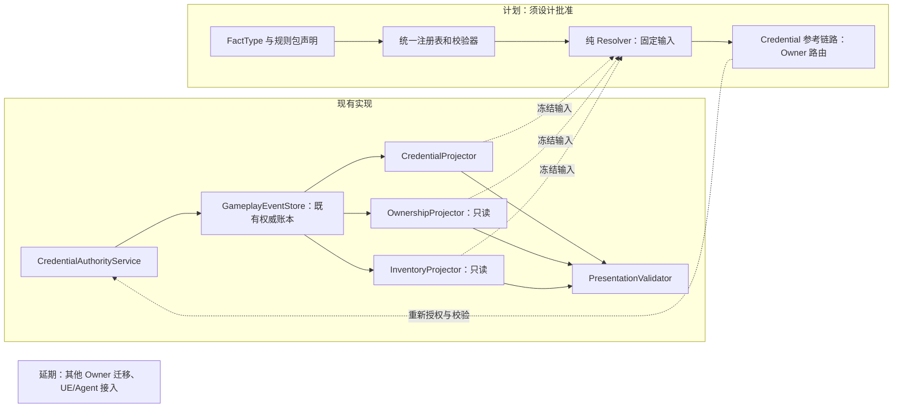
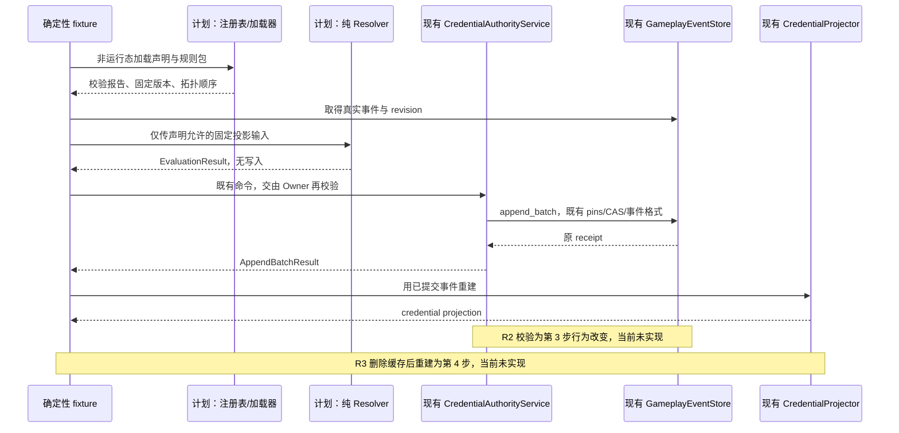
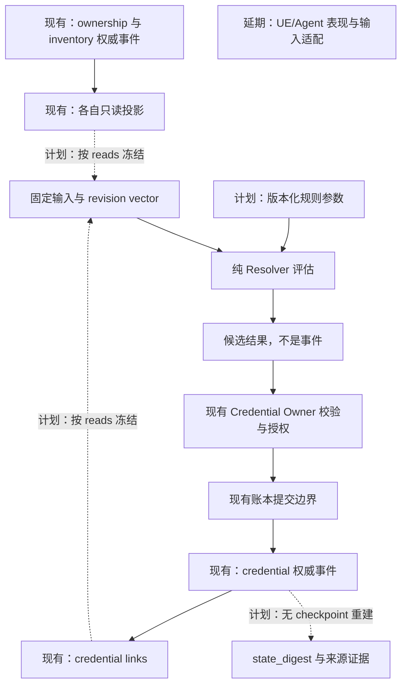

# G3 credential 首域 L2–L5：只读设计

- 日期：2026-11-16；状态：方案 A 的阶段 0–3 已获实施授权；方案 B 待阶段 4 闸门，禁止提前实施。
- 本轮为“第 2 步：仅文档，设计修订”；只修改本文件，没有实现注册器、校验器、Resolver、规则包或回放改动。原第 1 步记录在 `be16b1ac`。
- 目标：以 credential 的真实提交与投影链路建立参考设计，为随后“只增加声明和规则包”的 FactType 探针准备可审查边界。本文件不宣布 G3 满足。
- 起点仓库：`D:/Temp/paralls-g0-b3-ingress-20261109`。
- 分支：`codex/g0-b3-ingress-20261109`。
- 本轮起点 HEAD：`be16b1acafcabe19c4201959e4f4e224445b04d7`，与预期一致；第 1 步代码基点为 `d6c30d58bc6e89f042cd727643f494460f00451a`。
- 起点 `git status --porcelain=v1`：空输出，工作区干净。
- 本轮预算：只读代码与 AST/存档文件静态扫描，提交前后只执行 `--collect-only`，不运行测试用例或全量测试，不启动 UE/Godot，不操作美术资源。

## 已验证

### 本轮起点与收集证据

cwd：`D:/Temp/paralls-g0-b3-ingress-20261109`。命令：

```powershell
git rev-parse HEAD
git branch --show-current
git status --porcelain=v1
```

原始输出（status 为空）：

```text
be16b1acafcabe19c4201959e4f4e224445b04d7
codex/g0-b3-ingress-20261109
```

本轮提交前、后各串行收集五组，命令如下；前一次 `pre`，后一次改成 `post`。目录必须尚不存在：

```powershell
$g3RevEvidence = 'D:/Temp/g3-credential-design-revision-20261116'
$g3RevRepo = (Get-Location).Path
foreach ($g3RevGroup in @('ownership','modifier','equipment','inventory','shared-replay')) {
    $g3RevArgs = @('docs/verification/g0-939c6746/run_baseline.py',
        '--repo',$g3RevRepo,'--output',"$g3RevEvidence/pre-$g3RevGroup",'--collect-only')
    foreach ($g3RevNode in Get-Content "docs/verification/g0-939c6746/G1-$g3RevGroup-nodeids.txt") {
        if ($g3RevNode.Trim()) { $g3RevArgs += @('--test',$g3RevNode.Trim()) }
    }
    & 'D:/Temp/paralls-g0-py312/Scripts/python.exe' @g3RevArgs *> "$g3RevEvidence/pre-$g3RevGroup.log"
    if ($LASTEXITCODE -ne 0) { throw "Stop collection: $g3RevGroup" }
    Get-Content "$g3RevEvidence/pre-$g3RevGroup.log" -Tail 1
}
```

提交前原始输出：

```text
========================= 5 tests collected in 0.21s ==========================
========================= 11 tests collected in 0.31s =========================
========================= 72 tests collected in 2.05s =========================
========================= 49 tests collected in 1.00s =========================
======================== 201 tests collected in 2.82s =========================
```

合计 338；精确收集 ID、命令、环境和原始日志保存在上述目录。提交后结果单独封存在 `post-*` 和 `final-collection-comparison.json`，由最终回报附原始输出；不能预写成已经执行。本轮不产生测试通过/失败结论，也不重跑 39 项基线失败。

以下运行结果均为**第 1 步历史证据**，本轮没有重新执行这些用例。

### 来源与命令

以下指定文件在运行时仓库中不存在；本次只读使用
`D:/Users/User/Documents/Unreal Projects/Paralls-docs` 中的对应文件：

1. `docs/superpowers/specs/2026-11-09-architecture-v2-execution-spec.md`，重点为 G3。
2. `docs/architecture-v2/03-事实类型/01-FactType定义.md`。
3. `docs/architecture-v2/03-事实类型/04-FactType完整schema.md`。
4. `docs/architecture-v2/05-规则包/03-校验器规则.md`。
5. `docs/architecture-v2/05-规则包/04-规则包文件格式.md`。
6. `docs/architecture-v2/06-模型与结算/01-Resolver合同.md`。

文档仓库 HEAD 为 `3d209c7b2b751da6327398181ab2dc6d603d56e5`；其中执行规格有用户已有的未提交修改，不能用该 HEAD 代指本次阅读的全部内容。六份文件的原始字节副本与 SHA256 保存在仓库外
`D:/Temp/g3-credential-design-20261116/references/` 和 `source-provenance.json`。
执行规格 SHA256 为 `4d58615d6c8bb681285ba35340e6379b82d5b626f74747e157fb84297b32de7d`。
本次没有修改或提交文档仓库的文件。

起点命令（cwd 为运行时仓库）：

```powershell
git rev-parse HEAD
git branch --show-current
git status --porcelain=v1
```

原始输出（第三条为空）：

```text
d6c30d58bc6e89f042cd727643f494460f00451a
codex/g0-b3-ingress-20261109
```

### 五组冻结节点：提交前实跑

使用 G0 原有 `run_baseline.py`，没有添加测试替身或改变现有测试。
从五个 `G1-*-nodeids.txt` 逐行读取 nodeid，各组单独串行执行。
可复现命令：

```powershell
$g3Python = 'D:/Temp/paralls-g0-py312/Scripts/python.exe'
$g3Repo = 'D:/Temp/paralls-g0-b3-ingress-20261109'
$g3Evidence = 'D:/Temp/g3-credential-design-20261116'
foreach ($g3Group in @('ownership','modifier','equipment','inventory','shared-replay')) {
    $g3Args = @('docs/verification/g0-939c6746/run_baseline.py',
        '--repo', $g3Repo, '--output', "$g3Evidence/pre-$g3Group")
    foreach ($g3Node in Get-Content "docs/verification/g0-939c6746/G1-$g3Group-nodeids.txt") {
        if ($g3Node.Trim()) { $g3Args += @('--test', $g3Node.Trim()) }
    }
    & $g3Python @g3Args *> "$g3Evidence/pre-$g3Group.log"
    if ($LASTEXITCODE -ne 0) { throw "Stop: $g3Group" }
}
```

上述目录已经存在；复跑需更换输出目录。提交后同样运行五组，输出到 `post-<group>`，不覆盖提交前证据。
每组原始日志、`invocation.json`、`environment.json`、`results.json`、`collected-nodeids.json` 和 JUnit 均在证据根目录。

逐组比较脚本的原始输出：

```json
{"group": "ownership", "collected": 5, "counts": {"passed": 5}, "baseline_failures_total": 39, "baseline_failures_in_scope": 0, "new_failures": 0, "collection_errors": 0}
{"group": "modifier", "collected": 11, "counts": {"passed": 11}, "baseline_failures_total": 39, "baseline_failures_in_scope": 0, "new_failures": 0, "collection_errors": 0}
{"group": "equipment", "collected": 72, "counts": {"passed": 72}, "baseline_failures_total": 39, "baseline_failures_in_scope": 0, "new_failures": 0, "collection_errors": 0}
{"group": "inventory", "collected": 49, "counts": {"passed": 49}, "baseline_failures_total": 39, "baseline_failures_in_scope": 0, "new_failures": 0, "collection_errors": 0}
{"group": "shared-replay", "collected": 201, "counts": {"passed": 201}, "baseline_failures_total": 39, "baseline_failures_in_scope": 0, "new_failures": 0, "collection_errors": 0}
```

比较依据：`docs/verification/g0-939c6746/run2/results.json` 确有 39 个失败；按实际收集的 nodeid 取交集，再比较失败的 `(test_name, phase, error_type)`。五组选集共 338 个节点，与 39 个失败的交集为空，全部节点 outcome 为 passed、退出码为 0、无收集错误，**满足本次选集无新增失败的要求**。没有重跑完整 9,922 节点基线，不能据此声称全部 39 项在当前 HEAD 仍保持原状。

### credential 相关现有节点：实跑与清单

额外执行以下命令，cwd 同上：

```powershell
& 'D:/Temp/paralls-g0-py312/Scripts/python.exe' `
  docs/verification/g0-939c6746/run_baseline.py `
  --repo 'D:/Temp/paralls-g0-b3-ingress-20261109' `
  --output 'D:/Temp/g3-credential-design-20261116/credential-existing' `
  --test 'tests/test_credential_runtime.py' `
  --test 'tests/test_adventure_basic_scenario4.py' `
  --test 'tests/test_adventure_basic_closure_evidence.py::test_each_adventure_basic_scenario_rebuilds_a_facade_with_canonical_replay_evidence[scenario-4-_scenario4]' `
  --test 'tests/test_adventure_basic_mirror_source.py::test_remaining_scenario_mirror_states_change_only_with_their_committed_facades'
```

原始输出末行：

```text
======================= 20 passed, 2 warnings in 0.56s ========================
```

20 个实际收集节点如下，精确参数化 ID 也保存在 `credential-existing/collected-nodeids.json`：

```text
tests/test_credential_runtime.py::test_credential_is_replayable_evidence_not_title_truth
tests/test_credential_runtime.py::test_credential_records_issuance_holder_attestation_without_becoming_current_holder_truth
tests/test_credential_runtime.py::test_revoke_and_supersede_change_only_credential_link_state
tests/test_credential_runtime.py::test_unknown_right_rejects_without_event_and_retry_is_idempotent
tests/test_credential_runtime.py::test_credential_presentation_requires_item_presence_and_right_holder
tests/test_credential_runtime.py::test_issuance_rejects_item_not_currently_held_without_link_event
tests/test_credential_runtime.py::test_credential_replay_boundaries_for_each_command[issue]
tests/test_credential_runtime.py::test_credential_replay_boundaries_for_each_command[revoke]
tests/test_credential_runtime.py::test_credential_replay_boundaries_for_each_command[supersede]
tests/test_credential_runtime.py::test_credential_stale_commit_rejects_without_partial_writes[issue]
tests/test_credential_runtime.py::test_credential_stale_commit_rejects_without_partial_writes[revoke]
tests/test_credential_runtime.py::test_credential_stale_commit_rejects_without_partial_writes[supersede]
tests/test_adventure_basic_scenario4.py::test_scenario4_purchase_atomically_transfers_land_deed_and_right_then_dropping_the_deed_does_not_transfer_title
tests/test_adventure_basic_scenario4.py::test_scenario4_rejects_title_transfer_without_present_credential_then_transfers_only_by_the_explicit_authority_command
tests/test_adventure_basic_scenario4.py::test_scenario4_rejects_wrong_holder_or_stale_right_revision_without_partial_mutation
tests/test_adventure_basic_scenario4.py::test_scenario4_replays_an_identical_land_right_transfer_without_a_second_title_mutation
tests/test_adventure_basic_scenario4.py::test_land_right_replay_rejects_changed_revision_and_missing_receipt
tests/test_adventure_basic_scenario4.py::test_land_right_stale_commit_rejects_without_partial_writes
tests/test_adventure_basic_closure_evidence.py::test_each_adventure_basic_scenario_rebuilds_a_facade_with_canonical_replay_evidence[scenario-4-_scenario4]
tests/test_adventure_basic_mirror_source.py::test_remaining_scenario_mirror_states_change_only_with_their_committed_facades
```

其中 scenario4 首个节点是场景邻接回归，不直接调用 credential；保留它以覆盖“纸契位置与产权独立”的边界。closure 的 scenario-4 节点覆盖域 facade 的全量回放和 checkpoint+tail 等价。`scripts/verification/verify_adventure_basic.py` 另有 credential 场景验证调用，本次只静态阅读，没有运行该脚本。搜索使用 credential 的领域类、三种完整事件名及 `issue_deed_credential`，未把登录/模型供应商的认证 credential 测试冒充本域覆盖。

## 仅静态检查

### 当前真实链路与三个生产导入者

阅读 `backend/app/gameplay/credential_runtime.py`（269 行）及以下三个生产导入者；测试导入者另计：

| 文件 | 实际用途 | 边界 |
|---|---|---|
| `backend/app/gameplay/adventure_basic_reference.py` | Scenario4 构造真实 CredentialAuthorityService，`issue_deed_credential()` 调用 issue；后续调用土地转让 authority | fixture 由真实 inventory/ownership 服务建数据，凭证不直接转移产权 |
| `backend/app/gameplay/land_right_runtime.py` | CredentialProjector + CredentialPresentationValidator 读取凭证并验证出示者；另检查配置的容器范围 | 此 Owner 写 ownership 事件；本任务不得修改它 |
| `backend/app/gameplay/adventure_basic_closure.py` | scenario-4 facade 重建 credential links，比较在线、snapshot 恢复与 checkpoint+tail 的 hash | 只读证据，不是写入者，也没有删除 checkpoint |

当前 credential 服务生成的三种事件、版本和 payload：

| event_type（全部 schema_version=1） | payload 字段 | 命令提交数量 |
|---|---|---|
| `gameplay.credential.issued` | `credential_id`, `credential_item_ref`, `issued_holder_ref`, `issued_holder_inventory_revision`, `right_id`, `credential_kind`, `proves`, `issuer_ref` | issue：1；supersede 的第二个事件 |
| `gameplay.credential.revoked` | `credential_id`, `issuer_ref`, `reason` | revoke：1 |
| `gameplay.credential.superseded` | `credential_id`, `replacement_credential_id`, `issuer_ref` | supersede：先 superseded 再 issued，共 2 |

当前全部事件使用 `stream_id="gameplay:credentials"`、`visibility_policy="authority_only"`、`transaction_id="tx:<command_id>"`。过渡方案 A 保留这些持久契约；终点 B 的版本和流映射变更仅在后文评估，未获实现授权。声明顺序不能重排 supersede 的两个事件。`issuer_ref` 与 link 的 issuer 比较是现有检查；不能把它描述为已经验证了外部调用者身份。

### 单个 Machine FactType 声明草案

以下是**待审的声明设计**，不是已加载的规则包。仅声明一个 FactType 模板 `fact:credential:*:link`，三种事件是同一类事实的不同转移。Owner 元数据拟注册 `Credential`，domain 为 `credential`，映射到现有 `actor_gameplay.credential_domain`，不取得 ownership 写权。

`*` 仅用于模板；实例必须采用合法、无冒号的 scope 标识，并可确定性映射回原 `credential_id`，不得直接把带冒号的业务 ID 拼成五段以上 FactType ID。

```yaml
"fact:credential:*:link":
  primitive: "machine"
  identity: "entity_ref"
  owner_ref: "Credential"
  visibility:
    class: "private"
    learnable_by: ["role:credential_authority"]
    channel: "direct"
    persistence: "permanent"
  event_schema_ref: "credential_link_legacy_v1"
  invariant_refs: ["M1", "M2", "M3", "M4", "M5", "credential_link_valid"]
  state_set_ref: "machine_def/credential_link@1"
  cadence: "event"
  host: "paralls"
  unknown_policy: "reject"
```

`credential_link_legacy_v1` 是拟议的 schema 集合引用，必须显式解析到三种原有 `(event_type, schema_version=1)`，不重命名或替换已有事件。state set、domain invariant、Owner 和 schema 集合注册均未实现，不能把这些引用当成已经存在。Machine 不声明仅适用于 pool/holdings 的 aggregation 字段。

状态集为 `absent / issued / revoked / superseded`；现有投影的 `status="active"` 在设计视图映射为 `issued`，不修改旧代码或 payload。

| from | to | 既有事件 | 限制 |
|---|---|---|---|
| absent | issued | `gameplay.credential.issued` | ID 在此前 links 中不存在 |
| issued | revoked | `gameplay.credential.revoked` | active、issuer 一致、reason 非空 |
| issued | superseded | `gameplay.credential.superseded` | active、issuer 一致、replacement ID 未使用 |

revoked 与 superseded 是不可退出的终态（M5）。supersede 命令在一个原子批次中对**两个 FactType 实例**各做一次转移：旧凭证 `fact:credential:<old_scope>:link` 为 `issued→superseded`，新凭证 `fact:credential:<new_scope>:link` 为 `absent→issued`。不是同一实例连做两次转移，也不是两个 FactType 模板。两条既有事件仍按 superseded、issued 顺序排列；新凭证继承旧凭证的 right/kind/proves。

**可见性限制：** `role:credential_authority` 仅是占位声明，未绑定真实 principal，**不构成可见性强制**。现有 `authority_only` 字段不变；占位角色不授权玩家或 Agent，不是外部身份认证证据。

合并后仍是所有凭证实例共用旧流，**独立实例 revision 尚未实现**。一个模板并不消除跨实例共享 head 的偏离；完整过渡/终点方案见“流映射偏离”。

### M3 裁定：历史约定 + v2 事件自带

核对范围为 `be16b1ac` 中的现有代码，`credential_runtime.py` SHA256 为 `95983e0ed2038a977404540b0d5916b51768aa2916413582b34b5481fe772302`。六原语规格要求每次转移记录四项，事件 schema 另限定 `condition_revision` 为 `int ≥ 1`，不能拿任意 stream head 或 revision vector 代替它。

| 字段 | 可用派生来源 | 证据与限制 |
|---|---|---|
| `from` | 同一 credential_id 在该事件之前的投影前态；无 link 为 absent，active 为 issued，其余终态原样保留 | `CredentialProjector.rebuild` 按 `(global_sequence,event_id)` 排序，66–99 行分别拒绝重复签发和非 active 退出。可确定性派生；不能按当前最终状态反推前态 |
| `to` | issued / revoked / superseded 事件类型分别映射 issued / revoked / superseded | 66、86、93–99 行的分支及 status 赋值；supersede 的两个 payload 含不同 credential_id，231–232 行。可派生 |
| `condition_ref` | 可以设计固定规则映射：issue、revoke、supersede 各对应该源码中被冻结的资格检查；supersede 的 replacement issued 必须先按同 transaction 的双事件识别，不能误用普通 issue 的 ownership 检查 | 186–201、209–213、221–234 行及 batch.command_id/transaction_id。**现有账本没有这个规则引用**；新解释器可定义有版本的 legacy 映射，但本轮未注册它，不能称为原事件已有审计字段 |
| `condition_revision` | 应是上述条件规则的版本；现有 `schema_version=1` 只代表事件 schema，不固定条件实现版本 | `_event` 242 行只写 schema_version；`_append` 237 行只保存流 revision pins；命令 digest 没有规则版本；没有 condition 注册或历史版本 pin。**无法从现有持久证据唯一派生实际采用的条件规则 revision** |

**已裁定：历史约定 + v2 事件自带。** 项目负责人批准：v1 历史事件统一按登记的 `credential_legacy_rule@1` 解释。该记录是**历史解释约定，不是原账本证据**，不证明当时执行过哪个规则版本。`condition_ref="credential_legacy_rule"`、`condition_revision=1` 来自本次明确登记，不由 event.schema_version 或流 revision 推断。

登记内容：

| 登记项 | 内容 |
|---|---|
| 规则标识/版本 | `credential_legacy_rule@1` |
| 源码基点 | `35674f57` 的 `backend/app/gameplay/credential_runtime.py`（与前次核对源码相同） |
| 源码 SHA256 | `95983e0ed2038a977404540b0d5916b51768aa2916413582b34b5481fe772302` |
| 普通 issued | absent→issued；按该源码 issue 的 ID、item active 唯一性、kind/proves、ownership 存在与 inventory 在场检查解释 |
| revoked | issued→revoked；issuer 一致、active、reason 非空 |
| superseded + 同事务 replacement issued | 两个实例分别 issued→superseded、absent→issued；按 supersede 的 prior/replacement/inventory 检查解释；不额外要求 ownership |
| 排序与来源 | `(global_sequence,event_id)`；保留 source_event_id、transaction_id 与原 batch pins |
| 适用边界 | 只解释现有三种 v1 类型；**旧存档运行证据缺失**，不能扩大为生产历史完整验证 |

方案 B 的 v2 新事件必须自带 `condition_ref/condition_revision`（字段方案在阶段 4 回报），不是运行时补猜；这属于持久事件改动，必须等用户确认闸门。当前不改 v1 的类型、版本、stream_id 或 payload。

现有 batch.expected_stream_revisions / pinned_revisions 可提供提交时流 CAS 证据：issue 含 credential、ownership、holder inventory；revoke 仅 credential；supersede 含 credential、replacement inventory。它们也没有保存 InventoryDefinitionRegistry 版本；当前多次 read_events 与读 head 的顺序不是统一冻结视图。因此不应声称可完整还原原始资格评估的输入与时点。

旧文档因无法从账本还原规则版本而停止；本轮用户已通过上述历史解释约定解除 M3 的这一停点。静态表中的“无法派生实际历史版本”仍是证据边界，不再作为方案 A 的实施阻塞。

### reads 声明与现有资格检查的逐项对应

采用“受限、冻结的投影输入”设计。下例为拟新增的 reads 结构：`projection_ref` 表示外部只读投影，不伪造 credential FactType；`fact_type_ref` 表示本域已注册事实。字段路径是 schema 字段选择，不是可执行表达式。

```yaml
reads:
  - projection_ref: "ownership.rights@1"
    owner_ref: "Ownership"
    fields: ["rights.right_id", "rights.asset_ref", "rights.holder_ref"]
    revision_stream: "gameplay:ownership"
  - projection_ref: "inventory.actor@1"
    owner_ref: "Inventory"
    scope_input: "holder_or_presenter_ref"
    fields: ["items.item_id", "locations.item_id", "locations.container_id"]
    revision_stream: "gameplay:inventory:{actor_ref}"
  - fact_type_ref: "fact:credential:*:link"
```

这里的 ownership/inventory 名称为拟定的只读输入注册项，实际取值来自现有 OwnershipProjector/InventoryProjector；两个外域不新增 credential FactType、不迁移、不改写主。表中的 `rights` 和 `items/locations` 是投影结构的选择描述，不声称当前代码已有此 reads 解析 API。

| 操作 | 本域读取 | 外域投影读取与现有判据 | 现有 revision 行为 |
|---|---|---|---|
| issue | ID 未存在；同 item 无 active link；kind/proves 在固定允许集合 | ownership：right 必须存在；inventory：item 同时存在于指定 holder 的 items 和 locations | pins/CAS credential、ownership、holder inventory |
| revoke | link 为 active；issuer 一致；reason 非空 | 无 | pins/CAS credential |
| supersede | prior active、issuer 一致；replacement ID 未存在；沿用 prior right/kind/proves | replacement inventory 的 item 在 items 与 locations 中；**现有逻辑没有再次要求 ownership right 存在** | pins/CAS credential、replacement inventory |
| presentation | link 存在且 active | presenter inventory 的 item 在 items 与 locations 中；right 存在且 holder 等于 presenter | 只读；当前多次 read_events，没有统一冻结输入向量 |
| land-right 调用者附加条件 | link.right/kind/proves 与 policy 相符 | asset/right/current holder 相符；凭证在 policy 指定容器；expected ownership revision 相符 | 由 land-right 自身 CAS；不移入 credential |

`credential_kind`、`proves`、issuer/reason 是命令/固定规则参数；InventoryDefinitionRegistry 需作为版本固定配置输入，不是另一个可变事实源。现有规则并未要求 issued holder 就是 right holder，不能在结构迁移中增加此条件。

**表达能力静态结论：满足现有资格检查的表达需求。** 上表没有需要读写外部 Owner 或任意脚本才能表达的判据。但是 reads 的加载校验、输入隔离与运行期访问约束尚未实现，不能声称已强制。Resolver 只接收固定输入，不得到 store、Owner 服务或无限制映射；非法读取需抛出 `resolver_input_undeclared`。仅靠模型自行填写 reads 而仍允许直接读 store，不满足要求。Python 任意代码的纯函数性不能靠一份清单静态证明，需配合固定入口、受限输入和真实负向测试。

### 读取方清单：直接流引用

在本轮起点 `be16b1ac`、编辑本文件之前执行：

```powershell
rg -n "gameplay:credentials" --glob "!backend/build/**"
```

原始输出（路径分隔符按 rg 原样保留；文档行号对应修改前）：

```text
docs\verification\g3-credential-design.md:150:全部事件使用 `stream_id="gameplay:credentials"`、`visibility_policy="authority_only"`、`transaction_id="tx:<command_id>"`。保留这些持久契约；声明顺序不能重排 supersede 的两个事件。`issuer_ref` 与 link 的 issuer 比较是现有检查；不能把它描述为已经验证了外部调用者身份。
backend\tests\test_adventure_basic_scenario4.py:110:        batch["expected_stream_revisions"]["gameplay:credentials"] -= 1
backend\tests\test_credential_runtime.py:193:        stream = "gameplay:ownership" if kind == "issue" else "gameplay:credentials"
backend\app\gameplay\credential_runtime.py:147:    _STREAM = "gameplay:credentials"
backend\app\gameplay\land_right_runtime.py:35:    _CREDENTIAL_STREAM = "gameplay:credentials"
```

| 引用方 | 读取/写入性质 | 依赖流名 | revision / pins 依赖 |
|---|---|---|---|
| `CredentialAuthorityService`，147、186–244 行 | 读取本域/外域；唯一发现的 credential 领域事件生成与授权提交方 | 是，`_STREAM` 写入 event.stream_id 并查 head | 是；issue/revoke/supersede 构造 expected/pinned revisions，store 为事件分配 stream_revision |
| `LandRightTransferAuthority`，35、107–168 行 | 读取 credential；写的是 ownership 事件，**不是额外 credential 写入方** | 是，credential 读 CAS 键硬编码旧流 | 是；读取 source_revision_vector 的旧流 head，填 expected revisions 与名为 credentials 的 pin |
| `test_credential_stale_commit_rejects_without_partial_writes`，193 行 | 测试拦截并转发原 authority 的 append，改变 expected revision 以验证拒绝；不是独立 credential 领域事件生成器 | 是 | 是；按旧流键注入 stale CAS，不读取新实例流 |
| `test_land_right_stale_commit_rejects_without_partial_writes`，110 行 | 测试拦截 land-right 的 ownership 提交并改 credential 读 CAS；不生成 credential 事件 | 是 | 是；按旧流键注入 stale CAS |
| 本设计文档 | 只读描述，无运行行为 | 文本引用 | 无运行依赖 |

### 读取方清单：AST 间接读取与调用链

搜索覆盖整个仓库可见的 Python 文件（含测试与 scripts，排除 `backend/build/`，不执行被分析模块）。用 `ast.walk` 遍历整棵树，包含函数内延迟 import；解析两个目标类的 import 别名、构造、局部变量和 `self` 属性上的方法调用。没有发现这两个类的函数内延迟 import，不能以只搜顶层 import 得出此结论。

实际命令形状：以下 Python AST 代码通过 PowerShell here-string 管道交给
`D:/Temp/paralls-g0-py312/Scripts/python.exe -` 执行。核心完整扫描命令如下（只写仓库外文本证据）：

```python
import ast, subprocess
from pathlib import Path
root = Path.cwd()
files = subprocess.check_output([
    'rg', '--files', '--hidden', '-g', '*.py', '-g', '!backend/build/**',
    '-g', '!**/.git/**'], text=True).splitlines()
targets = {'CredentialProjector', 'CredentialPresentationValidator'}
lines = []
for name in sorted(files):
    try:
        tree = ast.parse((root / name).read_text(encoding='utf-8-sig'))
    except (SyntaxError, UnicodeError):
        continue
    aliases, attrs = {}, {}
    for n in ast.walk(tree):
        if isinstance(n, ast.ImportFrom) and n.module == 'app.gameplay.credential_runtime':
            for a in n.names:
                if a.name in targets:
                    aliases[a.asname or a.name] = a.name
                    lines.append(f'{name.replace(chr(92),"/")}:{n.lineno}: import {a.name} as {a.asname or a.name} (any scope)')
    def kind(n):
        if isinstance(n, ast.Name):
            return aliases.get(n.id, attrs.get(n.id, n.id if n.id in targets else None))
        if isinstance(n, ast.Attribute):
            return n.attr if n.attr in targets else attrs.get(ast.unparse(n))
    for n in ast.walk(tree):
        if isinstance(n, (ast.Assign, ast.AnnAssign)) and isinstance(n.value, ast.Call):
            k = kind(n.value.func)
            if k in targets:
                for t in n.targets if isinstance(n, ast.Assign) else [n.target]:
                    attrs[ast.unparse(t)] = k
    for n in sorted(ast.walk(tree), key=lambda n: getattr(n, 'lineno', 0)):
        if isinstance(n, ast.Call):
            k = kind(n.func)
            if k in targets:
                lines.append(f'{name.replace(chr(92),"/")}:{n.lineno}: construct {k}: {ast.unparse(n.func)}')
            elif isinstance(n.func, ast.Attribute):
                v = n.func.value
                k = kind(v.func) if isinstance(v, ast.Call) else kind(v)
                if k in targets:
                    lines.append(f'{name.replace(chr(92),"/")}:{n.lineno}: use {k}.{n.func.attr}')
lines.append('scanned_python_files=' + str(len(files)))
raw = '\n'.join(lines) + '\n'
Path('D:/Temp/g3-credential-design-revision-20261116/ast-readers.txt').write_text(raw, encoding='utf-8')
print(raw, end='')
```

原始输出：

```text
backend/app/gameplay/adventure_basic_closure.py:25: import CredentialProjector as CredentialProjector (any scope)
backend/app/gameplay/adventure_basic_closure.py:253: use CredentialProjector.rebuild
backend/app/gameplay/adventure_basic_closure.py:253: construct CredentialProjector: CredentialProjector
backend/app/gameplay/credential_runtime.py:112: construct CredentialProjector: CredentialProjector
backend/app/gameplay/credential_runtime.py:117: use CredentialProjector.rebuild
backend/app/gameplay/credential_runtime.py:152: construct CredentialProjector: CredentialProjector
backend/app/gameplay/credential_runtime.py:186: use CredentialProjector.rebuild
backend/app/gameplay/credential_runtime.py:209: use CredentialProjector.rebuild
backend/app/gameplay/credential_runtime.py:221: use CredentialProjector.rebuild
backend/app/gameplay/land_right_runtime.py:10: import CredentialProjector as CredentialProjector (any scope)
backend/app/gameplay/land_right_runtime.py:10: import CredentialPresentationValidator as CredentialPresentationValidator (any scope)
backend/app/gameplay/land_right_runtime.py:47: construct CredentialProjector: CredentialProjector
backend/app/gameplay/land_right_runtime.py:48: construct CredentialPresentationValidator: CredentialPresentationValidator
backend/app/gameplay/land_right_runtime.py:107: use CredentialProjector.rebuild
backend/app/gameplay/land_right_runtime.py:116: use CredentialPresentationValidator.verify_right_holder_presentation
backend/tests/test_credential_runtime.py:5: import CredentialPresentationValidator as CredentialPresentationValidator (any scope)
backend/tests/test_credential_runtime.py:5: import CredentialProjector as CredentialProjector (any scope)
backend/tests/test_credential_runtime.py:48: use CredentialProjector.rebuild
backend/tests/test_credential_runtime.py:48: construct CredentialProjector: CredentialProjector
backend/tests/test_credential_runtime.py:57: use CredentialProjector.rebuild
backend/tests/test_credential_runtime.py:57: construct CredentialProjector: CredentialProjector
backend/tests/test_credential_runtime.py:71: use CredentialProjector.rebuild
backend/tests/test_credential_runtime.py:71: construct CredentialProjector: CredentialProjector
backend/tests/test_credential_runtime.py:91: use CredentialProjector.rebuild
backend/tests/test_credential_runtime.py:91: construct CredentialProjector: CredentialProjector
backend/tests/test_credential_runtime.py:100: use CredentialProjector.rebuild
backend/tests/test_credential_runtime.py:100: construct CredentialProjector: CredentialProjector
backend/tests/test_credential_runtime.py:118: construct CredentialPresentationValidator: CredentialPresentationValidator
backend/tests/test_credential_runtime.py:119: use CredentialPresentationValidator.verify_right_holder_presentation
backend/tests/test_credential_runtime.py:124: use CredentialPresentationValidator.verify_right_holder_presentation
backend/tests/test_credential_runtime.py:130: use CredentialPresentationValidator.verify_right_holder_presentation
scanned_python_files=2159
```

这些直接使用点经已阅读代码展开如下；“不依赖固定流名”不等于“不依赖 revision”：

| 读取位置/上游调用者 | 读取/写入性质 | 固定流名依赖 | stream_revision / pins 依赖 |
|---|---|---|---|
| `CredentialProjector.rebuild` | 只读；按事件类型过滤，未按流名过滤，也未按 schema_version 严格分派 | 无；从 event.stream_id 取键 | 有：每个键取最大 event.stream_revision，形成 source_revision_vector；不能将它当作单实例前态 revision |
| `CredentialPresentationValidator.__init__/verify_right_holder_presentation`（112、117 行） | 只读 credential/inventory/ownership | 无 credential 固定名 | 不直接读 credential head/pin，依赖 projector 状态；多次 read_events 非同一冻结向量 |
| `CredentialAuthorityService.__init__/issue/revoke/supersede`（152、186、209、221 行） | 读投影并生成 credential 事件 | 有，见直接表 | 有，见直接表 |
| `LandRightTransferAuthority.__init__/transfer`（47–48、107、116 行） | 读两个类的结果；仅写 ownership | 有 | 有，旧流 head 进入读 CAS/pin，B 需要跨 Owner 修改，当前不实施 |
| `adventure_basic_closure._build_domain_facade` scenario-4（253 行） | 只读，调用 CredentialProjector | 无 | facade/hash 含整个 source_revision_vector，因此按实例改流会改变结果；其 generic replay/checkpoint 也记录流向量 |
| `test_credential_runtime.py` 的五个 projector 构造点（48、57、71、91、100 行） | 读取断言；fixture 通过真实 authority 写入，不是另一个领域写入者 | projector 调用无固定名；stale 测试另有直接引用 | 57 行后的用例检查 issued_holder_inventory_revision；replay 用例比较 receipt，stale 用例依赖 CAS；其他 projector 断言主要依赖状态 |
| 同文件 validator 点（118–130 行） | 读取判断；用 OwnershipAuthorityService 转让产权以验证资格变化 | 无 credential 固定名 | 不直接断言 credential stream_revision/pin |
| `AdventureBasicScenario4`（reference.py:718、762–777、808 行）→ CredentialAuthorityService / LandRightTransferAuthority | 真实命令包装者，生成 credential 事件仍在 credential_runtime 内 | credential 路由本身不硬编码旧流 | 使用 expected_ownership_revision；transferred 的 credential CAS 由 land-right 负责 |
| `test_adventure_basic_scenario4.py`、`scripts/verification/verify_adventure_basic.py` → Scenario4 | 场景/验证调用者，可触发真实命令 | 脚本无硬编码；scenario4 stale 测试有 | 测试通过原 authority 构造 batch，检查 receipt/事务与 stale revision；无另一个 credential 事件生成器 |
| `capture_adventure_basic_closure` 与 `test_adventure_basic_closure_evidence.py` scenario-4 → facade | 只读凭证证据；测试前置数据用真实 Scenario4 命令创建 | 无 credential 固定名 | hash、通用 checkpoint provenance、revision vector 随流映射变化 |
| `test_adventure_basic_mirror_source.py` → Scenario4 / mirror facade | 读派生界面；设置场景时调用真实 credential 命令 | 无 credential 固定名 | 不直接断言 credential revision，但依赖提交后 facade 的重建 |

`rg -n 'gameplay\.credential\.(issued|revoked|superseded)' --glob '!backend/build/**' backend/app backend/tests scripts` 的代码命中仅在 `credential_runtime.py`，涵盖事件集合、分支和 `_event` 调用。未发现该模块之外生成 credential 领域事件的实现；store 的通用安装/恢复和测试对原 append 的拦截转发，不是第二个领域授权写入方。AST 清单是静态、有限的别名跟踪，不声称能穷尽任意动态反射；另以全部 Python 中的类名/模块名 rg 交叉核对，没有发现未解释的类使用点。

### 流映射偏离：A 过渡与 B 终点

**现状：** 一个 link FactType 模板的所有实例共用 `gameplay:credentials`。v2 规定实例 `stream_id = FactType ID`，例如 `fact:credential:<scope>:link`，每个实例各有 revision；scope 映射必须可逆且稳定，旧带冒号业务 ID 不能直接拼接。当前实现与该要求存在**已知偏离**。

**过渡方案 A（本轮获准）：** 保留旧 v1 类型、字段、流名及现有读 CAS；注册一个 Machine 模板，但把共享流记为已知偏离。不得将投影中的每个 credential_id 或每个模板别名包装成独立 CAS。A 的出口条件是：保留 credential_legacy_rule@1 历史解释边界；**v2 事件携带 condition_ref/condition_revision 字段**；B 的 v1/v2 双读与旧存档样本验证、跨实例 supersede 原子性、land-right 读向量迁移、跨实例不变量和旧 writer 停写栅栏均有证据；再经用户授权切换新写入，不重写旧事件。

**终点方案 B（仅静态评估，未实现）：** 同名新 credential 事件用 `schema_version=2`，新事件的 stream_id 按 link 实例；旧 v1 事件原样留在旧流；投影器显式支持三种类型的 v1/v2，按全局顺序合并。不能因为当前 projector 不检查版本而称为已支持 v2，也不能只改 schema_version 即声称 M3 证据问题已解决。

| 评估项 | 代码依据及方案影响 | 静态结论/缺口 |
|---|---|---|
| 旧存档兼容 | `GameplayEventStore.from_snapshot` 重建原 event/transaction/result/revision；必须保留旧事件、receipt、ID、digest 和旧流序号。新 projector 对 v1 采用明确的兼容解释，对 v2 按实例流校验；旧已提交命令重试仍返回原 v1 receipt，不能改造成 v2 再写一次 | 结构上可保留旧账本；没有旧 credential 存档样本的运行证据，历史规则只按已裁定解释约定处理，不冒充旧账本版本证据 |
| 现有存档静态扫描 | 使用 `rg --files --hidden -g '!backend/build/**' -g '!**/.git/**' -g '*.json' -g '*.jsonl' -g '*.db' -g '*.sqlite' -g '*.sqlite3'` 列文件，Python JSON 递归只统计含 `event_type` 和 `stream_id` 的 credential 事件对象，不输出 payload/认证内容 | 原始输出见下；未发现偏离旧流的 credential 事件，但样本中 credential 事件总数为 0，**不能证明真实旧存档均兼容**。ignored 文件、zip 内文件及仓库外用户存档未检查；未打开生产数据库 |
| 多流原子批次 | `AtomicEventBatch.events` 为列表、expected_stream_revisions 为向量；store `_prepare_append` 先逐流校验，再逐 event.stream_id 分配 revision（215–235、315–358、385–411 行）。内存 store 在同一 lock 下整批安装；Durable 的 1332–1371 行用 `_transaction`，1182–1200 行在 SQLite `BEGIN IMMEDIATE`/上下文事务内 `_write_delta`，失败回滚 | 现有存储 API 静态支持一个 batch 的多个流，不需要为此修改存储核心；未执行 credential 多流用例 |
| debt 参照 | `debt_runtime.py:860–899` 的 `_revisions/_append` 取 economy/contract/debt/commerce 向量，创建 DebtSettlementPlan 再 `to_atomic_event_batch()` 一次 append；其 193–198 行把 read/expected/pinned 向量放进同一 AtomicEventBatch | 这是现有多流批次使用方式；没有把 debt 改成 credential，也没有运行它作为替身 |
| 跨 v1/v2 supersede | 对仅有 v1 历史的旧凭证，前态由 v1+v2 合并取得；这次两个**新**事件均为 v2，旧实例流可从 0 开始，写旧实例 superseded 与新实例 issued，各一次、同一 transaction。batch 同时 CAS 旧 aggregate head（防旧 writer）和两个实例 head，并保留 replacement inventory 读 CAS；旧 v1 已有 supersede batch 原样重放 | store 不要求一个 batch 的事件同流或同 schema_version；在存储结构上可行。不能把无 v2 前缀的旧实例误判为业务 absent；必须由兼容投影提供前态，且切换后冻结旧 v1 写入 |
| 跨 v1/v2 同批表示 | 若过渡期另选择旧凭证仍发 v1、replacement 发 v2，store 也没有单一版本/单一流限制；需 batch 包含旧流、新实例流及库存向量 | 仅说明 API 能表达，不在本轮选择混发策略；B 的定义仍为新事件 v2 |
| land-right expected revision | 当前 `expected_ownership_revision` 参数继续代表 ownership head，无需偷换为 credential head。`land_right_runtime.py:155–168` 的 credential 读 CAS 要从旧流单值改为相关实例流 head，并在兼容期同时保护旧流 head；pin 需能审计完整读向量，不能让 `credentials` 单一旧值掩盖新流 | 必须修改另一个 Owner 的读取/pin 约定；只记录所需变化，不实施。读 head=0 的 v1-only link 也要保护对应 v2 流从无到有的变化 |
| 跨实例不变量 | issue 检查“同 item 不能有两条 active link”（credential_runtime.py:189–190）；旧 aggregate CAS 曾为所有 credential 写入制造共同冲突点。拆流后，两个并发新实例各自 CAS 不会因相同 item 自动冲突 | 需设计真实的跨实例不变量保护和统一冻结读取；不能假定读取旧 aggregate head 就会保护两个不写该 head 的 v2 writer。B 的完整并发正确性未证明，多流原子能力本身不解决它 |
| 注册与严格校验 | 可选 EventSchemaRegistry 在 store:263–270 对每条 event 的类型/版本 require；B 需注册 v2。replay/历史版本策略及外部 reader 支持清单必须同步批准 | 当前不改注册器、其他 Owner、event_store.py 或 models.py；不得当作零行为改变迁移 |

存档文件静态扫描原始汇总（完整列表/计数在仓库外 `saved-event-scan.json`）：

```json
{"candidate_count": 528, "json_documents": 680, "credential_events": 0, "off_stream_events": 0, "database_files": [], "invalid_json_files": [], "off_stream_locations": []}
```

因此，本轮未发现“旧存档中存在旧流以外 credential 事件”或“credential_runtime 之外的 credential 领域写入方”；受样本覆盖和静态工具边界限制，不能提升为生产账本的完整审计。多流批次 API 静态可行，B 的完整迁移仍需独立授权和实证；M3 已裁定；B 的这些机制仍待独立闸门，不在当前方案 A 中实施。

### D2、D3、D4 与拟议文件位置

- **D2 严格：** 每个 Resolver layer 的 owner 必须与每个输出 FactType 的 owner 相等；跨域读取不授予写权。supersede 的两个输出仍全部归 Credential。不能以管线顶层 owner 相等代替逐层检查。
- **D3：** 代码模型与数据模型进入同一张注册表。代码项须有版本、输入/输出 schema、reads、writes_fact_types、确定性策略；只在 Python 中隐式定义一个函数不算注册。代码模型不能在规则包内放脚本。现有 authority service 有 IO，不能原样注册成纯 Resolver。
- **D4：** 作者声明 `resolve_order`；编译器拓扑排序生成从 10 起、同 scope 稠密唯一的整数 `resolution_order`。缺声明与编译产物缺顺序都拒绝为 `facttype_resolution_order_missing`，不填默认值。排序用稳定 ID 作为无依赖顶点的确定性 tie-break。

单个 link 模板不需要规定不同 FactType 之间的顺序，可以先声明：

```yaml
resolve_order:
  before: []
  unrelated:
    - "fact:credential:*:link"
```

dependency graph 另保留 ownership/inventory 只读投影顶点到使用它们的 layer 的边，用于输入冻结与依赖校验；不把外域顶点冒充 credential 写事实。机器状态的命令先后、事件 global_sequence 和 supersede 原子批次顺序仍由账本决定，不能用 resolution_order 取代。

位置沿用项目 `backend/app/gameplay/` 的领域模块与显式 registry 模式，测试在 `backend/tests/`。候选新文件为 `backend/app/gameplay/fact_type_registry.py`、`rule_pack_validator.py`、`credential_reference_chain.py` 以及对应测试；规则包按规格置于 `packs/credential_reference/pack.yaml` 与 `fact_types/`、`machine_defs/`、`models/`、`bindings/`。当前仓库没有此 packs 根目录，属于待审新增，不另建第二个存储层。不添加依赖；现有 PyYAML 的语法限制需在加载器中明确检查。

本轮按用户批准的阶段 1，在上述候选位置实现注册、校验及方案 A 参考链路。未来 reference-chain 模块必须通过真实 CredentialAuthorityService/GameplayEventStore 完成授权提交并读取真实事件，不能让新模型输出直接进入存储、绕过 Owner。M3 历史解释已裁定，但实例流偏离仍未解除，不能用注册器单测取代链路验收。

五个必须的拒绝测试各自独立反例：

| 拒绝码 | 最小反例 | 需验证的结果 |
|---|---|---|
| `facttype_visibility_missing` | 删除一条声明的 visibility，或设为空 | 整包拒绝，无部分注册 |
| `facttype_resolution_order_missing` | 删除该类型的偏序覆盖声明 | 不自动分配默认顺序，整包拒绝 |
| `facttype_owner_unknown` | owner_ref 指向未注册 Owner | 定位未知引用，整包拒绝 |
| `resolver_owner_mismatch` | 某个 layer 标成 Ownership 却输出 credential 事实 | 逐层拒绝，不靠顶层 owner 掩盖 |
| `resolver_input_undeclared` | 模型实际索取 inventory 输入，而该模型 reads 未声明它 | 访问受限输入时明确拒绝；不能只比较两份自报清单 |

加载报告需保留 code、target、file/line/column 和 hint，并聚合可独立发现的问题；任何 error 整包不生效。运行中禁止换包。代码模型纯计算、实际 IO/提交在 authority 边界的分工必须可测。

### R1 / R2 / R3 现状与后续验收设计

| 项 | 当前静态证据 | 满足情况 |
|---|---|---|
| R1 | `CredentialAuthorityService._duplicate` 调用 `owner_runtime_base.replay_duplicate`；检查 record、payload_digest、原 result，再深拷贝并标 duplicate_replayed；20 个节点中包含 3 命令的精确重试用例 | 现有测试满足其覆盖的 R1 路径 |
| R2 | credential runtime 和共享 helper 均未遍历 `committed_event_ids`；内存 `get_by_idempotency` 复制缓存 receipt，Durable 版本读事务 result，均未逐 ID 解析 | **不满足** credential duplicate 路径的事件引用验证 |
| R3 | CredentialProjector 每次从事件重建，没有 credential checkpoint 或 `state_digest` API；closure 比较域 facade hash 与通用 replay hash，但未实际删 checkpoint | **不满足**“删除 checkpoint 后重建，state_digest 一致”的精确判据 |

R2 的注意事项：snapshot restore 在 `event_store.py` 中已有 result/event 列表一致性检查，但这是恢复边界，不等于每次 credential duplicate 请求都被检查。第 3 步只在 credential 路径新增校验，保持共享 helper 和其他 Owner 行为。

拟议 R2 验收（尚未实现）：receipt 为 committed；原 transaction 可获取且 command/transaction 与请求一致；每个 committed_event_id 经 `get_event` 解析；无重复 ID、事件 transaction/command/类型一致；ID 列表与原事务事件逐项一致；issue/revoke 各 1 个、supersede 按既有顺序 2 个。缺事件、事务不符、数量不符分别用明确 credential 错误码（候选 `credential_replay_event_missing`、`credential_replay_transaction_mismatch`、`credential_replay_event_count_mismatch`），不得把已存在却损坏的 receipt 变成 None、空列表或新提交。没有幂等记录时首次命令继续执行的现有语义不变。提交信息必须注明“行为改变，非结构迁移”。

拟议 R3 验收（尚未实现）：在任务拥有的确定性 fixture store 上真实保存 checkpoint；记录其存在及完整域状态 digest；导出该 fixture snapshot，**仅移除其中 projection_checkpoints 缓存项**后通过现有 `from_snapshot` 建立另一真实 store；验证恢复 store 无 checkpoint、权威事件与事务完全保留；用同一冻结包、模型和投影器全量重建并比较 canonical `state_digest`。digest 应包含完整 credential links（含签发 attestation/source_event_id）与 source_revision_vector；需另记源事件/包/模型摘要以排除同错或版本漂移。不得只 hash 空 facade、只比较通用 replay 状态或复用删除前缓存。这里只提出 fixture 设计，不删除用户数据库或修改存储核心。

### 架构图：现状与计划的边界



### 时序图：计划路径复用真实 Owner



### 数据流图：无第二写权



### 第 4 步探针的冻结判据

先冻结真实链路与通用 fixture 驱动，再新增一个能通过既有原语、模型、命令绑定表达的 credential 相关事实。具体新增语义需在冻结时明确，不能把同一事件的别名或只注册不提交算成新事实。

保留两个候选，**现在不选定**：

| 候选 | 要验证什么 | 判据风险 |
|---|---|---|
| 给 `credential_kind` 增加一个取值 | 固定模型读取规则包允许集合，新增值能沿真实 Owner 链路执行 | 这本身只扩充现有 link 的值域，未必是新增 FactType；当前允许集合硬编码于 authority 与 projector。若冻结后还需改它们，探针不满足零代码改动，不能把新增 enum 值冒充新 FactType |
| 规则包新增一个只读派生事实 | 以已声明的 link/ownership/inventory 输入，通过已冻结的通用模型得到 credential 相关的新派生事实 | 必须明确 authority、派生/持久化边界、缺失输入策略及所需回放证据；只加一个显示字段或仅注册不执行不算完整 L2–L5。不得借“只读”降低新增 FactType 判据 |

探针只允许修改 FactType 注册数据和规则包，需从真实加载、Resolver、Owner 授权提交走到投影/回放。保存探针前后 commit/diff、`git diff --stat <frozen-head> --`、代码路径 `git diff --numstat <frozen-head> -- backend/app backend/tests scripts`、事件数量/类型、拒绝与 replay 证据。Owner/runtime/test driver 在探针阶段均不能新增分支；若必须写 Python、改持久事件或改其他 Owner，立即记录缺少的机制并停止，不以放宽判据补救。此处未运行探针，不承诺现有链路能达到零代码改动。

## 执行计划与提交边界（本轮用户已指定）

| 提交 | 精确文件范围 | 验收 |
|---|---|---|
| 阶段 0 | 本文件 | M3 登记、A 出口、旧存档限制；无代码变更 |
| 阶段 1.1 | fact_type_registry.py 与其新增测试 | 单个 link Machine、逐层 owner、代码/数据模型同表、稳定拓扑序 |
| 阶段 1.2 | rule_pack_validator.py、packs/credential_reference/ 声明及新增测试 | 严格数据子集、定位错误、多错整包拒绝 |
| 阶段 1.3 | 新增五个独立拒绝码测试文件 | 第五项实际访问未声明输入时拒绝 |
| 阶段 1.4 | credential_reference_chain.py 与其新增测试 | 冻结真实投影、受限输入、通过真实 credential Owner 提交 |
| 阶段 2 | 仅 credential_runtime.py 和新增 R2 测试 | 三类错误码、原 receipt 重试；行为改变，非结构迁移 |
| 阶段 3 R3 | 新增 R3 测试 | 真实 checkpoint、去缓存 snapshot 恢复、完整状态及来源摘要 |
| 阶段 3 探针 | 仅规则包取值 | 冻结后记录 diff；kind 新值若被既有 runtime 拒绝，记录缺口并立即停止 |

每次提交前后重跑五组冻结列表，分别为 5/11/72/49/201，合计 338 次节点执行（列表间存在 8 个重复节点，不能去重后声称仍执行 338）。与 G0 的 39 项失败取交集比较，新增失败停止；新增测试累计执行。原第 1 步和文档修订的旧验证证据只作历史记录。执行命令、原始 stdout、results、invocation 和逐组比较封存在仓库外 `D:/Temp/g3-credential-implementation-20261116/`；不会用新收集替代本轮真实测试。

本轮禁止改动其他 Owner、共享 replay_duplicate、event_store.py、models.py、land_right_runtime、adventure_basic_closure 或任何既有测试；新链路不得成为第二个事实写入者。新增代码模型只接收受限冻结输入；规则包只带数据。实现原子完整的加载和纯评估不等于证明任意 Python 代码已被沙箱隔离。

## 需要用户决定

M3 已按本轮决定闭合为“历史约定 + v2 事件自带”；**旧存档运行证据缺失**继续保留。方案 A 的共享流与可见性占位均为已知限制。阶段 3 选定 kind 扩展探针；若需要改 runtime，记录失败并停止，不迁就判据。

阶段 4 必须停下，回报 v2 condition 字段、双流投影、land-right 读向量及旧存档样本方案，再等用户确认。不得提前实施 B，不把 enum 值扩展本身宣称为新增 FactType 的成功证明。

## 阶段 5-0：运行时准入集合与构造点盘点

本节只记录代码现状，为后续可选集合注入建立调用方基线。搜索范围为 `backend/app`、`backend/tests`、`scripts`，明确排除 `backend/build/`。函数内 import 也在搜索范围；构造器调用以类名的直接调用表达式为准。

### CredentialAuthorityService 构造点

执行命令：

```powershell
rg -n -C 2 'CredentialAuthorityService\s*\(' backend/app backend/tests scripts --glob '!backend/build/**'
```

原始输出：

```text
backend/app\gameplay\adventure_basic_reference.py-716-            inventory=inventory,
backend/app\gameplay\adventure_basic_reference.py-717-            purchase_authority=purchase_authority,
backend/app\gameplay\adventure_basic_reference.py:718:            credential_authority=CredentialAuthorityService(
backend/app\gameplay\adventure_basic_reference.py-719-                store=base.store,
backend/app\gameplay\adventure_basic_reference.py-720-                inventory_registry=base.inventory_registry,
--
backend/app\gameplay\credential_reference_chain.py-75-        self._store = store
backend/app\gameplay\credential_reference_chain.py-76-        self._inventory_registry = inventory_registry
backend/app\gameplay\credential_reference_chain.py:77:        self._owner = CredentialAuthorityService(store=store, inventory_registry=inventory_registry)
backend/app\gameplay\credential_reference_chain.py-78-        self.pack = pack
backend/app\gameplay\credential_reference_chain.py-79-
--
backend/tests\test_credential_replay_integrity.py-14-    if kind == "revoke_credential":
backend/tests\test_credential_replay_integrity.py-15-        chain.execute("supersede_credential", **command("supersede_credential"))
backend/tests\test_credential_replay_integrity.py:16:    service = CredentialAuthorityService(store=store, inventory_registry=registry)
backend/tests\test_credential_replay_integrity.py-17-    invoke = getattr(service, kind)
backend/tests\test_credential_replay_integrity.py-18-    args = command(kind)
--
backend/tests\test_credential_runtime.py-22-    for item_id in ("item:deed:1", "item:deed:2"):
backend/tests\test_credential_runtime.py-23-        inventory.instantiate(command_id=f"cmd:{item_id}", actor_ref="actor:alice", item_id=item_id, definition_id="item:land-deed", quantity=1, container_id="container:alice-bag", idempotency_key=item_id, causation_id="cause", correlation_id="corr")
backend/tests\test_credential_runtime.py:24:    return store, registry, CredentialAuthorityService(store=store, inventory_registry=registry)
```

这些是四个直接构造点。`adventure_basic_reference` 和两个既有 credential 测试不传允许集合；reference chain 是唯一会从 G3 规则包读取并向 Owner 注入的构造点。reference chain 的构造源码当前同样未注入。检索未发现函数内延迟 import 的额外构造表达式。

### credential_kind / proves 集合与运行时路径

执行命令：

```powershell
rg -n -C 1 'credential_kind not in|proves not in|credential_kind in \{|evidence_only|contract_document' backend/app/gameplay/credential_runtime.py backend/app/gameplay/adventure_basic_reference.py backend/app/gameplay/land_right_runtime.py --glob '!backend/build/**'
rg -n -F 'credential_kinds:' packs backend --glob '!backend/build/**'
```

原始输出（第一条命令）：

```text
backend/app/gameplay/credential_runtime.py-71-                proves = _text(payload, "proves")
backend/app/gameplay/credential_runtime.py:72:                if credential_kind not in {"deed", "receipt", "certificate", "key", "contract_document"} or proves not in {"evidence_only", "access_only", "evidence_and_access"}:
backend/app/gameplay/credential_runtime.py-73-                    raise CredentialRuntimeError("credential_invalid")
--
backend/app/gameplay/credential_runtime.py-190-            raise CredentialRuntimeError("credential_item_already_linked")
backend/app/gameplay/credential_runtime.py:191:        if credential_kind not in {"deed", "receipt", "certificate", "key", "contract_document"} or proves not in {"evidence_only", "access_only", "evidence_and_access"}:
backend/app/gameplay/credential_runtime.py-192-            raise CredentialRuntimeError("credential_invalid")
--
backend/app/gameplay/land_right_runtime.py-25-    credential_kind: str = "deed"
backend/app/gameplay/land_right_runtime.py:26:    credential_proves: str = "evidence_only"
backend/app/gameplay/land_right_runtime.py-55-            or policy.credential_kind != "deed"
backend/app/gameplay/land_right_runtime.py:56:            or policy.credential_proves not in {"evidence_only", "evidence_and_access"}
```

原始输出（第二条命令）：

```text
packs\credential_reference\models\credential_command.yaml:17:    credential_kinds: ["deed", "receipt", "certificate", "key", "contract_document", "permit"]
```

`CredentialProjector.rebuild` 在 `credential_runtime.py:72` 校验每个历史 issued payload 的 kind/proves；`CredentialAuthorityService.issue_credential` 在 `:191` 对新命令做相同集合检查。这两处各自硬编码五个 kind 和三个 proves。它们不是从包中读取。`land_right_runtime.py:55-56` 是 land-right policy 的窄业务约束（仅 deed，且限定两种证明能力），不是 credential Owner 的全局准入列表；阶段 5-1 不改此 Owner。

规则包 loader 把 `models/credential_command.yaml` 的 `params.credential_kinds` 与 `params.proves` 编入 `credential_command@1` 注册模型；`CredentialReferenceChain.freeze_inputs/evaluate` 通过已加载 `LoadedPack.registry` 的模型参数读取它们。当前实例化链路只把 `store` 和 `inventory_registry` 传给 `CredentialAuthorityService`，故包集合只约束纯 Resolver 的预判，不控制 Owner 准入，也不控制 projector 对已提交事件的回放准入。上一轮 `permit` 探针正是因此通过 Resolver、随后在真实 Owner 以 `credential_invalid` 拒绝；事件数未增加。

## 阶段 5 执行记录

| 提交 | 文件范围 | 说明 |
|---|---|---|
| 5-0 | 本文档 | 构造点与集合流向静态盘点；附原始搜索输出 |
| 5-1 | credential_runtime.py、reference chain 与新增测试；恢复 rule pack 五种 kind 基线 | 可选集合注入，默认保持既有五种 kind/三种 proves；仅 reference chain 注入规则包集合 |
| 5-2 | 仅 `packs/credential_reference/models/credential_command.yaml` | 先测基线拒绝，再只改声明接受 permit；提交自身代码 numstat 必须为空 |
| 5-3 | 本文档 | 仅记录 B 前置问题、候选与真实旧存档证据限制 |

### 阶段 5-2 探针记录

冻结基点为 `03356f0d48f28c4a9a3960f0196671a76752d7f7`，提交为 `bcf930566b3ef24ca00e4d0fbbef0c40b15612c7`。阶段开始时规则包恢复为五种基线 kind；同一 fixture、命令参数 `credential_kind="permit"` 在未加声明时由 Resolver 与真实 Owner 均以 `credential_invalid` 拒绝，源事件数 6，snapshot 不变。只把 `permit` 加入 `models/credential_command.yaml` 后，同一命令通过真实 CredentialAuthorityService 提交一条 `gameplay.credential.issued`，receipt 为 `new_commit`；重放返回相同 event ID，状态为 `duplicate_replayed`，CredentialProjector 重建结果含 `permit`。源事件从 6 增至 7。

提交差异原始输出：

```text
> git diff --stat 03356f0d..bcf93056 --
 packs/credential_reference/models/credential_command.yaml | 2 +-
 1 file changed, 1 insertion(+), 1 deletion(-)
> git diff --numstat 03356f0d..bcf93056 -- backend/app backend/tests scripts
<空输出>
> git show --stat --oneline --summary bcf93056
bcf93056 G3 credential: prove permit admission through declaration-only probe
 packs/credential_reference/models/credential_command.yaml | 2 +-
 1 file changed, 1 insertion(+), 1 deletion(-)
```

fixture 使用真实 store、OwnershipAuthorityService、InventoryAuthorityService、CredentialAuthorityService 与 CredentialProjector；不是生产旧存档证据。命令、提交 receipt、事件完整 JSON 和 replay receipt 保存在仓库外 `D:/Temp/g3-credential-implementation-20261116/probe-result.json`；未加声明时的拒绝证据为 `probe-baseline.json`。提交前后冻结五组与 credential/G3 测试均由 `verify.py phase5-2-pre/post` 运行，详细原始输出在 `phase5-2-{pre,post}-GROUP.log` 及对应 results.json。

## 阶段 5-3：方案 B 前置问题（待答，不实施）

方案 B 仍未获本节授权，也没有改持久事件、流映射或任何其他 Owner。下列候选是待评估方向，不是已选择的方案。

| 待答问题 | 当前代码证据 | 候选做法与未决点 |
|---|---|---|
| 1. 实例流 ID 的无冲突编码 | `credential_runtime.py` 的 `CredentialLink.credential_id` 和 `_text` 接受非空字符串；issued payload 原样保留 credential_id；现有 `_STREAM` 是共享常量。FactType 命名契约使用冒号分段，credential ID 本身可含冒号或特殊字符。 | 定义 `fact:credential:<encoded-id>:link` 的唯一规范。候选为 UTF-8 byte 百分号编码，并规定十六进制大小写、是否允许 unescaped 字节、空 ID/长度上限和 decode 后规范性校验；另可使用摘要作流键并在注册映射表保存原 ID。逐字拼接、非规范百分号编码或无映射的单向摘要均不能直接证明可逆、无冲突。需要测试冒号、百分号、Unicode、空值、规范化等价和长度边界。 |
| 2. 跨实例同 item 唯一性 | `CredentialAuthorityService.issue_credential` 先从全量 credential 投影扫描同一 item 的 active link，再把 `gameplay:credentials` 当前 head 放入同一事务的 expected/pinned revisions。共同流 head 让并发签发争用相同 CAS。 | 按实例拆流后候选包括：真实、可 CAS 的 item 唯一索引/租约事实流；经治理的唯一性 Owner/序列化命令队列；或专门设计可原子检查并提交的约束存储。仅扫描冻结 projection 后写各自 instance stream 会发生竞态；同时读旧 aggregate head 但不递增它也不能让两个新 writer 相互冲突。选择须说明 supersede 释放旧 item 与 replacement item 的原子顺序和恢复语义。 |
| 3. 旧 v1 writer 停写栅栏 | `CredentialAuthorityService._event` 仍生成 `schema_version=1` 和 `_STREAM="gameplay:credentials"`；`_append` 继续提交该事件。兼容双读期间仅靠发布新代码不能证明旧进程已退出。 | 候选为部署层 writer drain/版本门禁、显式切换状态拒绝旧命令，或账本/Owner 能验证的 writer epoch/capability 栅栏。需要定义多进程、回滚、离线命令及栅栏与最后一个 v1 batch 的原子边界；不能只靠文档约定或观察到一次 v2 写入。 |
| 4. `land_right_runtime` 的读向量迁移 | `LandRightTransferAuthority.transfer_title` 从单次 `read_events()` 派生 credential source_revision_vector，随后 expected revisions 读取 `gameplay:credentials` 单个旧 key，pins 使用单个 `credentials` revision。`expected_ownership_revision` 独立代表 ownership stream head。 | 保持 `expected_ownership_revision` 含义不变。候选 credential read vector 包括 legacy aggregate head、被消费 link 的 instance head，以及任何校验依赖的关联事实流；包括显式 revision 0 以保护缺席到出现的变化。CAS 与 pins 必须传完整 stream→revision 对应关系，不可继续用单值 `credentials` 遮蔽向量。需要评估读投影和 append 前之间的并发窗口及 pin 审计格式。 |

### 旧存档与双读证据边界

目前没有可供验证的真实旧 credential 存档样本。此前对候选保存文件的静态扫描记录为 `credential_events=0`，它既不是事件不存在证明，也不是历史兼容性运行证据。任何未来双读测试目前只能构造合成 v1 fixture 再与 v2 fixture 混读；这只能验证定义的兼容逻辑，**不能称为真实历史数据证据**。进入方案 B 前需要用户提供/批准可审阅的真实旧存档样本来源及脱敏覆盖范围；在此之前，旧格式分布、receipt/pins 和边界状态保持未知。

以上四项及真实历史样本覆盖均待回答。不得据本表候选实施方案 B、修改 `land_right_runtime` 或改写 v1 事件。

## G3 方案 B：B-0 设计与运行证据（2026-11-17）

本节记录 B-0 自检证据；没有实施 B-1/B-2，也没有更改 v1 事件。本次 B-0 起点为 `f42c08ae49efcf00c345fbed53e54e93d6ac745a`，分支 `codex/g0-b3-ingress-20261109`，开始时 `git status --porcelain=v1` 与暂存区均为空。B-0 全部产物只应提交本文件。

### 多流批次 CAS：真实内存 store 实验

实验脚本位于仓库外 `D:/Temp/g3-b0-20261117/g3_b0_multistream_cas.py`，使用真实 `GameplayEventStore` 和 `AtomicEventBatch`，不替换或模拟 store。复跑命令（工作目录为运行时仓库）：

```powershell
$env:PYTHONPATH = 'D:\Temp\paralls-g0-b3-ingress-20261109\backend'
& 'D:\Temp\paralls-g0-py312\Scripts\python.exe' 'D:\Temp\g3-b0-20261117\g3_b0_multistream_cas.py'
```

原始输出：

```text
CASE multi_stream_expected_current
committed=True heads={X:1,Y:1} events=2
CASE stale_Y_expected_is_all_or_none
seed_committed=True rejected=True error=revision_conflict heads={X:0,Y:1} events=1
CASE concurrent_same_stream_Y
results=['committed', 'revision_conflict'] head_Y=1 events=1
CASE facttype_scope_encoding_real_source_samples
credential:deed:1 -> c-Y3JlZGVudGlhbDpkZWVkOjE -> credential:deed:1 fact_id_length=46
credential:deed:2 -> c-Y3JlZGVudGlhbDpkZWVkOjI -> credential:deed:2 fact_id_length=46
credential:g3:1 -> c-Y3JlZGVudGlhbDpnMzox -> credential:g3:1 fact_id_length=43
credential:g3:2 -> c-Y3JlZGVudGlhbDpnMzoy -> credential:g3:2 fact_id_length=43
credential:adventure-basic:archive-plot-deed -> c-Y3JlZGVudGlhbDphZHZlbnR1cmUtYmFzaWM6YXJjaGl2ZS1wbG90LWRlZWQ -> credential:adventure-basic:archive-plot-deed fact_id_length=82
item:deed:1 -> c-aXRlbTpkZWVkOjE -> item:deed:1 fact_id_length=38
item:deed:2 -> c-aXRlbTpkZWVkOjI -> item:deed:2 fact_id_length=38
item:g3:1 -> c-aXRlbTpnMzox -> item:g3:1 fact_id_length=35
item:adventure-basic:archive-plot-deed -> c-aXRlbTphZHZlbnR1cmUtYmFzaWM6YXJjaGl2ZS1wbG90LWRlZWQ -> item:adventure-basic:archive-plot-deed fact_id_length=74
reject_empty=credential_fact_scope_invalid expected=credential_fact_scope_invalid
reject_control=credential_fact_scope_invalid expected=credential_fact_scope_invalid
reject_too-long=credential_fact_scope_too_long expected=credential_fact_scope_too_long
CASE real_v1_fixture_from_CredentialAuthorityService
committed=True event_count=1 event_type=gameplay.credential.issued schema_version=1 stream_id=gameplay:credentials credential_id=credential:adventure-basic:archive-plot-deed item_ref=item:adventure-basic:archive-plot-deed
CASE G2_fence_on_legacy_credential_stream
old_v1_writer_rejected=True error=authority_context_invalid credential_events=0
registered_writer_context_accepted=True error=None
```

`GameplayEventStore.append_batch` 在同一个内存锁内收集 expected/read revision、调用 `_prepare_append` 校验整个 revision vector，成功后才 `_install_batch`；因此上述 X 零写和同 Y 互斥是运行结果，并与实现边界相符。此证据只覆盖内存实现；B-1 不改变存储核心，且 B-0 用户自检要求的最小实验满足。

### holder 建模与跨事实唯一性

**选择 Machine，不选择 Holdings。** 同 item 至多有一个 active credential 是排他状态和合法状态转移，不是可分割数量、守恒物料或带预留/转移的持有集合；Holdings 的 H1–H5 不能自然表达“至多一个 active link”。新 Machine 是按 item 编码的 `fact:credential:<item-scope>:holder`，状态集 `absent / occupied`，转移 `absent→occupied`、`occupied→absent`；`occupied→occupied` 不是普通 issue/revoke 转移。它只表示 active-link 的唯一性占用，不授予 item custody 或产权。

| 声明项 | 设计 |
|---|---|
| FactType ID | `fact:credential:<encode(item_ref)>:holder`；与 `fact:credential:<encode(credential_id)>:link` 属于同一 credential Owner 的两个模板 |
| primitive / owner | `machine` / `Credential`；holder 仍由 `CredentialAuthorityService` 这个 Owner 原子写，不改 Inventory 或 Ownership |
| holder 状态与转移 | `absent→occupied` 表示该 item 有一个 active link；`occupied→absent` 表示 active link 已 revoked；没有普通 `occupied→occupied` 转移 |
| reads | link Machine 读取其 credential link 前态；holder 的唯一性不变量读取冻结的相关 credential link 投影和当前 item holder 投影；两者都只读，store/Owner 服务不进入 Resolver 输入 |
| 偏序 | holder occupancy 投影与 link 投影均在 Credential 命令资格 Resolver 前；解析两个独立 Machine 事实时无依赖按稳定 FactType ID 排序，事件提交仍由一个 Owner 批次完成 |

holder 不复制 credential ID，也不冒充完整的 item→credential 映射；active credential 身份仍来自 link Machine，holder 仅是该 item 是否已占用的 CAS 锁。冻结读取 link 投影用于给出 `credential_item_already_linked`，但最终并发保证来自 holder 流的 CAS，而非 Resolver 的扫描。部署时必须先从旧 v1 projection 初始化既有 active item 的 holder 状态；初始化前不能开启 v2 issue。holder 状态与 link 状态的一致性是 Credential Owner 的跨事实不变量，按《跨事实不变式》§三在提交前、同一冻结 revision vector 上校验。

| 命令 | 本批次写流 | 每条写流 expected_revision 来源 | 约束与并发反例 |
|---|---|---|---|
| issue item I / credential C | `link(C)` 与 `holder(I)` | 从同一次捕获的全局有序事件快照归约得到各自 head；holder absent 为 0，之后使用该 item holder head | 发现 active link 或 holder 已 occupied 时先报 `credential_item_already_linked`；两个不同 credential 并发 issue 同 item 时都读到 holder revision r，首批将其 CAS 到 r+1，另一批 `revision_conflict`，Owner 映射为同 item 冲突且无 link 局部写入。若只扫 projection 后分别写 link(C1)/link(C2)，两批会同时成功，唯一性丢失 |
| revoke C（item I） | `link(C)` 与 `holder(I)` | 同一快照中的 C link head 与 I holder head；holder 只在当前 link 为 active 时释放 | 对终态 link 拒绝 `credential_not_active`；holder revision 过期时两流整批拒绝。无 holder 流会允许不同 C 对同 item 分别 revoke/issue 交错，不能保护同 item 唯一性 |
| supersede C1→C2，旧 item I、新 item J | `link(C1)`、`link(C2)`、`holder(I)`、`holder(J)`；若 I=J，只写该 holder 一次且保持 occupied | 所有写流的 head 来自同一事件快照；C2 不存在时 revision 0；新旧 holder head 均纳入 CAS | 新旧 link 转移和 holder 释放/占用属于一个原子批次；任一 expected 过期则全拒绝。不同 item 且 J 被并发 issue 占用时，supersede 整批失败，C1 不会先变终态。相同 item 时 holder 锁维持 occupied，旧 link 终结、新 link 激活在同批内替换 |

当前代码证据：`credential_runtime.py` issue 先扫 `CredentialProjector` 检查 `credential_item_already_linked`，再将共享 `gameplay:credentials` head 放入 pins/expected revision；因此同 item 两个并发签发争用共享 head，后到者失败。`credential_duplicate` 是投影器在同一 credential ID 出现重复 issued 时拒绝；v2 同样以 link(C) 的 CAS 和 absent→issued 转移保护。现有 supersede 把旧 `superseded`、新 `issued` 放在一批；B-2 需扩为上述最多四条流，同时 v1 历史兼容不允许把旧事件搬写进 holder 流。新旧账本交界必须从 v1 projection 一次性导入占用状态并以明确 cutover revision 固定；不能靠运行中双写旧 aggregate head。

### 实例流 ID 编码与真实样例

源码取样命令：

```powershell
rg -n 'land_deed_credential_id|credential_id="credential:|replacement_credential_id="credential:|credential_item_ref="item:|replacement_item_ref="item:' backend/app/gameplay/credential_runtime.py backend/app/gameplay/adventure_basic_reference.py backend/tests/test_credential_runtime.py backend/tests/g3_credential_fixture.py
```

原始输出：

```text
backend/tests/g3_credential_fixture.py:38:        return common | dict(credential_id="credential:g3:1", credential_item_ref="item:g3:1",
backend/tests/g3_credential_fixture.py:41:        return common | dict(credential_id="credential:g3:2", reason="replaced")
backend/tests/g3_credential_fixture.py:42:    return common | dict(prior_credential_id="credential:g3:1", replacement_credential_id="credential:g3:2",
backend/tests/g3_credential_fixture.py:43:        replacement_item_ref="item:g3:2", replacement_holder_ref="actor:g3")
backend/tests/test_credential_runtime.py:81:        prior_credential_id="credential:deed:1",
backend/tests/test_credential_runtime.py:82:        replacement_credential_id="credential:deed:2",
backend/tests/test_credential_runtime.py:83:        replacement_item_ref="item:deed:2",
backend/app/gameplay/adventure_basic_reference.py:626:    land_deed_credential_id = "credential:adventure-basic:archive-plot-deed"
backend/app/gameplay/adventure_basic_reference.py:766:                credential_id=self.land_deed_credential_id,
backend/app/gameplay/adventure_basic_reference.py:767:                credential_item_ref=self.land_deed_item_id,
```

编码为 `scope = "c-" + base64url_no_padding(UTF8(identifier))`，按 UTF-8 字节编码，不做 Unicode 规范化；反解必须严格 UTF-8、重新编码后与输入 scope 完全相同。不同原字节串由 base64url 单射映射，不含冒号，首字符固定字母 `c`，满足 scope 标识不为空且不会改变 `fact:credential:<scope>:<name>` 的段数。与 holder 共用该编码。前述运行输出验证 5 个 credential ID 和 4 个 item_ref 往返且唯一，FactType ID 为 35–82 字符；空/控制字符用 `credential_fact_scope_invalid`，FactType ID 超过 128 用 `credential_fact_scope_too_long` 拒绝。此上限与拒绝码须由 B-1 的唯一编码 helper 实现并测试；不接受静默截断或摘要碰撞风险。

### v1/v2 双读验收用例

v1 输入必须通过现有 `AdventureBasicScenario4.create()` 与 `issue_deed_credential()`（内部真实 `CredentialAuthorityService`）产生，不能手写 v1 事件冒充生产写入。运行证据已显示产生 1 个 `gameplay.credential.issued`、`schema_version=1`、旧流 `gameplay:credentials`、credential/item 均为实际 Scenario 4 ID。未来单测可用真实 Authority Service 在内存 store 构造其余 v1 状态；这是确定性 fixture，不是旧存档证据。

| 用例 | 构造与断言 |
|---|---|
| 只有 v1 | 由真实 Service issue/revoke/supersede；双读 projection 与 B-1 前 v1-only projection 的 canonical bytes 逐字节比较 |
| 只有 v2 | 由 B-1 新 schema 的合法实例流事件组成，检查每个 `stream_revision` 和 FactType ID 映射 |
| v1 issued + v2 revoked | 先由服务产生 v1 issued，再在其后追加 v2 link 转移；全局顺序后状态为 revoked |
| v1 issued + v2 superseded，新凭证 v2 | 旧 link 在 v2 终态 superseded，新 link absent→issued；结果含新旧两个实例且源事件分别可追溯 |
| 全局顺序合并 | 交错写入 v1 aggregate 与 v2 instance，按 `(global_sequence,event_id)` 排序；不按 stream 分组后串接 |
| 跨版本重复 credential_id | v1/v2 对同 credential ID 重复 issued，按 canonical instance identity 以 `credential_duplicate` fail closed |

现有真实 v1 Authority Service 与未来双读的 v1 fixture 只验证代码生成的确定性事件；没有真实旧存档样本，因此不代表生产历史事件覆盖。

### v2 事件与 M3 字段

保留三种既有 v1 event type/schema/payload 不变。v2 转移使用新的事件类型（候选命名 `gameplay.credential.link_issued`、`gameplay.credential.link_revoked`、`gameplay.credential.link_superseded`），各自 `schema_version=2`；不在旧 event type 下给 v1 消费者引入新增必填字段。这样既提供明确的 v2 事件版本，也遵守《事件 schema 规格》§六新增必填字段不得复用旧事件名的规则。精确名字须在 B-1 注册时与全局事件类型登记核对。v2 Machine 转移 payload 显式要求 `from_state`、`to_state`、`condition_ref`、`condition_revision`；`condition_revision` 是规则版本，不是 stream revision。M3 的 `from_state` 由实例 link 前态派生（不存在为 absent，已有 active 为 issued，终态保留其终态），`to_state` 由 v2 transition kind 固定映射。条件引用使用已登记规则 ID 与正整数版本，资格来源同时带相关 link、holder、ownership/inventory 投影 revision pins；缺失任何引用或 pin 时拒绝，不从运行时当前默认规则猜测。

升级到 schema_version 2 的依据是新增的 credential v2 事件定义携带完整 M3 条件字段；旧 v1 replay 继续用 v1 解码与 `credential_legacy_rule@1` 历史解释约定，不 upcast 并改写账本。此处提出的是新类型/版本的设计，不表示已完成事件注册或修改任何持久事件。

### B-1/B-2 文件、测试、回退与判据

| 阶段/独立提交 | 预期文件与测试 | 回退方式与完成判据 |
|---|---|---|
| B-0 | 仅 `docs/verification/g3-credential-design.md` | `git revert <B-0 commit>`；多流 CAS 有运行证据、全部真实样例编码唯一可逆、holder 无需改 store 核心 |
| B-1.1 v2 schema 注册 | `backend/app/gameplay/event_schema_registry.py`（若可扩展既有机制）、credential schema 声明及 schema tests；具体列表提交前以 rg/登记路径核实 | 单提交 revert；合法/非法 v1/v2 schema 验证，旧 writer 行为不变 |
| B-1.2 双读投影 | `credential_runtime.py` 的投影/必要薄适配与 credential projector 测试；不改写事件 | 单提交 revert；本节六种混合用例通过，v1-only canonical bytes 与改前逐字节相同，R2/R3 混合账本成立 |
| B-1.3 B-1 验收 | 仅新增专项测试/必要 fixture | 按该提交 revert；credential/land-right 定向与 338 冻结节点无新增失败，整个 B-1 提交序列可 revert 回 B-1 前 |
| B-2.1 v2 写入 + holder | `credential_runtime.py`、credential schema/编码声明及专项 tests；每项持久行为独立提交并在消息中标注“持久事件行为改变” | 单项 revert；同批写 link/holder，旧 v1 writer 尚未开放切换前必须已有可验证拒绝边界；并发唯一性拒绝 |
| B-2.2 v1 停写 fence | 复用已支持的 `register_authority_stream`、`authority_contexts` 与 `update_authority_stream`；只在核实 Owner 能构造登记上下文且旧调用被拒后实施，不扩写 store | 单提交 revert；旧提交明确报错，正确 epoch/writer context 通过，升级/回滚 epoch 行为有覆盖 |
| B-2.3 land-right 读向量 | 若经闸门批准，修改 `backend/app/gameplay/land_right_runtime.py` 及其定向测试；该文件目前仍受禁止，B-2 前置问题未决时不得改 | 单提交 revert；列出并验证 legacy stream、credential link、holder/存在性 revision 全向量，land-right 全量专项通过 |
| B-2.4 adventure-basic 核对 | `adventure_basic_reference.py` 仅在构造链路需传入同一 Owner/fence 上下文且得到授权后；本任务默认不修改 | 单提交 revert；Scenario 4 不绕过 Owner，v1 历史仍可读，R2/R3 与全组门槛满足 |

每个提交前后依用户要求运行五组冻结节点，并把失败节点与 `docs/verification/g0-939c6746/run2/results.json` 的 39 项失败按 nodeid、阶段和错误类型比较；新增失败立即停止。B-1 的 v1-only 比较须将改前投影 canonical bytes 保存到仓库外证据，不只比较状态数量。B-2 前置问题中的真实旧存档样本仍无着落；合成 v1 fixture 不替代该证据。

### B-0 验证记录

起点检查命令及输出：

```text
git rev-parse HEAD
git branch --show-current
git status --porcelain=v1
git diff --cached --name-only
f42c08ae49efcf00c345fbed53e54e93d6ac745a
codex/g0-b3-ingress-20261109
<后两条为空输出>
```

冻结五组执行命令由 G0 runner 按五份 `G1-*-nodeids.txt` 逐条 `--test` 参数运行。命令模式为：

```powershell
$args = @('docs/verification/g0-939c6746/run_baseline.py','--repo',$repoRoot,'--output',$out)
foreach ($node in Get-Content "docs/verification/g0-939c6746/G1-$group-nodeids.txt") {
    if ($node.Trim()) { $args += @('--test',$node.Trim()) }
}
& $pythonExe @args
```

每组均与 G0 39 失败清单逐 nodeid 比较；原始结果摘要：

```text
ownership collected=5 exit_code=0 baseline_failures=39 in_scope_baseline_failures=0 new_failures=0 collection_errors=0
modifier collected=11 exit_code=0 baseline_failures=39 in_scope_baseline_failures=0 new_failures=0 collection_errors=0
equipment collected=72 exit_code=0 baseline_failures=39 in_scope_baseline_failures=0 new_failures=0 collection_errors=0
inventory collected=49 exit_code=0 baseline_failures=39 in_scope_baseline_failures=0 new_failures=0 collection_errors=0
shared-replay collected=201 exit_code=0 baseline_failures=39 in_scope_baseline_failures=0 new_failures=0 collection_errors=0
======================== 5 passed, 2 warnings in 0.39s ========================
======================= 11 passed, 2 warnings in 1.36s =======================
======================= 72 passed, 6 warnings in 18.32s =======================
======================= 49 passed, 6 warnings in 9.67s =======================
================= 201 passed, 7 warnings in 66.36s (0:01:06) ==================
```

冻结组 runner 输出及 `results.json` 保存在仓库外 `D:/Temp/g3-b0-20261117/pre/`。credential 与 land-right 定向命令选取 `test_credential_runtime.py`、R2 integrity、R3 rebuild、reference chain、pack schema、kind admission、facttype rejection、Scenario 4、closure/mirror 与 `test_authority_epoch_fence.py`：

```text
======================= 108 passed, 3 warnings in 3.18s =======================
{"collected_count":108,"counts":{"passed":108},"exit_code":0,"collection_errors":[]}
```

B-0 目前满足三项自检门：多流 CAS 真实内存实验通过；全部当前源码/测试样例无冲突可逆编码；holder 方案使用现有多流 AtomicEventBatch 与 expected revision，无需修改存储核心。此为本次执行者依据列明证据作出的状态记录，不替用户宣布 B-0/B-1/B-2 整体通过。

### B-0 后自检

```powershell
git show --stat --oneline --summary <B-0-commit>
git diff --numstat <B-0-parent> <B-0-commit> -- backend/app backend/tests scripts
$env:PYTHONPATH = 'D:\Temp\paralls-g0-b3-ingress-20261109\backend'
& 'D:\Temp\paralls-g0-py312\Scripts\python.exe' 'D:\Temp\g3-b0-20261117/g3_b0_multistream_cas.py'
```

最后一条是提交后独立重做的最小多流实验，不能以本节前面的首次输出代替；提交完成后把实际输出补录于下：

```text
<待提交后复跑并粘贴原始输出>
```

本阶段没有新增拒绝/并发测试，因此“抽 3 个新增测试临时破坏逻辑”的自检在 B-0 不适用；后续阶段一旦新增此类测试，必须逐项做破坏验证并恢复，不得提交破坏。

## B-0 状态与待用户决定

| 项目 | 状态 | 证据/限制 |
|---|---|---|
| 独立 revision | 满足（运行证据） | X/Y 同批各到 revision 1；Y 过期使整批拒绝且 X=0；同 Y 并发一成一拒。当前 B-0 未切换写入 |
| M3 | 满足（设计裁定，v2 待实现） | v1 按 `credential_legacy_rule@1` 解释且明示不是原账本证据；v2 自带 from/to/condition 字段。v2 事件尚未实现 |
| 旧存档兼容 | 不满足（证据缺失） | 没有真实旧存档样本；真实 Authority 生成的 fixture 只验证代码路径，不是历史样本 |
| 停写栅栏 | 满足（适用于当前 store 机制的运行证据） | 注册 credential 旧流后旧 Service 写入返回 `authority_context_invalid`；真实 G2 fence 测试覆盖 memory/durable 与 epoch 更新，但 B-2 切换尚未实施 |
| land-right 迁移 | 不满足（未实施） | 仍读取旧单流，expected/pins 向量尚未迁移；B-2 文件需在 gate 后评估 |

B-0 文档提交完成后停在 B-1 前置点，用户需要审阅 holder 占用 Machine 的业务含义、v2 新事件类型与字段的 schema-version 兼容选择、fence 登记及 context 可信来源、以及未来提供真实旧存档样本的方式。B-2 任何持久切写或修改 `land_right_runtime` 之前必须明确这些边界；本次没有执行方案 B 的代码阶段。
