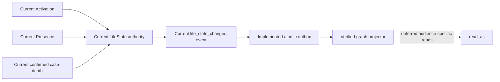
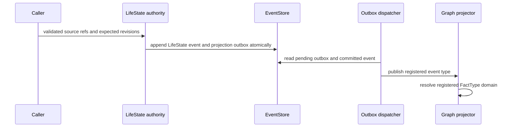
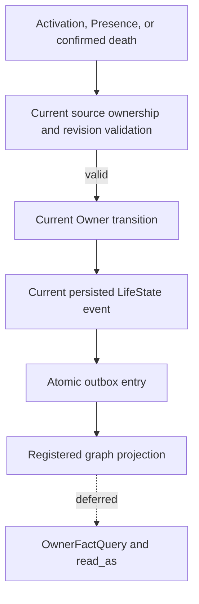

# LifeState Migration Design

- Baseline: `94d4aa20c3093904bb5ac1daa2af4f93c6981677` (`integration-2026-11-22-8`).
- Scan: `rg` over `backend/app` and `backend/tests`, plus Architecture v2 Owner, FactType, ordering, and migration-spec documents.
- Scan time: 2026-11-22 Asia/Shanghai.
- Conclusion: static design input. The baseline test selection ran separately; this document makes no migration-complete claim.

## Facts and candidate FactTypes

`CanonicalLifeStateAuthority` appends `gameplay.character.life_state_changed` to `gameplay:character:life:<actor_ref>`. Initial `unknown -> alive` requires committed Activation and Presence events with matching actor/world, sequence, ownership, and revisions (`backend/app/gameplay/life_state_runtime.py:37-117`). `dead` requires a confirmed case-death event and matching terminal outcome from the conflict stream (`:133-224`). The event schema declares v2 (`backend/app/gameplay/event_schema_registry.py:190-194`); historical receipt handling accepts v1 and v2 (`life_state_runtime.py:236-291`). The Owner definition classifies LifeState as stewarded (`04-Owner/01-Owner定义.md:17,46`). The current authority remains a compatibility adapter for source admission and persisted event writes.

Candidate FactType: `fact:character:*:lifestate`, primitive `machine`, Owner `LifeState`, visibility `private`, matching the canonical short name and example in Architecture v2 (`04-Owner/01-Owner定义.md:46`; `03-事实类型/01-FactType定义.md:179`). Candidate states are `unknown`, `alive`, and `dead`, derived from current persisted payloads. Resolution ordering follows the documented example placing LifeState after its causal inputs; exact pipeline order remains to be validated against the full resolver (`03-事实类型/02-结算顺序.md:47`). The private visibility target selectors need a concrete declaration and must be checked against the current graph audience before claim of U7. The pack resolver evaluates only the allowed transition table; source provenance and commit authority remain in the compatibility adapter.

## Readers for U6

| Reader or caller | Static evidence |
|---|---|
| Activation/presence admission and retry | `backend/app/population_continuity/activation_presence.py:8,59,204-230` |
| Combat target catalog | `backend/app/character_agent/execution/combat_target_catalog.py:37` |
| Canonical combat validation | `backend/app/gameplay/canonical_combat_authority.py:186-375` |
| Durable combat settlement | `backend/app/gameplay/combat_durable_adapter.py:409-413` |
| Identity continuity | `backend/app/population_continuity/identity_continuity.py:37` |
| Presence runtime | `backend/app/population_continuity/presence_runtime.py:104,195` |
| Equipment prediction and commands | `backend/app/services/equipment_prediction_service.py:108,143`; `equipment_command_service.py:184,313,361` |
| Soul life/presence sources and runtime | `backend/app/gameplay/soul_life_sources.py:40-54,143`; `soul_presence_sources.py:75`; `soul_runtime.py:214`; `soul_fact_runtime.py:319` |
| World replay and checkpoint | `backend/app/world_runtime/replay_participants.py:61,880-890`; `replay_checkpoint.py:118` |

These are static read references, not a trust or audience classification. The production importer count is one, `population_continuity/activation_presence.py:8`.

## Event visibility and known deviations

`gameplay.character.life_state_changed` is already declared in the gameplay schema registry and maps to a registered graph FactType domain. The graph projector subscribes to registered gameplay event types in `backend/app/main.py:2282-2299`. At baseline neither LifeState append path attached an outbox entry. This unit adds event-specific graph projection entries atomically to both writes (`life_state_runtime.py:117,225,369-385`). `GameplayOutboxDispatcher` reads pending entries and publishes committed events (`backend/app/gameplay/dispatcher.py:24-32,97-125`). The focused test drives a real committed case-death event through dispatcher, typed bus subscription, and graph projector.

The existing event payload carries a `visibility_policy` placeholder of `project`, while the candidate FactType uses `private` (`life_state_runtime.py:81-89,146-153`; `packs/life_state/fact_types/life_state.yaml`). Audience selectors and production `read_as` are not implemented by this pack loader. Existing readers rely on exact event type, stream naming, and v1/v2 payload semantics. The event type, schema versions, and historical payload meanings remain stable. No schema or central registry file is owned by this unit.

## Probe design

1. Commit initial alive from valid activation and presence, dispatch its persisted outbox entry, and assert the graph projector receives and projects that committed event.
2. Reject absent, forged, stale, and mismatched source facts; reject duplicate death and altered idempotency reuse.
3. Reopen the durable store and retry committed v1/v2 receipts with historical semantics intact.
4. Compare checkpoint restore, tail replay, and full replay for identical LifeState facts.
5. Verify existing combat, equipment, population, Soul, and replay readers retain their expected behavior.

## Diagrams

