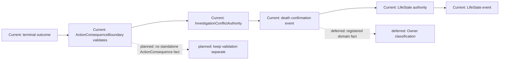
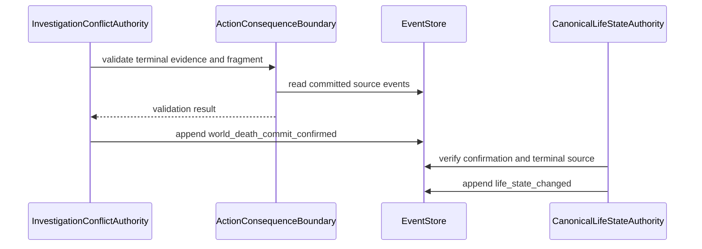
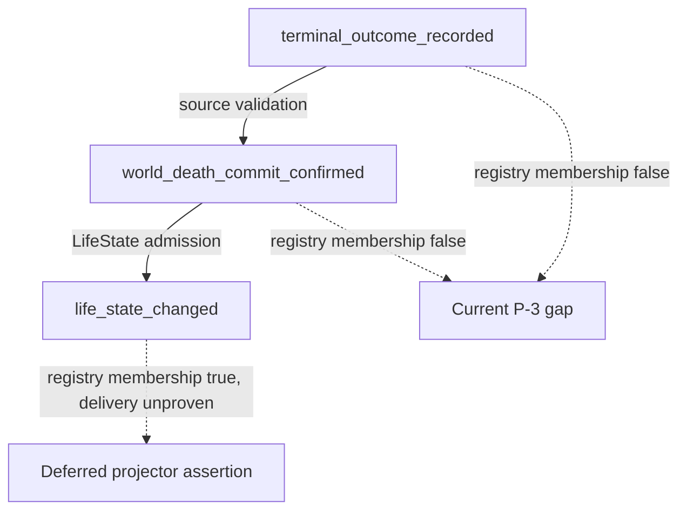

# Candidate Design: Action Consequence

- Baseline: code scan `0e67fe812280e7e518c84c27653153f5a69f2330`; coordination instructions read from `origin/integration` at `9b09084c5adccc2367f2d5da9f438af9d80393b4`.
- Scan: `rg` over `backend/app` and `backend/tests`; read-only FactType registry query using Python 3.12.2 with `PYTHONPATH=<this worktree>\backend`.
- Scan time: 2026-11-22 Asia/Shanghai.
- Conclusion: static-only design input. No code, tests, schema, or rule package changed; no test suite was run.

## Facts and candidate FactTypes

`ActionConsequenceBoundary` validates an action-consequence intent against a committed source event and owner fragment (`action_consequence_runtime.py:45-78`). Its world-death method validates `gameplay.conflict.terminal_outcome_recorded` but does not append an event (`action_consequence_runtime.py:80-95`). `InvestigationConflictAuthority` calls this boundary, then appends `gameplay.conflict.world_death_commit_confirmed` (`p5/investigation_conflict.py:271-274,338-345`). `CanonicalLifeStateAuthority` later consumes that confirmation and writes `gameplay.character.life_state_changed` (`life_state_runtime.py:150-177,212-224`).

There is no independent ActionConsequence fact in the current source. Candidate FactType division follows the separate facts and authorities:

| Fact candidate | Primitive candidate | Owner candidate | Basis |
|---|---|---|---|
| `engagement:<engagement_ref>:terminal_outcome` | `machine` or `process`, unresolved | `Combat`, candidate only | terminal event encodes an outcome; formal Owner doc shows Combat only in an example and says it must not write LifeState (`01-Owner定义.md:93-101`) |
| `case_death:<confirmation_ref>:confirmation` | `process`, candidate | investigation/conflict authority pending Owner classification | confirmation is a provenance/authorization event written by `InvestigationConflictAuthority`, not by this boundary (`investigation_conflict.py:338-345`) |
| `character:<actor_ref>:lifestate` | `machine` | `LifeState` | terminal state transition is written only by the LifeState authority (`life_state_runtime.py:212-224`; `01-FactType定义.md:175-180`) |

The first two fact identifiers are examples for design discussion, not stable IDs. The Confirmation fact may instead be command evidence rather than a world FactType. That distinction is unresolved by current code and requires a domain decision before implementation.

Candidate visibility: terminal result and confirmation evidence should be scoped to participants/authorized investigators; LifeState follows the LifeState candidate's private audience. Current source events use `project` visibility (`action_consequence` validation at `:68-72`; `life_state_runtime.py:151-152`). Architecture v2 has no implicit default visibility (`01-FactType定义.md:35-40,63-70`).

Candidate `resolution_order`: terminal outcome before world-death confirmation before LifeState transition, matching the runtime's explicit causal checks (`action_consequence_runtime.py:80-95`; `investigation_conflict.py:338-345`; `life_state_runtime.py:150-177`). This order is conditional on those facts being in one pipeline; numeric values must come from the actual L5 topology, not this document (`01-FactType定义.md:39-40`).

## U6 readers

| Reader or caller | Evidence | Observed role |
|---|---|---|
| `gameplay/p5/investigation_conflict.py` | `:271,274,338-345` | calls the boundary and writes the death confirmation |
| `gameplay/p5/stormnight_action_graph.py` | `:16` | recognizes terminal outcome event type |
| `gameplay/life_state_runtime.py` | `:150-177,343-346` | validates confirmation and matching terminal event |
| `gameplay/soul_life_sources.py` | `:143` | consumes terminal event evidence |
| `world_runtime/replay_participants.py` | `:934-939` | replays terminal and confirmation events |
| `tests/test_action_consequence_boundaries.py` | multiple tests | source validation, zero-write rejection, confirmation, retry and reopen contracts |
| `tests/test_3d_scripted_mystery_action_replay.py` | `:97,148` | replay and retry scenarios for world-death command |

These are static references. U6 still needs event-version/payload-specific checks if schemas change.

## Event and P-3 status

This runtime has no event write path. Its source type is `gameplay.conflict.terminal_outcome_recorded` (`action_consequence_runtime.py:17,88`). The caller writes `gameplay.conflict.world_death_commit_confirmed` (`investigation_conflict.py:302,345`), while LifeState writes `gameplay.character.life_state_changed` (`life_state_runtime.py:17,218`). The read-only registry query returned `False` for both conflict event types and `True` for the LifeState type. These are registry membership judgments, not projection behavior evidence.

## Known deviations

- ActionConsequence is currently a validation boundary, not a fact-owning runtime (`action_consequence_runtime.py:45-95`).
- `Combat` is not in `REGISTERED_OWNER_IDS` (`fact_type_registry.py:11`) and is not a row in the formal native/stewarded Owner lists; it occurs in a `denies` example (`01-Owner定义.md:26-54,93-101`).
- The conflict event names are absent from `FACT_TYPE_REGISTRY.event_types()` in the read-only query. P-3 projection delivery is therefore not established.
- Current `project` visibility does not identify which actors may observe the terminal result.

## Probe sketch

Use the existing action consequence boundary tests to assert that accepted terminal evidence is read-only at this boundary, invalid or wrong-owner fragments reject without a write, and the conflict authority appends exactly one confirmation for an exact retry. Then trace the confirmation into the LifeState transition and separately assert each event's FactType registry membership and actual graph-projector delivery. No probe was run for this design note.

## Diagrams

