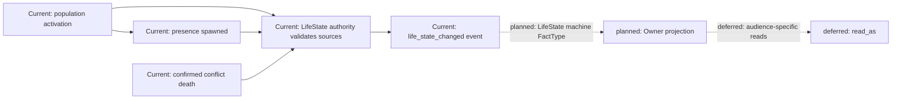
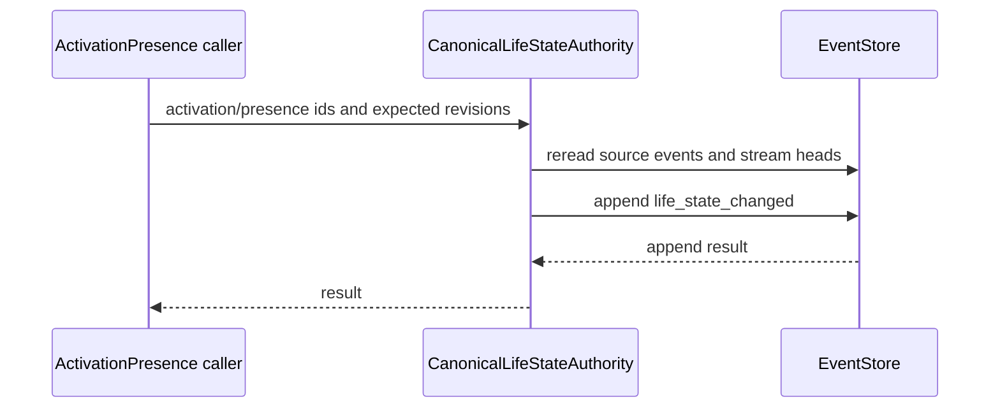
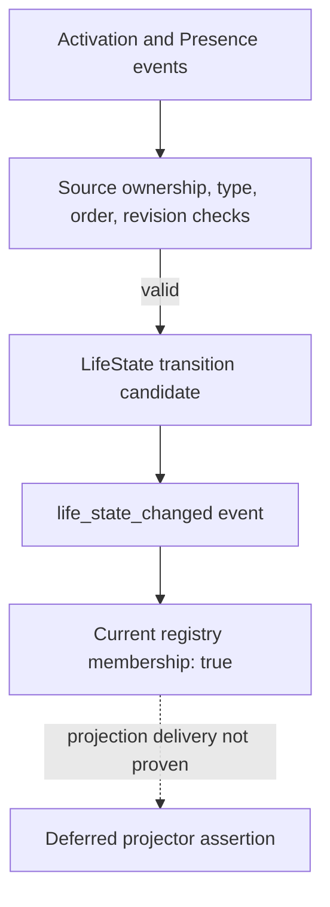

# Candidate Design: LifeState

- Baseline: code scan `0e67fe812280e7e518c84c27653153f5a69f2330`; coordination instructions read from `origin/integration` at `9b09084c5adccc2367f2d5da9f438af9d80393b4`.
- Scan: `rg` over `backend/app` and `backend/tests`; read-only FactType registry query using `D:\Temp\paralls-g0-py312\Scripts\python.exe` with `PYTHONPATH=<this worktree>\backend`.
- Scan time: 2026-11-22 Asia/Shanghai.
- Conclusion: static-only design input. No code, tests, schema, or rule package changed; no test suite was run.

## Facts and candidate FactTypes

`CanonicalLifeStateAuthority` admits an initial `alive` state only after re-reading committed population activation and presence events, then writes `gameplay.character.life_state_changed` to `gameplay:character:life:<actor>` (`life_state_runtime.py:37-47,53-77,106-117`). Case death requires a confirmed `gameplay.conflict.world_death_commit_confirmed` and a matching terminal conflict event before the same LifeState event is appended (`life_state_runtime.py:133-177,195-224`). The runtime does not infer death from health or write Presence/Soul facts (`life_state_runtime.py:1-4`).

Candidate fact: `character:<actor_ref>:lifestate`, primitive `machine`, candidate Owner `LifeState`. The formal FactType example uses `character:char-07:lifestate`, `machine`, `LifeState`, and `private` (`01-FactType定义.md:175-180`). This is a candidate mapping, not an Owner registration or migration decision.

Candidate visibility: `private`, with subject/authority selectors to be specified by the eventual Owner declaration. The current event policy is `project`, which is broader and does not encode a principal audience (`life_state_runtime.py:87-88,151-152`).

Candidate `resolution_order`: place LifeState after the activation and presence facts it validates, if those FactTypes participate in the same resolution pipeline. The code establishes causal prerequisites and verifies source sequence/revisions (`life_state_runtime.py:57-70,98-100`), while Architecture v2 requires order from pipeline topology and explicit unrelated declarations (`01-FactType定义.md:35-40,122-131`). The exact FactType IDs and pipeline topology are not established, so numeric order is intentionally unspecified.

## U6 readers

Static event-reference/read inventory:

| Reader or caller | Evidence | Observed role |
|---|---|---|
| `population_continuity/activation_presence.py` | `:8,59,206` | invokes canonical authority and reads the life stream |
| `services/equipment_command_service.py` | `:361` | reads the actor life event |
| `gameplay/canonical_combat_authority.py` | `:316` | validates a LifeState event as combat input |
| `gameplay/combat_durable_adapter.py` | `:409` | consumes projected life events during durable settlement |
| `gameplay/soul_life_sources.py` | `:54,143` | consumes LifeState and terminal-outcome evidence |
| `world_runtime/replay_participants.py` | `:61,934-939` | replays LifeState and death-source evidence |
| `world_runtime/replay_checkpoint.py` | `:118` | includes LifeState events in checkpoint state |
| `tests/test_life_state_case_death_caller.py` | multiple tests | admission, rejection, replay, and durable reopen contracts |
| `tests/test_population_activation_presence_service.py` | `:98,178,240,276-395` | initial-alive admission and retry contracts |

This list is a source-level inventory for future U6 review, not a complete authorization classification.

## Event and P-3 status

The current writer event is `_LIFE_EVENT = "gameplay.character.life_state_changed"` (`life_state_runtime.py:17`). It appears in `POPULATION_PRESENCE_EVENT_SCHEMAS` at `event_schema_registry.py:190-194` and in the legacy schema set at `event_schema_registry.py:463`. The current registry query returned `True` for `gameplay.character.life_state_changed`. The source event types `gameplay.conflict.terminal_outcome_recorded` and `gameplay.conflict.world_death_commit_confirmed` returned `False` in the same `FACT_TYPE_REGISTRY` query. These are registry membership results only, not evidence that the graph projector receives or applies the events.

## Known deviations

- `REGISTERED_OWNER_IDS` currently contains only `Credential`, `Ownership`, and `Economy / Market` (`fact_type_registry.py:11`). H-A-003 assigns the M0.5 name expansion to A; LifeState is not yet registered.
- Existing LifeState writes use a project-wide visibility policy rather than a FactType-level audience (`life_state_runtime.py:87-88,151-152`).
- The event schema and FactType registry currently expose the event name, but this does not establish a migrated L1 machine, a resolver, or a full Owner declaration.
- Historical tests include schema-v1 and schema-v2 expectations. Any event version or payload change needs an explicit reader inventory before implementation.

## Probe sketch

Use existing named LifeState scenarios as the basis for a later migration probe: valid initial-alive admission from activation plus presence; reject forged, stale, or missing sources; admit a confirmed case-death only once; exact retry after durable reopen; preserve historical schema-v1 semantics; and assert the LifeState event is in the registry. A separate projector assertion must establish actual delivery/application. No probe was run for this design note.

## Diagrams

