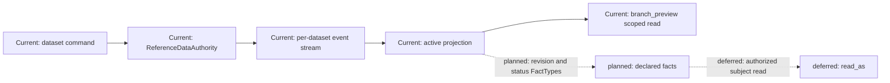
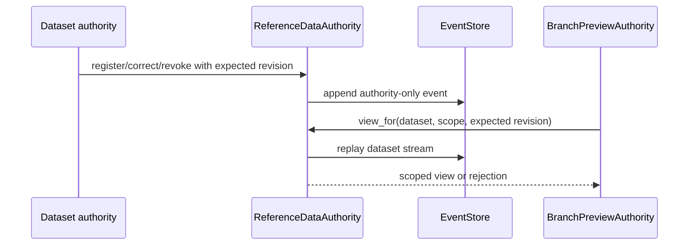
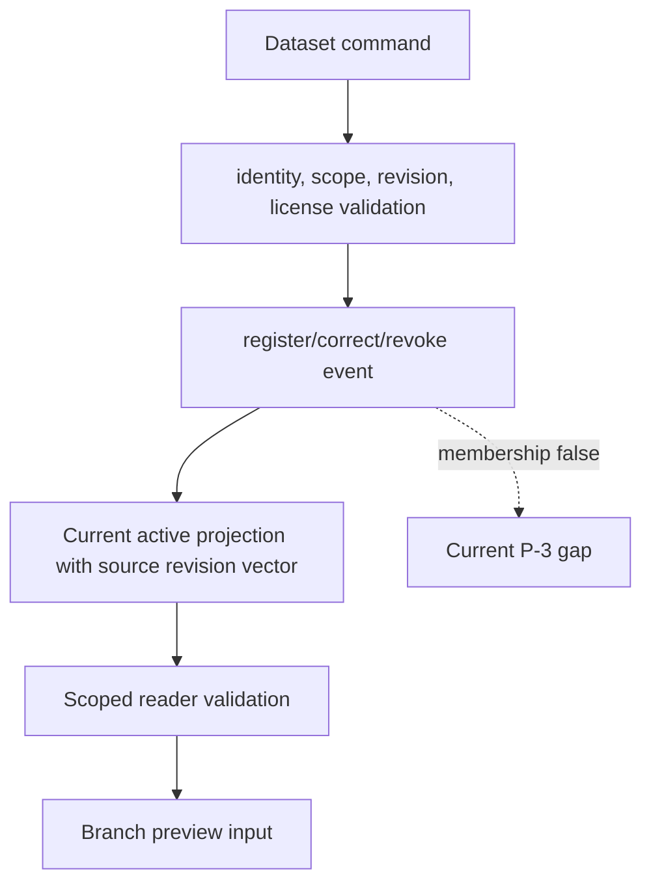

# Candidate Design: Reference Data

- Baseline: code scan `0e67fe812280e7e518c84c27653153f5a69f2330`; coordination instructions read from `origin/integration` at `9b09084c5adccc2367f2d5da9f438af9d80393b4`.
- Scan: `rg` over `backend/app` and `backend/tests`; read-only FactType registry query using Python 3.12.2 with `PYTHONPATH=<this worktree>\backend`.
- Scan time: 2026-11-22 Asia/Shanghai.
- Conclusion: static-only design input. No code, tests, schema, or rule package changed; no test suite was run.

## Facts and candidate FactTypes

`ReferenceDataAuthority` admits, corrects, revokes, and scopes dataset records (`reference_data_runtime.py:57-97`). Each dataset has its own `gameplay:reference_data:<dataset_ref>` stream (`:60-70`). The event names are generated from `_EVENT_PREFIX` plus `dataset_registered`, `dataset_corrected`, or `dataset_revoked` (`:62,72,75,85,107-130`). The active projection carries provenance, license, schema revision, digest, classification, allowed scopes, status, and source revision vector (`:144-176`).

Candidate FactTypes:

| Fact candidate | Primitive candidate | Owner candidate | Basis |
|---|---|---|---|
| `reference_dataset:<dataset_ref>:revision` | `process` | `Information / Intelligence`, inferred candidate | registration and correction create versioned provenance/content records; formal Owner scope includes propagation and verification (`01-Owner定义.md:31`) |
| `reference_dataset:<dataset_ref>:status` | `machine` | `Information / Intelligence`, inferred candidate | active/revoked state gates dataset reads (`reference_data_runtime.py:92-97,144-166`) |

The split reflects independently changing revision content and lifecycle status; code currently stores both in one projection. It is a proposal, not a migration assignment. The formal Owner list has no `Reference Data` Owner, and `Information / Intelligence` is a candidate only (`01-Owner定义.md:26-54`).

Candidate visibility: retain authority-only writes and represent scoped read permissions explicitly. The authority currently checks `reader_scope`, dataset classification, `allowed_scopes`, and license status (`reference_data_runtime.py:87-97`); its projection outbox is `authority_only` (`:129-134`). Do not infer public visibility from the event's projectability or from dataset existence.

Candidate `resolution_order`: dataset revision before status evaluation in a reader pipeline, because correction updates the active dataset projection while revocation prevents reads (`reference_data_runtime.py:144-166`). If status and revision are resolved by one machine only, declare only that fact's dependencies; if split, derive order from the consumer pipeline and explicitly declare unrelated facts. Architecture v2 requires topology-derived dense order, not a manually selected runtime sequence (`01-FactType定义.md:35-40,122-131`).

## U6 readers

| Reader or caller | Evidence | Observed role |
|---|---|---|
| `population_continuity/branch_preview.py` | `:17,71-89,581-585` | freezes an authorized dataset view and verifies source revision, digest, scope, and license before preview |
| `tests/test_infra_reference_data_license_admission.py` | multiple tests | dataset admission and licensing boundary |
| `tests/test_world_prediction.py` | `:15,36` | supplies reference dataset input to world prediction |

The runtime also returns a direct `view_for` result to callers. Static search found `branch_preview.py` as the production consumer in `backend/app`; other uses are tests. This is a call-site list, not a full authorization review.

## Event and P-3 status

The current event types generated by the runtime are `gameplay.reference_data.dataset_registered`, `gameplay.reference_data.dataset_corrected`, and `gameplay.reference_data.dataset_revoked` (`reference_data_runtime.py:62,72,75,85,107-130`). The read-only FactType registry query returned `False` for all three. This is a registry membership judgment, not projection behavior evidence. No `reference_data_event_schema.py` exists in the current source tree; P-3 is not established for these events.

## Known deviations

- `REGISTERED_OWNER_IDS` contains only `Credential`, `Ownership`, and `Economy / Market` (`fact_type_registry.py:11`); M0.5 Owner registration is assigned to A by H-A-003.
- Current projection combines revision, license, classification, scope, and lifecycle data in a single record (`reference_data_runtime.py:33-49,144-176`).
- Writes use `authority_only`, while reads expose three scopes through a direct runtime method rather than the future `read_as` boundary (`reference_data_runtime.py:87,129-134`).
- The event names are absent from the FactType registry; graph delivery is not demonstrated.

## Probe sketch

Later test register/correct/revoke transitions per dataset stream; exact retry and stale expected revision; creator/public/authority scope decisions; mismatched digest, revision vector, or license rejection in branch preview; and confirm revocation prevents subsequent preview. Add registry membership and a graph-projector delivery assertion for each actual event type. No probe was run for this design note.

## Diagrams

