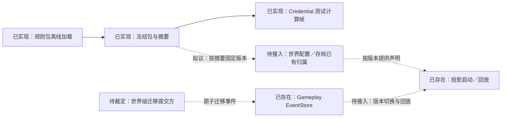
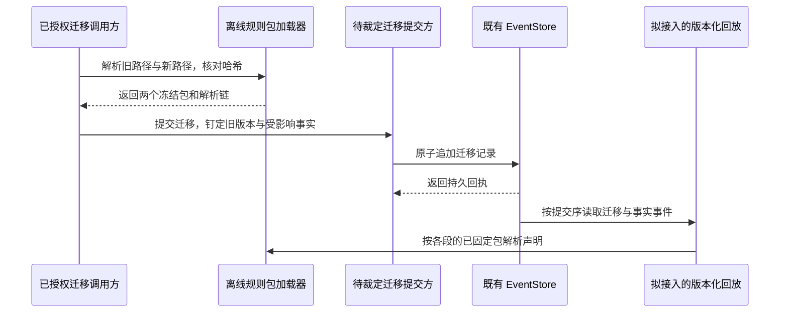
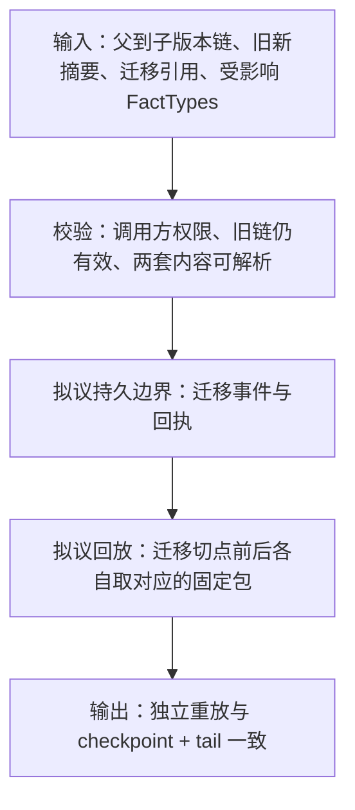

# M5-3 规则包迁移事件前置审计

以 `47f931fb` 核对迁移计划 M5-2 至 M5-4、Architecture v2《规则包总纲》第三节和《规则包文件格式》第六节。本次为静态审计。生产接线均为拟议路径。

## 现有入口

- `backend/app/gameplay/credential_reference_chain.py` 的 `load_credential_pack` 调用加载器，计算帧比较当前包的哈希。使用 `rg -n 'load_credential_pack|CredentialReferenceChain' backend/app scripts/verification backend/tests` 核对，仓库现有调用点由定向测试及夹具驱动。
- `backend/app/gameplay/replay.py` 和 `projection_startup.py` 传递 `world_config_revision`，`backend/app/gameplay/models.py` 的 `ProjectionCheckpoint` 保存该可选字符串。现有调用关系中未找到从它解析完整 `resolved_packs` 的代码。
- `backend/app/main.py` 的 `submit_replay_checkpoint` 接到显式 replay participant 清单。规则包迁移目前没有生产 participant。新增接线涉及 A/B 边界及存储核心。
- `gameplay_schema_event_types()` 发现域模块里以 `gameplay.` 开头的事件。正式规格中的 `pack.migrated` 若直接以同名放进域 schema，不会由该发现逻辑进入图。P-3 需要核实实际事件名、注册路径与图消费。

## 所有权与模块边界

## 拟议交互顺序

## 拟议数据流

## 实施前置

1. 先确定已授权的迁移 writer、版本链的持久归属以及该归属的跨宿主边界。解析链需要随既有存档事实持久化。缓存可由链恢复。
2. 选定事件名与实际 schema 注册路径，核对 P-3。需要明确 `from`、`to` 各自的内容哈希锚点，以及存档引用与 `world_config_revision` 的对应关系。
3. 验收覆盖旧链缺失拒绝、哈希变化拒绝、过期旧版本冲突零写入、幂等重试回原回执、迁移前后分段回放、checkpoint + tail 以及应用运行态换包拒绝。复用已有存储事务与回放接线合同。
4. 当前实施停在生产接线。M5-2 的离线部分可继续。M5-4 的 `running=True` 加载器拒绝已有定向证据，生产会话何时传入该状态仍待接入。
