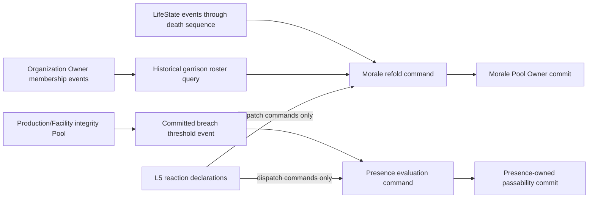
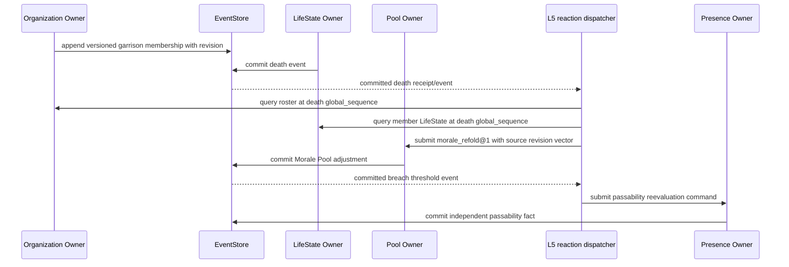
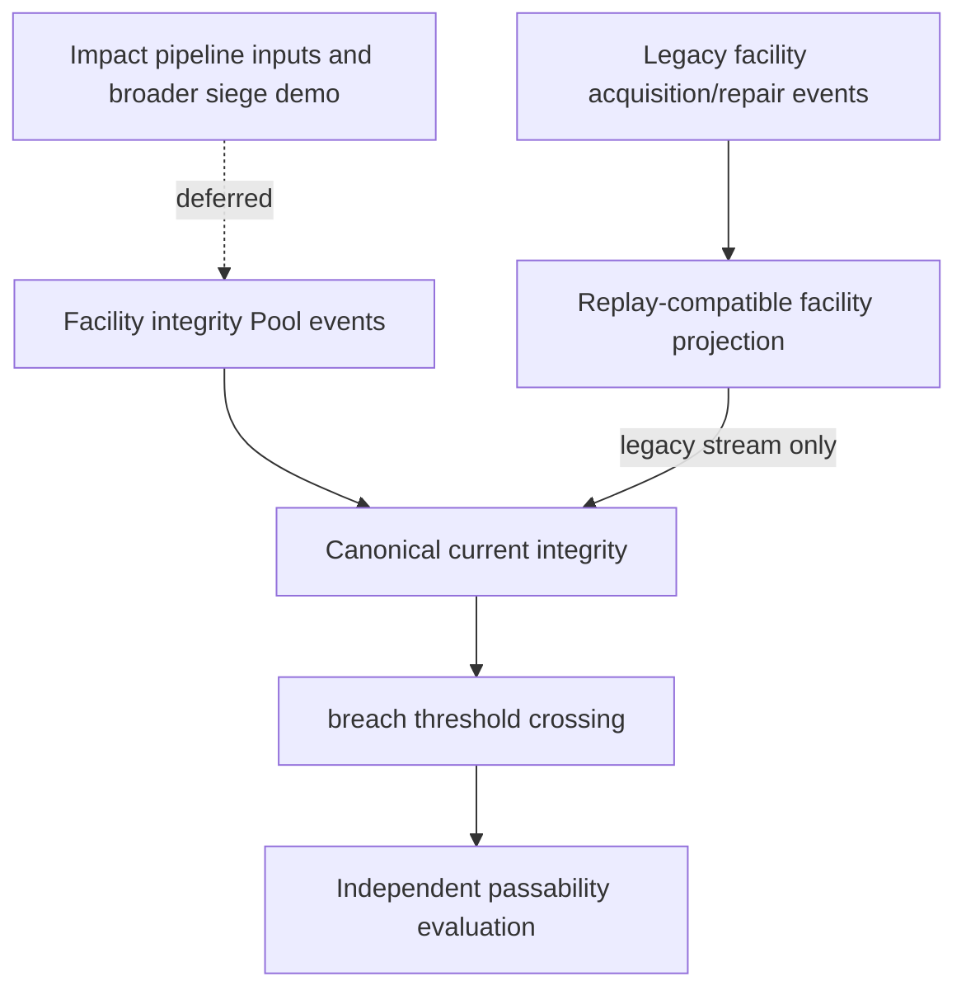

# M6-5 authoritative Morale and Presence inputs

Status: implementation in progress on thread A. This plan applies the project owner's authorization for A to implement the required Organization and Production/Facility inputs across the previous ownership boundary. It does not create an Owner or let L5 write facts.

## Contract and scope

The formal siege pattern requires committed LifeState death events to trigger a later Morale refold, and committed Facility integrity breach events to trigger an independent Presence passability evaluation. A confirmed `morale_refold@1` uses the active roster at the death event's `global_sequence`, with missing or ambiguous inputs returning unknown and causing no write. Presence owns its passability result. The source and result streams retain independent revisions and commits.

The Organization platform already has an Owner-authorized membership writer and persists `organization_membership_delegation_recorded@1` on `gameplay:organization:{organization_ref}`. Reuse it as the garrison roster source. At a death sequence, include only the configured organization and versioned garrison role, selecting each member's latest event at or before that sequence. Do not infer a roster from population or work assignments.

Facility currently stores `condition` in its construction/repair event stream. The target integrity FactType is `fact:facility:<gate>:integrity`, using the registered Pool primitive and a `breach` threshold. The implementation must preserve replay of existing acquisition/repair events and make the Pool the sole current integrity source before using the breach event as a Presence trigger.

## Independent implementation units

1. **Organization roster snapshot. Complete.** Commit `9cb0cbd5af691911a2b11e5e1be9e8e10d1bcba0` adds an as-of-`global_sequence` query over the existing committed membership stream. It returns the ordered active roster and observed Organization stream revision. Three dedicated tests and the permanent unit selection pass. No persisted event schema changes. Evidence: `docs/verification/m6-5-organization-roster-20261123.md`.
2. **Facility integrity Pool source. In analysis.** The formal FactType is `fact:facility:<gate>:integrity`, separate from general operational condition. Before adding its writer, identify the committed impact input and the reader/authority contract. Do not synthesize a breach from a repair or condition change.
3. **Morale/Presence production dispatch. Pending source contracts.** Connect only committed death and breach events to L5 declarations through a retryable, idempotent dispatch boundary. The dispatcher can submit commands but cannot append Morale or Presence facts. Register exact trusted command outputs and production event schemas. Check the Pool read-set contract for historical source revisions before relying on it for as-of-death refolds.
4. **Evidence and ledger.** Each unit gets a separate commit and evidence, including direct tests, its own selection file, event reader inventory, P-3 assertion, U1–U11 state, and the frozen selections. Keep aggregate results separate from slice evidence.

## Review focus

- A death cannot use membership or LifeState changes committed after its `global_sequence`.
- Missing roster, duplicate/invalid membership history, or missing member LifeState causes no Morale write.
- Facility legacy reads remain valid while current integrity has one source of truth.
- A breach event does not write Presence passability.
- Rejected commands and stale revisions produce zero writes; exact retries replay the original receipt.
- Rebuild without checkpoints reproduces source and result projections.
- Event visibility and `read_as` scope remain consistent with the formal FactType contracts.

## Verification environment

Use Python 3.12.2 from `D:\Temp\paralls-g0-py312\Scripts\python.exe`, set `PYTHONPATH` to this worktree's `backend`, and verify `app.__file__` resolves within this worktree before every pytest invocation. Store verification outputs in a unique new directory under `F:\paralls-verification\thread-a\`. Do not write new temporary artifacts to D:.
